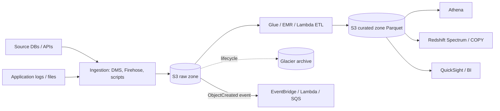
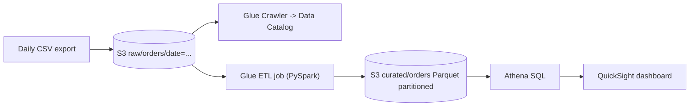
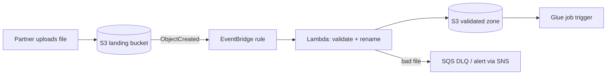
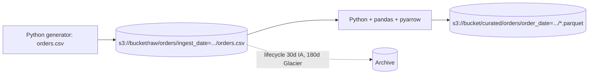

# Amazon S3 — Data Engineering Study Notes (0–2 YOE)

> Self-contained notes: fundamentals → implementation → interview preparation.
> Verify numeric quotas in the AWS docs or the Service Quotas console before relying on them — AWS changes limits and defaults over time (links at the end).

**Contents**
1. Introduction
2. Architecture and Working Mechanism
3. Core Concepts and Terminology
4. Data Engineering Use Cases
5. Hands-on Implementation (mini-project)
6. Interview Preparation (10 conceptual + 5 scenario + 3 troubleshooting, all answered)
7. Revision and Quick Reference

---

## 1. Introduction

### What is Amazon S3?
**Amazon Simple Storage Service (S3)** is AWS's *object storage* service. You store files (called **objects**) inside containers (called **buckets**) and access them over HTTPS using an API, the console, the AWS CLI or an SDK such as Boto3. There are no disks to size, no servers to patch and no file system to mount: you pay for what you store and the requests you make.

### Why was it introduced and what problem does it solve?
S3 launched in 2006 to give developers practically unlimited, durable and cheap storage without managing hardware. Before S3, teams bought storage arrays or ran HDFS clusters, planned capacity months ahead and had to handle disk failures themselves. S3 solves:

- **Capacity planning** — storage grows automatically.
- **Durability** — S3 Standard is designed for 99.999999999% (11 nines) durability by storing data redundantly across multiple Availability Zones (AZs).
- **Decoupling storage from compute** — Spark, Athena, Redshift, Glue and Lambda can all read the same data without copying it.

### Why is it important in Data Engineering?
Almost every AWS data platform has S3 at the centre. It is the **data lake** storage layer: raw files land in S3, ETL jobs transform them, and analytics engines query them in place. Skills you need as a Data Engineer: bucket layout, file formats, partitioning, lifecycle and cost control, security, and event-driven ingestion.

### When should you use it?
- Landing raw data from databases, APIs, logs, IoT and files (CSV, JSON, Parquet, Avro, ORC).
- Storing curated analytics datasets for Athena, Redshift Spectrum, EMR or Glue.
- Archival, backups and compliance data.
- Hosting model artifacts, ETL scripts, and Athena/Glue query results.

### When should you avoid it?
| Need | Why S3 is a poor fit | Better choice |
|---|---|---|
| Low-latency random reads/writes in place (databases, OS volumes) | Object storage; you replace whole objects, no in-place byte edits | EBS, a database |
| Shared POSIX file system (many servers mounting folders) | S3 is not a file system (no real directories, no atomic rename) | Amazon EFS / FSx |
| Millions of tiny files queried repeatedly | Request overhead and "small files problem" | Compact into larger Parquet files; use a table format |
| Frequent row-level updates | Objects are immutable-replace | Table formats (Iceberg/Delta/Hudi) on S3, or a database/warehouse |

### Simple real-world example
A retail company exports daily sales as CSV files. A script uploads each file to `s3://acme-datalake/raw/sales/2026-11-18/sales.csv`. A Glue job converts it to Parquet in `curated/`, and analysts query it with Athena. The company never provisions a server for storage.

### Brief comparison with alternatives
| Feature | Amazon S3 | HDFS | Amazon EBS | Amazon EFS |
|---|---|---|---|---|
| Type | Object storage | Distributed file system (on cluster disks) | Block storage | Network file system |
| Scales to | Practically unlimited | Limited by cluster size | Per volume | Elastic |
| Durability model | Managed, multi-AZ | You manage replication (default factor 3) | Replicated within one AZ | Multi-AZ |
| Compute coupling | Decoupled | Coupled to cluster | Attached to one instance | Mountable by many |
| Typical DE use | Data lake | Legacy Hadoop | Databases | Shared files for apps |

---

## 2. Architecture and Working Mechanism

### Overall architecture (practical level)
S3 is a regional service. When you create a bucket you choose a Region; objects in that bucket are stored in that Region. S3 Standard automatically stores objects redundantly across at least three AZs, so losing a data centre does not lose data. You talk to S3 through a REST API (used by the console, CLI and SDKs).

### Major components
- **Bucket** — a container with a globally unique name (within a partition) in one Region.
- **Object** — the data plus metadata, identified by a **key** (the full "path" such as `raw/sales/2026-11-18/sales.csv`). Max object size is 5 TB.
- **Prefix** — the leading part of a key; S3 has a flat namespace, and the "folders" in the console are just prefixes.
- **Metadata** — system metadata (content type, size, ETag, last modified) and user-defined metadata.
- **Version ID** — present when versioning is enabled.
- **Policies** — bucket policy, IAM policy, Block Public Access and (rarely) ACLs control access.
- **Features around data** — lifecycle rules, replication, event notifications, inventory, Object Lock, access points.

### End-to-end request flow (PUT then GET)
1. Client signs the request with AWS credentials (SigV4) and calls the S3 endpoint over HTTPS.
2. S3 authenticates the caller and evaluates IAM policy, bucket policy, Block Public Access and any SCPs/VPC endpoint policies.
3. For a PUT, S3 encrypts the object (SSE-S3 by default; SSE-KMS if configured), stores it redundantly, and returns an ETag (and a version ID if versioning is on).
4. S3 provides **strong read-after-write consistency**: after a successful PUT or DELETE, a subsequent GET or LIST sees the change.
5. Optional: S3 emits an event (`s3:ObjectCreated:*`) to Lambda, SQS, SNS or EventBridge.
6. For a GET, S3 checks permissions again, decrypts (calling KMS if SSE-KMS) and streams the object.

Performance: S3 scales request rates per prefix — at least 3,500 PUT/COPY/POST/DELETE and 5,500 GET/HEAD requests per second per partitioned prefix. Spreading load across prefixes multiplies throughput.

### Mermaid — S3 in a data lake



### Explanation of each component in the diagram
- **Source DBs / APIs / Logs** — origins of data.
- **Ingestion** — DMS (database replication), Kinesis Data Firehose (streaming) or custom scripts write into S3.
- **S3 raw zone** — immutable copy of data exactly as received (replayable).
- **ETL** — Glue/EMR/Lambda clean, convert to columnar formats and write to the curated zone.
- **S3 curated zone** — analytics-ready Parquet, partitioned.
- **Athena / Redshift Spectrum / BI** — query engines reading S3 in place.
- **Lifecycle → Glacier** — rules move old raw files to cheaper storage.
- **Event notifications** — trigger downstream processing as soon as files arrive.

### Practical Data Engineering architecture with other services
A typical batch pattern: **S3 (raw) → Glue Crawler/Data Catalog → Glue ETL job → S3 (curated Parquet) → Athena → QuickSight**, orchestrated by Step Functions or Airflow (MWAA) and secured with IAM roles and KMS keys. IAM governs who can read/write; CloudTrail logs access; CloudWatch alarms monitor pipeline jobs.

---

## 3. Core Concepts and Important Terminologies

### 3.1 Buckets and objects
- **Definition:** Buckets hold objects; objects are the files plus metadata.
- **Why it matters:** Naming and layout decide cost, performance and manageability.
- **How it works:** Bucket names are DNS-compatible (3–63 chars, lowercase letters, numbers, hyphens). Keys are up to 1,024 bytes of UTF-8.
- **Example:** `s3://acme-datalake-prod/raw/orders/ingest_date=2026-11-18/orders_001.json.gz`
- **DE relevance:** One bucket per environment (dev/prod) and per zone (raw/curated) is a common design.
- **Config:** Region, versioning, encryption, Object Ownership, Block Public Access, tags.
- **Mistakes:** Putting environment secrets in object names; creating one bucket per team without governance; assuming "folders" exist.

```python
import boto3
s3 = boto3.client("s3", region_name="ap-south-1")
# For regions other than us-east-1 you must pass LocationConstraint
s3.create_bucket(
    Bucket="acme-datalake-dev-123456789012",
    CreateBucketConfiguration={"LocationConstraint": "ap-south-1"},
)
s3.put_object(Bucket="acme-datalake-dev-123456789012",
              Key="raw/orders/hello.txt", Body=b"hello s3")
```

### 3.2 Prefixes, keys and partitioning
- **Definition:** A prefix is the key portion before the object name. *Partitioning* means encoding column values in the key, e.g. Hive style `year=2026/month=11/day=18/`.
- **Why it matters:** Query engines (Athena, Glue, Spark) use partition values in the path to read only the needed data (partition pruning), reducing scan cost and time.
- **How it works:** Athena/Glue map `key=value` path segments to partition columns in the Data Catalog.
- **Example:** `curated/orders/order_date=2026-11-18/part-0000.parquet`
- **Config/Rule of thumb:** Choose low-to-medium cardinality columns commonly used in filters (date, region). Avoid partitioning by high-cardinality IDs.
- **Mistakes:** Over-partitioning (millions of tiny files); partitioning by columns never filtered on.

### 3.3 Storage classes
| Class | Use | Retrieval | Notes |
|---|---|---|---|
| S3 Standard | Frequently accessed data | Immediate | Default; multi-AZ |
| S3 Intelligent-Tiering | Unknown/changing access | Immediate for frequent/infrequent tiers | Small per-object monitoring fee; automatic tiering |
| S3 Standard-IA | Infrequent access, still needs fast access | Immediate | Retrieval fee, 30-day minimum storage, 128 KB billing minimum |
| S3 One Zone-IA | Re-creatable infrequent data | Immediate | Single AZ (less resilient) |
| S3 Glacier Instant Retrieval | Archive with millisecond access | Immediate | 90-day minimum |
| S3 Glacier Flexible Retrieval | Archive | Minutes to hours | 90-day minimum |
| S3 Glacier Deep Archive | Long-term compliance archive | Hours (about 12–48) | 180-day minimum; cheapest |
| S3 Express One Zone | Very low-latency, high-request workloads | Immediate | Single AZ, directory buckets; newer — check current docs |

- **Why it matters:** Storage cost is usually the largest S3 line item.
- **Mistakes:** Moving small objects to IA classes (minimum billable size) or moving data that is read often (retrieval fees exceed savings); forgetting minimum storage duration charges.

### 3.4 Lifecycle policies
- **Definition:** Rules that automatically transition objects between classes or expire them.
- **Why:** Automates cost optimisation and retention.
- **How:** Rules apply by prefix/tag; transitions happen by object age; also clean up noncurrent versions and incomplete multipart uploads.

```json
{
  "Rules": [
    {
      "ID": "raw-tiering-and-expiry",
      "Status": "Enabled",
      "Filter": { "Prefix": "raw/" },
      "Transitions": [
        { "Days": 30, "StorageClass": "STANDARD_IA" },
        { "Days": 180, "StorageClass": "GLACIER" }
      ],
      "Expiration": { "Days": 730 },
      "NoncurrentVersionExpiration": { "NoncurrentDays": 30 },
      "AbortIncompleteMultipartUpload": { "DaysAfterInitiation": 7 }
    }
  ]
}
```
```bash
aws s3api put-bucket-lifecycle-configuration \
  --bucket acme-datalake-dev-123456789012 \
  --lifecycle-configuration file://lifecycle.json
```
- **Mistakes:** Expiring data still needed by downstream jobs; overlapping rules; forgetting that Glacier retrieval needs a restore request.

### 3.5 Versioning
- **Definition:** Keeps multiple variants of an object under the same key.
- **Why:** Recover from accidental overwrite or deletion. A delete creates a **delete marker** instead of removing data.
- **How:** Enable on the bucket; once enabled it can only be suspended, not removed. Versioning is required for replication and Object Lock.
- **Mistakes:** Cost growth from noncurrent versions (add lifecycle rules); confusing "deleted" objects (delete marker) with permanently deleted.

```bash
aws s3api put-bucket-versioning --bucket my-bucket \
  --versioning-configuration Status=Enabled
aws s3api list-object-versions --bucket my-bucket --prefix raw/orders/
```

### 3.6 Replication
- **Definition:** Automatic asynchronous copying of objects to another bucket — **CRR** (cross-Region) or **SRR** (same-Region).
- **Why:** Disaster recovery, compliance, latency, account separation.
- **How:** Requires versioning on source and destination and an IAM role S3 assumes. By default only new objects are replicated; **S3 Batch Replication** handles existing ones.
- **Mistakes:** Forgetting KMS permissions when objects use SSE-KMS; assuming delete markers or existing objects replicate automatically.

### 3.7 Encryption
- **At rest:** All new objects are encrypted by default with **SSE-S3** (S3-managed keys). Options: **SSE-KMS** (keys in AWS KMS; auditable via CloudTrail, per-request KMS calls), **DSSE-KMS** (dual-layer), **SSE-C** (customer-provided keys), or client-side encryption.
- **In transit:** HTTPS (TLS). Enforce with a bucket policy condition `aws:SecureTransport`.
- **Bucket Keys:** reduce KMS request volume/cost for SSE-KMS.
- **DE relevance:** Cross-account readers need both S3 and KMS key permissions.
- **Mistakes:** Using SSE-KMS without Bucket Keys on huge buckets (KMS throttling/cost); forgetting `kms:Decrypt` in consumer roles.

### 3.8 Access control: IAM vs bucket policies vs ACLs vs Block Public Access
| Mechanism | Attached to | Typical use |
|---|---|---|
| IAM identity policy | User/role | What this principal may do across services |
| Bucket policy | Bucket (resource-based) | Cross-account access, enforce TLS/encryption, restrict by VPC endpoint |
| ACLs | Bucket/object | Legacy; new buckets have ACLs disabled (Object Ownership "bucket owner enforced") |
| Block Public Access | Account/bucket | Safety net preventing public exposure |
| Access Points | Bucket | Per-application permission and network control |

A request is allowed if some policy allows it **and nothing explicitly denies it** (for same-account access, either IAM or bucket policy allowing is enough; cross-account needs both sides).

```json
{
  "Version": "2012-10-17",
  "Statement": [
    {
      "Sid": "DenyInsecureTransport",
      "Effect": "Deny",
      "Principal": "*",
      "Action": "s3:*",
      "Resource": [
        "arn:aws:s3:::acme-datalake-prod",
        "arn:aws:s3:::acme-datalake-prod/*"
      ],
      "Condition": { "Bool": { "aws:SecureTransport": "false" } }
    },
    {
      "Sid": "AllowGlueRoleReadRaw",
      "Effect": "Allow",
      "Principal": { "AWS": "arn:aws:iam::111122223333:role/GlueEtlRole" },
      "Action": ["s3:GetObject", "s3:ListBucket"],
      "Resource": [
        "arn:aws:s3:::acme-datalake-prod",
        "arn:aws:s3:::acme-datalake-prod/raw/*"
      ]
    }
  ]
}
```
- **Mistakes:** `s3:ListBucket` applies to the *bucket ARN* while `s3:GetObject` applies to `bucket/*` — mixing them is the classic AccessDenied bug.

### 3.9 Event notifications
- **Definition:** S3 can publish events (object created/removed/restored, etc.) to **Lambda, SQS, SNS** or **Amazon EventBridge**.
- **Why:** Event-driven ingestion — start processing the moment a file lands.
- **How:** Configure on the bucket with optional prefix/suffix filters. The destination must allow S3 (Lambda resource policy / SQS queue policy). EventBridge gives richer filtering and multiple targets.
- **Behaviour:** Delivery is at-least-once, not guaranteed in order — design consumers to be idempotent.
- **Mistakes:** Writing output to the same prefix that triggers the function (infinite loop); missing permissions; assuming ordering.

```bash
aws s3api put-bucket-notification-configuration --bucket my-bucket \
  --notification-configuration '{
    "LambdaFunctionConfigurations": [{
      "LambdaFunctionArn": "arn:aws:lambda:ap-south-1:111122223333:function:ingest-new-file",
      "Events": ["s3:ObjectCreated:*"],
      "Filter": {"Key": {"FilterRules": [
        {"Name": "prefix", "Value": "raw/orders/"},
        {"Name": "suffix", "Value": ".csv"}]}}
    }]}'
```

### 3.10 Multipart upload and transfer
- **Definition:** Uploads a large object as independent parts (5 MiB–5 GiB each, up to 10,000 parts), then completes it.
- **Why:** Parallel, resumable uploads; required for objects larger than 5 GB; recommended above about 100 MB.
- **How:** Boto3's `upload_file` / `TransferConfig` does this automatically.
- **Mistakes:** Leaving incomplete uploads (you pay for stored parts) — add `AbortIncompleteMultipartUpload` in lifecycle.

```python
import boto3
from boto3.s3.transfer import TransferConfig
cfg = TransferConfig(multipart_threshold=64*1024*1024, max_concurrency=8,
                     multipart_chunksize=64*1024*1024)
boto3.client("s3").upload_file("big.parquet", "my-bucket",
                               "curated/big.parquet", Config=cfg)
```

### 3.11 Pre-signed URLs
Temporary URLs that let someone without AWS credentials GET/PUT one object for a limited time. The URL carries the permissions of the signer, so use short expiries.

```python
url = boto3.client("s3").generate_presigned_url(
    "get_object", Params={"Bucket": "my-bucket", "Key": "curated/report.csv"},
    ExpiresIn=900)
```

### 3.12 Data lake architecture on S3
- **Zones:** `raw` (immutable landing), `clean/staging` (validated, typed), `curated` (modelled, Parquet, partitioned), optionally `sandbox` and `archive`.
- **Why Parquet/ORC:** columnar and compressed — query engines read only needed columns, cutting Athena scan cost.
- **File sizing:** aim for roughly 128 MB–1 GB files; thousands of tiny files slow down queries.
- **Table formats:** Apache Iceberg/Hudi/Delta add ACID updates and schema evolution on S3 (Athena, Glue, EMR support them).
- **Governance:** Glue Data Catalog and Lake Formation for table-level and column-level permissions.

### 3.13 Other useful features (know the names)
- **S3 Inventory** — scheduled CSV/Parquet listing of objects (cheaper than LIST at scale).
- **Object Lock** — WORM retention (needs versioning).
- **S3 Access Points** and **VPC gateway endpoints** — network/permission scoping and private access without internet.
- **S3 Storage Lens / Storage Class Analysis** — usage and cost insights.
- **Requester Pays** — the downloader pays request/transfer costs.
- **S3 Select** — no longer available to new customers; prefer Athena or application-side filtering. Check the docs for current status.

---

## 4. Data Engineering Use Cases

### Real-world use cases
- **Data lake for analytics** — raw + curated zones feeding Athena/Redshift/BI.
- **Log and clickstream storage** — Firehose delivers compressed, partitioned logs.
- **CDC landing zone** — AWS DMS writes change files to S3; Glue merges into tables.
- **Machine learning data store** — feature files and model artifacts.
- **Archive and compliance** — Glacier classes + Object Lock.

### Batch processing
Files arrive (or are exported) on a schedule → stored in `raw/` → a Glue/EMR/Spark job reads the whole partition (e.g. yesterday) → writes Parquet to `curated/` → Athena/Redshift queries. S3 prefixes by date make backfills simple: re-run the job for any date.

### Real-time / streaming
Kinesis Data Streams or MSK → Kinesis Data Firehose (buffering by size/time, optional format conversion to Parquet) → S3 partitioned by time. S3 is the durable sink; Athena queries near-real-time data after it is delivered.

### Pipeline example 1 — Batch ETL


### Pipeline example 2 — Event-driven near-real-time


### Why a Data Engineer chooses S3 over alternatives
Cheapest durable storage per GB, compatible with every AWS analytics service, no capacity planning, fine-grained security, and decoupled compute (scale ETL and query separately). HDFS requires always-on clusters; a warehouse is costlier for raw/cold data.

---

## 5. Hands-on Implementation

### Mini-project: Build a partitioned retail data lake on S3

**1. Objective:** Create a secure S3 bucket with raw and curated zones, ingest a CSV, convert it to partitioned Parquet, and add lifecycle and versioning.

**2. Business problem:** A retailer's analysts query large CSV exports directly and pay for scanning everything. You must store raw data safely and publish a cheaper-to-query partitioned Parquet copy.

**3. Architecture**


**4. Prerequisites and setup**
- AWS account, AWS CLI configured (`aws configure`) with permissions for S3.
- Python 3.9+; `pip install boto3 pandas pyarrow`.
- Costs: S3 storage and requests for a few KB are effectively free-tier/negligible; all resources are removed in cleanup.

**5–6. Step-by-step implementation with complete code**

*Step 1 — Create `datalake_setup.py`*
```python
import boto3, uuid, sys

REGION = "ap-south-1"          # change to your region
ACCOUNT = boto3.client("sts").get_caller_identity()["Account"]
BUCKET = f"retail-datalake-{ACCOUNT}-{REGION}"   # globally unique

s3 = boto3.client("s3", region_name=REGION)

def create_bucket():
    kwargs = {"Bucket": BUCKET}
    if REGION != "us-east-1":
        kwargs["CreateBucketConfiguration"] = {"LocationConstraint": REGION}
    s3.create_bucket(**kwargs)
    s3.put_public_access_block(
        Bucket=BUCKET,
        PublicAccessBlockConfiguration={
            "BlockPublicAcls": True, "IgnorePublicAcls": True,
            "BlockPublicPolicy": True, "RestrictPublicBuckets": True})
    s3.put_bucket_versioning(Bucket=BUCKET,
                             VersioningConfiguration={"Status": "Enabled"})
    s3.put_bucket_encryption(
        Bucket=BUCKET,
        ServerSideEncryptionConfiguration={"Rules": [
            {"ApplyServerSideEncryptionByDefault": {"SSEAlgorithm": "AES256"}}]})
    s3.put_bucket_lifecycle_configuration(
        Bucket=BUCKET,
        LifecycleConfiguration={"Rules": [{
            "ID": "raw-tiering",
            "Status": "Enabled",
            "Filter": {"Prefix": "raw/"},
            "Transitions": [{"Days": 30, "StorageClass": "STANDARD_IA"},
                            {"Days": 180, "StorageClass": "GLACIER"}],
            "NoncurrentVersionExpiration": {"NoncurrentDays": 30},
            "AbortIncompleteMultipartUpload": {"DaysAfterInitiation": 7}}]})
    print("Created and configured", BUCKET)

if __name__ == "__main__":
    create_bucket()
```

*Step 2 — Create `ingest_orders.py` (generate data, upload raw, publish curated Parquet)*
```python
import io, boto3, pandas as pd, numpy as np
from datetime import date, timedelta
import pyarrow as pa, pyarrow.parquet as pq

REGION = "ap-south-1"
ACCOUNT = boto3.client("sts").get_caller_identity()["Account"]
BUCKET = f"retail-datalake-{ACCOUNT}-{REGION}"
s3 = boto3.client("s3", region_name=REGION)

# 1) Generate a small realistic dataset
rng = np.random.default_rng(42)
days = [date(2026, 11, 15) + timedelta(days=i) for i in range(4)]
rows = []
for d in days:
    for i in range(50):
        rows.append({"order_id": f"{d:%Y%m%d}-{i:03d}",
                     "customer_id": int(rng.integers(1, 20)),
                     "amount": round(float(rng.uniform(5, 500)), 2),
                     "order_date": d.isoformat()})
df = pd.DataFrame(rows)

# 2) Upload the raw CSV exactly as received (one file, today's ingest date)
ingest_date = date(2026, 11, 18).isoformat()
csv_buf = df.to_csv(index=False).encode()
s3.put_object(Bucket=BUCKET,
              Key=f"raw/orders/ingest_date={ingest_date}/orders.csv",
              Body=csv_buf)

# 3) Convert to partitioned Parquet in curated/
for order_date, part in df.groupby("order_date"):
    table = pa.Table.from_pandas(part.drop(columns=["order_date"]),
                                 preserve_index=False)
    buf = io.BytesIO()
    pq.write_table(table, buf, compression="snappy")
    buf.seek(0)
    key = f"curated/orders/order_date={order_date}/part-0000.parquet"
    s3.put_object(Bucket=BUCKET, Key=key, Body=buf.getvalue())
    print("wrote", key, len(part), "rows")
```

**7. Explanation of the code**
- `create_bucket` applies safe defaults: Block Public Access, versioning, default encryption, and a lifecycle rule that tiers raw data and cleans up incomplete uploads and old versions.
- `ingest_orders.py` mimics a daily ingest: the **raw** CSV is stored untouched under an `ingest_date=` prefix (replayable), while **curated** data is Parquet partitioned by `order_date` (`order_date` is left out of the file because it is encoded in the path, which is what Athena/Glue partition columns expect).

**8. Expected output**
```
Created and configured retail-datalake-111122223333-ap-south-1
wrote curated/orders/order_date=2026-11-15/part-0000.parquet 50 rows
wrote curated/orders/order_date=2026-11-16/part-0000.parquet 50 rows
...
```

**9. Validation and testing**
```bash
BUCKET=retail-datalake-<account>-ap-south-1
aws s3 ls s3://$BUCKET/raw/ --recursive
aws s3 ls s3://$BUCKET/curated/orders/ --recursive --human-readable
aws s3api get-bucket-versioning --bucket $BUCKET
aws s3api get-bucket-lifecycle-configuration --bucket $BUCKET
aws s3api head-object --bucket $BUCKET \
  --key curated/orders/order_date=2026-11-15/part-0000.parquet
```
Check that `ServerSideEncryption` shows `AES256` in `head-object`, that four partitions exist and that the lifecycle rule is listed. Optional: read a partition back with pandas (`pd.read_parquet` after downloading with `aws s3 cp`).

**10. Common errors and troubleshooting**
| Error | Cause | Fix |
|---|---|---|
| `BucketAlreadyExists` / `BucketAlreadyOwnedByYou` | Name taken globally / you already created it | Add account ID/region to the name; ignore the second error |
| `IllegalLocationConstraintException` | Missing `LocationConstraint` outside us-east-1 | Pass `CreateBucketConfiguration` |
| `AccessDenied` on put/list | Role lacks `s3:PutObject` / `s3:ListBucket` (wrong ARN level) | Grant bucket ARN for list, `bucket/*` for objects |
| `NoCredentialsError` | CLI/SDK not configured | `aws configure` or attach a role |

**11. Cost and cleanup**
Costs here are tiny (a few KB storage + requests). Because **versioning is on**, deleting objects leaves delete markers; empty the bucket completely:
```bash
aws s3 rm s3://$BUCKET --recursive
# delete all versions and delete markers (use the console "Empty bucket" or a script):
aws s3api delete-objects --bucket $BUCKET --delete "$(aws s3api list-object-versions \
  --bucket $BUCKET --output json \
  --query '{Objects: Versions[].{Key:Key,VersionId:VersionId}}')"
aws s3api delete-bucket --bucket $BUCKET
```
(Easier: console → bucket → **Empty**, then **Delete**.)

---

## 6. Interview Preparation — Questions WITH Answers

### A. Conceptual Questions (10)

**Q1. What is Amazon S3 and how is it different from a file system or block storage?**
S3 is an object store: data is stored as objects (data + metadata) in buckets, addressed by a key and accessed through an HTTP API. A file system (EFS, HDFS) has real directories, supports in-place edits and atomic renames; block storage (EBS) exposes raw disk blocks to one instance. In S3 you overwrite the whole object, "folders" are just key prefixes, and there is no rename — a "rename" is copy + delete. *Keywords: object storage, flat namespace, key, immutable-replace, 11 nines durability, decoupled storage and compute.* Example: Athena can query the same S3 data while Glue writes new partitions, because no server owns the storage.

**Q2. Explain the S3 consistency model.**
Since December 2020 S3 provides **strong read-after-write consistency** for PUTs of new objects, overwrites and deletes, and strongly consistent LIST operations — in all Regions, at no extra cost. Earlier, overwrites were eventually consistent, which forced workarounds such as S3Guard. For a Data Engineer this means that after a Glue job finishes writing, a downstream job listing the prefix sees all files. Note: consistency is per object operation; S3 has no multi-object transactions, so a half-written set of files may still be visible — use `_SUCCESS` markers or table formats (Iceberg/Delta) for atomic commits.

**Q3. Compare S3 storage classes and explain how you choose one.**
Choose based on access pattern, retrieval time and minimum retention. Frequently read: Standard. Unknown or changing patterns: Intelligent-Tiering (automatic tiering, small monitoring fee, no retrieval fees). Infrequent but needs fast access: Standard-IA (30-day minimum, per-GB retrieval fee) or One Zone-IA if the data can be recreated. Archive: Glacier Instant Retrieval (ms access), Flexible Retrieval (minutes–hours), Deep Archive (cheapest, hours). Typical lake: raw data in Standard for 30 days, then IA, then Glacier after 6 months via lifecycle rules. Pitfall: small objects and short-lived data in IA classes cost more because of minimum billable size/duration.

**Q4. What are lifecycle policies and what can they do?**
Lifecycle rules automate actions on objects by prefix, tag or size: **transition** to cheaper classes after N days, **expire** (delete) objects, delete **noncurrent versions** after N days, and **abort incomplete multipart uploads**. They run asynchronously (objects may not move at the exact minute). Example: raw logs → IA at 30 days, Glacier at 180, delete at 730. Data Engineers use them to control cost and meet retention policies. Caution: expiring raw data you may need to reprocess, and transition minimums (objects must usually stay 30 days in Standard before moving to IA).

**Q5. What is versioning and why is it important? What is a delete marker?**
Versioning keeps every version of an object under the same key, identified by a version ID. When you delete an object in a versioned bucket, S3 adds a **delete marker** as the current version; older versions remain recoverable (delete the marker to "undelete", or delete a specific version ID to remove permanently). Importance: protects against accidental overwrite/deletion by a buggy ETL job, and is required for replication and Object Lock. Costs grow with old versions, so combine it with `NoncurrentVersionExpiration` lifecycle rules. Once enabled it can only be suspended, not turned off.

**Q6. How does S3 encrypt data and how do SSE-S3 and SSE-KMS differ?**
All new objects are encrypted at rest by default. **SSE-S3** uses keys S3 manages — no extra setup or cost. **SSE-KMS** uses a KMS key you control: you get key policies, rotation, audit trails in CloudTrail and the ability to restrict who can decrypt — but each request calls KMS (cost, throttling), mitigated with **S3 Bucket Keys**. **SSE-C** supplies your own key per request. In transit, enforce TLS with `aws:SecureTransport`. Gotcha: with SSE-KMS a reader needs both S3 permission and `kms:Decrypt` on the key — a common cross-account failure.

**Q7. Explain how bucket policies, IAM policies, ACLs and Block Public Access interact.**
Authorization is the union of allowed statements minus explicit denies. Within the same account, an Allow in *either* the IAM policy or the bucket policy is enough; across accounts, **both** the caller's IAM policy and the bucket's resource policy must allow. An explicit Deny anywhere wins. **Block Public Access** overrides policies/ACLs that would make data public. New buckets have ACLs disabled (bucket owner enforced), so use policies. Best practice: roles for services, bucket policy for cross-account and guardrails (TLS, VPC endpoint), least privilege by prefix.

**Q8. What are S3 event notifications and what should you consider when using them?**
S3 can emit events such as `s3:ObjectCreated:*` to Lambda, SQS, SNS or EventBridge. Use cases: trigger validation, start a Glue job, or index files. Considerations: delivery is **at-least-once and unordered**, so processing must be idempotent; avoid recursive loops (writing back to the same prefix that triggers); configure destination permissions; for high volume buffer through SQS; EventBridge offers advanced filtering and multiple targets. For streaming-scale ingestion prefer Kinesis/Firehose rather than one event per tiny file.

**Q9. Why does file format and size matter for S3-based analytics? What is the small files problem?**
Query engines read many objects in parallel; every file has request overhead (listing, opening, footer reads). Millions of tiny files make Athena/Spark slow and increase S3 request costs, even if total data is small. Columnar formats (Parquet/ORC) with compression let engines read only needed columns and skip row groups using statistics, so scans cost less. Target about 128 MB–1 GB per file; compact small files with Glue/Spark (`coalesce`/`repartition`), Firehose buffering hints, or table-format compaction. Also avoid over-partitioning.

**Q10. What is a data lake architecture on S3 and why use zones?**
A data lake keeps data in open formats on S3 and applies schema at read time. Zones structure the lifecycle of data: **raw** (as received, immutable, replayable), **clean/staging** (validated and typed), **curated** (modelled, partitioned Parquet for consumers). Benefits: reprocessing after logic fixes, clear ownership/permissions per zone, cost tiering (raw goes cold). Governance uses the Glue Data Catalog and Lake Formation; table formats (Iceberg/Delta/Hudi) add ACID updates and time travel. Compared with a warehouse, a lake stores everything cheaply and decouples storage from compute.

### B. Scenario-Based Questions (5)

**S1. Your daily ETL reads 2 million 20 KB JSON files from S3 and takes hours.**
*Problem:* small-files overhead — most time is spent listing/opening objects. *Solution:* compact upstream (batch or buffer files before landing; Firehose buffer size/interval), and in Glue/Spark use **file grouping** options (e.g. `groupFiles`/`groupSize` in Glue DynamicFrame reads) or a compaction job that rewrites into ~256 MB Parquet files, partitioned by date. *Why:* fewer, larger columnar files reduce requests and parallelise better. *Alternatives:* S3 Inventory to avoid heavy listing; Iceberg with compaction; change the producer to write larger files. *Trade-off:* compaction adds a step and latency but pays back quickly in compute and request cost.

**S2. Compliance requires keeping raw data 7 years, but access is rare after 90 days. Costs are rising.**
*Solution:* lifecycle rule on `raw/`: Standard → Standard-IA (30 days) or Glacier Instant Retrieval (90) → Deep Archive (365) with expiration at 7 years; add `NoncurrentVersionExpiration` and abort-multipart rules; consider Intelligent-Tiering if access is unpredictable; use Object Lock (compliance mode) if WORM is mandated. *Why:* automates cost reduction while preserving retention. *Alternatives:* Intelligent-Tiering with archive tiers; replication to a cheaper account. *Trade-offs:* retrieval delay/fees for Glacier classes and minimum storage durations; restore requests are needed for Flexible/Deep Archive.

**S3. A partner account must upload files to your bucket; you must restrict them to one prefix and ensure files are encrypted.**
*Solution:* bucket policy granting the partner's role `s3:PutObject` only on `arn:aws:s3:::bucket/partner-a/*`, with conditions (e.g. `s3:x-amz-server-side-encryption`) and `bucket-owner-full-control`/Object Ownership "bucket owner enforced" so your account owns the objects; add a Deny for non-TLS; optionally expose an S3 Access Point per partner. Partner assumes a role or uses its own IAM principal. *Why:* resource policy handles cross-account without sharing credentials, least privilege by prefix. *Alternatives:* pre-signed URLs, AWS Transfer Family (SFTP). *Trade-off:* Transfer Family costs more but supports SFTP-only partners.

**S4. You must trigger a validation Lambda whenever a CSV lands, but occasionally the function processes the same file twice.**
*Explanation:* S3 notifications are at-least-once; Lambda async retries can also duplicate. *Solution:* make processing idempotent — record processed `bucket/key/versionId/etag` in DynamoDB with a conditional write (or check an output marker) and skip duplicates; configure a DLQ/on-failure destination; set `reservedConcurrency` if downstream is limited. *Alternatives:* S3 → SQS → Lambda for buffering and visibility timeout control; EventBridge with archive/replay. *Trade-off:* idempotency tracking adds a DynamoDB table but guarantees safe retries.

**S5. Athena queries over `s3://lake/events/` scan terabytes although analysts always filter by date.**
*Solution:* convert the data to Parquet partitioned by `event_date` (and maybe `region`), register partitions (Glue crawler, `MSCK REPAIR TABLE`, partition projection or Iceberg), and require partition filters in queries/workgroup. Keep partitions reasonably sized (not tiny hourly folders unless needed). *Why:* partition pruning and columnar scans reduce bytes read, and Athena bills per byte scanned. *Alternatives:* Iceberg hidden partitioning; materialised aggregates. *Trade-off:* ETL step and partition management overhead.

### C. Troubleshooting Questions (3)

**T1. `AccessDenied` when a Glue job reads `s3://lake/raw/orders/`.**
*Root causes:* role lacks `s3:GetObject` on the object ARN or `s3:ListBucket` on the bucket ARN; wrong prefix in policy; bucket policy explicit Deny (TLS/VPC endpoint condition); SSE-KMS object but no `kms:Decrypt`; cross-account without bucket-side allow; SCP restriction. *Debug approach:* (1) identify the real principal: `aws sts get-caller-identity` or the Glue job's role; (2) read the exact error — S3 vs KMS; (3) check `aws s3api get-bucket-policy` and `head-object` for encryption; (4) use the IAM Policy Simulator or CloudTrail to see the denied action. *Fix example:*
```json
{"Effect":"Allow","Action":["s3:ListBucket"],"Resource":"arn:aws:s3:::lake"},
{"Effect":"Allow","Action":["s3:GetObject"],"Resource":"arn:aws:s3:::lake/raw/orders/*"},
{"Effect":"Allow","Action":["kms:Decrypt"],"Resource":"arn:aws:kms:ap-south-1:111122223333:key/<key-id>"}
```

**T2. An S3 event-triggered Lambda is never invoked.**
*Root causes:* notification not saved (conflicting/overlapping prefix-suffix filters), Lambda resource policy missing `lambda:InvokeFunction` for `s3.amazonaws.com`, wrong event type, uploading under a non-matching prefix/suffix, file created in a different Region/bucket, function throttled/failing. *Debug:* `aws s3api get-bucket-notification-configuration`; check Lambda **Configuration → Triggers** and resource policy (`aws lambda get-policy`); upload a test file matching the filter; check CloudWatch Logs and Lambda `Invocations`/`Throttles` metrics; try EventBridge as an alternative to see raw events. *Fix:* add the permission with `aws lambda add-permission --principal s3.amazonaws.com --source-arn arn:aws:s3:::bucket --statement-id s3invoke --action lambda:InvokeFunction`, correct filters, and re-test.

**T3. Bucket costs jumped; the console shows far more storage than live data.**
*Root causes:* versioning with many noncurrent versions; incomplete multipart uploads; no lifecycle rules; replication duplicates; many small objects in IA classes. *Debug:* use **S3 Storage Lens** or `aws s3api list-object-versions`; check "Incomplete multipart uploads" metrics; review Cost Explorer by usage type (TimedStorage-ByteHrs, Requests-Tier1). *Fix:* add lifecycle rules for noncurrent versions and `AbortIncompleteMultipartUpload`, delete delete markers, move cold data to cheaper classes, compact small files.
```bash
aws s3api list-multipart-uploads --bucket my-bucket
aws s3api abort-multipart-upload --bucket my-bucket --key <key> --upload-id <id>
```

---

## 7. Revision and Quick Reference

### Key takeaways
- S3 = durable, cheap, decoupled object storage; the foundation of data lakes.
- Design key layout (partitions) and file sizes/formats for query engines.
- Secure with least privilege, Block Public Access, encryption, TLS.
- Automate cost control with lifecycle, Intelligent-Tiering and cleanup rules.

### Commonly forgotten details
- `ListBucket` → bucket ARN; `GetObject/PutObject` → `bucket/*`.
- Bucket names are global; regions other than us-east-1 need `LocationConstraint`.
- Versioning cannot be removed once enabled (only suspended).
- Event notifications are at-least-once and unordered.
- Incomplete multipart uploads silently accrue cost.
- SSE-KMS readers need `kms:Decrypt`.
- Replication needs versioning and copies new objects only (use Batch Replication for existing).

### Important commands
```bash
aws s3 ls s3://bucket/prefix/ --recursive --human-readable --summarize
aws s3 cp file.csv s3://bucket/raw/ ; aws s3 sync ./local s3://bucket/raw/
aws s3 rm s3://bucket/prefix/ --recursive
aws s3api put-bucket-versioning --bucket b --versioning-configuration Status=Enabled
aws s3api get-bucket-policy --bucket b
aws s3api put-bucket-lifecycle-configuration --bucket b --lifecycle-configuration file://lc.json
aws s3api head-object --bucket b --key k
```

### Frequently used configurations
Default encryption, Block Public Access (all four settings), versioning + noncurrent expiry, lifecycle with abort-multipart, `aws:SecureTransport` deny, event notification filters, Intelligent-Tiering for unpredictable access.

### Common errors and solutions
| Error | Fix |
|---|---|
| AccessDenied | Check IAM + bucket policy + KMS + SCP; correct resource ARN level |
| NoSuchBucket / 301 PermanentRedirect | Wrong Region/endpoint |
| SlowDown (503) | Spread load across prefixes, add retries with backoff |
| EntityTooLarge | Use multipart upload for large files |
| RequestTimeTooSkewed | Fix client clock |

### Service limitations
Max object 5 TB; single PUT up to 5 GB; no in-place edits; no atomic multi-object operations; "folders" are prefixes; S3 is not a database; request rate per prefix has documented baseline (3,500 write / 5,500 read per second per prefix).

### Performance and cost optimisation
Use Parquet + compression; partition wisely; 128 MB–1 GB files; Transfer Acceleration/multipart for large uploads; Intelligent-Tiering/lifecycle; delete incomplete uploads and old versions; use S3 Inventory instead of repeated LIST; VPC gateway endpoint to avoid NAT data charges.

### Security best practices
Least-privilege roles; Block Public Access on; bucket policies with TLS-only and VPC endpoint conditions; SSE-KMS where audit is needed; CloudTrail data events for sensitive buckets; Object Lock for WORM; MFA delete only where truly needed.

### Connections with other AWS services
IAM (access), KMS (keys), Glue/Athena/Redshift/EMR (processing and query), Lambda/EventBridge/SQS/SNS (events), Firehose/DMS (ingestion), Lake Formation (governance), CloudTrail/CloudWatch (audit/monitoring), Macie (sensitive data discovery).

### Quick revision cheat sheet
```
Bucket (global name, regional) -> Objects (key, value, metadata)
Zones: raw -> clean -> curated (Parquet, partitioned, 128MB-1GB)
Classes: Standard -> IA -> Glacier IR/FR -> Deep Archive; Intelligent-Tiering = auto
Protect: Versioning + Lifecycle + Replication + Object Lock
Secure: IAM + bucket policy + BPA + SSE + TLS
Events: Lambda/SQS/SNS/EventBridge (at-least-once)
Consistency: strong read-after-write; no multi-object transactions
```

### 10 rapid-fire revision questions
1. **Max object size?** 5 TB.
2. **Largest single PUT?** 5 GB — use multipart beyond that.
3. **Durability of S3 Standard?** Designed for 99.999999999%.
4. **Default encryption for new objects?** SSE-S3 at minimum.
5. **How are "folders" represented?** As key prefixes.
6. **What does a delete in a versioned bucket do?** Adds a delete marker.
7. **What does replication require?** Versioning on source and destination plus an IAM role.
8. **Which action needs the bucket ARN?** `s3:ListBucket`.
9. **Why use Parquet?** Columnar, compressed, cheaper/faster scans.
10. **Are S3 event notifications ordered?** No — at-least-once, unordered; make consumers idempotent.

---

## Official AWS documentation
- Amazon S3 User Guide — https://docs.aws.amazon.com/AmazonS3/latest/userguide/Welcome.html
- Storage classes — https://docs.aws.amazon.com/AmazonS3/latest/userguide/storage-class-intro.html
- Lifecycle management — https://docs.aws.amazon.com/AmazonS3/latest/userguide/object-lifecycle-mgmt.html
- Versioning — https://docs.aws.amazon.com/AmazonS3/latest/userguide/Versioning.html
- Replication — https://docs.aws.amazon.com/AmazonS3/latest/userguide/replication.html
- Data protection and encryption — https://docs.aws.amazon.com/AmazonS3/latest/userguide/UsingEncryption.html
- Event notifications — https://docs.aws.amazon.com/AmazonS3/latest/userguide/EventNotifications.html
- Multipart upload — https://docs.aws.amazon.com/AmazonS3/latest/userguide/mpuoverview.html
- Performance guidelines — https://docs.aws.amazon.com/AmazonS3/latest/userguide/optimizing-performance.html
- Boto3 S3 reference — https://boto3.amazonaws.com/v1/documentation/api/latest/reference/services/s3.html
