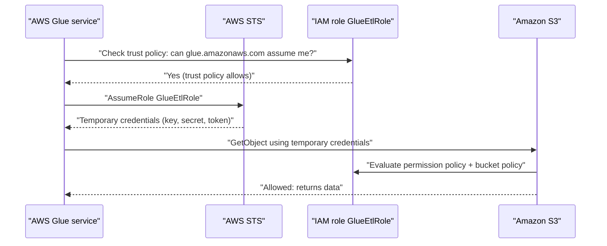
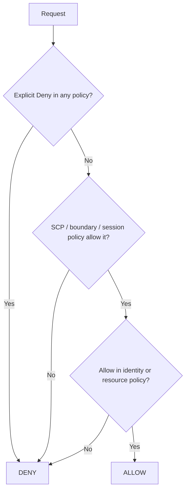
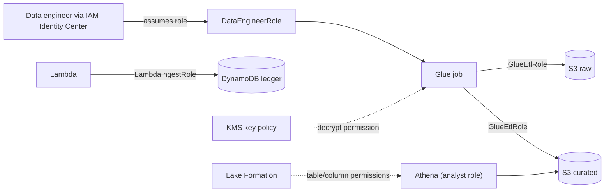
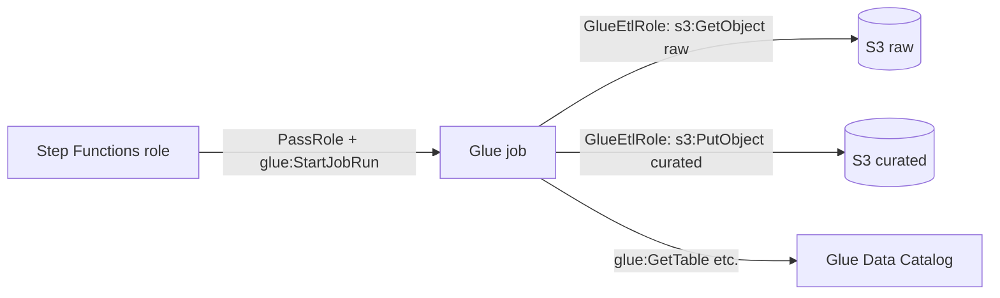
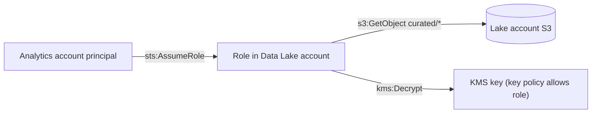
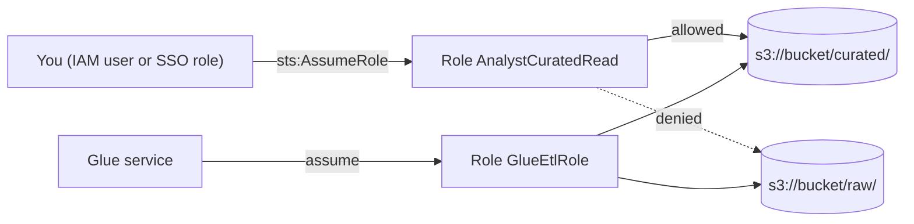

# AWS IAM — Data Engineering Study Notes (0–2 YOE)

> Self-contained notes: fundamentals → implementation → interview preparation.
> IAM behaviour and limits evolve; confirm details in the official docs listed at the end.

**Contents**
1. Introduction
2. Architecture and Working Mechanism
3. Core Concepts and Terminology
4. Data Engineering Use Cases
5. Hands-on Implementation (mini-project)
6. Interview Preparation (10 conceptual + 5 scenario + 3 troubleshooting, all answered)
7. Revision and Quick Reference

---

## 1. Introduction

### What is AWS IAM?
**AWS Identity and Access Management (IAM)** controls **who** (authentication) can do **what** (authorization) on **which AWS resources**. Every API call to AWS — from the console, CLI, Boto3 or another service such as Glue — is checked against IAM. IAM itself is free; it is a global service (identities are not tied to one Region).

### Why was it introduced and what problem does it solve?
Without IAM, you would have a single account password shared by everybody. IAM lets you create separate identities, grant them only the permissions they need, use **temporary credentials**, and audit usage. It solves the problems of shared secrets, over-privileged access and no accountability.

### Why is it important in Data Engineering?
Data pipelines are chains of services calling each other: Glue reads S3, Lambda writes to DynamoDB, EMR reads from Kinesis, Redshift `COPY`s from S3. Each hop needs an **IAM role** with exactly the right permissions. Most pipeline failures that engineers hit early in their careers are `AccessDenied` errors, so IAM is a core debugging skill. Data security and compliance (least privilege, auditing) also depend on it.

### When should you use it?
- Always — every AWS resource access is governed by IAM.
- Use **roles** for services (Glue, Lambda, EMR, Redshift) and for cross-account access.
- Use **IAM Identity Center** (or federation) for human users instead of long-lived IAM users.

### When should you avoid certain IAM patterns?
| Avoid | Why | Use instead |
|---|---|---|
| Root account for daily work | Unrestricted; cannot be limited by IAM policies | Admin role/user with MFA; root only for rare account tasks |
| Long-term access keys in code or repos | Easily leaked | Roles, instance/task roles, Identity Center, Secrets Manager |
| `"Action": "*", "Resource": "*"` | Over-privileged | Scoped policies |
| One shared IAM user for a team | No audit trail | Per-person identities via Identity Center |
| IAM for *data-level* permissions inside a lake (table/column/row) | Policies on S3 paths get unwieldy | **AWS Lake Formation** on top of IAM |

### Simple real-world example
A Glue job needs to read `s3://acme-lake/raw/` and write `s3://acme-lake/curated/`. You create an IAM **role** `GlueEtlRole` that Glue is allowed to assume, and attach a policy granting read on `raw/*` and write on `curated/*`. No passwords or keys are stored anywhere; Glue receives temporary credentials automatically.

### Brief comparison with alternatives
| Service | Purpose | Relation to IAM |
|---|---|---|
| IAM | Core authN/authZ for AWS APIs | Foundation |
| IAM Identity Center | Single sign-on and permission sets for workforce users | Issues temporary role sessions via IAM |
| Amazon Cognito | Identities for *your application's* end users | Can map users to IAM roles |
| AWS Lake Formation | Table/column/row-level data permissions | Works together with IAM |
| AWS Organizations SCPs | Guardrails across accounts | Limit what IAM can grant |
| AWS KMS key policies | Control use of encryption keys | Evaluated alongside IAM |

---

## 2. Architecture and Working Mechanism

### Overall architecture
IAM is a control plane that sits in front of every AWS service. When a **principal** (user, role session, federated user, service) sends a request, the service asks IAM to **authenticate** (who are you? — signature with credentials) and **authorize** (is this action allowed on this resource under these conditions?).

### Major components
- **Principals** — root user, IAM users, IAM roles (assumed by people, services or other accounts), federated identities.
- **Identities** — users, groups (collections of users), roles.
- **Policies** — JSON documents defining permissions: identity-based, resource-based, permissions boundaries, SCPs, session policies.
- **STS (Security Token Service)** — issues temporary credentials (`AssumeRole`, `AssumeRoleWithWebIdentity`, etc.).
- **Credentials** — password (console), access keys (programmatic, long-term), temporary session credentials (key + secret + session token).

### End-to-end request flow
1. A request is signed (SigV4) with credentials and sent to a service endpoint.
2. The service identifies the principal and gathers **request context** (action, resource ARN, tags, IP, time, MFA, etc.).
3. IAM evaluates all applicable policies:
   - **Default is implicit deny**.
   - An **explicit Deny** in any policy always wins.
   - Guardrails — **SCPs**, **permissions boundaries**, **session policies** — must *also* allow the action (they limit; they never grant).
   - Then an **Allow** must exist in an identity-based policy and/or a resource-based policy (rules differ for cross-account).
4. If allowed, the service performs the action; the call is logged in CloudTrail.

### Mermaid — role assumption by a service


### Mermaid — policy evaluation (simplified)


### Explanation of diagram components
- **Trust policy check** — a role has a *trust policy* defining who can assume it; Glue is the trusted service principal.
- **STS** — exchanges the assume-role request for short-lived credentials.
- **Permission policy** — what the role may do once assumed.
- **Evaluation flow** — explicit deny overrides everything; guardrails limit; an allow must exist.

### Practical Data Engineering architecture

Each service has its own role; humans assume roles through SSO; Lake Formation adds data-level control; KMS key policies gate decryption.

---

## 3. Core Concepts and Important Terminologies

### 3.1 Users
- **Definition:** A long-term identity for a person or application, with optional console password and access keys.
- **Why it matters:** Legacy/small setups use users; modern practice prefers Identity Center + roles.
- **How it works:** A user has no permissions until policies are attached (directly or via groups).
- **Example:** `aws iam create-user --user-name alice`
- **DE relevance:** CI/CD or on-premises scripts sometimes still use user keys — rotate them and prefer roles (e.g. OIDC for GitHub Actions).
- **Mistakes:** Sharing users; leaving unused keys; attaching policies directly instead of via groups/roles.

### 3.2 Groups
- **Definition:** A collection of IAM users; permissions attached to the group apply to all members.
- **Why:** Easier management (e.g. `DataEngineers`, `Analysts`).
- **Limitation:** Groups cannot be principals in resource policies and cannot be assumed; they hold only users (not roles).

### 3.3 Roles
- **Definition:** An identity with permissions that is **assumed** temporarily by a trusted principal — no password or permanent keys.
- **Why it matters:** Foundation for service access (Glue, Lambda, EMR), cross-account access and federation.
- **How it works:** Two policy types attach to a role:
  - **Trust policy** (a resource-based policy on the role) — *who may assume it*.
  - **Permission policy** — *what the role may do*.
- **Example:** EC2 instance profile, Lambda execution role, Glue service role.
- **Mistakes:** Forgetting the trust policy (service cannot assume); using the wrong principal (`lambda.amazonaws.com` vs `glue.amazonaws.com`).

### 3.4 Policies — types and structure
| Policy type | Attached to | Grants or limits? | Typical use |
|---|---|---|---|
| Identity-based (managed/inline) | User, group, role | Grants | "This role may read S3 `raw/*`" |
| Resource-based | Resource (S3 bucket, SQS queue, KMS key, Lambda, role trust policy) | Grants | Cross-account access, service invocation |
| Permissions boundary | User/role | Limits maximum | Delegated admin safety |
| Service control policy (SCP) | Org/OU/account | Limits maximum | Organisation guardrails (e.g. deny regions) |
| Session policy | Passed during AssumeRole | Limits | Narrow a session further |
| ACLs | S3 objects/buckets (legacy) | Grants | Avoid for new designs |

**Policy JSON elements**
```json
{
  "Version": "2012-10-17",
  "Statement": [
    {
      "Sid": "ReadRawZone",
      "Effect": "Allow",
      "Action": ["s3:GetObject"],
      "Resource": "arn:aws:s3:::acme-lake/raw/*",
      "Condition": { "Bool": { "aws:SecureTransport": "true" } }
    }
  ]
}
```
- `Effect`: Allow/Deny. `Action`: API operations. `Resource`: ARN(s). `Principal`: used only in resource-based policies. `Condition`: optional constraints (IP, tags, MFA, VPC endpoint, source account...). `NotAction`, `NotResource` exist but are error-prone.
- **Managed vs inline:** AWS-managed (maintained by AWS), customer-managed (reusable, versionable), inline (embedded in one identity).
- **Mistakes:** Using wildcards casually; forgetting that S3 `ListBucket` needs the bucket ARN and `GetObject` needs the object ARN; assuming an Allow overrides a Deny.

### 3.5 Trust policy vs permission policy (commonly confused)
```json
// Trust policy: WHO can assume the role
{
  "Version": "2012-10-17",
  "Statement": [{
    "Effect": "Allow",
    "Principal": { "Service": "glue.amazonaws.com" },
    "Action": "sts:AssumeRole"
  }]
}
// Permission policy: WHAT the role can do
{
  "Version": "2012-10-17",
  "Statement": [
    {"Effect":"Allow","Action":["s3:GetObject"],"Resource":"arn:aws:s3:::acme-lake/raw/*"},
    {"Effect":"Allow","Action":["s3:PutObject"],"Resource":"arn:aws:s3:::acme-lake/curated/*"},
    {"Effect":"Allow","Action":["s3:ListBucket"],"Resource":"arn:aws:s3:::acme-lake"}
  ]
}
```
(JSON does not allow comments; the `//` lines are for explanation only — remove them when saving files.)

### 3.6 STS and `AssumeRole`
- **Definition:** STS issues temporary credentials (access key ID, secret key, session token) with an expiry.
- **Why:** No long-term secrets; automatic expiry; scoped sessions.
- **How:** A principal calls `sts:AssumeRole` on a role it is trusted by; credentials last from 15 minutes up to the role's configured maximum session duration (default 1 hour, configurable up to 12 hours; role chaining limits to 1 hour).
- **Example (Boto3):**
```python
import boto3
sts = boto3.client("sts")
resp = sts.assume_role(
    RoleArn="arn:aws:iam::111122223333:role/DataEngineerReadCurated",
    RoleSessionName="alice-session",
    DurationSeconds=3600)
c = resp["Credentials"]
s3 = boto3.client("s3",
    aws_access_key_id=c["AccessKeyId"],
    aws_secret_access_key=c["SecretAccessKey"],
    aws_session_token=c["SessionToken"])
```
- **Related calls:** `AssumeRoleWithSAML`, `AssumeRoleWithWebIdentity` (OIDC), `GetCallerIdentity` (who am I — `aws sts get-caller-identity`).
- **Mistakes:** Forgetting the session token; expecting credentials to be renewed automatically in custom code (SDK providers refresh them when configured via profiles).

### 3.7 Cross-account access
- **Pattern:** Account B's role trusts Account A's principal; Account A grants its users permission to `sts:AssumeRole` on that role. Alternatively use a resource-based policy (e.g. S3 bucket policy) that names Account A's principal; for cross-account **both** sides must allow.
- **ExternalId:** a shared secret condition in the trust policy used when a third party assumes your role, preventing the *confused deputy* problem.
```json
{
  "Version": "2012-10-17",
  "Statement": [{
    "Effect": "Allow",
    "Principal": { "AWS": "arn:aws:iam::444455556666:root" },
    "Action": "sts:AssumeRole",
    "Condition": { "StringEquals": { "sts:ExternalId": "analytics-2026" } }
  }]
}
```
- **DE relevance:** Central data lake account sharing data with analytics accounts; vendors writing into your landing bucket.
- **Mistakes:** Allowing only the trust side but not the caller's IAM permission to assume; KMS key policy forgotten.

### 3.8 Service roles, execution roles and `iam:PassRole`
- **Service role:** a role a service assumes to act for you (Glue service role, Lambda execution role, EMR service role and EC2 instance profile role).
- **PassRole:** to create a Glue job or Lambda with a role, **you** must have `iam:PassRole` for that role — it prevents privilege escalation.
```json
{"Effect":"Allow","Action":"iam:PassRole",
 "Resource":"arn:aws:iam::111122223333:role/GlueEtlRole",
 "Condition":{"StringEquals":{"iam:PassedToService":"glue.amazonaws.com"}}}
```
- **Mistake:** Job creation fails with "not authorized to perform iam:PassRole".

### 3.9 Least privilege and tooling
- Start with minimal permissions and add as needed; use **IAM Access Analyzer** (policy generation from CloudTrail activity, external access findings), the **IAM Policy Simulator**, and "last accessed" data to remove unused permissions.
- Prefer scoped resource ARNs and conditions over wildcards.

### 3.10 Conditions, tags and MFA
- Common condition keys: `aws:SourceIp`, `aws:SecureTransport`, `aws:PrincipalOrgID`, `aws:MultiFactorAuthPresent`, `aws:SourceArn`/`aws:SourceAccount` (service-to-service), `s3:prefix`.
- **ABAC (attribute-based access control):** match principal tags to resource tags to scale permissions.

### 3.11 Credentials hygiene
- Enable **MFA** for humans and root; delete root access keys; rotate/remove access keys not used; never commit keys. Use `aws iam generate-credential-report` and `aws iam get-access-key-last-used` to audit.

### 3.12 IAM Identity Center (know the role)
Centralised workforce sign-in and **permission sets** that map to roles in accounts; sessions are temporary. Recommended for human access in multi-account setups instead of per-account IAM users.

---

## 4. Data Engineering Use Cases

### Real-world use cases
- Service roles for Glue, EMR, Lambda, Redshift, Step Functions, Airflow.
- Least-privilege read/write per zone (raw read-only for analysts, curated read/write for ETL).
- Cross-account lakes: central governance account shares curated data.
- CI/CD for pipelines using OIDC federation (no static keys).
- Audit and compliance with CloudTrail and Access Analyzer.

### Batch processing
Orchestrator (Step Functions/MWAA) assumes an execution role and starts Glue/EMR jobs with `iam:PassRole`; each job uses its own role for S3, Glue Catalog, KMS, CloudWatch logs.

### Real-time pipelines
Lambda execution role grants `kinesis:GetRecords`/`GetShardIterator`/`DescribeStream`/`ListShards` (or the AWS-managed `AWSLambdaKinesisExecutionRole`), writes to S3/DynamoDB, and logs to CloudWatch. Firehose delivery role writes to S3 and optionally reads Glue schema and uses KMS.

### Pipeline example 1 — Least-privilege batch ETL


### Pipeline example 2 — Cross-account data sharing


### Why a Data Engineer uses IAM roles rather than alternatives
Temporary credentials remove secret management; roles are auditable; fine-grained policies enforce least privilege; they are required by every AWS data service. For human users, SSO beats IAM users; for dataset-level permissions, add Lake Formation.

---

## 5. Hands-on Implementation

### Mini-project: Least-privilege Glue role and an assumable read-only analyst role

**1. Objective:** Create (a) a Glue service role limited to specific S3 prefixes and (b) a read-only role that you assume through STS, then prove what is allowed and denied.

**2. Business problem:** The ETL job should only read `raw/` and write `curated/`, while analysts must only read `curated/`. Nobody should use admin keys in code.

**3. Architecture**


**4. Prerequisites and setup**
- An S3 bucket with `raw/` and `curated/` objects (use the bucket from the S3 notes, or any test bucket).
- Permissions to create IAM roles/policies (an admin or sufficiently privileged identity).
- AWS CLI and Boto3. IAM is free; no charges for this project.

**5–6. Implementation and complete code**

*Step 1 — Set variables and create the Glue role*
```bash
ACCOUNT=$(aws sts get-caller-identity --query Account --output text)
BUCKET=retail-datalake-$ACCOUNT-ap-south-1     # use your bucket

cat > glue-trust.json <<'EOF'
{
  "Version": "2012-10-17",
  "Statement": [{
    "Effect": "Allow",
    "Principal": { "Service": "glue.amazonaws.com" },
    "Action": "sts:AssumeRole"
  }]
}
EOF

cat > glue-perms.json <<EOF
{
  "Version": "2012-10-17",
  "Statement": [
    {"Effect":"Allow","Action":["s3:ListBucket"],"Resource":"arn:aws:s3:::$BUCKET",
     "Condition":{"StringLike":{"s3:prefix":["raw/*","curated/*"]}}},
    {"Effect":"Allow","Action":["s3:GetObject"],"Resource":"arn:aws:s3:::$BUCKET/raw/*"},
    {"Effect":"Allow","Action":["s3:PutObject","s3:GetObject","s3:DeleteObject"],
     "Resource":"arn:aws:s3:::$BUCKET/curated/*"}
  ]
}
EOF

aws iam create-role --role-name GlueEtlRole \
  --assume-role-policy-document file://glue-trust.json
aws iam put-role-policy --role-name GlueEtlRole \
  --policy-name S3ZoneAccess --policy-document file://glue-perms.json
# AWS managed policy providing baseline Glue service permissions and logs:
aws iam attach-role-policy --role-name GlueEtlRole \
  --policy-arn arn:aws:iam::aws:policy/service-role/AWSGlueServiceRole
```

*Step 2 — Create an analyst role that your own identity can assume*
```bash
MY_ARN=$(aws sts get-caller-identity --query Arn --output text)
# NOTE: if MY_ARN is an assumed-role session ARN (SSO), use the IAM role ARN instead,
# or use arn:aws:iam::$ACCOUNT:root as the principal (then any principal in the
# account that is allowed sts:AssumeRole by its own policy can assume it).
cat > analyst-trust.json <<EOF
{
  "Version": "2012-10-17",
  "Statement": [{
    "Effect": "Allow",
    "Principal": { "AWS": "arn:aws:iam::$ACCOUNT:root" },
    "Action": "sts:AssumeRole"
  }]
}
EOF

cat > analyst-perms.json <<EOF
{
  "Version": "2012-10-17",
  "Statement": [
    {"Effect":"Allow","Action":"s3:ListBucket","Resource":"arn:aws:s3:::$BUCKET",
     "Condition":{"StringLike":{"s3:prefix":["curated/*"]}}},
    {"Effect":"Allow","Action":"s3:GetObject","Resource":"arn:aws:s3:::$BUCKET/curated/*"}
  ]
}
EOF
aws iam create-role --role-name AnalystCuratedRead \
  --assume-role-policy-document file://analyst-trust.json --max-session-duration 3600
aws iam put-role-policy --role-name AnalystCuratedRead \
  --policy-name CuratedReadOnly --policy-document file://analyst-perms.json
```

*Step 3 — Assume the role and test allowed vs denied access (`test_assume.py`)*
```python
import boto3, os
from botocore.exceptions import ClientError

ACCOUNT = boto3.client("sts").get_caller_identity()["Account"]
BUCKET = os.environ.get("BUCKET", f"retail-datalake-{ACCOUNT}-ap-south-1")

creds = boto3.client("sts").assume_role(
    RoleArn=f"arn:aws:iam::{ACCOUNT}:role/AnalystCuratedRead",
    RoleSessionName="analyst-test")["Credentials"]

s3 = boto3.client("s3",
    aws_access_key_id=creds["AccessKeyId"],
    aws_secret_access_key=creds["SecretAccessKey"],
    aws_session_token=creds["SessionToken"])

print("Caller:", boto3.client("sts",
      aws_access_key_id=creds["AccessKeyId"],
      aws_secret_access_key=creds["SecretAccessKey"],
      aws_session_token=creds["SessionToken"]).get_caller_identity()["Arn"])

def try_list(prefix):
    try:
        r = s3.list_objects_v2(Bucket=BUCKET, Prefix=prefix, MaxKeys=3)
        print(f"LIST {prefix}: OK ->", [o["Key"] for o in r.get("Contents", [])])
    except ClientError as e:
        print(f"LIST {prefix}: DENIED ->", e.response["Error"]["Code"])

try_list("curated/")
try_list("raw/")
```
(IAM changes can take a few seconds to propagate; if the first `assume_role` fails, wait ~10 seconds and retry.)

**7. Explanation of the code**
- The Glue **trust policy** lets the Glue service assume the role; the **permission policy** scopes S3 access by prefix, using the bucket ARN for `ListBucket` (with an `s3:prefix` condition) and object ARNs for object actions.
- The analyst role trusts principals in the account (who must also have `sts:AssumeRole` permission themselves) and can only list/read `curated/`.
- The Python script assumes the role, prints the identity and tests list calls on both prefixes to demonstrate least privilege.

**8. Expected output**
```
Caller: arn:aws:sts::111122223333:assumed-role/AnalystCuratedRead/analyst-test
LIST curated/: OK -> ['curated/orders/order_date=2026-11-15/part-0000.parquet', ...]
LIST raw/: DENIED -> AccessDenied
```

**9. Validation and testing**
```bash
aws iam get-role --role-name GlueEtlRole --query 'Role.AssumeRolePolicyDocument'
aws iam list-attached-role-policies --role-name GlueEtlRole
aws iam simulate-principal-policy \
  --policy-source-arn arn:aws:iam::$ACCOUNT:role/AnalystCuratedRead \
  --action-names s3:GetObject \
  --resource-arns arn:aws:s3:::$BUCKET/raw/x.csv arn:aws:s3:::$BUCKET/curated/x.parquet
```
The simulation should show `implicitDeny` for `raw/` and `allowed` for `curated/`. Also try creating a Glue job with `GlueEtlRole` (requires your identity to have `iam:PassRole`).

**10. Common errors and troubleshooting**
| Error | Cause | Fix |
|---|---|---|
| `MalformedPolicyDocument` | Invalid JSON/comments, bad ARN | Validate JSON; remove comments |
| `AccessDenied` on `AssumeRole` | Trust policy doesn't include you, or your identity lacks `sts:AssumeRole` | Fix trust policy; add permission to the caller; wait for propagation |
| `Not authorized to perform iam:PassRole` | Missing PassRole when creating Glue/Lambda with a role | Add `iam:PassRole` for that role ARN |
| `AccessDenied` on list in the allowed prefix | `s3:prefix` condition doesn't match (e.g. empty prefix) | Use the right `Prefix` in the call |

**11. Cost considerations and cleanup**
IAM itself is free. S3 requests are negligible. Clean up:
```bash
aws iam detach-role-policy --role-name GlueEtlRole \
  --policy-arn arn:aws:iam::aws:policy/service-role/AWSGlueServiceRole
aws iam delete-role-policy --role-name GlueEtlRole --policy-name S3ZoneAccess
aws iam delete-role --role-name GlueEtlRole
aws iam delete-role-policy --role-name AnalystCuratedRead --policy-name CuratedReadOnly
aws iam delete-role --role-name AnalystCuratedRead
```

