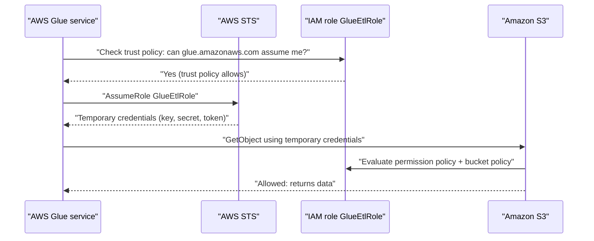
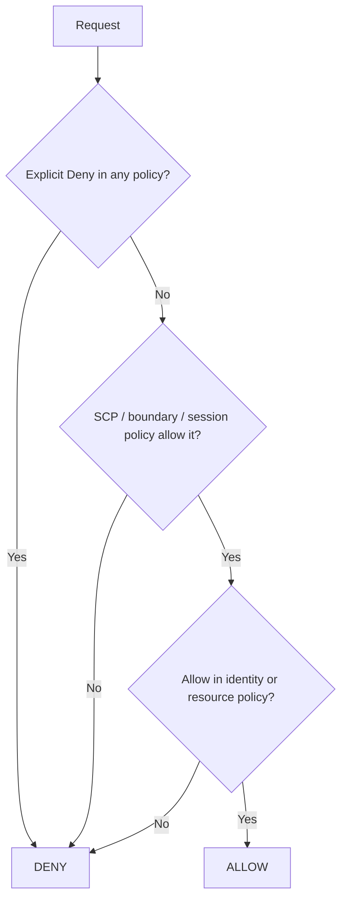
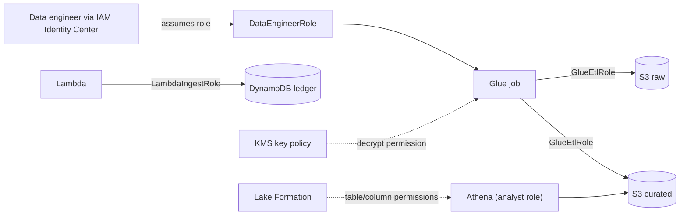
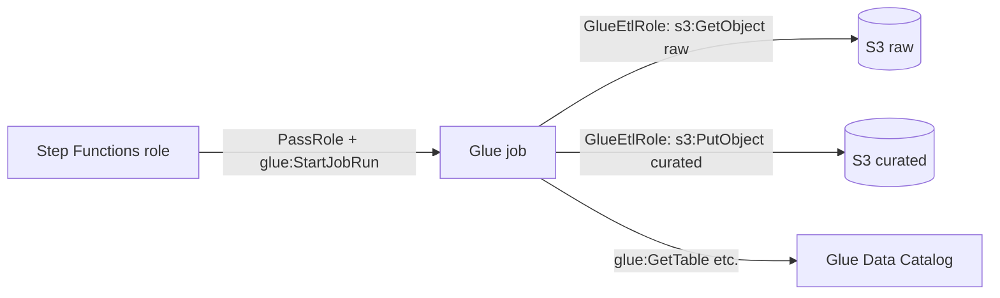
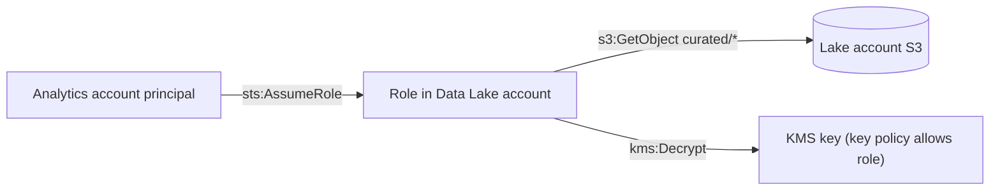
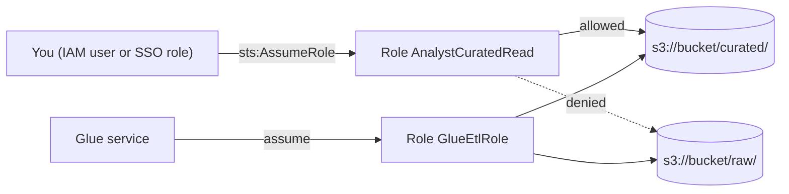

# AWS IAM — Data Engineering Study Notes (0–2 YOE)

> Self-contained notes: fundamentals → implementation → interview preparation.
> IAM behaviour and limits evolve; confirm details in the official docs listed at the end.

**Contents**
1. Introduction
2. Architecture and Working Mechanism
3. Core Concepts and Terminology
4. Data Engineering Use Cases
5. Hands-on Implementation (mini-project)
6. Interview Preparation (10 conceptual + 5 scenario + 3 troubleshooting, all answered)
7. Revision and Quick Reference

---

## 1. Introduction

### What is AWS IAM?
**AWS Identity and Access Management (IAM)** controls **who** (authentication) can do **what** (authorization) on **which AWS resources**. Every API call to AWS — from the console, CLI, Boto3 or another service such as Glue — is checked against IAM. IAM itself is free; it is a global service (identities are not tied to one Region).

### Why was it introduced and what problem does it solve?
Without IAM, you would have a single account password shared by everybody. IAM lets you create separate identities, grant them only the permissions they need, use **temporary credentials**, and audit usage. It solves the problems of shared secrets, over-privileged access and no accountability.

### Why is it important in Data Engineering?
Data pipelines are chains of services calling each other: Glue reads S3, Lambda writes to DynamoDB, EMR reads from Kinesis, Redshift `COPY`s from S3. Each hop needs an **IAM role** with exactly the right permissions. Most pipeline failures that engineers hit early in their careers are `AccessDenied` errors, so IAM is a core debugging skill. Data security and compliance (least privilege, auditing) also depend on it.

### When should you use it?
- Always — every AWS resource access is governed by IAM.
- Use **roles** for services (Glue, Lambda, EMR, Redshift) and for cross-account access.
- Use **IAM Identity Center** (or federation) for human users instead of long-lived IAM users.

### When should you avoid certain IAM patterns?
| Avoid | Why | Use instead |
|---|---|---|
| Root account for daily work | Unrestricted; cannot be limited by IAM policies | Admin role/user with MFA; root only for rare account tasks |
| Long-term access keys in code or repos | Easily leaked | Roles, instance/task roles, Identity Center, Secrets Manager |
| `"Action": "*", "Resource": "*"` | Over-privileged | Scoped policies |
| One shared IAM user for a team | No audit trail | Per-person identities via Identity Center |
| IAM for *data-level* permissions inside a lake (table/column/row) | Policies on S3 paths get unwieldy | **AWS Lake Formation** on top of IAM |

### Simple real-world example
A Glue job needs to read `s3://acme-lake/raw/` and write `s3://acme-lake/curated/`. You create an IAM **role** `GlueEtlRole` that Glue is allowed to assume, and attach a policy granting read on `raw/*` and write on `curated/*`. No passwords or keys are stored anywhere; Glue receives temporary credentials automatically.

### Brief comparison with alternatives
| Service | Purpose | Relation to IAM |
|---|---|---|
| IAM | Core authN/authZ for AWS APIs | Foundation |
| IAM Identity Center | Single sign-on and permission sets for workforce users | Issues temporary role sessions via IAM |
| Amazon Cognito | Identities for *your application's* end users | Can map users to IAM roles |
| AWS Lake Formation | Table/column/row-level data permissions | Works together with IAM |
| AWS Organizations SCPs | Guardrails across accounts | Limit what IAM can grant |
| AWS KMS key policies | Control use of encryption keys | Evaluated alongside IAM |

---

## 2. Architecture and Working Mechanism

### Overall architecture
IAM is a control plane that sits in front of every AWS service. When a **principal** (user, role session, federated user, service) sends a request, the service asks IAM to **authenticate** (who are you? — signature with credentials) and **authorize** (is this action allowed on this resource under these conditions?).

### Major components
- **Principals** — root user, IAM users, IAM roles (assumed by people, services or other accounts), federated identities.
- **Identities** — users, groups (collections of users), roles.
- **Policies** — JSON documents defining permissions: identity-based, resource-based, permissions boundaries, SCPs, session policies.
- **STS (Security Token Service)** — issues temporary credentials (`AssumeRole`, `AssumeRoleWithWebIdentity`, etc.).
- **Credentials** — password (console), access keys (programmatic, long-term), temporary session credentials (key + secret + session token).

### End-to-end request flow
1. A request is signed (SigV4) with credentials and sent to a service endpoint.
2. The service identifies the principal and gathers **request context** (action, resource ARN, tags, IP, time, MFA, etc.).
3. IAM evaluates all applicable policies:
   - **Default is implicit deny**.
   - An **explicit Deny** in any policy always wins.
   - Guardrails — **SCPs**, **permissions boundaries**, **session policies** — must *also* allow the action (they limit; they never grant).
   - Then an **Allow** must exist in an identity-based policy and/or a resource-based policy (rules differ for cross-account).
4. If allowed, the service performs the action; the call is logged in CloudTrail.

### Mermaid — role assumption by a service


### Mermaid — policy evaluation (simplified)


### Explanation of diagram components
- **Trust policy check** — a role has a *trust policy* defining who can assume it; Glue is the trusted service principal.
- **STS** — exchanges the assume-role request for short-lived credentials.
- **Permission policy** — what the role may do once assumed.
- **Evaluation flow** — explicit deny overrides everything; guardrails limit; an allow must exist.

### Practical Data Engineering architecture

Each service has its own role; humans assume roles through SSO; Lake Formation adds data-level control; KMS key policies gate decryption.

---

## 3. Core Concepts and Important Terminologies

### 3.1 Users
- **Definition:** A long-term identity for a person or application, with optional console password and access keys.
- **Why it matters:** Legacy/small setups use users; modern practice prefers Identity Center + roles.
- **How it works:** A user has no permissions until policies are attached (directly or via groups).
- **Example:** `aws iam create-user --user-name alice`
- **DE relevance:** CI/CD or on-premises scripts sometimes still use user keys — rotate them and prefer roles (e.g. OIDC for GitHub Actions).
- **Mistakes:** Sharing users; leaving unused keys; attaching policies directly instead of via groups/roles.

### 3.2 Groups
- **Definition:** A collection of IAM users; permissions attached to the group apply to all members.
- **Why:** Easier management (e.g. `DataEngineers`, `Analysts`).
- **Limitation:** Groups cannot be principals in resource policies and cannot be assumed; they hold only users (not roles).

### 3.3 Roles
- **Definition:** An identity with permissions that is **assumed** temporarily by a trusted principal — no password or permanent keys.
- **Why it matters:** Foundation for service access (Glue, Lambda, EMR), cross-account access and federation.
- **How it works:** Two policy types attach to a role:
  - **Trust policy** (a resource-based policy on the role) — *who may assume it*.
  - **Permission policy** — *what the role may do*.
- **Example:** EC2 instance profile, Lambda execution role, Glue service role.
- **Mistakes:** Forgetting the trust policy (service cannot assume); using the wrong principal (`lambda.amazonaws.com` vs `glue.amazonaws.com`).

### 3.4 Policies — types and structure
| Policy type | Attached to | Grants or limits? | Typical use |
|---|---|---|---|
| Identity-based (managed/inline) | User, group, role | Grants | "This role may read S3 `raw/*`" |
| Resource-based | Resource (S3 bucket, SQS queue, KMS key, Lambda, role trust policy) | Grants | Cross-account access, service invocation |
| Permissions boundary | User/role | Limits maximum | Delegated admin safety |
| Service control policy (SCP) | Org/OU/account | Limits maximum | Organisation guardrails (e.g. deny regions) |
| Session policy | Passed during AssumeRole | Limits | Narrow a session further |
| ACLs | S3 objects/buckets (legacy) | Grants | Avoid for new designs |

**Policy JSON elements**
```json
{
  "Version": "2012-10-17",
  "Statement": [
    {
      "Sid": "ReadRawZone",
      "Effect": "Allow",
      "Action": ["s3:GetObject"],
      "Resource": "arn:aws:s3:::acme-lake/raw/*",
      "Condition": { "Bool": { "aws:SecureTransport": "true" } }
    }
  ]
}
```
- `Effect`: Allow/Deny. `Action`: API operations. `Resource`: ARN(s). `Principal`: used only in resource-based policies. `Condition`: optional constraints (IP, tags, MFA, VPC endpoint, source account...). `NotAction`, `NotResource` exist but are error-prone.
- **Managed vs inline:** AWS-managed (maintained by AWS), customer-managed (reusable, versionable), inline (embedded in one identity).
- **Mistakes:** Using wildcards casually; forgetting that S3 `ListBucket` needs the bucket ARN and `GetObject` needs the object ARN; assuming an Allow overrides a Deny.

### 3.5 Trust policy vs permission policy (commonly confused)
```json
// Trust policy: WHO can assume the role
{
  "Version": "2012-10-17",
  "Statement": [{
    "Effect": "Allow",
    "Principal": { "Service": "glue.amazonaws.com" },
    "Action": "sts:AssumeRole"
  }]
}
// Permission policy: WHAT the role can do
{
  "Version": "2012-10-17",
  "Statement": [
    {"Effect":"Allow","Action":["s3:GetObject"],"Resource":"arn:aws:s3:::acme-lake/raw/*"},
    {"Effect":"Allow","Action":["s3:PutObject"],"Resource":"arn:aws:s3:::acme-lake/curated/*"},
    {"Effect":"Allow","Action":["s3:ListBucket"],"Resource":"arn:aws:s3:::acme-lake"}
  ]
}
```
(JSON does not allow comments; the `//` lines are for explanation only — remove them when saving files.)

### 3.6 STS and `AssumeRole`
- **Definition:** STS issues temporary credentials (access key ID, secret key, session token) with an expiry.
- **Why:** No long-term secrets; automatic expiry; scoped sessions.
- **How:** A principal calls `sts:AssumeRole` on a role it is trusted by; credentials last from 15 minutes up to the role's configured maximum session duration (default 1 hour, configurable up to 12 hours; role chaining limits to 1 hour).
- **Example (Boto3):**
```python
import boto3
sts = boto3.client("sts")
resp = sts.assume_role(
    RoleArn="arn:aws:iam::111122223333:role/DataEngineerReadCurated",
    RoleSessionName="alice-session",
    DurationSeconds=3600)
c = resp["Credentials"]
s3 = boto3.client("s3",
    aws_access_key_id=c["AccessKeyId"],
    aws_secret_access_key=c["SecretAccessKey"],
    aws_session_token=c["SessionToken"])
```
- **Related calls:** `AssumeRoleWithSAML`, `AssumeRoleWithWebIdentity` (OIDC), `GetCallerIdentity` (who am I — `aws sts get-caller-identity`).
- **Mistakes:** Forgetting the session token; expecting credentials to be renewed automatically in custom code (SDK providers refresh them when configured via profiles).

### 3.7 Cross-account access
- **Pattern:** Account B's role trusts Account A's principal; Account A grants its users permission to `sts:AssumeRole` on that role. Alternatively use a resource-based policy (e.g. S3 bucket policy) that names Account A's principal; for cross-account **both** sides must allow.
- **ExternalId:** a shared secret condition in the trust policy used when a third party assumes your role, preventing the *confused deputy* problem.
```json
{
  "Version": "2012-10-17",
  "Statement": [{
    "Effect": "Allow",
    "Principal": { "AWS": "arn:aws:iam::444455556666:root" },
    "Action": "sts:AssumeRole",
    "Condition": { "StringEquals": { "sts:ExternalId": "analytics-2026" } }
  }]
}
```
- **DE relevance:** Central data lake account sharing data with analytics accounts; vendors writing into your landing bucket.
- **Mistakes:** Allowing only the trust side but not the caller's IAM permission to assume; KMS key policy forgotten.

### 3.8 Service roles, execution roles and `iam:PassRole`
- **Service role:** a role a service assumes to act for you (Glue service role, Lambda execution role, EMR service role and EC2 instance profile role).
- **PassRole:** to create a Glue job or Lambda with a role, **you** must have `iam:PassRole` for that role — it prevents privilege escalation.
```json
{"Effect":"Allow","Action":"iam:PassRole",
 "Resource":"arn:aws:iam::111122223333:role/GlueEtlRole",
 "Condition":{"StringEquals":{"iam:PassedToService":"glue.amazonaws.com"}}}
```
- **Mistake:** Job creation fails with "not authorized to perform iam:PassRole".

### 3.9 Least privilege and tooling
- Start with minimal permissions and add as needed; use **IAM Access Analyzer** (policy generation from CloudTrail activity, external access findings), the **IAM Policy Simulator**, and "last accessed" data to remove unused permissions.
- Prefer scoped resource ARNs and conditions over wildcards.

### 3.10 Conditions, tags and MFA
- Common condition keys: `aws:SourceIp`, `aws:SecureTransport`, `aws:PrincipalOrgID`, `aws:MultiFactorAuthPresent`, `aws:SourceArn`/`aws:SourceAccount` (service-to-service), `s3:prefix`.
- **ABAC (attribute-based access control):** match principal tags to resource tags to scale permissions.

### 3.11 Credentials hygiene
- Enable **MFA** for humans and root; delete root access keys; rotate/remove access keys not used; never commit keys. Use `aws iam generate-credential-report` and `aws iam get-access-key-last-used` to audit.

### 3.12 IAM Identity Center (know the role)
Centralised workforce sign-in and **permission sets** that map to roles in accounts; sessions are temporary. Recommended for human access in multi-account setups instead of per-account IAM users.

---

## 4. Data Engineering Use Cases

### Real-world use cases
- Service roles for Glue, EMR, Lambda, Redshift, Step Functions, Airflow.
- Least-privilege read/write per zone (raw read-only for analysts, curated read/write for ETL).
- Cross-account lakes: central governance account shares curated data.
- CI/CD for pipelines using OIDC federation (no static keys).
- Audit and compliance with CloudTrail and Access Analyzer.

### Batch processing
Orchestrator (Step Functions/MWAA) assumes an execution role and starts Glue/EMR jobs with `iam:PassRole`; each job uses its own role for S3, Glue Catalog, KMS, CloudWatch logs.

### Real-time pipelines
Lambda execution role grants `kinesis:GetRecords`/`GetShardIterator`/`DescribeStream`/`ListShards` (or the AWS-managed `AWSLambdaKinesisExecutionRole`), writes to S3/DynamoDB, and logs to CloudWatch. Firehose delivery role writes to S3 and optionally reads Glue schema and uses KMS.

### Pipeline example 1 — Least-privilege batch ETL


### Pipeline example 2 — Cross-account data sharing


### Why a Data Engineer uses IAM roles rather than alternatives
Temporary credentials remove secret management; roles are auditable; fine-grained policies enforce least privilege; they are required by every AWS data service. For human users, SSO beats IAM users; for dataset-level permissions, add Lake Formation.

---

## 5. Hands-on Implementation

### Mini-project: Least-privilege Glue role and an assumable read-only analyst role

**1. Objective:** Create (a) a Glue service role limited to specific S3 prefixes and (b) a read-only role that you assume through STS, then prove what is allowed and denied.

**2. Business problem:** The ETL job should only read `raw/` and write `curated/`, while analysts must only read `curated/`. Nobody should use admin keys in code.

**3. Architecture**


**4. Prerequisites and setup**
- An S3 bucket with `raw/` and `curated/` objects (use the bucket from the S3 notes, or any test bucket).
- Permissions to create IAM roles/policies (an admin or sufficiently privileged identity).
- AWS CLI and Boto3. IAM is free; no charges for this project.

**5–6. Implementation and complete code**

*Step 1 — Set variables and create the Glue role*
```bash
ACCOUNT=$(aws sts get-caller-identity --query Account --output text)
BUCKET=retail-datalake-$ACCOUNT-ap-south-1     # use your bucket

cat > glue-trust.json <<'EOF'
{
  "Version": "2012-10-17",
  "Statement": [{
    "Effect": "Allow",
    "Principal": { "Service": "glue.amazonaws.com" },
    "Action": "sts:AssumeRole"
  }]
}
EOF

cat > glue-perms.json <<EOF
{
  "Version": "2012-10-17",
  "Statement": [
    {"Effect":"Allow","Action":["s3:ListBucket"],"Resource":"arn:aws:s3:::$BUCKET",
     "Condition":{"StringLike":{"s3:prefix":["raw/*","curated/*"]}}},
    {"Effect":"Allow","Action":["s3:GetObject"],"Resource":"arn:aws:s3:::$BUCKET/raw/*"},
    {"Effect":"Allow","Action":["s3:PutObject","s3:GetObject","s3:DeleteObject"],
     "Resource":"arn:aws:s3:::$BUCKET/curated/*"}
  ]
}
EOF

aws iam create-role --role-name GlueEtlRole \
  --assume-role-policy-document file://glue-trust.json
aws iam put-role-policy --role-name GlueEtlRole \
  --policy-name S3ZoneAccess --policy-document file://glue-perms.json
# AWS managed policy providing baseline Glue service permissions and logs:
aws iam attach-role-policy --role-name GlueEtlRole \
  --policy-arn arn:aws:iam::aws:policy/service-role/AWSGlueServiceRole
```

*Step 2 — Create an analyst role that your own identity can assume*
```bash
MY_ARN=$(aws sts get-caller-identity --query Arn --output text)
# NOTE: if MY_ARN is an assumed-role session ARN (SSO), use the IAM role ARN instead,
# or use arn:aws:iam::$ACCOUNT:root as the principal (then any principal in the
# account that is allowed sts:AssumeRole by its own policy can assume it).
cat > analyst-trust.json <<EOF
{
  "Version": "2012-10-17",
  "Statement": [{
    "Effect": "Allow",
    "Principal": { "AWS": "arn:aws:iam::$ACCOUNT:root" },
    "Action": "sts:AssumeRole"
  }]
}
EOF

cat > analyst-perms.json <<EOF
{
  "Version": "2012-10-17",
  "Statement": [
    {"Effect":"Allow","Action":"s3:ListBucket","Resource":"arn:aws:s3:::$BUCKET",
     "Condition":{"StringLike":{"s3:prefix":["curated/*"]}}},
    {"Effect":"Allow","Action":"s3:GetObject","Resource":"arn:aws:s3:::$BUCKET/curated/*"}
  ]
}
EOF
aws iam create-role --role-name AnalystCuratedRead \
  --assume-role-policy-document file://analyst-trust.json --max-session-duration 3600
aws iam put-role-policy --role-name AnalystCuratedRead \
  --policy-name CuratedReadOnly --policy-document file://analyst-perms.json
```

*Step 3 — Assume the role and test allowed vs denied access (`test_assume.py`)*
```python
import boto3, os
from botocore.exceptions import ClientError

ACCOUNT = boto3.client("sts").get_caller_identity()["Account"]
BUCKET = os.environ.get("BUCKET", f"retail-datalake-{ACCOUNT}-ap-south-1")

creds = boto3.client("sts").assume_role(
    RoleArn=f"arn:aws:iam::{ACCOUNT}:role/AnalystCuratedRead",
    RoleSessionName="analyst-test")["Credentials"]

s3 = boto3.client("s3",
    aws_access_key_id=creds["AccessKeyId"],
    aws_secret_access_key=creds["SecretAccessKey"],
    aws_session_token=creds["SessionToken"])

print("Caller:", boto3.client("sts",
      aws_access_key_id=creds["AccessKeyId"],
      aws_secret_access_key=creds["SecretAccessKey"],
      aws_session_token=creds["SessionToken"]).get_caller_identity()["Arn"])

def try_list(prefix):
    try:
        r = s3.list_objects_v2(Bucket=BUCKET, Prefix=prefix, MaxKeys=3)
        print(f"LIST {prefix}: OK ->", [o["Key"] for o in r.get("Contents", [])])
    except ClientError as e:
        print(f"LIST {prefix}: DENIED ->", e.response["Error"]["Code"])

try_list("curated/")
try_list("raw/")
```
(IAM changes can take a few seconds to propagate; if the first `assume_role` fails, wait ~10 seconds and retry.)

**7. Explanation of the code**
- The Glue **trust policy** lets the Glue service assume the role; the **permission policy** scopes S3 access by prefix, using the bucket ARN for `ListBucket` (with an `s3:prefix` condition) and object ARNs for object actions.
- The analyst role trusts principals in the account (who must also have `sts:AssumeRole` permission themselves) and can only list/read `curated/`.
- The Python script assumes the role, prints the identity and tests list calls on both prefixes to demonstrate least privilege.

**8. Expected output**
```
Caller: arn:aws:sts::111122223333:assumed-role/AnalystCuratedRead/analyst-test
LIST curated/: OK -> ['curated/orders/order_date=2026-11-15/part-0000.parquet', ...]
LIST raw/: DENIED -> AccessDenied
```

**9. Validation and testing**
```bash
aws iam get-role --role-name GlueEtlRole --query 'Role.AssumeRolePolicyDocument'
aws iam list-attached-role-policies --role-name GlueEtlRole
aws iam simulate-principal-policy \
  --policy-source-arn arn:aws:iam::$ACCOUNT:role/AnalystCuratedRead \
  --action-names s3:GetObject \
  --resource-arns arn:aws:s3:::$BUCKET/raw/x.csv arn:aws:s3:::$BUCKET/curated/x.parquet
```
The simulation should show `implicitDeny` for `raw/` and `allowed` for `curated/`. Also try creating a Glue job with `GlueEtlRole` (requires your identity to have `iam:PassRole`).

**10. Common errors and troubleshooting**
| Error | Cause | Fix |
|---|---|---|
| `MalformedPolicyDocument` | Invalid JSON/comments, bad ARN | Validate JSON; remove comments |
| `AccessDenied` on `AssumeRole` | Trust policy doesn't include you, or your identity lacks `sts:AssumeRole` | Fix trust policy; add permission to the caller; wait for propagation |
| `Not authorized to perform iam:PassRole` | Missing PassRole when creating Glue/Lambda with a role | Add `iam:PassRole` for that role ARN |
| `AccessDenied` on list in the allowed prefix | `s3:prefix` condition doesn't match (e.g. empty prefix) | Use the right `Prefix` in the call |

**11. Cost considerations and cleanup**
IAM itself is free. S3 requests are negligible. Clean up:
```bash
aws iam detach-role-policy --role-name GlueEtlRole \
  --policy-arn arn:aws:iam::aws:policy/service-role/AWSGlueServiceRole
aws iam delete-role-policy --role-name GlueEtlRole --policy-name S3ZoneAccess
aws iam delete-role --role-name GlueEtlRole
aws iam delete-role-policy --role-name AnalystCuratedRead --policy-name CuratedReadOnly
aws iam delete-role --role-name AnalystCuratedRead
```

---

## 6. Interview Preparation — Questions WITH Answers

### A. Conceptual Questions (10)

**Q1. What is IAM and what are its main building blocks?**
IAM is AWS's service for controlling authentication (who you are) and authorization (what you may do). Building blocks: **users** (long-term identities), **groups** (sets of users), **roles** (assumable identities with temporary credentials), **policies** (JSON permissions), and **STS** (issues temporary credentials). Every API call is evaluated against policies; the default is deny. *Keywords: principal, policy, role, least privilege, implicit deny.* It is global, free, and the base of all pipeline security — e.g. Glue, Lambda and EMR each use roles.

**Q2. Difference between an IAM user, group and role?**
A **user** represents a person or app with long-term credentials (password/access keys). A **group** is only a container of users for attaching policies — it cannot be assumed and cannot be a principal in policies. A **role** has no permanent credentials; a trusted principal (service, user, account, federated identity) *assumes* it and gets temporary credentials. Roles are preferred for services and cross-account access because there is nothing to leak or rotate manually. Example: Lambda uses an execution role, a human uses SSO to assume `DataEngineerRole`.

**Q3. Explain identity-based vs resource-based policies.**
Identity-based policies attach to a user/group/role and define what that identity can do. Resource-based policies attach to a resource (S3 bucket, SQS queue, KMS key, Lambda function, role trust policy) and include a **Principal** element defining who can access the resource. Within one account, either type allowing the action is enough. For cross-account access both the caller's identity policy and the resource policy must allow (unless the caller assumes a role in the resource's account). Example: an S3 bucket policy allows another account's role to read objects.

**Q4. What is the difference between a trust policy and a permission policy?**
A role has two separate kinds of policy. The **trust policy** (assume-role policy) says *who is allowed to assume the role* (e.g. `glue.amazonaws.com`, another account, an OIDC provider). The **permission policy** says *what the role can do* after it is assumed. A frequent bug: permissions are perfect but the service cannot assume the role because the trust policy names the wrong service principal. Remember: trust = door; permissions = what is inside the room.

**Q5. How does IAM evaluate permissions? What overrides what?**
Start from **implicit deny**. If any applicable policy has an **explicit Deny**, the request is denied regardless of Allows. Organisation SCPs, permission boundaries and session policies must also allow the action (they set maximum permissions). Finally there must be an **Allow** in an identity-based and/or resource-based policy. So: explicit deny > (guardrails must allow) > allow > implicit deny. Practical use: an SCP denying regions or a bucket policy denying non-TLS traffic cannot be bypassed by a broad Allow.

**Q6. What is STS and how does `AssumeRole` work?**
Security Token Service issues short-lived credentials. A principal calls `AssumeRole` with a role ARN; IAM checks that the role's trust policy trusts the caller (and the caller is permitted to call `sts:AssumeRole` if in another account/or via identity policy); STS returns an access key, secret key and **session token** valid for a duration (e.g. 1 hour). The caller uses them for subsequent calls. Benefits: no long-term secrets, automatic expiry, session names for auditing in CloudTrail, optional MFA and ExternalId conditions.

**Q7. How do you grant cross-account access?**
Two common ways. (1) **Role-based:** Account B creates a role trusting Account A's principal; Account A allows its users to `sts:AssumeRole` on that role; users assume it and act inside Account B. (2) **Resource-based:** Account B's resource policy (e.g. an S3 bucket policy) names Account A's principal; Account A's identity policy also allows the action. Remember encryption: with SSE-KMS the key policy/grant must allow the other account's role. Use `ExternalId` for third parties and `aws:PrincipalOrgID` to limit to your organisation.

**Q8. What is least privilege and how would you implement it for a pipeline?**
Least privilege means giving only the permissions needed, on the narrowest resources, for the shortest time. For a Glue job: a dedicated role; `s3:GetObject` on the input prefix, `s3:PutObject` on the output prefix, `s3:ListBucket` with a prefix condition, `glue:GetTable/GetPartitions` for specific databases, `logs:*` for its log group only, and `kms:Decrypt/GenerateDataKey` for the key used. Start restrictive, test, expand when `AccessDenied` shows a real need. Use IAM Access Analyzer's policy generation from CloudTrail and "last accessed" data to prune later.

**Q9. What is `iam:PassRole` and why is it required?**
When you configure a service to act with a role (e.g. create a Glue job with `GlueEtlRole`, a Lambda with an execution role, an EMR cluster with a service role), your identity must have `iam:PassRole` on that role. This prevents users from escalating privileges by attaching a more powerful role to a service they control. You can limit it with the condition `iam:PassedToService`. Missing PassRole is a very common error when deploying pipelines with Terraform/CloudFormation/CI.

**Q10. Why use roles and IAM Identity Center instead of long-term access keys? What are best practices for credentials?**
Long-term keys can be leaked in code, logs or laptops and rarely get rotated. Roles/SSO give temporary credentials that expire, support MFA, are centrally managed and audited. Best practices: lock away root with MFA; no root access keys; use SSO for humans; roles for workloads (instance/task/execution roles, OIDC for CI/CD); if keys are unavoidable, rotate them, store in Secrets Manager, and monitor via credential report and CloudTrail. Enable MFA, and use Access Analyzer to detect unintended external access.

### B. Scenario-Based Questions (5)

**S1. A Glue job fails with `AccessDenied` reading S3 even though "the role has S3 access".**
*Scenario:* the role policy lists `s3:GetObject` on `arn:aws:s3:::lake`. *Problem:* object actions need object ARNs (`lake/*`), and `s3:ListBucket` needs the bucket ARN. *Solution:* separate statements: ListBucket on `arn:aws:s3:::lake` (with optional `s3:prefix` condition) and GetObject on `arn:aws:s3:::lake/raw/*`; check KMS decrypt and bucket policy denies. *Why:* S3 evaluates action against the specific resource type. *Alternatives:* attach the AWS managed `AmazonS3ReadOnlyAccess` (too broad for production). *Trade-off:* precise policies take more care but are safer.

**S2. A partner's AWS account must read one curated dataset in your lake.**
*Solution:* create a role `PartnerReadCurated` in your account with permission to `s3:GetObject` on only that prefix; trust policy naming the partner account (with `sts:ExternalId` condition); partner users get `sts:AssumeRole` permission in their account; if objects use SSE-KMS add the role to the key policy. Optionally use a bucket policy/Access Point or Lake Formation cross-account sharing for table-level control. *Why:* no shared credentials, revocable by editing the trust policy. *Alternatives:* S3 bucket policy directly granting the partner role; pre-signed URLs for ad hoc sharing. *Trade-off:* Lake Formation adds governance but extra setup.

**S3. Your CI/CD pipeline uses an IAM user's access keys stored as GitHub secrets. Security wants them removed.**
*Solution:* configure GitHub as an **OIDC identity provider** in IAM and create a role whose trust policy allows `sts:AssumeRoleWithWebIdentity` from that provider, restricted by conditions on repository and branch (`token.actions.githubusercontent.com:sub`). The workflow assumes the role at runtime and gets temporary credentials; delete the old keys. *Why:* no long-lived secrets; scoped to repo/branch. *Alternatives:* self-hosted runners with instance roles; Identity Center for humans. *Trade-off:* initial setup effort, need careful condition on `sub` to avoid any repo assuming the role.

**S4. Developers must create roles for their own Glue jobs but must not become admins.**
*Solution:* use **permissions boundaries**: allow developers `iam:CreateRole` and `iam:AttachRolePolicy` only when the created role has the boundary policy attached (condition `iam:PermissionsBoundary`), and restrict `iam:PassRole` to those roles. The boundary caps what any created role can do (e.g. S3/Glue only). *Why:* delegation without privilege escalation. *Alternatives:* centralised platform team creates roles via IaC; SCPs for organisation-level guardrails. *Trade-off:* boundaries are complex to author and debug.

**S5. An analyst can see a Glue table in the console but Athena returns permission errors on the underlying data.**
*Explanation:* seeing metadata requires Glue permissions; reading data requires S3 (and KMS) permissions — or, if Lake Formation governs the table, Lake Formation grants. *Solution:* verify the analyst role's S3 read permission on the table location and KMS key; if Lake Formation is enabled, grant `SELECT` on the table/columns and ensure the S3 location is registered. Use CloudTrail to identify the denied action and principal. *Alternatives:* manage with IAM only (simple) or Lake Formation (fine-grained). *Trade-off:* Lake Formation gives column/row-level security but adds a second permission layer.

### C. Troubleshooting Questions (3)

**T1. "User is not authorized to perform: sts:AssumeRole on resource role/X".**
*Possible root causes:* the role's trust policy does not list the caller (wrong account/role ARN); the caller's identity policy lacks `sts:AssumeRole`; a condition (MFA, ExternalId, source IP) is not satisfied; the caller is itself an assumed-role session and the trust policy names the underlying role ARN incorrectly; SCP blocks STS. *Debug:* `aws sts get-caller-identity` to see the true caller ARN; `aws iam get-role --role-name X` to read the trust policy; compare principal ARNs; check conditions and SCPs; try the policy simulator. *Fix:* update the trust policy principal and/or add `sts:AssumeRole` permission for the caller; supply `--external-id` or MFA token if required. Wait a few seconds for IAM propagation.

**T2. Glue job creation fails with "not authorized to perform iam:PassRole".**
*Root causes:* the identity creating the job has no `iam:PassRole` for the role ARN; condition `iam:PassedToService` doesn't match; the role is in another account/path. *Debug:* read the error ARN; check the identity's policies with `aws iam list-attached-user-policies` / `list-attached-role-policies`; use `simulate-principal-policy` for `iam:PassRole`. *Fix:*
```json
{"Effect":"Allow","Action":"iam:PassRole",
 "Resource":"arn:aws:iam::111122223333:role/GlueEtlRole",
 "Condition":{"StringEquals":{"iam:PassedToService":"glue.amazonaws.com"}}}
```

**T3. An S3 object read fails with `AccessDenied` although IAM and bucket policy allow it.**
*Root causes:* explicit Deny in a bucket policy or SCP (e.g. requires VPC endpoint or TLS); the object is encrypted with SSE-KMS and the role lacks `kms:Decrypt` or the key policy doesn't trust the role; permissions boundary or session policy limits access; S3 Block Public Access/Access Point policy; cross-account missing one side; Lake Formation governs the location. *Debug approach:* (1) `aws sts get-caller-identity`; (2) `aws s3api head-object` to see encryption; (3) check bucket policy `Deny` statements and SCPs; (4) policy simulator with the real principal; (5) CloudTrail event shows `errorMessage` mentioning explicit deny or KMS. *Fix:* adjust the offending layer — e.g. add the role to the KMS key policy, satisfy the condition (use the VPC endpoint), or remove the explicit deny.

---

## 7. Revision and Quick Reference

### Key takeaways
- Everything in AWS is authorized by IAM; default is deny; explicit deny wins.
- Roles + temporary credentials > users + access keys.
- Two policies on a role: trust (who) and permissions (what).
- Use least privilege, MFA, SSO, and audit with CloudTrail/Access Analyzer.

### Commonly forgotten details
- `iam:PassRole` is required to attach a role to a service.
- Groups can't be assumed or used as principals.
- Cross-account needs both sides to allow (or role assumption).
- SCPs/boundaries restrict but never grant.
- S3 `ListBucket` uses the bucket ARN; object actions use `bucket/*`.
- KMS needs its own permission (key policy + IAM/grant).
- JSON policies cannot contain comments.
- IAM is eventually consistent — changes may take seconds.

### Important commands
```bash
aws sts get-caller-identity
aws iam create-role --role-name R --assume-role-policy-document file://trust.json
aws iam put-role-policy --role-name R --policy-name P --policy-document file://perm.json
aws iam attach-role-policy --role-name R --policy-arn <arn>
aws iam list-roles ; aws iam get-role --role-name R
aws sts assume-role --role-arn <arn> --role-session-name test
aws iam simulate-principal-policy --policy-source-arn <arn> --action-names s3:GetObject --resource-arns <arn>
aws iam generate-credential-report ; aws iam get-credential-report
```

### Frequently used configurations
Service principals: `glue.amazonaws.com`, `lambda.amazonaws.com`, `elasticmapreduce.amazonaws.com`, `ec2.amazonaws.com`, `redshift.amazonaws.com`, `firehose.amazonaws.com`, `states.amazonaws.com`. Managed policies: `AWSGlueServiceRole`, `AWSLambdaBasicExecutionRole`, `AWSLambdaKinesisExecutionRole`, `AmazonS3ReadOnlyAccess` (broad — avoid in production).

### Common errors and solutions
| Error | Solution |
|---|---|
| AccessDenied | Find denying layer: identity policy, resource policy, SCP, boundary, KMS, Lake Formation |
| `sts:AssumeRole` not authorized | Fix trust policy and caller permission |
| `iam:PassRole` not authorized | Add PassRole for that role ARN |
| ExpiredToken | Refresh credentials; check session duration |
| MalformedPolicyDocument | Validate JSON, ARNs, remove comments |

### Service limitations
Policy size limits apply (inline/managed policy character limits and quotas on attached policies per role/user — check IAM quotas); role session duration limited (role chaining max 1 hour); IAM is global and eventually consistent; roles per account have quotas that can be raised.

### Performance and cost optimisation
IAM is free. Avoid excessive STS calls by caching credentials (SDKs do); reduce KMS call volume with S3 Bucket Keys; use IaC to avoid manual drift.

### Security best practices
MFA everywhere; no root keys; SSO for people; roles for workloads; least privilege; permission boundaries and SCPs; Access Analyzer; CloudTrail enabled org-wide; rotate/disable unused keys; use conditions (`aws:PrincipalOrgID`, `aws:SourceArn`).

### Connections with other AWS services
S3 (bucket policies), KMS (key policies), Glue/EMR/Lambda/Redshift (service roles), Lake Formation (data permissions), Organizations (SCPs), CloudTrail (audit), Secrets Manager (credentials), IAM Identity Center (SSO), CloudFormation/Terraform (IaC).

### Quick revision cheat sheet
```
Deny (explicit) > SCP/boundary/session must allow > Allow > implicit deny
Role = trust policy (WHO assumes) + permission policy (WHAT it can do)
STS AssumeRole -> temp creds (key+secret+token)
PassRole to attach a role to a service
Cross-account: trust + permission (or bucket policy + identity policy)
S3: ListBucket -> bucket ARN, Get/Put -> bucket/*
```

### 10 rapid-fire revision questions
1. **Default decision when no policy matches?** Implicit deny.
2. **What beats an Allow?** An explicit Deny.
3. **Can a group be a principal or be assumed?** No.
4. **Which policy defines who can assume a role?** The trust (assume-role) policy.
5. **What does STS return?** Access key ID, secret key and session token with expiry.
6. **Why `iam:PassRole`?** Stops privilege escalation when attaching roles to services.
7. **Do SCPs grant permissions?** No — they only limit.
8. **How should humans access AWS in multi-account setups?** IAM Identity Center/SSO.
9. **What is ExternalId for?** Prevents the confused deputy problem with third parties.
10. **Tool to generate least-privilege policies from usage?** IAM Access Analyzer policy generation.

---

## Official AWS documentation
- IAM User Guide — https://docs.aws.amazon.com/IAM/latest/UserGuide/introduction.html
- Policy evaluation logic — https://docs.aws.amazon.com/IAM/latest/UserGuide/reference_policies_evaluation-logic.html
- IAM roles — https://docs.aws.amazon.com/IAM/latest/UserGuide/id_roles.html
- Temporary credentials / STS — https://docs.aws.amazon.com/IAM/latest/UserGuide/id_credentials_temp.html
- Cross-account access — https://docs.aws.amazon.com/IAM/latest/UserGuide/tutorial_cross-account-with-roles.html
- Best practices — https://docs.aws.amazon.com/IAM/latest/UserGuide/best-practices.html
- Permissions boundaries — https://docs.aws.amazon.com/IAM/latest/UserGuide/access_policies_boundaries.html
- IAM Access Analyzer — https://docs.aws.amazon.com/IAM/latest/UserGuide/what-is-access-analyzer.html
- Boto3 IAM/STS reference — https://boto3.amazonaws.com/v1/documentation/api/latest/reference/services/iam.html
