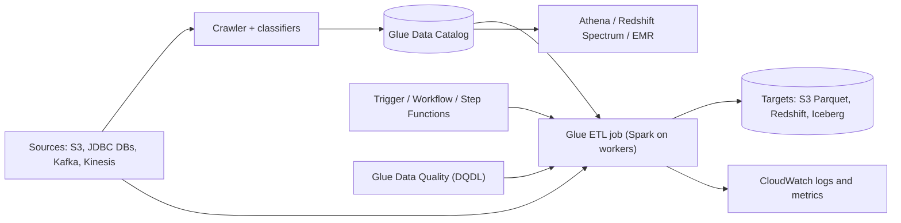
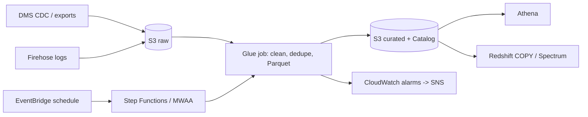
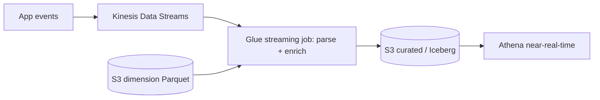
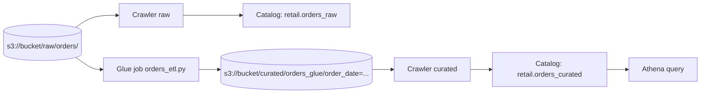

# AWS Glue — Data Engineering Study Notes (0–2 YOE)

> Self-contained notes: fundamentals → implementation → interview preparation.
> Glue versions, worker types, pricing and quotas change; confirm in the docs linked at the end.

**Contents**
1. Introduction
2. Architecture and Working Mechanism
3. Core Concepts and Terminology
4. Data Engineering Use Cases
5. Hands-on Implementation (mini-project)
6. Interview Preparation (10 conceptual + 5 scenario + 3 troubleshooting, all answered)
7. Revision and Quick Reference

---

## 1. Introduction

### What is AWS Glue?
**AWS Glue** is a serverless data integration service. It combines three things:
1. a **Data Catalog** (central metadata store describing your datasets),
2. **crawlers** that discover schemas and populate the catalog, and
3. **ETL jobs** (mostly Apache Spark/PySpark, also Python shell, Ray and streaming) that transform data.

You do not manage servers or clusters: you pick a worker type and count and Glue provisions Spark capacity for the duration of the job.

### Why was it introduced and what problem does it solve?
Before Glue, teams ran their own Hadoop/Spark clusters, maintained a Hive metastore and wrote custom scripts to track schemas. Glue removes cluster management, gives a shared metastore that Athena, Redshift Spectrum, EMR and Lake Formation all understand, and automates schema discovery.

### Why is it important in Data Engineering?
Glue is AWS's default answer for serverless **batch ETL** and for **metadata management** of the S3 data lake. The Glue Data Catalog is the glue (hence the name) between storage (S3) and query engines (Athena, Redshift Spectrum, EMR).

### When should you use it?
- Converting raw CSV/JSON on S3 to partitioned Parquet.
- Scheduled or event-driven batch transformations in a serverless setup.
- Maintaining a central catalog and discovering schemas.
- Moderate-to-large Spark jobs where you want to avoid cluster administration.

### When should you avoid it?
| Situation | Better option |
|---|---|
| Tiny transformations (a few MB, seconds) | Lambda or Athena CTAS — Glue Spark has startup overhead |
| Need full control of Spark/Hadoop configuration, custom libraries at the OS level, always-on clusters | EMR (EC2 / Serverless / on EKS) |
| Sub-second low-latency stream processing | Kinesis Data Analytics (Apache Flink) / Lambda; Glue streaming is micro-batch |
| SQL-only transformations on warehouse data | Redshift SQL or dbt |
| Heavy orchestration across many systems | Step Functions / MWAA (Glue workflows are basic) |

### Simple real-world example
A company drops daily order CSV files in S3. A Glue crawler registers the table; a Glue job converts the data to Parquet partitioned by date; analysts query the Parquet table from Athena. No cluster is ever created by hand.

### Brief comparison with alternatives
| | Glue | EMR | Lambda | Databricks |
|---|---|---|---|---|
| Model | Serverless Spark ETL + catalog | Managed Hadoop/Spark clusters (or Serverless) | Functions, 15-min limit | Managed lakehouse platform (not AWS-native) |
| Ops effort | Lowest | Medium | Low | Medium |
| Control | Moderate | High | Low for big data | High |
| Billing | Per DPU-second | EC2/EMR per instance-second | Per ms of GB-seconds | DBUs + cloud |
| Best for | Standard batch ETL, catalog | Custom/large/long-running big data | Small event-driven tasks | Advanced analytics/ML |

---

## 2. Architecture and Working Mechanism

### Overall architecture
Glue is a collection of cooperating components. Metadata lives in the **Data Catalog**; **crawlers** and manual definitions populate it; **jobs** read from sources and write to targets using Spark running on Glue-managed workers; **triggers/workflows** schedule and chain jobs; **Glue Data Quality** validates data; Glue **Studio** gives a visual authoring tool and monitoring UI.

### Major components
- **Data Catalog** — databases → tables → partitions (schema, location, format, partition keys, parameters).
- **Crawlers** — scan data stores, infer schema using **classifiers**, create/update tables and partitions.
- **Connections** — stored connection info (JDBC, Kafka, etc., possibly inside a VPC).
- **Jobs** — scripts (PySpark/Scala Spark, Python shell, Ray, streaming) with a role, worker type/count, parameters.
- **Triggers & Workflows** — schedule/event/conditional start of jobs and crawlers; workflows chain them.
- **Job bookmarks** — state that tracks already processed data for incremental processing.
- **Glue Studio / Visual ETL, Notebooks, Interactive Sessions** — development tools.
- **Glue Data Quality** — rule-based checks written in DQDL.

### End-to-end flow for a Spark ETL job
1. You start a job run (console, CLI, trigger, Step Functions, EventBridge).
2. Glue allocates workers (each worker = a number of DPUs) in an AWS-managed environment and starts Spark with your script. **DPU** = Data Processing Unit: 4 vCPU and 16 GB memory (G.1X worker = 1 DPU).
3. The script uses the **GlueContext**: reads from the catalog or paths, transforms with DynamicFrames/DataFrames and writes outputs.
4. The job assumes its **IAM role** to access S3, the catalog, KMS and CloudWatch.
5. Logs and metrics flow to CloudWatch; the run ends and workers are released; you pay for DPU-time used.

### Mermaid — Glue architecture


### Explanation of each component
- **Sources/Targets** — where data comes from and goes.
- **Crawler + classifiers** — detect format (CSV, JSON, Parquet...) and schema, write tables to the catalog.
- **Data Catalog** — shared metadata used by Glue jobs and by Athena/Redshift Spectrum/EMR.
- **ETL job** — Spark script doing transformations on managed workers.
- **Trigger/Workflow/Step Functions** — orchestration.
- **CloudWatch** — logs, metrics, alarms.
- **Data Quality** — checks inside jobs or on catalog tables.

### Practical architecture with other AWS services


---

## 3. Core Concepts and Important Terminologies

### 3.1 Glue Data Catalog
- **Definition:** A persistent metadata repository (Hive-metastore compatible) holding databases, tables, partitions and schemas.
- **Why it matters:** Athena, Redshift Spectrum, EMR, Glue and Lake Formation share one definition of each table, so you define it once.
- **How it works:** A table stores the S3 location, format (SerDe/input-output format), columns and partition keys. It does **not** hold the data.
- **Example:** Table `retail.orders` → `s3://lake/curated/orders/`, Parquet, partitioned by `order_date`.
- **Config:** catalog encryption, resource policies, partition indexes (speed partition lookups on large tables).
- **Mistakes:** Assuming the catalog stores data; deleting a table in the catalog and expecting S3 data to disappear (it does not); letting the catalog and S3 layout drift apart.

```python
import boto3
glue = boto3.client("glue")
glue.create_database(DatabaseInput={"Name": "retail"})
tables = glue.get_tables(DatabaseName="retail")["TableList"]
print([t["Name"] for t in tables])
```

### 3.2 Crawlers and classifiers
- **Definition:** A crawler scans a data store, infers the schema and creates/updates catalog tables and partitions. **Classifiers** recognise file formats (built-in for CSV, JSON, Parquet, Avro, ORC, XML...; custom grok/regex/CSV classifiers if needed).
- **Why:** Saves manually writing schemas; picks up new partitions.
- **How:** Runs on demand or on schedule; for S3 targets it samples files and groups similar schemas into one table by default. Schema-change behaviour is configurable (update in database, add new columns only, log) as is delete behaviour.
- **Config:** include/exclude patterns, sample size, table grouping, recrawl policy (crawl new folders only).
- **Mistakes:** Mixed schemas/formats in one prefix creating many unexpected tables; running a full crawl on huge data daily (use incremental recrawl, partition projection or `ALTER TABLE ADD PARTITION`/`MSCK REPAIR`); relying on crawlers when you know the schema (define it with IaC instead).

```python
glue.create_crawler(
    Name="curated-orders-crawler",
    Role="GlueEtlRole",
    DatabaseName="retail",
    Targets={"S3Targets": [{"Path": "s3://my-lake/curated/orders/"}]},
    SchemaChangePolicy={"UpdateBehavior": "UPDATE_IN_DATABASE",
                        "DeleteBehavior": "LOG"},
    RecrawlPolicy={"RecrawlBehavior": "CRAWL_NEW_FOLDERS_ONLY"})
glue.start_crawler(Name="curated-orders-crawler")
```

### 3.3 ETL jobs and job types
| Type | Engine | Use |
|---|---|---|
| Spark (`glueetl`) | Apache Spark (PySpark/Scala) | Main batch ETL |
| Spark Streaming | Spark Structured Streaming | Micro-batch from Kinesis/Kafka |
| Python shell | Single Python process (fractions of a DPU) | Light tasks, API calls, small files |
| Ray | Ray framework | Python data science scale-out (specific use) |

**Glue version** determines Spark/Python versions (for example Glue 4.0 uses Spark 3.3, Glue 5.0 uses Spark 3.5 — confirm current versions in the docs).

### 3.4 Workers, DPUs and cost
- A **DPU** provides 4 vCPU and 16 GB memory. Worker types: **G.1X** (1 DPU, default), **G.2X** (2 DPU), **G.4X**, **G.8X** (more memory/CPU), **G.025X** (streaming, small), plus memory-optimised **R** types where available. Check the docs for current options.
- You specify worker type and **number of workers**; Spark jobs need at least 2. **Auto scaling** (Glue 3.0+) treats the number as the maximum and scales within a run.
- Billing is per DPU-hour, per second, with a short minimum (1 minute for current versions). **Flex execution** class offers lower cost for non-urgent jobs (variable start).
- **Mistakes:** Over-provisioning "just in case"; ignoring that more workers don't help a skewed or single-file job.

### 3.5 GlueContext, DynamicFrame and Spark DataFrame
- **DynamicFrame:** Glue's schema-flexible, self-describing collection. Each record carries its own schema, and fields with conflicting types become **choice types** that you resolve with `ResolveChoice`.
- **DataFrame:** standard Spark; stricter schema, richer SQL/ML API and optimiser (Catalyst).
- **Why both exist:** DynamicFrames cope with messy, semi-structured data and offer Glue-specific features (catalog-aware reads/writes, bookmarks, grouping files); DataFrames are best for business logic. Convert freely: `dyf.toDF()` and `DynamicFrame.fromDF(df, glueContext, "name")`.
- **Mistake:** Writing complex joins in DynamicFrame APIs when a DataFrame is simpler and faster.

```python
from awsglue.dynamicframe import DynamicFrame
dyf = glueContext.create_dynamic_frame.from_catalog(
    database="retail", table_name="orders_raw",
    transformation_ctx="read_orders")
dyf = dyf.resolveChoice(specs=[("amount", "cast:double")])   # fix mixed types
df = dyf.toDF().dropDuplicates(["order_id"])
out = DynamicFrame.fromDF(df, glueContext, "out")
```

### 3.6 Job bookmarks
- **Definition:** Glue remembers what a job has already processed so the next run reads only new data (for supported sources such as S3 and some JDBC).
- **How it works:** Uses `transformation_ctx` names plus job state; for S3 it tracks file modification times/paths.
- **Config:** `--job-bookmark-option job-bookmark-enable | job-bookmark-disable | job-bookmark-pause`; the script must call `job.init()` and `job.commit()`, and every source/sink needs a unique `transformation_ctx`.
- **Mistakes:** Forgetting `job.commit()`; changing/renaming `transformation_ctx` (loses state); expecting bookmarks to detect *updated* rows in a table; reprocessing needs a **bookmark reset** (`aws glue reset-job-bookmark --job-name X`). Many teams prefer explicit date parameters for deterministic, idempotent reruns.

### 3.7 Partitions, pushdown predicates and writing partitioned data
- **Reading less data:** use `push_down_predicate` with catalog reads so Glue lists/reads only matching partitions: `from_catalog(..., push_down_predicate="order_date >= '2026-11-01'")`. Catalog **partition indexes** speed lookups when a table has very many partitions.
- **Writing:** `partitionBy` (Spark) or `partitionKeys` (Glue sink) creates Hive-style folders.
- **Idempotent partition overwrite:** set `spark.sql.sources.partitionOverwriteMode=dynamic` and `mode("overwrite")` so reruns replace only touched partitions.
- **Mistakes:** Over-partitioning; many tiny files from high write parallelism — `repartition`/`coalesce` before writing.

### 3.8 Handling many small input files (`groupFiles`)
For many small S3 files, tell Glue to group them into larger read tasks:
```python
dyf = glueContext.create_dynamic_frame.from_options(
    connection_type="s3",
    connection_options={"paths": ["s3://my-lake/raw/logs/"],
                        "recurse": True,
                        "groupFiles": "inPartition",
                        "groupSize": "134217728"},   # 128 MB groups
    format="json")
```

### 3.9 Connections
Stored configuration for JDBC (RDS, Redshift, on-premises), Kafka, MongoDB etc., including VPC subnet/security group for private resources. Jobs that use a connection in a VPC need networking that can reach S3 (VPC endpoint or NAT) and the Glue/STS endpoints. **Mistake:** job hangs/fails because the subnet has no route to S3.

### 3.10 Triggers and Workflows
- **Triggers:** scheduled (cron), on-demand, or conditional (start when a previous job/crawler succeeds), plus EventBridge-based starts.
- **Workflows:** a graph of crawlers/jobs/triggers with run tracking and shared run properties.
- **When to choose Step Functions/MWAA instead:** complex branching, retries, cross-service orchestration, richer observability.

### 3.11 Glue Studio and Visual ETL
Drag-and-drop job authoring that generates PySpark; good for prototypes and learners; production teams usually keep scripts in Git and deploy via IaC.

### 3.12 Glue Data Quality
Rules written in **DQDL** (Data Quality Definition Language) evaluated on catalog tables or inside jobs; results appear as scores and can fail a job or publish metrics.
```
Rules = [
    IsComplete "order_id",
    IsUnique "order_id",
    ColumnValues "amount" > 0,
    RowCount > 0
]
```
Use for fail-fast checks before publishing curated data. **Mistake:** adding checks without deciding what happens on failure (alert, quarantine, stop).

### 3.13 Job parameters and arguments
Pass runtime values via `--arguments`; read them with `getResolvedOptions`. Special parameters include `--TempDir`, `--job-bookmark-option`, `--enable-metrics`, `--enable-continuous-cloudwatch-log`, `--extra-py-files`, `--additional-python-modules`, `--enable-auto-scaling`, `--conf`.

---

## 4. Data Engineering Use Cases

### Real-world use cases
- Raw → curated lake: CSV/JSON → Parquet, deduplicated, typed, partitioned.
- Database offload: JDBC read from RDS/Oracle → S3.
- CDC merge: apply DMS change files to Iceberg/Hudi/Delta tables.
- Data quality gates before publishing.
- Catalog management for enterprise lake with Lake Formation.

### Batch processing
Scheduled Glue jobs (EventBridge/Step Functions) process a partition (usually yesterday) with parameters like `--run_date`, writing idempotently with partition overwrite. Crawlers or direct catalog API updates register partitions.

### Real-time / streaming
Glue streaming jobs read from Kinesis Data Streams or Kafka (MSK) with Spark Structured Streaming, apply transformations (window aggregations) and write micro-batches to S3 or Iceberg. Best for near-real-time (seconds–minutes), not sub-second.

### Pipeline example 1 — Daily batch ETL


### Pipeline example 2 — Streaming enrichment


### Why a Data Engineer chooses Glue
Serverless (no cluster tuning), integrated catalog, tight S3/Athena/Redshift integration, pay-per-use, quick to start. Choose EMR when you need custom clusters or want cheaper steady-state big jobs with Spot; choose Lambda for tiny tasks; choose Databricks for advanced lakehouse features outside AWS-native tooling.

---

## 5. Hands-on Implementation

### Mini-project: Convert raw orders CSV to partitioned Parquet with Glue and query it in Athena

**1. Objective:** Create a Glue database, crawl raw CSV, run a PySpark Glue job that cleans and writes partitioned Parquet, crawl the output and query with Athena.

**2. Business problem:** Analysts query raw CSV and pay for scanning everything. You need typed, deduplicated, partitioned Parquet in a catalogued table.

**3. Architecture**


**4. Prerequisites and setup**
- The S3 bucket and `raw/orders/` data from the S3 notes (or any CSV with `order_id, customer_id, amount, order_date`).
- The `GlueEtlRole` from the IAM notes. **Extend its S3 policy** so it can also read the script and use a temp path, and write the Athena results if you use that role:
```bash
cat > glue-perms-extra.json <<EOF
{"Version":"2012-10-17","Statement":[
 {"Effect":"Allow","Action":["s3:GetObject"],"Resource":"arn:aws:s3:::$BUCKET/scripts/*"},
 {"Effect":"Allow","Action":["s3:PutObject","s3:GetObject","s3:DeleteObject"],"Resource":"arn:aws:s3:::$BUCKET/temp/*"},
 {"Effect":"Allow","Action":["s3:ListBucket"],"Resource":"arn:aws:s3:::$BUCKET",
  "Condition":{"StringLike":{"s3:prefix":["scripts/*","temp/*"]}}}]}
EOF
aws iam put-role-policy --role-name GlueEtlRole --policy-name S3Extras \
  --policy-document file://glue-perms-extra.json
```
- Variables: `BUCKET`, `REGION`. **Costs:** Glue crawlers and ETL jobs are billed per DPU-hour (no free tier for jobs/crawlers; small runs cost cents). Athena bills per data scanned. Check the pricing page.

**5–6. Implementation and code**

*Step 1 — Database and raw crawler*
```bash
aws glue create-database --database-input Name=retail
aws glue create-crawler --name raw-orders-crawler --role GlueEtlRole \
  --database-name retail \
  --targets "{\"S3Targets\":[{\"Path\":\"s3://$BUCKET/raw/orders/\"}]}"
aws glue start-crawler --name raw-orders-crawler
# wait until READY, then inspect:
aws glue get-crawler --name raw-orders-crawler --query 'Crawler.State'
aws glue get-table --database-name retail --name orders
```
The crawler names the table after the prefix (`orders`). Note the inferred columns, including the partition column `ingest_date`.

*Step 2 — Write the ETL script `orders_etl.py`*
```python
import sys
from awsglue.utils import getResolvedOptions
from awsglue.context import GlueContext
from awsglue.job import Job
from pyspark.context import SparkContext
from pyspark.sql import functions as F

args = getResolvedOptions(sys.argv, ["JOB_NAME", "SOURCE_PATH", "TARGET_PATH"])
sc = SparkContext()
glueContext = GlueContext(sc)
spark = glueContext.spark_session
spark.conf.set("spark.sql.sources.partitionOverwriteMode", "dynamic")  # idempotent reruns
job = Job(glueContext)
job.init(args["JOB_NAME"], args)

# 1) Read raw CSV (header row, infer types)
df = (spark.read.option("header", "true").option("inferSchema", "true")
      .csv(args["SOURCE_PATH"]))

# 2) Clean: types, nulls, duplicates, simple rule
df = (df.withColumn("order_date", F.to_date("order_date"))
        .withColumn("amount", F.col("amount").cast("double"))
        .dropna(subset=["order_id", "order_date"])
        .filter(F.col("amount") > 0)
        .dropDuplicates(["order_id"]))

print("Rows after cleaning:", df.count())

# 3) Write partitioned Parquet (one folder per order_date)
(df.repartition("order_date")          # avoids many tiny files per partition
   .write.mode("overwrite")
   .partitionBy("order_date")
   .parquet(args["TARGET_PATH"]))

job.commit()
```

*Step 3 — Upload the script, create and run the job*
```bash
aws s3 cp orders_etl.py s3://$BUCKET/scripts/orders_etl.py

aws glue create-job --name orders-etl --role GlueEtlRole \
  --command "Name=glueetl,ScriptLocation=s3://$BUCKET/scripts/orders_etl.py,PythonVersion=3" \
  --glue-version 4.0 --worker-type G.1X --number-of-workers 2 \
  --default-arguments "{\"--TempDir\":\"s3://$BUCKET/temp/\",\"--enable-metrics\":\"true\",\"--SOURCE_PATH\":\"s3://$BUCKET/raw/orders/\",\"--TARGET_PATH\":\"s3://$BUCKET/curated/orders_glue/\"}"

RUN_ID=$(aws glue start-job-run --job-name orders-etl --query JobRunId --output text)
aws glue get-job-run --job-name orders-etl --run-id $RUN_ID --query 'JobRun.JobRunState'
```
Poll until `SUCCEEDED`. (If you use a newer Glue version such as 5.0, change `--glue-version`; check the docs for supported versions.)

*Step 4 — Crawl the curated output and query it*
```bash
aws glue create-crawler --name curated-orders-crawler --role GlueEtlRole \
  --database-name retail \
  --targets "{\"S3Targets\":[{\"Path\":\"s3://$BUCKET/curated/orders_glue/\"}]}"
aws glue start-crawler --name curated-orders-crawler
```
In Athena (set a query result location in the workgroup first, see the Athena notes):
```sql
SELECT order_date, COUNT(*) AS orders, ROUND(SUM(amount),2) AS revenue
FROM retail.orders_glue
GROUP BY order_date
ORDER BY order_date;
```
(The curated table is named after the final prefix: `orders_glue`.)

**7. Explanation of the code**
- The script reads the raw CSV, enforces types, drops invalid rows and duplicates, then writes Parquet partitioned by `order_date`. `partitionOverwriteMode=dynamic` means a rerun only replaces the partitions present in the new data. `repartition("order_date")` groups rows per partition value before writing so each folder gets a few larger files.
- `job.init()` / `job.commit()` register the job run state (required for bookmarks).
- The second crawler registers the new Parquet table and its partitions in the catalog so Athena can query it.

**8. Expected output**
- Job log (CloudWatch): `Rows after cleaning: 200` (for the sample data from the S3 notes).
- S3: `curated/orders_glue/order_date=2026-11-15/part-....snappy.parquet` etc.
- Athena returns four rows (one per date) with order counts and revenue.

**9. Validation and testing**
```bash
aws s3 ls s3://$BUCKET/curated/orders_glue/ --recursive
aws glue get-table --database-name retail --name orders_glue \
  --query 'Table.{Loc:StorageDescriptor.Location,Parts:PartitionKeys}'
aws glue get-partitions --database-name retail --table-name orders_glue --query 'Partitions[].Values'
```
Compare row counts: Athena `COUNT(*)` should equal the script's logged count. Re-run the job and confirm results do not duplicate (idempotent overwrite).

**10. Common errors and troubleshooting**
| Error | Likely cause | Fix |
|---|---|---|
| `AccessDeniedException` on S3 | Role missing script/temp/data permissions | Update the role policy (Step 4 prerequisites) |
| Job fails: `Could not find script` | Wrong `ScriptLocation` | Check S3 path and Region |
| Crawler creates a table with strange column names (`col0, col1`) | CSV header not detected | Use a custom CSV classifier (`ContainsHeader=PRESENT`) or define the table yourself |
| Athena: `HIVE_BAD_DATA` or zero rows | Partitions not registered / wrong location | Re-run crawler or `MSCK REPAIR TABLE` |
| Job succeeded but wrote nothing | Source filter removed all rows | Check logs, schema inference and filters |

**11. Cost considerations and cleanup**
Runs of 2 workers for a couple of minutes cost a small amount; crawlers have a minimum billed duration per run. Delete when finished:
```bash
aws glue delete-job --job-name orders-etl
aws glue delete-crawler --name raw-orders-crawler
aws glue delete-crawler --name curated-orders-crawler
aws glue delete-database --name retail      # removes catalog tables, not S3 data
aws s3 rm s3://$BUCKET/curated/orders_glue/ --recursive
aws s3 rm s3://$BUCKET/scripts/ --recursive
aws s3 rm s3://$BUCKET/temp/ --recursive
```

---

## 6. Interview Preparation — Questions WITH Answers

### A. Conceptual Questions (10)

**Q1. What is AWS Glue and what are its main components?**
Glue is a serverless data integration service with: the **Data Catalog** (metadata for databases/tables/partitions), **crawlers** and **classifiers** (schema discovery), **ETL jobs** (Spark, Python shell, streaming, Ray) running on managed workers, **triggers/workflows** (scheduling), **connections** (to JDBC/Kafka sources), **Glue Studio** (visual authoring), and **Glue Data Quality** (DQDL rules). It removes cluster management: you set a worker type and count, and pay for DPU-time. *Keywords: serverless, Spark, Data Catalog, DPU.* Typical story: crawl S3 → catalog → Glue job → Parquet → Athena.

**Q2. What is the Glue Data Catalog and who uses it?**
It is a central, Hive-metastore-compatible metadata repository: databases contain tables, tables describe schema, location, format and partition keys, and partitions map key values to S3 prefixes. It stores metadata, not data. Athena, Redshift Spectrum, EMR, Glue jobs and Lake Formation all read it, which makes a table definition reusable across engines. Deleting a table from the catalog does not delete S3 files. Important features: encryption of metadata, resource policies, partition indexes for tables with many partitions.

**Q3. What do crawlers and classifiers do, and when should you not use a crawler?**
A crawler scans a data store, uses classifiers (built-in or custom) to recognise formats and infer schema, then creates or updates catalog tables and partitions. Configure schedules, include/exclude patterns, schema-change and delete behaviour, and incremental recrawl of new folders. Don't use crawlers when the schema is known and stable (define tables via DDL/IaC), when the prefix contains mixed schemas (you get many odd tables), or for very large datasets where recrawling is slow/costly — use partition projection, `MSCK REPAIR TABLE`, or explicit `batch_create_partition`.

**Q4. What is a DynamicFrame and how does it differ from a Spark DataFrame?**
A DynamicFrame is Glue's self-describing distributed collection: each record carries its own schema, so inconsistent types in a column become a **choice type** (e.g. `int` or `string`) resolved by `ResolveChoice`. It also integrates with the catalog, bookmarks and file grouping. A DataFrame has a single strict schema, offers richer SQL/ML APIs and the Catalyst optimiser. Common practice: read with DynamicFrame (messy inputs), resolve types, convert to DataFrame for joins/aggregations, convert back for Glue sinks if needed. Interviewers like "DynamicFrame = schema flexibility at read time, DataFrame = performance and rich API."

**Q5. Explain Glue worker types, DPUs and how you size a job.**
A DPU is 4 vCPU and 16 GB RAM. Worker types (G.1X = 1 DPU, G.2X = 2 DPU, larger G.4X/G.8X, G.025X for small streaming) differ in CPU/memory per worker. You choose type and number of workers (Spark jobs need at least two); with **auto scaling** the number is a maximum. Sizing approach: start small, watch CloudWatch/Spark UI metrics (executors used, memory, shuffle spill, job runtime), scale **out** for parallel workloads and scale **up** (bigger worker) for memory-heavy tasks such as large joins. Billing is per DPU-second, so right-sizing and the **Flex** class for non-urgent jobs save money.

**Q6. What are job bookmarks and what are their limitations?**
Bookmarks let a job process only new data since the last successful run (for supported sources such as S3 files and some JDBC with a monotonic key). They use `transformation_ctx` identifiers and job state saved on `job.commit()`. Limitations: don't detect updates to existing rows, depend on stable `transformation_ctx`, complicate reprocessing (need `reset-job-bookmark`), and can hide data issues. A robust alternative is parameterised runs (`--run_date`) with idempotent partition overwrites, which makes backfills trivial.

**Q7. How do you reduce the data a Glue job reads? Explain partition pruning and pushdown predicates.**
Store data partitioned by commonly filtered columns and read with `push_down_predicate` (e.g. `"order_date='2026-11-18'"`) from catalog tables so Glue lists and reads only matching partitions. For tables with thousands of partitions, add catalog **partition indexes** to speed partition retrieval. Use columnar formats (Parquet) so Spark prunes columns and uses predicate pushdown inside files. For many small files, use `groupFiles`/`groupSize`. These reduce S3 requests, memory and runtime.

**Q8. Compare Glue workflows/triggers with Step Functions and Airflow (MWAA).**
Glue workflows chain crawlers/jobs with triggers and show run graphs — simple, native, cheap. Step Functions is a general orchestrator for AWS services: retries, branching, parallel maps, waits, error handling, rich visualisation. MWAA (Apache Airflow) suits teams wanting Python DAGs, many integrations and backfills. Choose Glue workflows for small Glue-only pipelines; Step Functions/MWAA for cross-service, conditional, long or auditable pipelines.

**Q9. What is Glue Data Quality?**
A feature to define rule sets in **DQDL** (e.g. `IsComplete "id"`, `ColumnValues "amount" > 0`, `RowCount > 0`) and evaluate them on catalog tables or within ETL jobs. Results give rule-level pass/fail and scores and can publish CloudWatch metrics or stop a job. Use it as a gate before publishing curated data; decide what happens on failure (fail the job, quarantine records, alert) and track trends. It complements, not replaces, unit tests and source-side validation.

**Q10. When would you choose Glue vs EMR vs Lambda?**
Glue: serverless Spark ETL and catalog with minimal ops, good for routine batch. EMR: need control over cluster, libraries, Spark/Hadoop tuning, long-running or interactive clusters, Spot/Graviton optimisation, non-Spark frameworks (Hive, Presto, HBase). Lambda: small, short (≤15 min), event-driven transformations or glue code. Rule of thumb: tiny → Lambda; standard big batch → Glue; custom/huge/cost-optimised steady workloads → EMR. Consider operational skill and cost per run.

### B. Scenario-Based Questions (5)

**S1. A Glue job reading 3 million small JSON files takes 6 hours.**
*Problem:* per-file overhead dominates (listing, opening, task scheduling). *Solution:* use `groupFiles`/`groupSize` to batch small files into 128 MB read tasks; better, fix upstream (Firehose buffering, compaction job) so files are ≥128 MB, and write Parquet. Use partitioned layouts and `push_down_predicate`. *Why:* fewer, larger tasks cut overhead; columnar output speeds downstream. *Alternatives:* Iceberg with compaction, S3 Inventory to avoid listing. *Trade-off:* compaction adds a step but saves ongoing cost.

**S2. You need daily incremental loads without reprocessing the whole history.**
*Options:* (1) job bookmarks on the S3 source; (2) explicit `--run_date` parameter reading only that partition and overwriting the target partition. *Recommendation:* option 2 for deterministic reruns and backfills; use bookmarks only for simple append-only file landing. For database sources use a watermark column (`updated_at`) stored in a control table (DynamoDB/S3) or DMS CDC. *Why:* idempotency and observability beat hidden state. *Trade-off:* you must manage parameters/state yourself.

**S3. The upstream team adds a column and sometimes changes `amount` from int to string; jobs and Athena break.**
*Solution:* land raw data unchanged; in Glue read as DynamicFrame and use `ResolveChoice`/explicit casts to the contract type; configure crawlers with a schema-change policy (add new columns only, log otherwise) or manage schemas explicitly; add Glue Data Quality or schema checks that alert on breaking changes; consider Iceberg for safe schema evolution. *Why:* separate ingestion from strict curated schemas. *Alternatives:* Glue Schema Registry for streaming schemas. *Trade-off:* governance process needed to agree on contracts.

**S4. The monthly Glue bill doubled.**
*Approach:* identify costly jobs in Cost Explorer/CloudWatch (DPU-seconds); check job run insights/Spark UI for skew, spill, long idle executors; right-size worker type/count, enable auto scaling, use Flex for non-urgent jobs, cut data read with partition pruning, avoid reprocessing history, stop crawlers running too often, remove retries that rerun large jobs. *Why:* cost = DPUs × time. *Alternatives:* move steady heavy workloads to EMR on Spot. *Trade-off:* tuning time vs savings.

**S5. A join between a 400 GB fact table and a 50 MB dimension is slow.**
*Solution:* broadcast the small table (`broadcast(dim_df)`) to avoid shuffling the large table; filter early and select needed columns; make sure partitions are pruned; check for skew on join key and enable Spark adaptive query execution (default in recent Glue versions) or salt hot keys. *Why:* a broadcast hash join avoids shuffling 400 GB. *Alternatives:* bucket both tables on the key (preparation cost), pre-join once into a curated table. *Trade-off:* broadcasting too large a table can cause OOM.

### C. Troubleshooting Questions (3)

**T1. Glue job fails with `AccessDeniedException` or "Insufficient Lake Formation permission(s)".**
*Root causes:* role lacks S3 object/list permissions on source/target/script/temp paths; KMS decrypt missing; Glue catalog actions (`glue:GetTable`, `GetPartitions`, `BatchCreatePartition`) missing; Lake Formation controls the table and the role has no grants; cross-account bucket policy missing. *Debug approach:* read the exact error in CloudWatch logs (`/aws-glue/jobs/error`); note whether the service is S3, KMS, Glue or Lake Formation; check the role's policies and the bucket policy; use `aws iam simulate-principal-policy`; for Lake Formation grant `SELECT` and data location access. *Fix:* add the missing permission (prefer least privilege) and rerun.

**T2. Job fails with "Container killed by YARN for exceeding memory limits" or OOM.**
*Root causes:* skewed join/aggregation, huge partitions, `collect()`/`toPandas()` on large data, too many columns, wide shuffles with too few partitions, undersized worker type, UDF memory use. *Debug:* Spark UI (stage with max task time/spill), CloudWatch memory metrics, job run insights. *Fixes:* use a larger worker type (G.2X/G.4X), increase shuffle partitions or repartition, filter/select earlier, broadcast small dimensions, handle skew (salting/AQE), remove driver-side collection, tune `spark.executor.memoryOverhead` via `--conf` where supported, write intermediate results to S3 rather than caching everything.
```python
spark.conf.set("spark.sql.shuffle.partitions", "400")
df = df.repartition(400, "customer_id")
```

**T3. Crawler produced the wrong schema, many unwanted tables or missed partitions.**
*Root causes:* mixed formats/schemas under one prefix, header not detected for CSV, inconsistent column types between files, crawler grouping policy, exclude patterns missing, partitions detected as columns because folder names are not `key=value`, crawler role lacks S3 access. *Debug:* review crawler run logs (`/aws-glue/crawlers`), inspect the created tables (`get-table`), list the S3 layout. *Fix:* restructure S3 into one dataset per prefix with consistent schema, add a custom classifier (CSV with header), use include/exclude patterns, set `TableGroupingPolicy`, or create tables with DDL and add partitions via `MSCK REPAIR TABLE`/API; rerun.

---

## 7. Revision and Quick Reference

### Key takeaways
- Glue = Data Catalog + crawlers + serverless Spark ETL (+ workflows, DQ).
- The catalog holds metadata only; Athena/Redshift Spectrum/EMR reuse it.
- Cost = DPU-hours; right-size, partition, avoid small files.
- Prefer explicit parameters + idempotent partition overwrites over opaque state.

### Commonly forgotten details
- Spark jobs need at least 2 workers; one is the driver.
- `job.commit()` is required for bookmarks.
- Changing `transformation_ctx` loses bookmark state.
- Job role needs access to script, temp dir, data, catalog and logs.
- Jobs in a VPC need routes to S3/Glue endpoints.
- Deleting a catalog table doesn't delete S3 data.
- Crawlers cost money — schedule thoughtfully.

### Important commands and syntax
```bash
aws glue start-job-run --job-name J --arguments '{"--run_date":"2026-11-18"}'
aws glue get-job-run --job-name J --run-id jr_xxx
aws glue get-tables --database-name db
aws glue start-crawler --name C ; aws glue get-crawler --name C
aws glue reset-job-bookmark --job-name J
aws logs tail /aws-glue/jobs/error --follow
```
```python
from awsglue.utils import getResolvedOptions
args = getResolvedOptions(sys.argv, ["JOB_NAME", "run_date"])
glueContext.create_dynamic_frame.from_catalog(database="db", table_name="t",
    push_down_predicate="order_date='2026-11-18'", transformation_ctx="src")
```

### Frequently used configurations
`--job-bookmark-option`, `--TempDir`, `--enable-metrics`, `--enable-continuous-cloudwatch-log`, `--additional-python-modules`, `--enable-auto-scaling`, `--conf spark.sql.shuffle.partitions=...`, worker type/count, Glue version, `--enable-glue-datacatalog` (for Spark SQL on catalog), job timeout and retries.

### Common errors and solutions
| Error | Solution |
|---|---|
| AccessDenied / Lake Formation permission | Fix role policies/LF grants |
| OOM / container killed | Bigger workers, more partitions, fix skew |
| Job runs forever | Check skew/small files/connection hangs; set timeout |
| Crawler wrong schema | Custom classifier, consistent layout, explicit DDL |
| `EntityNotFoundException` | Wrong database/table name or Region |
| VPC connectivity timeout | Add VPC endpoint/NAT and security group rules |

### Service limitations
Spark startup time (tens of seconds+) — poor for tiny jobs; limited low-level cluster control; streaming is micro-batch; crawlers can be slow/costly at scale; workflows are basic orchestration; check quotas for concurrent runs, DPUs and catalog objects.

### Performance and cost optimisation
Parquet + partitioning; `groupFiles` for small inputs; broadcast small tables; auto scaling; Flex for non-urgent; avoid unnecessary full recrawls; limit `count()` calls (they trigger jobs); monitor with job run insights.

### Security best practices
Dedicated least-privilege roles per job; encrypt catalog/S3/job bookmarks/CloudWatch logs with KMS; keep credentials in Secrets Manager (Glue connections); VPC endpoints for private access; Lake Formation for fine-grained table/column control; avoid hardcoded secrets in scripts.

### Connections with other AWS services
S3, IAM, KMS, CloudWatch, Athena, Redshift (Spectrum/COPY), EMR (shared catalog), Lake Formation, EventBridge/Step Functions/MWAA (orchestration), Kinesis/MSK (streaming), DMS (CDC sources), Secrets Manager.

### Quick revision cheat sheet
```
Sources -> Crawler -> Catalog (metadata only) -> Glue job (Spark, GlueContext) -> S3 Parquet partitioned
DPU = 4 vCPU/16 GB ; G.1X=1 DPU, G.2X=2 ; min 2 workers
DynamicFrame (flexible schema, ResolveChoice) <-> DataFrame (Catalyst)
Bookmarks need job.init/commit + unique transformation_ctx
Idempotent: dynamic partition overwrite + run_date parameter
```

### 10 rapid-fire revision questions
1. **What is a DPU?** 4 vCPU and 16 GB memory.
2. **Does the Data Catalog store data?** No, only metadata.
3. **Minimum workers for a Spark job?** Two.
4. **What resolves mixed column types in DynamicFrames?** `ResolveChoice`.
5. **What must the script call for bookmarks to work?** `job.init()` and `job.commit()`.
6. **How to read fewer partitions?** `push_down_predicate`.
7. **How to speed up many tiny S3 files?** `groupFiles`/`groupSize` or compaction.
8. **Language for Glue Data Quality rules?** DQDL.
9. **Which engines can use the Glue Data Catalog?** Athena, Redshift Spectrum, EMR, Glue, Lake Formation.
10. **How to reprocess with bookmarks enabled?** Reset the bookmark (`reset-job-bookmark`) or use explicit parameters.

---

## Official AWS documentation
- AWS Glue Developer Guide — https://docs.aws.amazon.com/glue/latest/dg/what-is-glue.html
- Data Catalog — https://docs.aws.amazon.com/glue/latest/dg/catalog-and-crawler.html
- Crawlers — https://docs.aws.amazon.com/glue/latest/dg/add-crawler.html
- Glue ETL programming (PySpark) — https://docs.aws.amazon.com/glue/latest/dg/aws-glue-programming-python.html
- Job parameters — https://docs.aws.amazon.com/glue/latest/dg/aws-glue-programming-etl-glue-arguments.html
- Job bookmarks — https://docs.aws.amazon.com/glue/latest/dg/monitor-continuations.html
- Worker types and DPUs — https://docs.aws.amazon.com/glue/latest/dg/add-job.html
- Glue Data Quality — https://docs.aws.amazon.com/glue/latest/dg/glue-data-quality.html
- Glue pricing — https://aws.amazon.com/glue/pricing/
- Boto3 Glue reference — https://boto3.amazonaws.com/v1/documentation/api/latest/reference/services/glue.html
