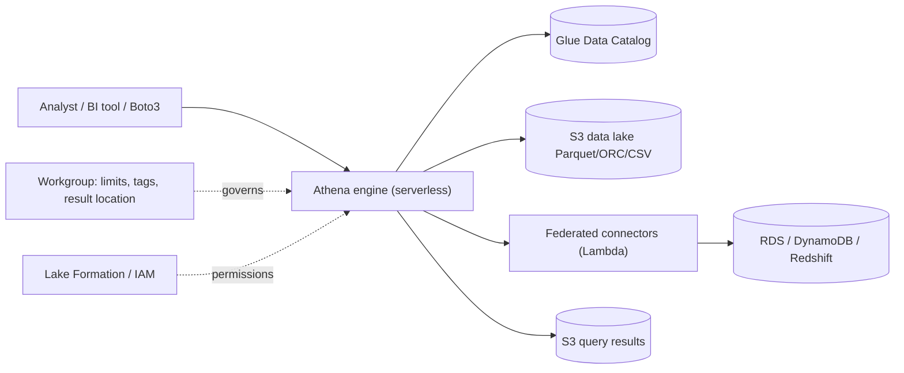
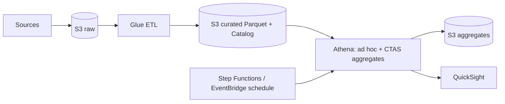
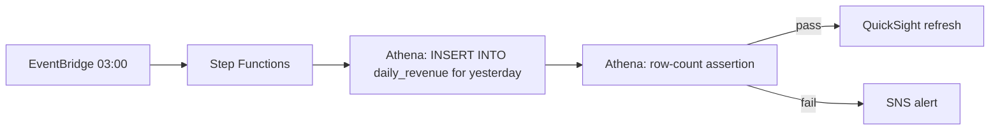
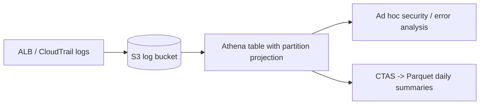
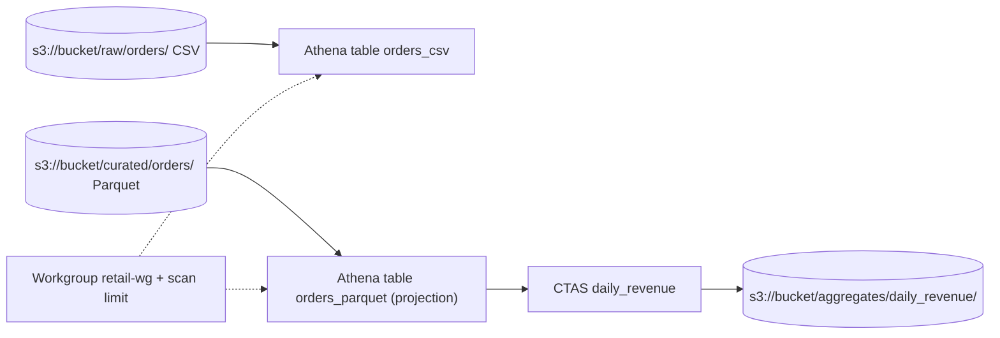

# Amazon Athena — Data Engineering Study Notes (0–2 YOE)

> Self-contained notes: fundamentals → implementation → interview preparation.
> Pricing, quotas and engine versions change; confirm in the official docs linked at the end.

**Contents**
1. Introduction
2. Architecture and Working Mechanism
3. Core Concepts and Terminology
4. Data Engineering Use Cases
5. Hands-on Implementation (mini-project)
6. Interview Preparation (10 conceptual + 5 scenario + 3 troubleshooting, all answered)
7. Revision and Quick Reference

---

## 1. Introduction

### What is Amazon Athena?
**Amazon Athena** is a serverless, interactive query service that lets you run standard **SQL directly on data stored in Amazon S3** — no servers, no loading step. You define table metadata (usually in the Glue Data Catalog) that points at S3 locations, then query CSV, JSON, Parquet, ORC, Avro and other formats. The SQL engine is based on Trino (Presto family) and DDL uses Hive syntax. With the default on-demand model you pay for the amount of data your queries scan.

### Why was it introduced and what problem does it solve?
Analyzing S3 data used to require standing up a Hadoop/Presto cluster or loading data into a warehouse first. Athena removes cluster management and lets analysts and engineers query data **where it lives**, within seconds, using SQL they already know.

### Why is it important in Data Engineering?
- Fast way to **explore, validate and debug** data lake files.
- Used for **ELT**: `CTAS` and `INSERT INTO` create curated datasets.
- Backbone of cost-effective ad hoc analytics on a lake; integrates with the Glue Catalog, Lake Formation, QuickSight and BI tools via JDBC/ODBC.

### When should you use it?
- Ad hoc and exploratory SQL on S3 data; infrequent queries.
- Data validation/QA queries on pipeline outputs.
- Lightweight transformations producing Parquet via CTAS.
- Log analysis (CloudTrail, ALB, VPC Flow Logs).

### When should you avoid it?
| Situation | Better option |
|---|---|
| Hundreds of concurrent dashboard users with strict low-latency SLAs | Redshift (provisioned/Serverless) or caching layer |
| Heavy repeated joins on huge tables where predictable performance matters | Redshift, EMR/Spark |
| Row-level OLTP workloads | Databases (RDS/DynamoDB) |
| Complex multi-step ETL with custom code | Glue/EMR (though Athena Spark exists) |
| Querying millions of tiny CSV/JSON files unprepared | Convert to Parquet first |

### Simple real-world example
After a Glue job writes Parquet to S3, an analyst runs
`SELECT region, SUM(amount) FROM sales WHERE order_date = DATE '2026-11-18' GROUP BY region;`
in Athena. Because the table is partitioned and columnar, Athena scans a few MB and returns in seconds.

### Brief comparison with alternatives
| | Athena | Redshift | EMR (Presto/Spark) | BigQuery (GCP) |
|---|---|---|---|---|
| Infrastructure | Serverless | Cluster or Serverless | Managed clusters | Serverless |
| Data location | S3 (external) | Warehouse storage + Spectrum | S3/HDFS | Native storage |
| Billing | Per TB scanned (or provisioned capacity) | Per node-hour / RPU-hour | Per instance | Per TB / slots |
| Best for | Ad hoc, lake queries | Repeated BI workloads, complex joins | Custom big data jobs | Equivalent to Athena+warehouse |

---

## 2. Architecture and Working Mechanism

### Overall architecture
Athena separates **metadata**, **compute** and **storage**. Metadata comes from the Glue Data Catalog (or a Hive metastore/external catalog), compute is a pool of Athena-managed workers that run distributed SQL, and storage is S3. Results are written to an S3 **query result location**.

### Major components
- **Query engine** — distributed SQL (Trino-based) executing DML; Hive-style DDL.
- **Data Catalog** — databases/tables/partitions (Glue by default).
- **Workgroups** — isolate users/teams, set result locations, cost controls and engine versions.
- **Data sources** — S3 primarily; **federated query** via Lambda connectors to RDS, DynamoDB, Redshift, etc.
- **Result location** — S3 prefix storing CSV results and metadata.
- **Athena for Apache Spark** — notebook sessions running Spark code (separate capability).
- **Capacity reservations/provisioned capacity** — optional dedicated DPUs instead of per-TB pricing.

### End-to-end flow of a query
1. User/app submits SQL (console, JDBC, SDK `StartQueryExecution`).
2. Athena parses the query, looks up table metadata/partitions in the Glue Catalog.
3. The planner prunes partitions using `WHERE` filters on partition columns.
4. Worker nodes read only the required S3 objects (for Parquet/ORC only needed columns/row groups), process data in parallel, and join/aggregate.
5. Results are written to the S3 result location and returned; `GetQueryResults` reads them.
6. Billing is based on bytes scanned (rounded up; a minimum per query applies) — DDL statements are free and failed queries are not charged for scanned data.

### Mermaid architecture


### Explanation of components
- **Athena engine** runs distributed SQL; no clusters visible to you.
- **Catalog** defines schema and partitions; Athena does not store data.
- **S3 data lake** is the actual storage; format and layout drive performance/cost.
- **Federated connectors** let a query join S3 data with operational stores.
- **Results bucket** keeps every query's output; manage its lifecycle.
- **Workgroup** enforces settings and limits; **IAM/Lake Formation** control access.

### Practical Data Engineering architecture


---

## 3. Core Concepts and Important Terminologies

### 3.1 Serverless SQL and the pricing model
- **Definition:** Athena executes SQL without infrastructure; you pay per query based on **data scanned** (on-demand) — historically about $5 per TB scanned with a small minimum per query; DDL and failed queries are free of scan charges. Check the pricing page for current figures. **Provisioned capacity** is an alternative for predictable, high-volume workloads.
- **Why it matters:** Optimising scan volume directly optimises cost.
- **Mistakes:** Believing `LIMIT 10` reduces cost (usually not; the scan can still be large unless the format/partition allows early termination); querying large CSV/JSON repeatedly instead of Parquet.

### 3.2 Glue Data Catalog integration and external tables
- **Definition:** An **external table** stores only metadata; data stays in S3. `DROP TABLE` removes the definition, not the files.
- **How:** DDL such as `CREATE EXTERNAL TABLE ... LOCATION 's3://bucket/prefix/'` registers the table in the catalog.
- **Example:**
```sql
CREATE DATABASE IF NOT EXISTS retail_athena;

CREATE EXTERNAL TABLE retail_athena.orders_parquet (
  order_id    string,
  customer_id bigint,
  amount      double
)
PARTITIONED BY (order_date string)
STORED AS PARQUET
LOCATION 's3://my-lake/curated/orders/';
```
- **Mistakes:** Pointing `LOCATION` at a file instead of a prefix; schema mismatch with the files; forgetting to register partitions.

### 3.3 Supported formats, SerDes and compression
| Format | Type | Notes |
|---|---|---|
| CSV/TSV | Text | Use OpenCSVSerDe (quotes) or LazySimpleSerDe; all strings with OpenCSV; header via `skip.header.line.count` |
| JSON | Text | JSON SerDe (OpenX or Hive); nested data via `struct`/`array`/`map` |
| Parquet | Columnar | Best for analytics; snappy default, ZSTD supported |
| ORC | Columnar | Good alternative, Hive ecosystems |
| Avro | Row | Schema evolution friendly |
| Iceberg/Hudi/Delta | Table formats | Iceberg has the richest Athena support (DML, time travel) |
Prefer **Parquet/ORC** with compression for cost/performance.

### 3.4 Partitioning and partition management
- **Definition:** Splitting data into folders by column values (`order_date=2026-11-18/`) and declaring them as partition columns.
- **Why:** Athena skips folders that don't match `WHERE` filters (partition pruning), reducing bytes scanned.
- **Ways to register partitions:**
  1. `MSCK REPAIR TABLE t;` — scans S3 for Hive-style folders (can be slow on many partitions).
  2. `ALTER TABLE t ADD IF NOT EXISTS PARTITION (order_date='2026-11-18') LOCATION 's3://...';`
  3. **Glue crawler** or Glue API (`batch_create_partition`).
  4. **Partition projection** — Athena computes partition values and locations from table properties (no catalog partition lookup):
```sql
CREATE EXTERNAL TABLE events (
  event_id string, user_id string, payload string)
PARTITIONED BY (dt string)
STORED AS PARQUET
LOCATION 's3://my-lake/curated/events/'
TBLPROPERTIES (
  'projection.enabled'='true',
  'projection.dt.type'='date',
  'projection.dt.format'='yyyy-MM-dd',
  'projection.dt.range'='2026-01-01,NOW',
  'storage.location.template'='s3://my-lake/curated/events/dt=${dt}/'
);
```
- **Mistakes:** Filtering with functions on the partition column (e.g. `date(order_date)`), which can prevent pruning; too many tiny partitions; data folder names not matching the projection template.

### 3.5 CTAS, INSERT INTO and views
- **CTAS (`CREATE TABLE AS SELECT`):** creates a new table and writes data in a chosen format/partitioning — the core Athena ELT tool.
```sql
CREATE TABLE retail_athena.daily_revenue
WITH (
  format = 'PARQUET',
  write_compression = 'SNAPPY',
  external_location = 's3://my-lake/aggregates/daily_revenue/',
  partitioned_by = ARRAY['order_date']
) AS
SELECT customer_id, SUM(amount) AS revenue, order_date
FROM retail_athena.orders_parquet
GROUP BY customer_id, order_date;
```
Partition columns must be the **last** columns in the `SELECT`.
- **INSERT INTO:** appends new rows to an existing table (writes new files).
- **Limits:** a single CTAS/INSERT can write at most **100 partitions** (`HIVE_TOO_MANY_OPEN_PARTITIONS`); split by date ranges or use bucketing. Check the docs for the current limit.
- **Views:** stored queries (no data); good for stable business logic and column-level exposure.
```sql
CREATE OR REPLACE VIEW retail_athena.v_big_orders AS
SELECT * FROM retail_athena.orders_parquet WHERE amount > 400;
```

### 3.6 Bucketing
Clustering data by hash of a column into a fixed number of files (`bucketed_by`, `bucket_count` in CTAS) to speed filters/joins on high-cardinality columns. Use sparingly; partition first.

### 3.7 Query optimisation techniques
- Select only needed columns (never `SELECT *` on wide tables).
- Filter on partition columns; store common filter columns sorted.
- Use Parquet/ORC; target ~128 MB+ files; avoid small files.
- Put the **larger table on the left** of a join and the smaller on the right (Trino broadcasts the right side).
- Use `approx_distinct()` for large distinct counts when exactness isn't required.
- Avoid `ORDER BY` on huge results without `LIMIT`; avoid multiple `regexp_like` on big text if possible; use `UNLOAD` to export results efficiently.
- Check `EXPLAIN` and the query stats (`DataScannedInBytes`, `EngineExecutionTimeInMillis`).

### 3.8 Workgroups and cost control
- **Definition:** Logical grouping of queries with settings: result location, encryption, **per-query data scanned limit**, **workgroup data usage controls** with alarms, CloudWatch metrics, tags for cost allocation, engine version.
- **Why:** Separate teams (analysts vs ETL), prevent runaway scans, allocate cost.
- **Config:** `EnforceWorkGroupConfiguration=true` forces the workgroup's result location/encryption on all queries.

### 3.9 Iceberg tables in Athena
Athena can create and query **Apache Iceberg** tables, supporting `INSERT`, `UPDATE`, `DELETE`, `MERGE`, time travel and schema evolution, plus maintenance commands (`OPTIMIZE`, `VACUUM`).
```sql
CREATE TABLE retail_athena.orders_iceberg (
  order_id string, customer_id bigint, amount double, order_date date)
PARTITIONED BY (order_date)
LOCATION 's3://my-lake/iceberg/orders/'
TBLPROPERTIES ('table_type'='ICEBERG');
```
Use for GDPR deletes, CDC merges and slowly changing data.

### 3.10 Federated queries and Athena for Apache Spark
- **Federated query** uses Lambda-based data source connectors so one SQL statement can join S3 data with RDS, DynamoDB, etc. Good for small lookups, not for heavy joins.
- **Athena for Apache Spark** provides notebook sessions for PySpark analysis without managing clusters.

### 3.11 Query results, reuse and security
- Results stored as CSV in S3; set a lifecycle rule to expire old results.
- **Query result reuse** can return cached results for identical queries within a time window.
- Security: IAM (Athena + Glue + S3 + KMS permissions), Lake Formation, encryption of results (SSE-S3/KMS), workgroup enforcement, optional VPC endpoints.

### 3.12 Run Athena from Python (Boto3)
```python
import time, boto3
athena = boto3.client("athena", region_name="ap-south-1")

def run(sql, workgroup, database):
    qid = athena.start_query_execution(
        QueryString=sql, WorkGroup=workgroup,
        QueryExecutionContext={"Database": database})["QueryExecutionId"]
    while True:
        q = athena.get_query_execution(QueryExecutionId=qid)["QueryExecution"]
        state = q["Status"]["State"]
        if state in ("SUCCEEDED", "FAILED", "CANCELLED"):
            break
        time.sleep(1)
    if state != "SUCCEEDED":
        raise RuntimeError(q["Status"].get("StateChangeReason", state))
    scanned = q["Statistics"]["DataScannedInBytes"]
    rows = athena.get_query_results(QueryExecutionId=qid)["ResultSet"]["Rows"]
    return rows, scanned
```

---

## 4. Data Engineering Use Cases

### Real-world use cases
- **Data lake exploration and validation** after each pipeline run.
- **Log analytics** (ALB/CloudTrail/VPC flow logs) with partition projection.
- **Lightweight ELT** — CTAS to create aggregates and Parquet conversions.
- **Self-service BI** via QuickSight/JDBC.
- **Data quality checks** with SQL assertions on S3 tables.

### Batch processing
EventBridge/Step Functions run Athena queries (`startQueryExecution.sync` integration) to build daily aggregates from curated Parquet into new partitions; downstream tools read the aggregates. Backfills are re-runs for specific dates.

### Real-time pipelines
Athena is not a streaming engine. It queries **near-real-time** data once Firehose/Glue streaming writes files to S3 (latency = buffering interval). Use partition projection so new time partitions are queryable immediately.

### Pipeline example 1 — Daily aggregate build


### Pipeline example 2 — Log analytics


### Why a Data Engineer chooses Athena
Zero infrastructure, pay-per-query, direct S3 access, instant start and easy CTAS-based ELT. Choose Redshift for heavy concurrent BI, Glue/EMR for complex transformations, and keep Athena for exploration, validation, and moderate analytical queries.

---

## 5. Hands-on Implementation

### Mini-project: Compare CSV vs Parquet scan cost and build a daily revenue aggregate

**1. Objective:** Create Athena tables over raw CSV and curated Parquet (with partition projection), measure bytes scanned, and publish a partitioned aggregate with CTAS.

**2. Business problem:** Analysts need daily revenue by customer. Querying raw CSV is expensive and slow; you must prove the savings and publish a reusable aggregate.

**3. Architecture**


**4. Prerequisites and setup**
- The S3 bucket and sample data from the S3 notes (`raw/orders/ingest_date=.../orders.csv` and `curated/orders/order_date=.../part-0000.parquet`).
- An identity allowed to use Athena, read the Glue catalog and S3, and write to the result/aggregate prefixes.
- `BUCKET` and `REGION` shell variables. Athena charges per data scanned — this data is tiny, so cost is negligible.

**5–6. Implementation and code**

*Step 1 — Workgroup with result location and scan guardrail*
```bash
aws athena create-work-group --name retail-wg \
  --configuration "ResultConfiguration={OutputLocation=s3://$BUCKET/athena-results/},EnforceWorkGroupConfiguration=true,BytesScannedCutoffPerQuery=1073741824,PublishCloudWatchMetricsEnabled=true"
```

*Step 2 — Create the database and tables (run each statement via console or the Python helper in 3.12)*
```sql
CREATE DATABASE IF NOT EXISTS retail_athena;

-- RAW CSV (header row, partitioned by ingest_date folder)
CREATE EXTERNAL TABLE retail_athena.orders_csv (
  order_id string, customer_id string, amount string, order_date string
)
PARTITIONED BY (ingest_date string)
ROW FORMAT SERDE 'org.apache.hadoop.hive.serde2.OpenCSVSerde'
LOCATION 's3://<BUCKET>/raw/orders/'
TBLPROPERTIES ('skip.header.line.count'='1');

MSCK REPAIR TABLE retail_athena.orders_csv;

-- CURATED Parquet with partition projection (no crawler needed)
CREATE EXTERNAL TABLE retail_athena.orders_parquet (
  order_id string, customer_id bigint, amount double
)
PARTITIONED BY (order_date string)
STORED AS PARQUET
LOCATION 's3://<BUCKET>/curated/orders/'
TBLPROPERTIES (
  'projection.enabled'='true',
  'projection.order_date.type'='date',
  'projection.order_date.format'='yyyy-MM-dd',
  'projection.order_date.range'='2026-11-01,NOW',
  'storage.location.template'='s3://<BUCKET>/curated/orders/order_date=${order_date}/'
);
```
Replace `<BUCKET>` with your bucket name.

*Step 3 — Run comparison queries and capture scan size (`compare_scan.py`)*
```python
import sys, time, boto3
athena = boto3.client("athena")
WG, DB = "retail-wg", "retail_athena"

def run(sql):
    qid = athena.start_query_execution(
        QueryString=sql, WorkGroup=WG,
        QueryExecutionContext={"Database": DB})["QueryExecutionId"]
    while True:
        q = athena.get_query_execution(QueryExecutionId=qid)["QueryExecution"]
        if q["Status"]["State"] in ("SUCCEEDED", "FAILED", "CANCELLED"):
            break
        time.sleep(1)
    if q["Status"]["State"] != "SUCCEEDED":
        raise RuntimeError(q["Status"].get("StateChangeReason"))
    return q["Statistics"]["DataScannedInBytes"], qid

csv_sql = """SELECT order_date, SUM(CAST(amount AS double)) rev
             FROM orders_csv WHERE order_date = '2026-11-16' GROUP BY order_date"""
pq_sql  = """SELECT order_date, SUM(amount) rev
             FROM orders_parquet WHERE order_date = '2026-11-16' GROUP BY order_date"""

for name, sql in [("CSV", csv_sql), ("Parquet", pq_sql)]:
    scanned, qid = run(sql)
    print(f"{name:8} scanned {scanned:>8} bytes  (query {qid})")
```

*Step 4 — Publish an aggregate with CTAS*
```sql
CREATE TABLE retail_athena.daily_revenue
WITH (
  format = 'PARQUET',
  write_compression = 'SNAPPY',
  external_location = 's3://<BUCKET>/aggregates/daily_revenue/',
  partitioned_by = ARRAY['order_date']
) AS
SELECT customer_id, ROUND(SUM(amount), 2) AS revenue, COUNT(*) AS orders, order_date
FROM retail_athena.orders_parquet
GROUP BY customer_id, order_date;
```
Note: `external_location` must be an **empty** S3 prefix. To append later days use `INSERT INTO retail_athena.daily_revenue SELECT ... WHERE order_date = DATE_FORMAT(...)`.

**7. Explanation of the code**
- The workgroup enforces a result location and caps each query at 1 GB scanned.
- The CSV table uses OpenCSVSerDe (all columns are strings, hence the cast); `MSCK REPAIR` registers `ingest_date` partitions.
- The Parquet table uses **partition projection**, so no crawler or `MSCK` is required. The `WHERE order_date = ...` filter prunes to one folder.
- The script prints `DataScannedInBytes` for each query so you can quantify savings.
- CTAS writes partitioned Parquet aggregates (partition column last in the `SELECT`).

**8. Expected output** (numbers vary with your data)
```
CSV      scanned     5600 bytes  (query abc...)
Parquet  scanned     1900 bytes  (query def...)
```
Parquet should scan less because it reads only the needed columns and one partition. With real datasets the gap is dramatically larger.

**9. Validation and testing**
```sql
SELECT COUNT(*) FROM retail_athena.orders_parquet;     -- equals rows loaded
SELECT * FROM retail_athena.daily_revenue ORDER BY order_date LIMIT 10;
SELECT "$path", COUNT(*) FROM retail_athena.orders_parquet GROUP BY 1;  -- shows source files
```
Compare totals between CSV and Parquet tables, and verify `aws s3 ls s3://$BUCKET/aggregates/daily_revenue/` shows partition folders.

**10. Common errors and troubleshooting**
| Error | Cause | Fix |
|---|---|---|
| `HIVE_BAD_DATA` / zero rows on Parquet | Column type mismatch (e.g. `customer_id` int vs string) or wrong location | Match the Parquet schema (`int64` → `bigint`) |
| `TABLE_NOT_FOUND` | Wrong database in the context | Set `QueryExecutionContext` or qualify names |
| `No output location provided` | Workgroup/result location missing | Use the workgroup or pass `ResultConfiguration` |
| CTAS `HIVE_PATH_ALREADY_EXISTS` | `external_location` not empty | Use a new/empty prefix |
| `AccessDenied` | Missing S3/Glue/KMS permissions | Add permissions for data, results bucket and catalog |
| Query cancelled | Scan limit exceeded | Add partition filters or raise the workgroup limit |

**11. Cost considerations and cleanup**
Queries cost per data scanned (tiny here); S3 result files accumulate — remove them. Clean up:
```sql
DROP TABLE retail_athena.daily_revenue;
DROP TABLE retail_athena.orders_parquet;
DROP TABLE retail_athena.orders_csv;
DROP DATABASE retail_athena;
```
```bash
aws s3 rm s3://$BUCKET/aggregates/ --recursive
aws s3 rm s3://$BUCKET/athena-results/ --recursive
aws athena delete-work-group --work-group retail-wg --recursive-delete-option
```
(Dropping a CTAS-created *external-location* table does not delete its S3 data, hence the explicit `s3 rm`.)

