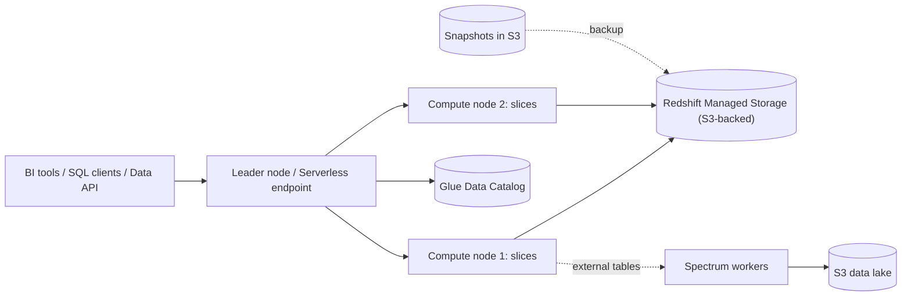
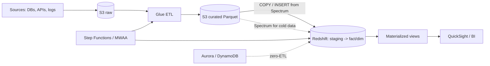
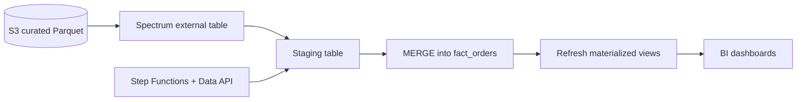
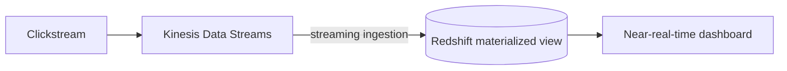
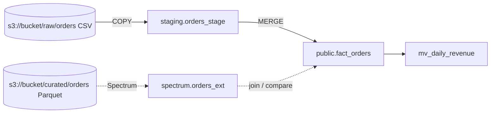

# Amazon Redshift — Data Engineering Study Notes (0–2 YOE)

> Self-contained notes: fundamentals → implementation → interview preparation.
> Redshift features, node types, defaults and pricing change often; confirm in the official docs linked at the end.

**Contents**
1. Introduction
2. Architecture and Working Mechanism
3. Core Concepts and Terminology
4. Data Engineering Use Cases
5. Hands-on Implementation (mini-project)
6. Interview Preparation (10 conceptual + 5 scenario + 3 troubleshooting, all answered)
7. Revision and Quick Reference

---

## 1. Introduction

### What is Amazon Redshift?
**Amazon Redshift** is AWS's fully managed, petabyte-scale **cloud data warehouse**. It uses **columnar storage** and **massively parallel processing (MPP)** to run complex analytical SQL (joins, aggregations, window functions) quickly over large datasets. It is based on PostgreSQL-compatible SQL (with differences), connects over JDBC/ODBC, and can also query S3 data in place with **Redshift Spectrum**. You can run it as a **provisioned cluster** or as **Redshift Serverless**.

### Why was it introduced and what problem does it solve?
Traditional on-premises warehouses (Teradata, Oracle Exadata) were expensive, slow to scale and hard to administer. Redshift (launched 2012) offered a cheaper, elastic warehouse where you pay for what you use and AWS handles patching, backups and hardware. It solves fast analytics on structured, modelled data at large scale.

### Why is it important in Data Engineering?
Many organisations load curated lake data into Redshift to serve BI dashboards (QuickSight, Tableau, Power BI), data marts and analytics with predictable performance and high concurrency. Data engineers design schemas (distribution/sort keys), build load pipelines (`COPY`, `MERGE`), and tune queries and workloads.

### When should you use it?
- Dimensional models (star schemas) powering dashboards and reporting.
- Complex SQL with many joins and aggregations over billions of rows.
- Many concurrent BI users needing consistent, low-latency performance.
- Combining warehouse tables with S3 data (Spectrum) or sharing data across teams (data sharing).

### When should you avoid it?
| Situation | Better option |
|---|---|
| Transaction processing (many single-row inserts/updates) | RDS/Aurora, DynamoDB |
| Occasional ad hoc queries on S3, no warehouse needed | Athena |
| Unstructured data processing, ML feature engineering at huge scale | EMR/Glue/Spark |
| Tiny datasets (GBs) with light usage | Athena or Aurora; Redshift Serverless if SQL warehouse is needed |

### Simple real-world example
A retailer loads daily orders from S3 into Redshift tables `fact_orders` and `dim_customer`. A BI dashboard queries revenue by region and month in seconds, while thousands of rows per second are never written one by one — they are bulk loaded with `COPY`.

### Brief comparison with alternatives
| | Redshift | Athena | Snowflake | Aurora (RDS) |
|---|---|---|---|---|
| Type | MPP columnar warehouse | Serverless query on S3 | Cloud data warehouse (multi-cloud) | OLTP relational database |
| Storage | Managed storage (RA3: S3-backed) | S3 only | Managed (separate from compute) | Managed database storage |
| Best at | Repeated BI/complex joins | Ad hoc lake queries | Similar to Redshift, multi-cloud | Transactions |
| Cost model | Node-hours/RPU-hours | Per TB scanned | Credits | Instance/IO |

---

## 2. Architecture and Working Mechanism

### Overall architecture (provisioned cluster)
A cluster has one **leader node** and one or more **compute nodes**. Clients connect to the leader, which parses SQL, builds and optimises the query plan, compiles code and coordinates execution. Each compute node is divided into **slices** (each with its own CPU/memory/disk portion); tables are distributed across slices according to the **distribution style**, and slices work in parallel. **RA3** node types separate compute from storage: data lives in **Redshift Managed Storage** (backed by S3) with a local SSD cache.

### Redshift Serverless
You define a **namespace** (databases, users, IAM roles, encryption) and a **workgroup** (compute settings: base capacity in **RPUs**, network, limits). Redshift scales compute automatically and bills per RPU-second used; compute pauses when idle.

### Major components
- **Leader node** — SQL endpoint, planner, coordinator.
- **Compute nodes and slices** — parallel storage and execution.
- **Managed storage** — columnar, compressed, replicated; snapshots to S3.
- **Spectrum layer** — pool of workers that scan S3 for external tables.
- **WLM / concurrency scaling** — workload management and extra transient capacity.
- **Data sharing, federated query, zero-ETL integrations** — sharing and ingestion features.
- **System tables/views** — `SYS_*`, `SVV_*`, `STL_*`/`STV_*` for monitoring.

### End-to-end flow of a query
1. A client (BI tool, Data API, SQL client) sends SQL to the leader/serverless endpoint.
2. The leader parses and optimises the query using table statistics, then generates and compiles execution code (results cache may answer repeated queries).
3. Plan segments are sent to compute slices; each slice scans its portion of columnar data (using sort-key **zone maps** to skip blocks).
4. If a join needs matching rows on different slices, data is **redistributed** or broadcast (a major cost — good distribution keys minimise it).
5. Intermediate results go back to the leader, which does final aggregation and returns results.
6. External tables trigger Spectrum workers to scan S3 data and push partial results back to compute nodes.

### Mermaid architecture


### Explanation of components
- **Leader** plans and coordinates; **compute slices** do the heavy lifting in parallel.
- **Managed storage** holds table data; hot data is cached on SSD.
- **Spectrum** lets queries read S3 files without loading them.
- **Glue Catalog** holds external table definitions.
- **Snapshots** provide backups/restore and cross-region copies.

### Practical Data Engineering architecture


---

## 3. Core Concepts and Important Terminologies

### 3.1 Provisioned cluster vs Redshift Serverless
| | Provisioned (RA3) | Serverless |
|---|---|---|
| Capacity | You choose node type and count | Base capacity (RPUs), auto scales |
| Billing | Per node-hour (reservations possible) | Per RPU-second while active |
| Idle | Pay unless paused/resized | Pauses when idle (no compute charge) |
| Best for | Steady, predictable heavy workloads | Spiky, new or unpredictable workloads |
- **RPU:** Redshift Processing Unit (compute capacity measure). Set a base capacity and optional **maximum capacity/usage limits** to control cost.
- **Mistakes:** Leaving provisioned clusters running 24/7 for light use; not setting usage limits on serverless.

### 3.2 Columnar storage, compression and zone maps
- Data is stored by column in 1 MB blocks, compressed with **encodings** (AZ64, ZSTD, etc.; `ENCODE AUTO` is the default and lets Redshift choose).
- **Why it matters:** analytical queries read only needed columns; compression reduces I/O.
- **Zone maps** store min/max per block; with good sort keys Redshift skips blocks that cannot match filters.

### 3.3 Distribution styles (how rows are spread across slices)
| Style | Behaviour | Use when |
|---|---|---|
| `AUTO` (default) | Redshift chooses and can change (small tables → ALL, larger → EVEN/KEY) | Start here if unsure |
| `EVEN` | Round-robin | No clear join key; staging tables |
| `KEY` | Rows with same key value go to same slice | Large fact + dimension joined on that key (co-located joins) |
| `ALL` | Full copy on every node | Small, rarely changing dimension tables |
- **Why:** joins on matching distribution keys avoid network redistribution.
- **Mistakes:** Choosing a skewed key (e.g. a column with few distinct values or mostly NULL) which overloads one slice; using ALL on big tables.
```sql
CREATE TABLE fact_orders (
  order_id    varchar(30) NOT NULL,
  customer_id bigint      NOT NULL,
  amount      double precision,
  order_date  date        NOT NULL
)
DISTSTYLE KEY DISTKEY (customer_id)
COMPOUND SORTKEY (order_date);
```

### 3.3b Sort keys
- Determine on-disk ordering and enable **zone map** pruning for range filters. **Compound** (default, order of columns matters, best with prefix filters), **interleaved** (equal weight to columns; rarely recommended), **AUTO** (Redshift decides using workload).
- Choose columns used in `WHERE`/range filters and joins — typically a date or timestamp.
- **Mistake:** Sorting by a high-cardinality unused column; heavy ingestion without maintenance on unsorted regions.

### 3.4 Loading data: `COPY`
- **Definition:** Bulk-loads data in parallel from S3 (also DynamoDB, EMR, remote hosts) into a table — the recommended load method (not row-by-row `INSERT`).
- **How it works:** Each slice loads part of the files in parallel, so use **multiple similar-sized files** (ideally a multiple of the number of slices), compressed.
```sql
COPY staging.orders_stage
FROM 's3://my-lake/raw/orders/'
IAM_ROLE 'arn:aws:iam::111122223333:role/RedshiftS3ReadRole'
FORMAT AS CSV
IGNOREHEADER 1
DATEFORMAT 'auto'
REGION 'ap-south-1';
```
- **Parquet/ORC:** `FORMAT AS PARQUET` (columns map by position; partition columns encoded in folder names are not loaded — use Spectrum for those).
- **Useful options:** `MANIFEST` (exact file list), `GZIP`, `MAXERROR`, `TRUNCATECOLUMNS`, `COMPUPDATE`, `STATUPDATE`.
- **Errors:** check `SYS_LOAD_ERROR_DETAIL` (or `STL_LOAD_ERRORS`) for row-level problems.
- **Auto-copy:** `COPY ... JOB CREATE ... AUTO ON` can automatically ingest new S3 files.
- **Mistakes:** One giant file (only one slice works); no IAM role attached to the cluster; wrong Region for S3.

### 3.5 Upserts: staging table + `MERGE` (or delete-insert)
Redshift does **not enforce** primary/foreign keys (they are informational hints for the optimiser), so duplicates are possible. Standard pattern: load to a staging table, then merge in one transaction.
```sql
BEGIN;
MERGE INTO public.fact_orders
USING staging.orders_stage s
ON fact_orders.order_id = s.order_id
WHEN MATCHED THEN UPDATE SET customer_id = s.customer_id, amount = s.amount, order_date = s.order_date
WHEN NOT MATCHED THEN INSERT (order_id, customer_id, amount, order_date)
                      VALUES (s.order_id, s.customer_id, s.amount, s.order_date);
TRUNCATE staging.orders_stage;
COMMIT;
```
(Older approach for engines/versions without MERGE: `DELETE FROM target USING stage WHERE ...; INSERT INTO target SELECT ... FROM stage;`.)

### 3.6 `UNLOAD`
Exports query results to S3 (CSV, Parquet) in parallel — used to archive cold data, feed other systems or build lake datasets.
```sql
UNLOAD ('SELECT * FROM fact_orders WHERE order_date < ''2026-01-01''')
TO 's3://my-lake/archive/fact_orders/'
IAM_ROLE 'arn:aws:iam::111122223333:role/RedshiftS3WriteRole'
FORMAT AS PARQUET PARTITION BY (order_date);
```

### 3.7 Redshift Spectrum (external tables)
- **Definition:** Query S3 data through external schemas/tables defined in the Glue Data Catalog while using Redshift SQL and joining with local tables.
- **Why:** Keep cold/huge data in S3 cheaply; avoid loading everything.
- **Billing:** In addition to Redshift compute, Spectrum charges per data scanned (like Athena).
```sql
CREATE EXTERNAL SCHEMA spectrum
FROM DATA CATALOG DATABASE 'retail_spectrum' REGION 'ap-south-1'
IAM_ROLE 'arn:aws:iam::111122223333:role/RedshiftS3ReadRole'
CREATE EXTERNAL DATABASE IF NOT EXISTS;

CREATE EXTERNAL TABLE spectrum.orders_ext (
  order_id varchar(30), customer_id bigint, amount double precision)
PARTITIONED BY (order_date date)
STORED AS PARQUET
LOCATION 's3://my-lake/curated/orders/';

ALTER TABLE spectrum.orders_ext ADD IF NOT EXISTS
  PARTITION (order_date='2026-11-15') LOCATION 's3://my-lake/curated/orders/order_date=2026-11-15/';
```
- **Mistakes:** Not partitioning/using Parquet (high scan cost); role lacking Glue/S3 permissions.

### 3.8 Materialized views
Store precomputed results of a query; can **auto-refresh** and refresh incrementally when possible; the optimiser can rewrite queries to use them.
```sql
CREATE MATERIALIZED VIEW mv_daily_revenue AUTO REFRESH YES AS
SELECT order_date, SUM(amount) AS revenue, COUNT(*) AS orders
FROM public.fact_orders GROUP BY order_date;
```
**Mistake:** assuming every query form supports incremental refresh; check limitations.

### 3.9 Workload management (WLM) and concurrency scaling
- **Automatic WLM** manages memory/concurrency per query using machine learning and queue priorities; **manual WLM** defines queues with fixed slots.
- **Query monitoring rules (QMR)** can log, hop or abort queries exceeding thresholds (e.g. runtime, rows scanned).
- **Concurrency scaling** adds transient clusters for bursts of read queries; **short query acceleration (SQA)** prioritises short queries.
- **Serverless** handles scaling for you with RPU limits.

### 3.10 Maintenance: `VACUUM`, `ANALYZE` and automatic table optimisation
- **VACUUM** reclaims space from deleted/updated rows and re-sorts data; Redshift runs automatic vacuum in the background, but large delete/update workloads may still need manual `VACUUM`.
- **ANALYZE** updates table statistics for the optimiser; automatic analyze usually handles it, run manually after big loads if needed.
- **Automatic table optimization** can choose/adjust sort and distribution keys.
- **Monitoring:** `SVV_TABLE_INFO` (skew, unsorted %, size), `SYS_QUERY_HISTORY`, `SYS_QUERY_DETAIL`, `EXPLAIN` plans.

### 3.11 Query tuning basics
- Use `EXPLAIN`; watch join redistribution steps (`DS_DIST_BOTH`, `DS_BCAST_INNER` are costly; `DS_DIST_NONE` is ideal).
- Filter on sort key columns, select only needed columns, avoid `SELECT *`, avoid cross joins, keep statistics current, use appropriate data types (smallest sufficient), prefer `INT`/`BIGINT` join keys over long strings.

### 3.12 Security and access
IAM roles for COPY/UNLOAD/Spectrum (associated with the cluster/namespace), database users/groups and **GRANT/REVOKE**, **row-level security** and **column-level** grants, dynamic data masking (available in current versions), encryption at rest with KMS and in transit with SSL, VPC placement and security groups, audit logging to S3/CloudWatch.

### 3.13 Redshift Data API
A serverless API to run SQL without managing connections/drivers (ideal for Lambda, Step Functions, Airflow).
```python
import time, boto3
rsd = boto3.client("redshift-data", region_name="ap-south-1")

def run(sql, workgroup="retail-wg", database="dev"):
    stmt = rsd.execute_statement(WorkgroupName=workgroup, Database=database, Sql=sql)["Id"]
    while True:
        d = rsd.describe_statement(Id=stmt)
        if d["Status"] in ("FINISHED", "FAILED", "ABORTED"):
            break
        time.sleep(1)
    if d["Status"] != "FINISHED":
        raise RuntimeError(d.get("Error"))
    return rsd.get_statement_result(Id=stmt) if d.get("HasResultSet") else None
```
(For provisioned clusters pass `ClusterIdentifier` and `DbUser` or `SecretArn`.)

### 3.14 Data sharing, federated query and zero-ETL (know the names)
- **Data sharing:** share live data between Redshift clusters/workgroups/accounts without copying.
- **Federated query:** query RDS/Aurora PostgreSQL/MySQL from Redshift.
- **Zero-ETL integrations:** near-real-time replication from Aurora/RDS/DynamoDB to Redshift without building pipelines.

---

## 4. Data Engineering Use Cases

### Real-world use cases
- Enterprise data warehouse and data marts feeding BI dashboards.
- Customer 360 and marketing analytics joining many sources.
- Financial/operational reporting with scheduled refreshes.
- Hot data in Redshift tables + cold data in S3 via Spectrum.
- Cross-team analytics using data sharing.

### Batch processing
Nightly pipeline: Glue writes curated Parquet to S3 → Redshift `COPY`/`INSERT ... SELECT` from Spectrum into a staging table → `MERGE` into fact tables → refresh materialised views → BI refresh. Orchestrated by Step Functions/MWAA using the Data API.

### Real-time / streaming
**Streaming ingestion** reads directly from Kinesis Data Streams or MSK into a Redshift materialized view with low latency; **zero-ETL** replicates operational database changes. Alternative: Firehose delivers to S3/Redshift with buffering.

### Pipeline example 1 — Batch warehouse load


### Pipeline example 2 — Streaming ingestion


### Why a Data Engineer chooses Redshift
Predictable high-concurrency performance for BI, rich SQL, tight integration with S3/Glue/QuickSight, and flexible deployment (provisioned vs serverless). Choose Athena for sporadic queries, Aurora for transactions, EMR/Glue for heavy non-SQL processing, and consider Snowflake if multi-cloud is required.

---

## 5. Hands-on Implementation

### Mini-project: Load orders into Redshift Serverless, upsert, and build a materialized view

**1. Objective:** Create a Redshift Serverless workgroup, load raw CSV with `COPY` into a staging table, `MERGE` into a fact table, create a materialized view, and query S3 Parquet with Spectrum.

**2. Business problem:** BI users need fast daily revenue dashboards. Data arrives in S3 as CSV; it must be loaded idempotently into a warehouse table and exposed through a precomputed view.

**3. Architecture**


**4. Prerequisites and setup**
- The S3 bucket and sample data from the S3 notes (raw CSV has header `order_id,customer_id,amount,order_date`).
- An identity allowed to manage Redshift Serverless, IAM roles and use the Data API (an admin is simplest for learning).
- **Costs:** Redshift Serverless bills per RPU-second while active (small base capacity, auto-pauses) plus storage; Secrets Manager charges a small monthly fee for a managed admin password. Delete resources afterwards. Check pricing.

**5–6. Implementation and code**

*Step 1 — IAM role that Redshift can assume to read S3 and use the Glue catalog*
```bash
ACCOUNT=$(aws sts get-caller-identity --query Account --output text)
REGION=ap-south-1
BUCKET=retail-datalake-$ACCOUNT-$REGION

cat > rs-trust.json <<'EOF'
{"Version":"2012-10-17","Statement":[{"Effect":"Allow",
 "Principal":{"Service":["redshift.amazonaws.com","redshift-serverless.amazonaws.com"]},
 "Action":"sts:AssumeRole"}]}
EOF
cat > rs-perms.json <<EOF
{"Version":"2012-10-17","Statement":[
 {"Effect":"Allow","Action":["s3:GetObject","s3:ListBucket"],
  "Resource":["arn:aws:s3:::$BUCKET","arn:aws:s3:::$BUCKET/*"]},
 {"Effect":"Allow","Action":["glue:CreateDatabase","glue:GetDatabase","glue:GetDatabases",
  "glue:CreateTable","glue:GetTable","glue:GetTables","glue:UpdateTable",
  "glue:BatchCreatePartition","glue:CreatePartition","glue:GetPartition","glue:GetPartitions"],
  "Resource":"*"}]}
EOF
aws iam create-role --role-name RedshiftS3ReadRole --assume-role-policy-document file://rs-trust.json
aws iam put-role-policy --role-name RedshiftS3ReadRole --policy-name s3-glue --policy-document file://rs-perms.json
ROLE_ARN=arn:aws:iam::$ACCOUNT:role/RedshiftS3ReadRole
```

*Step 2 — Create the Serverless namespace and workgroup*
```bash
aws redshift-serverless create-namespace --namespace-name retail-ns \
  --admin-username awsuser --manage-admin-password \
  --iam-roles $ROLE_ARN --db-name dev
aws redshift-serverless create-workgroup --workgroup-name retail-wg \
  --namespace-name retail-ns --base-capacity 8 --publicly-accessible
aws redshift-serverless get-workgroup --workgroup-name retail-wg --query 'workgroup.status'
```
Wait until the workgroup status is `AVAILABLE` (a few minutes). `--publicly-accessible` is not needed for the Data API; omit it for a private setup (see the docs for network requirements). The Data API call below uses your IAM identity.

*Step 3 — Run the SQL through the Data API (`redshift_project.py`)*
```python
import time, boto3
rsd = boto3.client("redshift-data", region_name="ap-south-1")
WG, DB = "retail-wg", "dev"
import os
ACCOUNT = boto3.client("sts").get_caller_identity()["Account"]
BUCKET = os.environ.get("BUCKET", f"retail-datalake-{ACCOUNT}-ap-south-1")
ROLE = f"arn:aws:iam::{ACCOUNT}:role/RedshiftS3ReadRole"

def run(sql):
    sid = rsd.execute_statement(WorkgroupName=WG, Database=DB, Sql=sql)["Id"]
    while True:
        d = rsd.describe_statement(Id=sid)
        if d["Status"] in ("FINISHED", "FAILED", "ABORTED"):
            break
        time.sleep(1)
    if d["Status"] != "FINISHED":
        raise RuntimeError(f'{d["Status"]}: {d.get("Error")}\nSQL: {sql[:120]}')
    return rsd.get_statement_result(Id=sid) if d.get("HasResultSet") else None

statements = [
 "CREATE SCHEMA IF NOT EXISTS staging",
 """CREATE TABLE IF NOT EXISTS staging.orders_stage (
      order_id varchar(30), customer_id bigint, amount double precision, order_date date)""",
 """CREATE TABLE IF NOT EXISTS public.fact_orders (
      order_id varchar(30) NOT NULL, customer_id bigint NOT NULL,
      amount double precision, order_date date NOT NULL)
    DISTSTYLE KEY DISTKEY (customer_id) COMPOUND SORTKEY (order_date)""",
 "TRUNCATE staging.orders_stage",
 f"""COPY staging.orders_stage FROM 's3://{BUCKET}/raw/orders/'
     IAM_ROLE '{ROLE}' FORMAT AS CSV IGNOREHEADER 1 DATEFORMAT 'auto' REGION 'ap-south-1'""",
 """MERGE INTO public.fact_orders USING staging.orders_stage s
    ON fact_orders.order_id = s.order_id
    WHEN MATCHED THEN UPDATE SET customer_id = s.customer_id, amount = s.amount, order_date = s.order_date
    WHEN NOT MATCHED THEN INSERT (order_id, customer_id, amount, order_date)
         VALUES (s.order_id, s.customer_id, s.amount, s.order_date)""",
 """CREATE MATERIALIZED VIEW public.mv_daily_revenue AS
    SELECT order_date, ROUND(SUM(amount)::numeric, 2) AS revenue, COUNT(*) AS orders
    FROM public.fact_orders GROUP BY order_date""",
]
for s in statements:
    run(s)
    print("OK:", s.strip().split("\n")[0][:70])

res = run("SELECT order_date, revenue, orders FROM public.mv_daily_revenue ORDER BY 1")
for rec in res["Records"]:
    print([list(c.values())[0] for c in rec])
```

*Step 4 — (Optional) Query the curated Parquet through Spectrum and compare*
Run through the same `run()` helper:
```sql
CREATE EXTERNAL SCHEMA IF NOT EXISTS spectrum
FROM DATA CATALOG DATABASE 'retail_spectrum' REGION 'ap-south-1'
IAM_ROLE '<ROLE_ARN>' CREATE EXTERNAL DATABASE IF NOT EXISTS;

CREATE EXTERNAL TABLE spectrum.orders_ext (
  order_id varchar(30), customer_id bigint, amount double precision)
PARTITIONED BY (order_date date) STORED AS PARQUET
LOCATION 's3://<BUCKET>/curated/orders/';

ALTER TABLE spectrum.orders_ext ADD IF NOT EXISTS PARTITION (order_date='2026-11-15')
  LOCATION 's3://<BUCKET>/curated/orders/order_date=2026-11-15/';
-- add the other dates similarly, then:
SELECT order_date, COUNT(*) FROM spectrum.orders_ext GROUP BY 1 ORDER BY 1;
```
(`<ROLE_ARN>` and `<BUCKET>` are your values. Redshift external-table partition columns of type `date` need partition values added with `ADD PARTITION`; for many partitions prefer a Glue crawler.)

**7. Explanation of the code**
- The Data API runs each SQL statement asynchronously; the helper polls until it finishes.
- `staging.orders_stage` receives raw rows via `COPY`; `MERGE` inserts new orders and updates existing ones, so rerunning the load does not create duplicates.
- `DISTKEY(customer_id)` co-locates rows by customer; `SORTKEY(order_date)` speeds date-range filters.
- The materialised view precomputes daily revenue for dashboards.

**8. Expected output**
```
OK: CREATE SCHEMA IF NOT EXISTS staging
...
['2026-11-15', '12345.67', '50']
['2026-11-16', '11890.12', '50']
...
```
(Numbers depend on your generated data; each date should show 50 orders for the S3 sample.)

**9. Validation and testing**
```sql
SELECT COUNT(*) FROM public.fact_orders;                       -- 200 for the sample
SELECT COUNT(DISTINCT order_id) FROM public.fact_orders;       -- equals COUNT(*) (no duplicates)
SELECT * FROM sys_load_error_detail ORDER BY start_time DESC LIMIT 5;  -- should be empty
EXPLAIN SELECT customer_id, SUM(amount) FROM public.fact_orders GROUP BY 1;
```
Rerun the script: counts should stay at 200 (idempotent via `MERGE`).

**10. Common errors and troubleshooting**
| Error | Cause | Fix |
|---|---|---|
| `Cannot assume role` / `S3ServiceException: Access Denied` on COPY | Role not associated with namespace, trust policy wrong, or no S3 permission | Associate role (`update-namespace --iam-roles`), fix trust/permissions |
| `Load into table ... failed. Check sys_load_error_detail` | Bad data, wrong column order/types, header | Inspect error detail table; fix types, `IGNOREHEADER`, `MAXERROR` |
| `ClientError: not authorized to perform redshift-serverless:GetCredentials` | Caller lacks permission | Add IAM permissions for Data API and GetCredentials |
| `relation does not exist` | Wrong database/schema | Qualify names; check `Database` parameter |
| `MERGE` not supported | Older version | Use delete-then-insert pattern |

**11. Cost considerations and cleanup**
Serverless compute is billed only while queries run (with a minimum per active period), but storage and the managed admin secret continue to cost. Clean up:
```bash
aws redshift-serverless delete-workgroup --workgroup-name retail-wg
aws redshift-serverless delete-namespace --namespace-name retail-ns
aws iam delete-role-policy --role-name RedshiftS3ReadRole --policy-name s3-glue
aws iam delete-role --role-name RedshiftS3ReadRole
aws glue delete-database --name retail_spectrum      # if you created the Spectrum database
```
(Delete the workgroup first, wait for it to finish, then delete the namespace. Check the console for any remaining snapshots or secrets.)

---

## 6. Interview Preparation — Questions WITH Answers

### A. Conceptual Questions (10)

**Q1. Explain Redshift's architecture.**
A Redshift cluster has a **leader node** (accepts connections, parses and optimises SQL, compiles code, coordinates) and **compute nodes** divided into **slices**; each slice processes a portion of the data in parallel (MPP). Data is stored **column-wise and compressed**. RA3 nodes store data in Redshift Managed Storage (S3-backed) with local SSD caching, decoupling compute from storage. Serverless replaces nodes with a namespace + workgroup measured in RPUs. Queries scan only needed columns, skip blocks via zone maps, and redistribute data between slices only when joins require it. *Keywords: leader, compute nodes, slices, columnar, MPP, RA3, Spectrum.*

**Q2. Provisioned cluster vs Redshift Serverless — how do you choose?**
Provisioned: you select node type/count; good for steady, predictable high-utilisation workloads, reserved-instance discounts, and fine tuning with WLM. Serverless: capacity (RPUs) scales automatically and pauses when idle; good for spiky, intermittent or new workloads and teams that don't want capacity planning; control cost with base capacity and maximum RPU/usage limits. Both use the same SQL engine and features. Decision factors: utilisation pattern, operational skill, cost predictability. Pitfall: serverless without limits can overspend on heavy queries; provisioned idle clusters waste money.

**Q3. What are distribution styles and how do you choose a distribution key?**
Distribution style defines how rows are placed on slices: **EVEN** (round-robin), **KEY** (hash of a column), **ALL** (copy on every node), **AUTO** (Redshift picks and adapts). Choose KEY on the column used to join the largest tables so matching rows are co-located (avoids network redistribution), with high cardinality and even spread (avoid skew); ALL for small, slowly changing dimensions; EVEN when there is no dominant join; AUTO if unsure. Check `SVV_TABLE_INFO` (skew) and `EXPLAIN` for `DS_DIST_*`/`DS_BCAST_*` steps to validate.

**Q4. What are sort keys and zone maps?**
Sort keys define how rows are ordered on disk. Redshift stores min/max per 1 MB block (zone maps); when data is sorted on a filter column (commonly a date), queries skip blocks outside the range. **Compound** sort keys help when queries filter on the leading column(s); **interleaved** gives equal weight to several columns but is rarely recommended and needs heavier maintenance; **AUTO** lets Redshift choose. Pick columns used in range filters and merge joins; avoid sorting on high-cardinality, unused columns.

**Q5. What are best practices for loading data with `COPY`?**
Use `COPY` instead of many `INSERT`s; load from S3 in **multiple compressed files of similar size** (ideally a multiple of the slice count; 1 MB–1 GB each) so slices work in parallel; use columnar formats (Parquet/ORC) where possible; use a **manifest** for an exact file list; use an IAM role (not keys); load into a **staging table** and then `MERGE`/insert into the target; use `COMPUPDATE`/`STATUPDATE` appropriately (stats update after large loads); check `SYS_LOAD_ERROR_DETAIL`/`STL_LOAD_ERRORS` for failures; keep the cluster and S3 bucket in compatible Regions.

**Q6. What is Redshift Spectrum and how does it differ from Athena?**
Spectrum lets Redshift query S3 data through external tables in the Glue Catalog, using a fleet of Spectrum workers; results combine with local tables in one SQL statement. Athena is a separate serverless service for S3 data. Differences: Spectrum requires a Redshift cluster/workgroup and charges Spectrum scan fees plus Redshift compute; it's ideal for joining cold lake data with warehouse tables and for extending storage. Athena is better for standalone ad hoc analysis. Both benefit from Parquet and partitioning.

**Q7. How do WLM, concurrency scaling and short query acceleration work?**
**Automatic WLM** assigns memory/concurrency dynamically and prioritises queries by queue priority; **manual WLM** uses fixed queues and slots. **Query monitoring rules** log, change priority or abort queries that exceed thresholds. **Concurrency scaling** provisions extra transient capacity to handle bursts of concurrent read queries (some free daily credits apply for provisioned clusters; check docs). **SQA** speeds up short queries by running them in a dedicated space. Serverless manages scaling automatically within RPU limits. The goal: protect BI dashboards from long ETL queries.

**Q8. What are `VACUUM` and `ANALYZE`, and do you still need them?**
Deletes/updates mark rows as deleted and rewrite changed rows; `VACUUM` reclaims space and re-sorts rows. `ANALYZE` refreshes table statistics so the optimiser plans well. Redshift now runs **automatic vacuum delete, automatic table sort and automatic analyze** in the background during low-load periods, so manual runs are mostly for large delete/update jobs or after big loads when performance matters immediately. Monitor `unsorted` and `stats_off` in `SVV_TABLE_INFO`. Design tip: prefer append-and-partition-by-time patterns (or truncate/insert) over heavy updates.

**Q9. What are materialised views and when do you use them?**
A materialised view stores the result of a query; refresh updates it (manually or auto, incremental when the query shape supports it). Use for expensive aggregations and joins repeatedly read by dashboards. The optimiser may automatically rewrite queries to use an MV (when applicable). Trade-offs: storage, refresh cost/latency, and not all SQL constructs support incremental refresh. They also power **streaming ingestion** from Kinesis/MSK into Redshift.

**Q10. Why are primary/foreign keys "informational" in Redshift and how do you handle duplicates?**
Redshift does not enforce primary key, unique or foreign key constraints (only NOT NULL is enforced). The optimiser can use declared keys as hints, but duplicates are possible if loads aren't careful. Prevent duplicates with idempotent load patterns: load into a staging table, deduplicate (e.g. `ROW_NUMBER()` over business key), and use `MERGE` or delete-insert inside a transaction; add data quality checks (`COUNT(*)` vs `COUNT(DISTINCT key)`). This is a common interview trap.

### B. Scenario-Based Questions (5)

**S1. A dashboard query joining a 2-billion-row fact table to a 10-million-row customer dimension takes minutes.**
*Problem:* data redistribution (`DS_DIST_BOTH`/`DS_BCAST_INNER`) on every run. *Solution:* review `EXPLAIN`; set `DISTKEY(customer_id)` on both tables so the join is co-located (`DS_DIST_NONE`), keep the filter column (date) as sort key, ensure statistics are current, avoid `SELECT *`, and consider a materialised view for the dashboard aggregation. If the dimension is small, `DISTSTYLE ALL`. *Why:* removing network movement dominates MPP performance. *Alternatives:* AUTO table optimisation to recommend keys; concurrency scaling won't fix per-query slowness. *Trade-off:* a key suiting one join may hurt others; watch skew.

**S2. Load 300 GB of daily CSV files into Redshift reliably.**
*Solution:* land files in S3 split into many compressed files (e.g. 128 MB–1 GB gzip each, count a multiple of slices), `COPY` into a staging table with a manifest/prefix and an IAM role, validate counts and error tables, then `MERGE` into the target in a transaction; orchestrate with Step Functions and the Data API; alert on failure and make the load idempotent (truncate staging first, key-based merge). Better still convert to Parquet. *Why:* parallel loading uses all slices. *Alternatives:* auto-copy jobs, Glue ETL to Redshift, zero-ETL for supported sources. *Trade-off:* compression/splitting step vs load speed.

**S3. You receive CDC (inserts, updates, deletes) from a source database into S3 and must reflect it in Redshift.**
*Solution:* load change files into a staging table with an operation column (`I/U/D`) and a sequence/timestamp; keep only the latest change per key using `ROW_NUMBER()`; run `MERGE` (`WHEN MATCHED AND op='D' THEN DELETE`, `WHEN MATCHED THEN UPDATE`, `WHEN NOT MATCHED THEN INSERT`) in one transaction; truncate staging. *Why:* atomic, idempotent upserts. *Alternatives:* zero-ETL integration if the source is Aurora/RDS/DynamoDB; Iceberg in the lake queried via Spectrum. *Trade-off:* ordering and late events need careful handling.

**S4. Workload is quiet most of the day but spikes at 9 am with 200 dashboard users; cost is high.**
*Solution:* move to Redshift Serverless with a modest base capacity and a max RPU limit (it scales for spikes and pauses when idle), or keep provisioned with concurrency scaling; add materialised views/result caching for repeated dashboard queries, short-query acceleration, query monitoring rules to stop runaway queries, and schedule heavy ETL off-peak. *Why:* matches capacity to demand. *Alternatives:* resize/pause-resume provisioned clusters on a schedule, reserved instances if usage is steady. *Trade-off:* serverless cold start/ramp-up and cost variability vs fixed predictable cost.

**S5. The data science team needs live access to the warehouse tables without affecting dashboard performance.**
*Solution:* use **Redshift data sharing** to give a separate consumer workgroup/cluster read access to the producer's schemas (no data copy, live data), with permissions via GRANT; consumers have their own compute so workloads are isolated. Cold history can stay in S3 and be queried via Spectrum. *Why:* workload isolation without ETL duplication. *Alternatives:* snapshot restore (stale), UNLOAD to S3 + Athena, Lake Formation sharing. *Trade-off:* some limitations on shared objects and cross-region/account setup.

### C. Troubleshooting Questions (3)

**T1. `COPY` fails with "Load into table failed" or `S3ServiceException: Access Denied`.**
*Root causes:* IAM role not attached to the cluster/namespace or lacks `s3:GetObject`/`s3:ListBucket`; trust policy missing Redshift principals; bucket in a different Region without the `REGION` option; KMS-encrypted objects without `kms:Decrypt`; malformed rows, wrong delimiter, header not skipped, type mismatch, too many errors. *Debug:* read the error message; `SELECT * FROM sys_load_error_detail ORDER BY start_time DESC` (or `stl_load_errors`) for file/line/column and reason; test a small file; check role association (`SELECT * FROM svv_iam_roles`? or the console) and policy simulation; check Region. *Fix:* attach/correct the role, add permissions, use `REGION`, fix data or options (`IGNOREHEADER`, `DELIMITER`, `TRUNCATECOLUMNS`, `MAXERROR`), rerun.

**T2. A previously fast query is now slow or the cluster shows high disk usage.**
*Root causes:* stale statistics after a big load; many unsorted rows/deleted rows needing vacuum; data skew on the distribution key; a bad plan with large redistributions; concurrent heavy ETL consuming resources; temporary-table spill from huge joins. *Debug approach:* `EXPLAIN` the query (look for `DS_DIST_BOTH`, `DS_BCAST_INNER`, nested loop joins); `SVV_TABLE_INFO` for `skew_rows`, `unsorted`, `stats_off`, `size`; `SYS_QUERY_HISTORY` and `SYS_QUERY_DETAIL` for runtime, queue and spill; check WLM queue times. *Fix:* run `ANALYZE`/`VACUUM` (or `VACUUM SORT ONLY`), change distribution/sort keys (or use automatic table optimisation), rewrite the query (filter early, avoid cross joins), tune WLM/priorities or add concurrency scaling.

**T3. Clients cannot connect to the cluster (timeout or "could not connect to server").**
*Root causes:* cluster not publicly accessible but client is outside the VPC; security group missing inbound port 5439 from the client CIDR; subnet route/NACL issues; wrong endpoint/port/database; Serverless workgroup not publicly accessible; DNS/VPN problems; user lacks credentials. *Debug:* confirm the endpoint, port (default 5439), and `PubliclyAccessible` setting; test from a bastion/EC2 in the VPC (`nc -zv endpoint 5439`); inspect security group and route tables; use the **Query Editor v2** or **Data API** to confirm the database itself works (these don't need direct network access). *Fix:* update security groups/NACLs, use VPN/PrivateLink, enable public access only if required with restricted IPs, correct connection settings.

---

## 7. Revision and Quick Reference

### Key takeaways
- Redshift = columnar MPP warehouse; leader + compute slices; RA3 separates storage; Serverless uses RPUs.
- Performance = distribution keys + sort keys + statistics + good loading (COPY).
- Keys are informational — enforce uniqueness in pipelines.
- Spectrum extends queries to S3; data sharing isolates workloads.

### Commonly forgotten details
- Use multiple files for `COPY`; one huge file loads on one slice.
- `COPY` from Parquet does not populate Hive partition columns from folder names.
- IAM roles must be associated with the cluster/namespace for COPY/Spectrum.
- Primary/foreign/unique keys aren't enforced.
- External-table partitions must be added/registered.
- Spectrum bills per TB scanned in addition to Redshift compute.
- `DISTSTYLE ALL` multiplies storage by node count.
- Temporary/staging tables should use `EVEN` or the target's key to speed merges.

### Important commands and syntax
```sql
CREATE TABLE t (...) DISTSTYLE KEY DISTKEY(c) COMPOUND SORTKEY(d);
COPY t FROM 's3://b/p/' IAM_ROLE '<arn>' FORMAT AS PARQUET;
UNLOAD ('SELECT ...') TO 's3://b/out/' IAM_ROLE '<arn>' FORMAT AS PARQUET;
MERGE INTO tgt USING stg ON ... WHEN MATCHED THEN UPDATE ... WHEN NOT MATCHED THEN INSERT ...;
ANALYZE t;  VACUUM t;  EXPLAIN SELECT ...;
SELECT * FROM svv_table_info; SELECT * FROM sys_query_history ORDER BY start_time DESC;
SELECT * FROM sys_load_error_detail;
CREATE MATERIALIZED VIEW mv AUTO REFRESH YES AS SELECT ...;
```
```bash
aws redshift-data execute-statement --workgroup-name wg --database dev --sql "select 1"
aws redshift-data describe-statement --id <id>
aws redshift-serverless list-workgroups
```

### Frequently used configurations
Distribution/sort keys, `ENCODE AUTO`, automatic WLM with priorities, query monitoring rules, concurrency scaling, base/max RPU (serverless), enhanced VPC routing, encryption with KMS, auto-copy jobs, scheduled queries/snapshots.

### Common errors and solutions
| Error | Solution |
|---|---|
| COPY access denied | Associate/correct IAM role, S3/KMS permissions, Region |
| Load error in `sys_load_error_detail` | Fix data/types/options |
| Slow join (`DS_DIST_BOTH`) | Align distribution keys / use ALL for small tables |
| Disk full / spill | Fix skew, filter earlier, resize, vacuum |
| Cannot connect | Security group, subnet, public access, endpoint |
| Duplicates | Staging + MERGE + checks |

### Service limitations
Not for OLTP; no enforced constraints; leader-node-bound functions; some PostgreSQL features unsupported; concurrency limits per queue/slot (automatic WLM adjusts); maximum limits on columns/row size; resize/pause considerations on provisioned; Spectrum limitations on formats/features; verify current quotas.

### Performance and cost optimisation
Right keys and encodings; compress and split loads; keep statistics fresh; use materialised views/result caching; Spectrum/UNLOAD for cold data; Serverless usage limits; pause/resize provisioned clusters; reserved instances for steady loads; monitor with CloudWatch and system views.

### Security best practices
Private subnets, security groups, SSL; KMS encryption; IAM roles instead of keys; least-privilege GRANTs, row-level security and column-level access; audit logging; rotate/manage admin credentials via Secrets Manager; restrict public access; use data sharing instead of copies.

### Connections with other AWS services
S3 (COPY/UNLOAD/Spectrum), Glue (catalog, ETL), IAM/KMS (access, encryption), Kinesis/MSK (streaming ingestion), DMS and zero-ETL (replication), Step Functions/MWAA (orchestration), QuickSight (BI), CloudWatch/CloudTrail (monitoring, audit), Lake Formation (governance).

### Quick revision cheat sheet
```
Leader (plan) + compute slices (parallel) ; columnar + compression ; RA3 managed storage
DIST: KEY (big join) | ALL (small dim) | EVEN | AUTO     SORT: date/range filters
Load: COPY from S3 (many compressed files) -> staging -> MERGE
Keys not enforced -> dedupe yourself
Spectrum = S3 external tables ; MV = precomputed ; Data share = live cross-cluster
Tune: EXPLAIN, svv_table_info, ANALYZE/VACUUM, WLM/concurrency scaling
```

### 10 rapid-fire revision questions
1. **What coordinates query execution?** The leader node.
2. **What is a slice?** A unit of compute/storage on a node working in parallel.
3. **Best way to bulk load?** `COPY` from S3.
4. **Which distribution style copies a table to every node?** `ALL`.
5. **Are primary keys enforced?** No — informational only.
6. **What do zone maps store?** Min/max values per block.
7. **What does Spectrum query?** External tables on S3 via the Glue Catalog.
8. **How do you check load errors?** `SYS_LOAD_ERROR_DETAIL` (`STL_LOAD_ERRORS`).
9. **Serverless capacity unit?** RPU (Redshift Processing Unit).
10. **Share live data without copying?** Redshift data sharing.

---

## Official AWS documentation
- Amazon Redshift Database Developer Guide — https://docs.aws.amazon.com/redshift/latest/dg/welcome.html
- Management Guide — https://docs.aws.amazon.com/redshift/latest/mgmt/welcome.html
- Redshift Serverless — https://docs.aws.amazon.com/redshift/latest/mgmt/serverless-whatis.html
- Distribution styles — https://docs.aws.amazon.com/redshift/latest/dg/c_choosing_dist_sort.html
- COPY command — https://docs.aws.amazon.com/redshift/latest/dg/r_COPY.html
- Redshift Spectrum — https://docs.aws.amazon.com/redshift/latest/dg/c-using-spectrum.html
- Workload management — https://docs.aws.amazon.com/redshift/latest/dg/c_workload_mngmt_classification.html
- Materialized views — https://docs.aws.amazon.com/redshift/latest/dg/materialized-view-overview.html
- Data API — https://docs.aws.amazon.com/redshift/latest/mgmt/data-api.html
- Redshift pricing — https://aws.amazon.com/redshift/pricing/
- Boto3 Redshift Data API — https://boto3.amazonaws.com/v1/documentation/api/latest/reference/services/redshift-data.html
