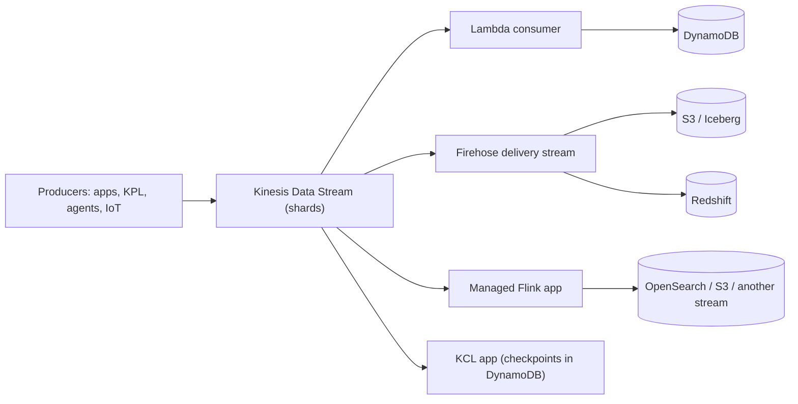
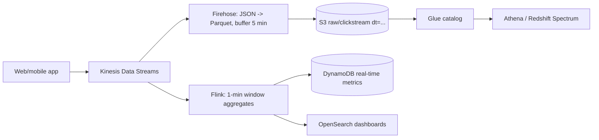
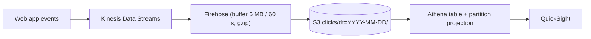
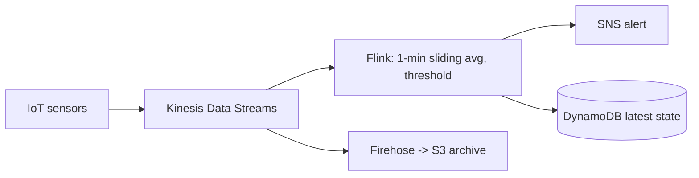
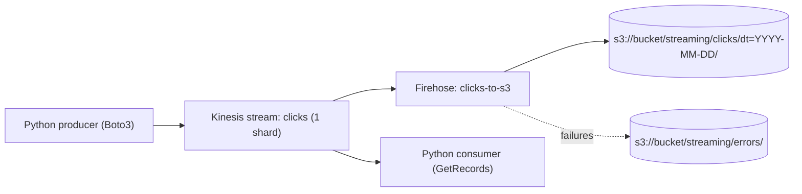

# Amazon Kinesis — Data Engineering Study Notes (0–2 YOE)

> Self-contained notes: fundamentals → implementation → interview preparation.
> Kinesis limits, capacity modes and service names have changed over time (e.g. "Kinesis Data Firehose" is now "Amazon Data Firehose" and "Kinesis Data Analytics" is now "Amazon Managed Service for Apache Flink"). Always confirm numbers on the quotas page linked at the end.

**Contents**
1. Introduction
2. Architecture and Working Mechanism
3. Core Concepts and Terminology
4. Data Engineering Use Cases
5. Hands-on Implementation (mini-project)
6. Interview Preparation (10 conceptual + 5 scenario + 3 troubleshooting, all answered)
7. Revision and Quick Reference

---

## 1. Introduction

### What is Amazon Kinesis?
**Amazon Kinesis** is AWS's family of services for collecting, processing and delivering **streaming data** (continuously generated events such as clicks, logs, IoT readings and transactions). The data-engineering members of the family are:

| Service | What it does |
|---|---|
| **Kinesis Data Streams (KDS)** | Durable, ordered, replayable stream you write to and read from with your own consumers |
| **Amazon Data Firehose** (formerly Kinesis Data Firehose) | Fully managed delivery of streaming data to S3, Redshift, OpenSearch, Iceberg tables, Splunk, HTTP endpoints, etc. — no consumer code |
| **Amazon Managed Service for Apache Flink** (formerly Kinesis Data Analytics) | Run Apache Flink applications for stateful stream processing (windows, joins, aggregations) |
| Kinesis Video Streams | Video ingestion (not covered here) |

### Why was it introduced and what problem does it solve?
Batch pipelines process data hours after it is created. Many use cases (fraud detection, monitoring, personalisation) need seconds-level latency. Running your own Kafka/Flume cluster is operationally heavy. Kinesis offers managed, scalable ingestion and delivery with durability across multiple Availability Zones.

### Why is it important in Data Engineering?
It is the AWS-native building block for **real-time ingestion**: applications write events once, and several consumers (Lambda, Flink, Firehose, KCL apps) can read them independently. Data engineers choose capacity mode, partition keys, consumers and delivery formats, and monitor lag and throttling.

### When should you use it?
- Real-time analytics or alerts (seconds latency).
- Continuous log/clickstream/IoT ingestion into S3, Redshift or OpenSearch.
- Multiple independent consumers need the same event stream, with replay for a retention window.
- Event-driven architectures with ordered events per key.

### When should you avoid it?
| Situation | Better option |
|---|---|
| Simple message queue between two components, one consumer per message, no replay | SQS |
| Fan-out notifications (email/SMS/Lambda) with no stream replay | SNS / EventBridge |
| Kafka ecosystem compatibility, long retention, many topics, Kafka Connect | Amazon MSK |
| Daily/hourly batch files | S3 + Glue; streaming is unnecessary complexity |
| Exactly-once semantic requirements without idempotent sinks | Design idempotency or use Flink with exactly-once sinks |

### Simple real-world example
A mobile app sends click events to a Kinesis data stream. Firehose reads the stream and writes compressed files to S3 every minute for analysts, while a Lambda function reads the same stream to update a real-time counter in DynamoDB.

### Brief comparison with alternatives
| | Kinesis Data Streams | Amazon MSK (Kafka) | SQS | SNS |
|---|---|---|---|---|
| Model | Ordered sharded log | Kafka topics/partitions | Queue | Pub/sub |
| Replay | Yes (retention up to 365 days) | Yes | No (deleted after processing) | No |
| Ops | Fully managed, simple | Managed Kafka, more concepts | Simplest | Simplest |
| Multiple consumers | Yes (shared or enhanced fan-out) | Yes (consumer groups) | One consumer per message (competing) | Fan-out push |
| Ordering | Per shard (partition key) | Per partition | FIFO queues only | FIFO topics only |

---

## 2. Architecture and Working Mechanism

### Overall architecture
A **data stream** is a set of **shards**. Producers write **records** (data blob + partition key); Kinesis hashes the partition key to pick a shard and appends the record there with an increasing **sequence number**. Consumers read records from shards in order. Data is replicated across three AZs and retained for the retention period (default 24 hours, extendable).

### Major components
- **Stream / shard / record** — the stream is the container; a shard is the unit of capacity and ordering; a record has data, partition key, sequence number.
- **Producers** — SDK (`PutRecord(s)`), **KPL** (Kinesis Producer Library, batching/aggregation/retries), Kinesis Agent, AWS services (CloudWatch Logs, DMS, IoT).
- **Consumers** — Lambda, KCL applications, Flink, Firehose, custom `GetRecords` clients.
- **Enhanced fan-out (EFO)** — dedicated throughput per consumer.
- **Capacity mode** — provisioned (you set shard count) or on-demand (automatic scaling).
- **Firehose delivery stream** — buffers and delivers to destinations with optional transformation.
- **DynamoDB lease table (KCL)** — stores checkpoints/leases for KCL consumers.

### End-to-end flow
1. A producer calls `PutRecords` with data and a **partition key** (e.g. `user_id`).
2. Kinesis applies an MD5 hash to the key; the hash maps to a shard's hash-key range.
3. The record is stored durably in that shard with a sequence number; all records with the same key go to the same shard, preserving order per key.
4. Consumers get a **shard iterator** (e.g. `LATEST`, `TRIM_HORIZON`) and call `GetRecords` (shared throughput), or subscribe with EFO (push over HTTP/2).
5. Consumers process records and **checkpoint** progress (KCL stores it in DynamoDB; Lambda tracks it internally).
6. Records expire after the retention period; consumers can replay from a timestamp or sequence number within it.

### Mermaid architecture


### Explanation of components
- **Shards** provide parallelism and ordering per partition key.
- **Lambda/KCL/Flink** are independent consumers reading the same data.
- **Firehose** is the zero-code route to storage and warehouses.
- **Destinations** store curated or aggregated outputs.

### Practical Data Engineering architecture


---

## 3. Core Concepts and Important Terminologies

### 3.1 Records, partition keys and sequence numbers
- **Record:** a data blob (opaque bytes; JSON/Avro/etc.), a **partition key** (string up to 256 chars) and a **sequence number** assigned by Kinesis. Each record's data size is limited (historically 1 MiB; check current quotas).
- **Partition key:** determines the shard via MD5 hash; records with the same key stay ordered within a shard.
- **Sequence number:** increasing per shard (not global).
- **Why it matters:** key choice controls ordering, balance and hot shards.
- **Mistakes:** Using a constant key (all data in one shard); using extremely skewed keys (one customer dominates); assuming ordering across shards.

### 3.2 Shards and capacity limits (provisioned mode)
- **Definition:** A shard is the base throughput unit. Per shard: writes up to **1 MiB/s or 1,000 records/s**; reads up to **2 MiB/s** (shared across all standard consumers) and up to 5 `GetRecords` calls per second.
- **How to size:** `shards = max(ceil(MB/s in), ceil(records/s ÷ 1000), ceil(MB/s out total ÷ 2))`.
- **Resharding:** split a shard (more capacity) or merge adjacent shards (less cost); `UpdateShardCount` automates uniform scaling.
- **Errors:** `ProvisionedThroughputExceededException` (read side) and `WriteProvisionedThroughputExceeded` metric/error (write side) mean a shard is saturated.

### 3.3 Capacity modes: provisioned vs on-demand
| | Provisioned | On-demand |
|---|---|---|
| You manage | Shard count and scaling | Nothing (stream scales to throughput) |
| Billing | Per shard-hour + PUT payload units | Per stream-hour + data in/out |
| Best for | Predictable throughput, lowest cost at steady load | Unpredictable/spiky traffic, simplicity |
| Caveat | Under-provision → throttling | Scaling is automatic but has limits relative to previous peaks; check docs |
Switching modes is possible with limits on frequency.

### 3.4 Retention and replay
Default retention is 24 hours; extend (up to 365 days) at extra cost. Within retention you can reread data by starting a new iterator at `TRIM_HORIZON` (oldest), `LATEST`, `AT_TIMESTAMP` or sequence numbers — enabling reprocessing after a bug fix. **Mistake:** assuming data is kept forever or that retention extension is free.

### 3.5 Producers
- **`PutRecord` / `PutRecords`:** SDK calls; `PutRecords` batches many records per request (check limits), and **partial failures** must be retried (`FailedRecordCount` > 0).
- **KPL:** library with aggregation (many user records packed into one Kinesis record), batching and retry logic — improves shard utilisation; consumers must de-aggregate (KCL does).
- **Kinesis Agent:** installs on servers to tail log files.
- **Mistakes:** sending one record per request (inefficient, throttles by requests); ignoring partial failures.
```python
import json, boto3
kinesis = boto3.client("kinesis", region_name="ap-south-1")

def send(events, stream="clicks"):
    entries = [{"Data": (json.dumps(e) + "\n").encode(),
                "PartitionKey": str(e["user_id"])} for e in events]
    resp = kinesis.put_records(StreamName=stream, Records=entries)
    failed = resp["FailedRecordCount"]
    if failed:
        # retry only the failed ones
        retry = [r for r, res in zip(entries, resp["Records"]) if "ErrorCode" in res]
        kinesis.put_records(StreamName=stream, Records=retry)
```

### 3.6 Consumers: shared throughput vs enhanced fan-out
- **Shared (standard):** consumers call `GetRecords`; all consumers on a shard split 2 MiB/s and 5 calls/s. Latency typically ~200 ms+ to a second.
- **Enhanced fan-out (EFO):** each registered consumer gets its own 2 MiB/s per shard pushed over HTTP/2 (`SubscribeToShard`), lower latency (~70 ms) at extra cost; there is a limit on registered consumers per stream (check quotas).
- **When to use EFO:** several consumers, latency sensitivity, or when consumers slow each other down.

### 3.7 Kinesis Client Library (KCL) and checkpointing
- **KCL** handles worker coordination, shard leases (stored in a **DynamoDB table**), load balancing, resharding and **checkpointing** (saving the last processed sequence number).
- **Delivery semantics:** at-least-once — after a crash, a worker resumes from the last checkpoint, reprocessing records after it, so processing must be **idempotent**.
- **Mistakes:** checkpointing before finishing processing (data loss) or too rarely (large reprocessing); not giving the app DynamoDB/CloudWatch permissions.

### 3.8 Lambda as a Kinesis consumer
An **event source mapping** polls shards and invokes your function with batches. Key settings: `BatchSize`, `MaximumBatchingWindowInSeconds`, `StartingPosition` (`LATEST`/`TRIM_HORIZON`), `ParallelizationFactor` (1–10 concurrent batches per shard, order maintained per key), `BisectBatchOnFunctionError`, `MaximumRetryAttempts`, `MaximumRecordAgeInSeconds`, **on-failure destination** (SQS/SNS), `ReportBatchItemFailures` (partial batch response). **Important:** a failing batch blocks that shard until it succeeds or expires (unless you limit retries and use a failure destination).
```python
def handler(event, context):
    failures = []
    for rec in event["Records"]:
        try:
            import base64, json
            payload = json.loads(base64.b64decode(rec["kinesis"]["data"]))
            process(payload)                       # your idempotent logic
        except Exception:
            failures.append({"itemIdentifier": rec["kinesis"]["sequenceNumber"]})
    return {"batchItemFailures": failures}          # needs ReportBatchItemFailures enabled
```

### 3.9 Amazon Data Firehose
- **Definition:** Managed service that **buffers and delivers** streaming data to destinations with no consumers to write.
- **Sources:** Direct PUT, Kinesis Data Streams, MSK, CloudWatch Logs/Events, IoT, etc.
- **Destinations:** S3, Redshift (via S3 COPY), OpenSearch, Splunk, HTTP endpoint, Snowflake, Apache Iceberg tables.
- **Buffering:** delivery occurs when the **buffer size** (MiB) or **buffer interval** (seconds) is reached first — larger buffers mean fewer/larger files, more latency. Check docs for allowed ranges.
- **Features:** Lambda **transformation**, **record format conversion** (JSON → Parquet/ORC using a Glue table schema), **dynamic partitioning** (partition S3 prefixes by record fields), compression, encryption, backup of failed records, custom S3 prefixes with timestamp expressions (e.g. `dt=!{timestamp:yyyy-MM-dd}/`) and an **error output prefix**.
- **Semantics:** at-least-once; latency is seconds–minutes depending on buffering.
- **Mistakes:** tiny buffers causing small files; missing error prefix when using expressions; not checking `DeliveryToS3.Success`.

### 3.10 Amazon Managed Service for Apache Flink (conceptual)
Runs Flink applications (Java/Scala/Python/SQL) for **stateful stream processing**: windows (tumbling/sliding/session), joins, aggregations, exactly-once processing with checkpoints/state. Typical pattern: read from Kinesis → compute 1-minute aggregates → write to S3/DynamoDB/OpenSearch/another stream. Choose it over Lambda when you need long windows, large state or complex event processing.

### 3.11 Monitoring and key metrics
| Metric | Meaning |
|---|---|
| `IncomingBytes`, `IncomingRecords` | Producer throughput |
| `WriteProvisionedThroughputExceeded` | Producer throttling |
| `ReadProvisionedThroughputExceeded` | Consumer throttling |
| `GetRecords.IteratorAgeMilliseconds` | How far consumers lag behind (key health metric) |
| Firehose `DeliveryToS3.Success`, `DataFreshness` | Delivery health/latency |
Enable **enhanced shard-level metrics** to find hot shards.

### 3.12 Security
IAM policies for producers/consumers (`kinesis:PutRecord(s)`, `GetRecords`, `GetShardIterator`, `DescribeStream`, `ListShards`, `SubscribeToShard`), server-side encryption with KMS, VPC endpoints (PrivateLink), CloudTrail for API auditing.

---

## 4. Data Engineering Use Cases

### Real-world use cases
- Clickstream analytics and personalisation.
- Application/infrastructure log ingestion and monitoring.
- IoT telemetry pipelines.
- Fraud/anomaly detection with windows.
- CDC/event streaming from DynamoDB (DynamoDB Streams → Kinesis) or databases.
- Feeding real-time dashboards (OpenSearch/QuickSight/DynamoDB).

### Batch-adjacent processing
Firehose is a streaming-to-batch bridge: continuous events become partitioned S3 files (e.g. every 5 minutes) that Glue/Athena process in batch. Replay from KDS can rebuild downstream stores.

### Real-time / streaming pipelines
Lambda for lightweight per-record/batch logic; Flink for stateful windows and joins; Firehose for no-code delivery; KCL apps for custom long-running consumers.

### Pipeline example 1 — Clickstream to data lake


### Pipeline example 2 — Real-time metrics and alerts


### Why a Data Engineer chooses Kinesis
Fully managed (no brokers), tight integration with Lambda/Firehose/Flink/S3/IAM, replay and ordering per key, simple scaling (on-demand). Choose MSK if you need Kafka APIs/ecosystem, SQS for simple work queues, EventBridge for event routing across SaaS/accounts.

---

## 5. Hands-on Implementation

### Mini-project: Real-time clickstream ingestion to S3 with Kinesis Data Streams and Firehose

**1. Objective:** Create a Kinesis stream, send click events with a Python producer, deliver them to S3 through Firehose (partitioned by date), and read from the stream with a simple consumer.

**2. Business problem:** The product team wants website click events available for analysis within minutes, without managing servers.

**3. Architecture**


**4. Prerequisites and setup**
- S3 bucket from the S3 notes; AWS CLI and Boto3; an admin-like identity for learning.
- `ACCOUNT`, `REGION`, `BUCKET` shell variables.
- **Costs (not free):** Kinesis Data Streams charges per shard-hour (~a few cents/hour for 1 provisioned shard) plus data; Firehose charges per GB ingested; S3 storage. Run the lab for ~30 minutes and delete everything.

**5–6. Implementation and code**

*Step 1 — Create the stream (1 provisioned shard for a low-cost lab)*
```bash
ACCOUNT=$(aws sts get-caller-identity --query Account --output text)
REGION=ap-south-1
BUCKET=retail-datalake-$ACCOUNT-$REGION
aws kinesis create-stream --stream-name clicks \
  --stream-mode-details StreamMode=PROVISIONED --shard-count 1 --region $REGION
aws kinesis wait stream-exists --stream-name clicks --region $REGION
STREAM_ARN=$(aws kinesis describe-stream-summary --stream-name clicks \
  --query StreamDescriptionSummary.StreamARN --output text)
```

*Step 2 — IAM role for Firehose (read the stream, write S3)*
```bash
cat > fh-trust.json <<'EOF'
{"Version":"2012-10-17","Statement":[{"Effect":"Allow",
 "Principal":{"Service":"firehose.amazonaws.com"},"Action":"sts:AssumeRole"}]}
EOF
cat > fh-perms.json <<EOF
{"Version":"2012-10-17","Statement":[
 {"Effect":"Allow","Action":["kinesis:DescribeStream","kinesis:GetShardIterator",
  "kinesis:GetRecords","kinesis:ListShards"],"Resource":"$STREAM_ARN"},
 {"Effect":"Allow","Action":["s3:AbortMultipartUpload","s3:GetBucketLocation","s3:GetObject",
  "s3:ListBucket","s3:ListBucketMultipartUploads","s3:PutObject"],
  "Resource":["arn:aws:s3:::$BUCKET","arn:aws:s3:::$BUCKET/*"]}]}
EOF
aws iam create-role --role-name FirehoseClicksRole --assume-role-policy-document file://fh-trust.json
aws iam put-role-policy --role-name FirehoseClicksRole --policy-name access --policy-document file://fh-perms.json
FH_ROLE=arn:aws:iam::$ACCOUNT:role/FirehoseClicksRole
```

*Step 3 — Create the Firehose delivery stream (Kinesis stream as source, S3 destination)*
```bash
sleep 10   # allow IAM propagation
aws firehose create-delivery-stream --delivery-stream-name clicks-to-s3 \
  --delivery-stream-type KinesisStreamAsSource \
  --kinesis-stream-source-configuration "KinesisStreamARN=$STREAM_ARN,RoleARN=$FH_ROLE" \
  --extended-s3-destination-configuration "{
    \"RoleARN\":\"$FH_ROLE\",
    \"BucketARN\":\"arn:aws:s3:::$BUCKET\",
    \"Prefix\":\"streaming/clicks/dt=!{timestamp:yyyy-MM-dd}/\",
    \"ErrorOutputPrefix\":\"streaming/errors/!{firehose:error-output-type}/dt=!{timestamp:yyyy-MM-dd}/\",
    \"BufferingHints\":{\"SizeInMBs\":5,\"IntervalInSeconds\":60},
    \"CompressionFormat\":\"GZIP\"}"
aws firehose describe-delivery-stream --delivery-stream-name clicks-to-s3 \
  --query 'DeliveryStreamDescription.DeliveryStreamStatus'
```
Wait for `ACTIVE`.

*Step 4 — Producer (`producer.py`)*
```python
import json, random, time, uuid
from datetime import datetime, timezone
import boto3

kinesis = boto3.client("kinesis", region_name="ap-south-1")
PAGES = ["/home", "/product/1", "/product/2", "/cart", "/checkout"]

def make_event():
    return {"event_id": str(uuid.uuid4()),
            "user_id": random.randint(1, 50),
            "page": random.choice(PAGES),
            "ts": datetime.now(timezone.utc).isoformat()}

sent = 0
for batch in range(20):                       # 20 batches x 25 records = 500 events
    events = [make_event() for _ in range(25)]
    entries = [{"Data": (json.dumps(e) + "\n").encode(),
                "PartitionKey": str(e["user_id"])} for e in events]
    resp = kinesis.put_records(StreamName="clicks", Records=entries)
    failed = resp["FailedRecordCount"]
    if failed:
        retry = [r for r, res in zip(entries, resp["Records"]) if "ErrorCode" in res]
        kinesis.put_records(StreamName="clicks", Records=retry)
    sent += len(entries)
    time.sleep(1)
print("sent", sent, "events")
```

*Step 5 — Simple consumer (`consumer.py`) using `GetRecords`*
```python
import json, time, boto3
kinesis = boto3.client("kinesis", region_name="ap-south-1")
shards = kinesis.list_shards(StreamName="clicks")["Shards"]
it = kinesis.get_shard_iterator(StreamName="clicks",
        ShardId=shards[0]["ShardId"], ShardIteratorType="TRIM_HORIZON")["ShardIterator"]
total = 0
for _ in range(10):
    out = kinesis.get_records(ShardIterator=it, Limit=200)
    it = out["NextShardIterator"]
    for r in out["Records"]:
        evt = json.loads(r["Data"])
        total += 1
    print("batch:", len(out["Records"]), "behind(ms):", out["MillisBehindLatest"])
    time.sleep(1)
print("read", total, "events")
```

**7. Explanation of the code**
- The producer batches 25 events per `PutRecords` call, uses `user_id` as the partition key (so each user's events stay ordered), appends `\n` so S3 files contain newline-delimited JSON, and retries failed records.
- The stream has one shard, enough for this small load (1 MiB/s or 1,000 records/s).
- Firehose reads from the stream, buffers up to 5 MiB or 60 seconds, compresses with gzip and writes to `streaming/clicks/dt=YYYY-MM-DD/`.
- The consumer reads from `TRIM_HORIZON` (oldest) and prints `MillisBehindLatest` to show lag.

**8. Expected output**
```
sent 500 events
batch: 200 behind(ms): 0
batch: 200 behind(ms): 0
batch: 100 behind(ms): 0
read 500 events
```
After 1–2 minutes S3 contains files like `streaming/clicks/dt=2026-11-18/clicks-to-s3-1-2026-11-18-10-05-33-....gz`.

**9. Validation and testing**
```bash
aws s3 ls s3://$BUCKET/streaming/clicks/ --recursive
aws s3 cp s3://$BUCKET/streaming/clicks/dt=$(date -u +%F)/ . --recursive --exclude "*" --include "*.gz"
zcat *.gz | wc -l                      # should equal 500 events in total
aws cloudwatch get-metric-statistics --namespace AWS/Firehose --metric-name DeliveryToS3.Success \
  --dimensions Name=DeliveryStreamName,Value=clicks-to-s3 --start-time $(date -u -d '15 min ago' +%FT%TZ) \
  --end-time $(date -u +%FT%TZ) --period 300 --statistics Average
```
(`date -d` is GNU/Linux syntax; adjust on macOS.) You can also create an Athena JSON table on `streaming/clicks/` to query the events.

**10. Common errors and troubleshooting**
| Error | Cause | Fix |
|---|---|---|
| `ResourceNotFoundException` | Wrong stream name/Region | Check `--region` and names |
| `ProvisionedThroughputExceededException` | Too many writes/reads per shard | Add shards/EFO, batch, back off |
| Firehose `ACTIVE` but no S3 files | Buffer interval not reached, no data, or role lacks permissions | Wait 60–120 s; check role; check errors prefix and CloudWatch logs |
| Firehose creation fails on role | IAM propagation delay / trust policy | Wait and retry; verify trust principal `firehose.amazonaws.com` |
| Files contain concatenated JSON without newlines | Producer omitted `\n` | Append newline delimiters |

**11. Cost considerations and cleanup**
Delete promptly — shard-hours accrue even when idle:
```bash
aws firehose delete-delivery-stream --delivery-stream-name clicks-to-s3
aws kinesis delete-stream --stream-name clicks --enforce-consumer-deletion
aws iam delete-role-policy --role-name FirehoseClicksRole --policy-name access
aws iam delete-role --role-name FirehoseClicksRole
aws s3 rm s3://$BUCKET/streaming/ --recursive
```

