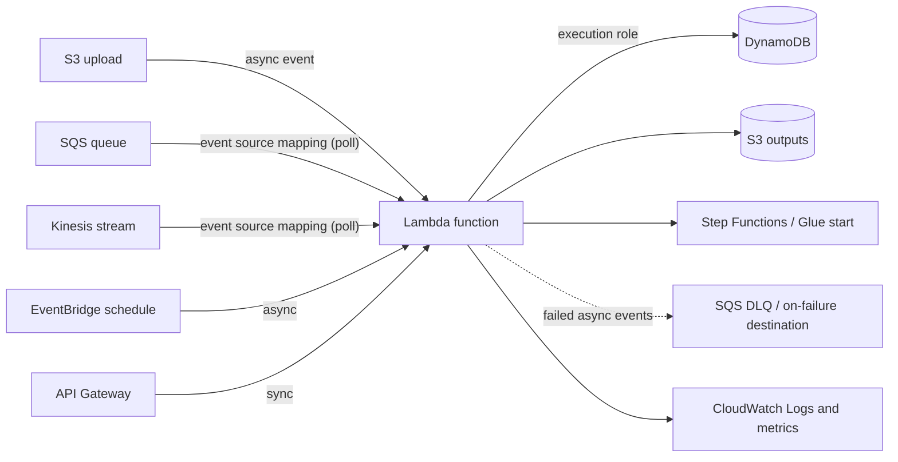
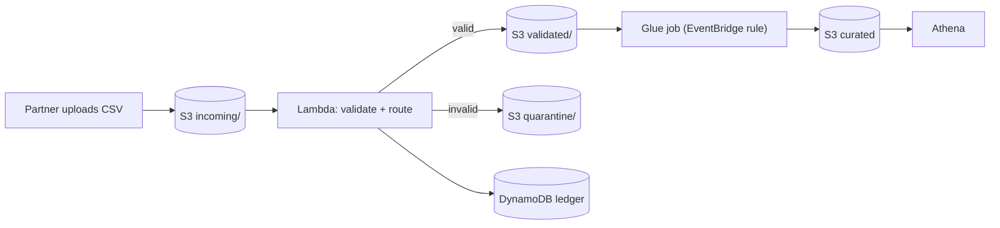
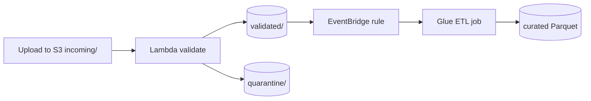
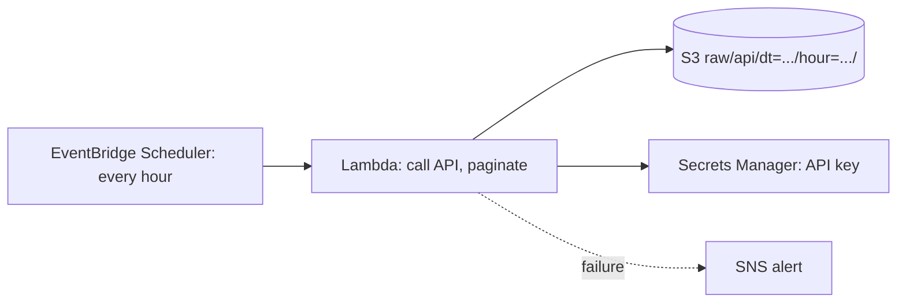
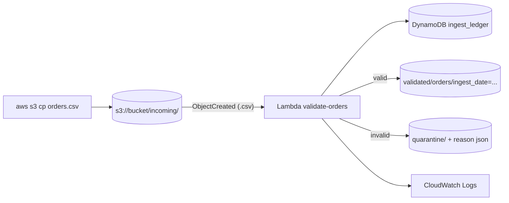

# AWS Lambda — Data Engineering Study Notes (0–2 YOE)

> Self-contained notes: fundamentals → implementation → interview preparation.
> Lambda limits, runtimes and pricing change regularly (for example, payload limits and runtime versions have been updated in recent years). Confirm numbers on the quotas and pricing pages linked at the end.

**Contents**
1. Introduction
2. Architecture and Working Mechanism
3. Core Concepts and Terminology
4. Data Engineering Use Cases
5. Hands-on Implementation (mini-project)
6. Interview Preparation (10 conceptual + 5 scenario + 3 troubleshooting, all answered)
7. Revision and Quick Reference

---

## 1. Introduction

### What is AWS Lambda?
**AWS Lambda** is a serverless compute service that runs your code (a **function**) in response to **events**, without you provisioning or managing servers. You upload code (or a container image), choose memory and timeout, and attach a trigger such as an S3 upload, an SQS message, a Kinesis record, an EventBridge schedule or an HTTP request through API Gateway. You pay for requests and execution time (billed in milliseconds, scaled by memory).

### Why was it introduced and what problem does it solve?
Before Lambda, even small tasks (resize an image, react to a file upload) required a running server or cron machine. Lambda removes idle capacity, patching and scaling work: it automatically runs as many copies of your function as there are events (within limits) and scales to zero when idle.

### Why is it important in Data Engineering?
Lambda is the **glue** of event-driven data pipelines: validating or routing files as they land in S3, transforming small records from queues/streams, starting Glue/EMR/Step Functions workflows, calling APIs for ingestion, and sending alerts. It is cheap, fast to build and integrates natively with S3, Kinesis, SQS, DynamoDB, EventBridge and Step Functions.

### When should you use it?
- Small to medium event-driven tasks that complete within 15 minutes.
- File validation/routing, lightweight transformations, enrichment via APIs.
- Triggering and orchestrating other services.
- Scheduled jobs (via EventBridge Scheduler) with short runtimes.
- Stream/queue consumers with modest per-record processing.

### When should you avoid it?
| Situation | Better option |
|---|---|
| Jobs running longer than 15 minutes | Glue, EMR, ECS/Fargate, Step Functions with chunking |
| Large-scale distributed transformations (GBs–TBs) | Glue/EMR (Spark) |
| Long-lived connections, stateful servers | ECS/EC2 |
| Predictable, constant heavy load with strict latency | Containers/EC2 may be cheaper |
| Heavy native/GPU workloads | Batch/ECS/SageMaker |

### Simple real-world example
A partner uploads `orders.csv` to S3. S3 triggers a Lambda that checks the header and row values; valid files are copied to `validated/` and invalid ones to `quarantine/`, with an entry saved in DynamoDB. No server runs when no files arrive.

### Brief comparison with alternatives
| | Lambda | Glue | ECS/Fargate | EC2 |
|---|---|---|---|---|
| Model | Event-driven functions | Serverless Spark ETL | Containers | Virtual servers |
| Max runtime | 15 min | Hours | Unlimited | Unlimited |
| Scale | Automatic per event | Per job | Service scaling | Manual/ASG |
| Best for | Small event tasks, glue logic | Big batch ETL | Long-running services/batch | Custom workloads |

---

## 2. Architecture and Working Mechanism

### Overall architecture
Lambda runs your code inside lightweight, isolated **execution environments** (Firecracker microVMs) managed by AWS. You define the function (code, runtime, handler, memory, timeout, role, environment variables, networking) and event sources. When an event arrives, Lambda finds or creates an execution environment and runs the handler; multiple events run in parallel in multiple environments up to the concurrency limit.

### Major components
- **Function** — code + configuration; versions and aliases for releases.
- **Runtime** — language environment (Python, Node.js, Java, .NET, Ruby, custom, or a container image).
- **Handler** — the entry point (e.g. `handler.lambda_handler`).
- **Event source / trigger** — what invokes the function.
- **Execution role** — IAM role Lambda assumes to call other AWS services.
- **Resource-based policy** — who may invoke the function (e.g. S3 service principal).
- **Layers** — shared libraries/dependencies.
- **Concurrency controls** — reserved and provisioned concurrency.
- **Destinations / DLQ** — handle failed asynchronous invocations.
- **CloudWatch Logs/Metrics/X-Ray** — observability.

### Invocation types
| Type | How | Examples | Retries |
|---|---|---|---|
| **Synchronous** | Caller waits for the response | API Gateway, SDK `RequestResponse` | Caller handles errors |
| **Asynchronous** | Lambda queues the event and returns immediately | S3, SNS, EventBridge | Lambda retries (default 2 retries) and can send failures to a DLQ/on-failure destination |
| **Poll-based (event source mapping)** | Lambda polls and invokes in batches | SQS, Kinesis, DynamoDB Streams, MSK | Retry behaviour depends on the source (stream shard blocks; SQS message returns after visibility timeout) |

### End-to-end flow (S3 upload example)
1. A file is uploaded to S3; S3 sends an event notification to Lambda (asynchronous invocation).
2. Lambda queues the event, finds a warm execution environment or creates one (**cold start**: download code, start runtime, run initialisation code outside the handler).
3. The handler runs with `event` and `context`, using the execution role to call S3/DynamoDB.
4. The result is returned; logs go to CloudWatch Logs; metrics (Invocations, Errors, Duration, Throttles, ConcurrentExecutions) are published.
5. The environment stays warm for a while and is reused for later invocations; otherwise it is frozen/terminated.
6. On errors Lambda retries (async) and, if retries are exhausted, delivers the event to a DLQ or on-failure destination.

### Mermaid architecture


### Explanation of components
- **Triggers** differ in how they call Lambda (async, poll, sync) which determines retry behaviour.
- **Execution role** gives least-privilege access to downstream services.
- **DLQ/destination** stores events that still fail after retries.
- **CloudWatch** provides logs/metrics for debugging.

### Practical Data Engineering architecture


---

## 3. Core Concepts and Important Terminologies

### 3.1 Functions, handlers and the programming model
- **Definition:** A function is your code plus configuration. In Python the handler receives `event` (JSON data from the trigger) and `context` (runtime info such as remaining time).
- **Best practice:** initialise SDK clients and read configuration **outside** the handler so warm invocations reuse them.
```python
import boto3, os
s3 = boto3.client("s3")                 # created once per execution environment
BUCKET = os.environ["BUCKET"]

def lambda_handler(event, context):
    print("remaining ms:", context.get_remaining_time_in_millis())
    return {"statusCode": 200, "body": "ok"}
```
- **Mistakes:** Creating clients inside the handler on every call; storing state in globals and assuming it persists (it may or may not).

### 3.2 Triggers and event sources
S3, SQS, SNS, Kinesis, DynamoDB Streams, MSK/Kafka, EventBridge (rules/scheduler), API Gateway/Function URLs, ALB, CloudWatch Logs subscriptions, Step Functions tasks and more. For each, understand the event shape (`event["Records"]` for S3/SQS/Kinesis) and the invocation type.

### 3.3 Execution role vs resource-based policy
- **Execution role:** what the function **can do** (call S3, DynamoDB, CloudWatch Logs) — trust policy for `lambda.amazonaws.com` + permission policies (e.g. `AWSLambdaBasicExecutionRole` for logs).
- **Resource-based (function) policy:** who **can invoke** the function (e.g. `s3.amazonaws.com` for a bucket, with `source-arn`/`source-account` conditions).
- **Mistakes:** adding an S3 trigger via CLI but forgetting `lambda add-permission`; granting `s3:*` on `*` to the role.

### 3.4 Memory, CPU, timeout and ephemeral storage
- **Memory:** 128 MB up to 10,240 MB; **CPU scales proportionally** with memory — more memory often means faster, sometimes cheaper, runs.
- **Timeout:** configurable up to 15 minutes (900 s).
- **Ephemeral storage (`/tmp`):** 512 MB default, configurable up to 10,240 MB; per execution environment, not persistent.
- **Billing:** requests + GB-seconds (memory × duration, per millisecond). Free tier includes monthly requests and GB-seconds (check pricing).
- **Mistake:** leaving the default 128 MB and 3-second timeout for data tasks; not using `context.get_remaining_time_in_millis()` for graceful exit.

### 3.5 Concurrency, scaling and throttling
- **Concurrency** = number of function instances processing events at the same time. Account-level default limit (typically 1,000 per Region, adjustable).
- **Reserved concurrency:** guarantees capacity for a function **and caps it** (protects downstream systems; also stops it from consuming the entire account pool).
- **Provisioned concurrency:** pre-warmed environments to avoid cold starts (costs extra).
- **Throttling:** when the limit is hit, sync callers get HTTP 429 (`TooManyRequestsException`); async events are retried for up to 6 hours; poll-based sources slow down.
- **SQS mapping:** configure `ScalingConfig.MaximumConcurrency` to cap concurrency from a queue.

### 3.6 Cold starts and warm starts
A **cold start** creates a new environment: download package, start runtime, run init code. It adds latency (tens of ms to seconds, depending on runtime, package size, VPC and init work). **Warm** invocations reuse an environment. Reduce cold starts by keeping packages small, lazy-loading heavy imports, using provisioned concurrency or SnapStart (supported runtimes) where latency matters. For batch/data pipelines cold starts rarely matter.

### 3.7 Asynchronous invocation, retries, DLQs and destinations
- Async invocations get **two retries by default** (configurable 0–2) with a maximum event age (default 6 hours, configurable down to 60 seconds). After that the event is discarded unless a **DLQ** (SQS/SNS) or **on-failure destination** (SQS, SNS, EventBridge, Lambda) is configured. **On-success destinations** can chain workflows.
```bash
aws lambda put-function-event-invoke-config --function-name validate-orders \
  --maximum-retry-attempts 1 --maximum-event-age-in-seconds 3600 \
  --destination-config '{"OnFailure":{"Destination":"arn:aws:sqs:ap-south-1:111122223333:validate-dlq"}}'
```
- **Mistake:** assuming failures are retried forever or that errors are visible without a DLQ/alarm.

### 3.8 Event source mappings: SQS and Kinesis
- **SQS:** Lambda polls the queue and sends batches; successful batches are deleted; on error messages reappear after the **visibility timeout** (set it to at least 6× the function timeout as AWS recommends) and may go to a queue DLQ after `maxReceiveCount`. Use **partial batch responses** (`ReportBatchItemFailures`) so only failed messages return.
- **Kinesis/DynamoDB Streams:** ordered per shard; a failing batch **blocks the shard** until success/expiry. Use `BisectBatchOnFunctionError`, `MaximumRetryAttempts`, `MaximumRecordAgeInSeconds`, an on-failure destination and `ParallelizationFactor`.
```python
def handler(event, context):
    failures = []
    for r in event["Records"]:              # SQS records
        try:
            process(r["body"])
        except Exception:
            failures.append({"itemIdentifier": r["messageId"]})
    return {"batchItemFailures": failures}
```

### 3.9 Idempotency
Events may be delivered more than once (S3 notifications, async retries, SQS standard queues, stream retries). Make handlers **idempotent**: use natural keys, conditional writes (`attribute_not_exists`) to a DynamoDB ledger, upserts, or the **Powertools for AWS Lambda** idempotency utility.
```python
try:
    ddb.put_item(TableName="ledger",
                 Item={"file_id": {"S": file_id}},
                 ConditionExpression="attribute_not_exists(file_id)")
except ddb.exceptions.ConditionalCheckFailedException:
    return  # already processed
```

### 3.10 Environment variables, secrets and configuration
Environment variables (up to 4 KB total) configure behaviour; encrypt sensitive values with KMS or, better, fetch secrets from **Secrets Manager/Parameter Store** at init time and cache them. **Mistake:** hard-coding credentials or bucket names in code.

### 3.11 Layers, packaging and container images
- **Zip deployment** (up to 50 MB zipped via direct upload; 250 MB unzipped including layers) — dependencies must match the runtime architecture (x86_64 vs arm64) and OS (Amazon Linux).
- **Layers** share libraries (e.g. the **AWS SDK for pandas** managed layer provides pandas/pyarrow).
- **Container images** up to 10 GB for large dependencies.
- **Mistake:** building native wheels on macOS/Windows and getting `ImportModuleError` in Lambda.

### 3.12 Versions, aliases and deployment
Publish immutable **versions**; use **aliases** (`prod`, `dev`) to route traffic and enable weighted canary releases. Use IaC (SAM/CloudFormation/Terraform/CDK) for repeatable deployment.

### 3.13 VPC access
Place a function in a VPC (subnets + security groups) to reach private resources (RDS). Then it needs a route to AWS services (NAT gateway or VPC endpoints for S3/DynamoDB/etc.). **Mistake:** function in a private subnet without NAT/endpoint times out calling S3.

### 3.14 Observability
CloudWatch Logs (`print`/`logging`), metrics (`Invocations`, `Errors`, `Duration`, `Throttles`, `ConcurrentExecutions`, `IteratorAge` for streams), X-Ray tracing, Lambda Insights. Use structured JSON logs with correlation IDs. Alarm on `Errors`, `Throttles` and DLQ depth.

### 3.15 Lambda in orchestration
Step Functions invokes Lambda tasks (and handles retries/branching); EventBridge Scheduler triggers scheduled runs; Lambda can start Glue jobs (`glue.start_job_run`), EMR steps, or Athena queries — typical orchestration glue.

---

## 4. Data Engineering Use Cases

### Real-world use cases
- File arrival processing: validate, rename, partition-route, catalog update.
- API ingestion on a schedule (pull data from SaaS APIs to S3).
- Lightweight stream/queue transformations and enrichment.
- Triggering Glue/EMR/Step Functions pipelines.
- Data quality checks and notifications.
- Metadata/ledger maintenance (DynamoDB, Glue Catalog partitions).

### Batch processing
EventBridge schedules Lambda to call a REST API each hour and store JSON in S3; Lambda starts a Glue job after files arrive; Lambda adds new partitions to the Glue Catalog (`glue.batch_create_partition`).

### Real-time / streaming
Kinesis → Lambda for per-record transforms and writes to DynamoDB/OpenSearch; SQS → Lambda for buffered, rate-controlled processing; DynamoDB Streams → Lambda for change propagation.

### Pipeline example 1 — File-triggered ingestion


### Pipeline example 2 — API ingestion on a schedule


### Why a Data Engineer chooses Lambda
Minimal ops, automatic scaling, pay-per-use, easy event integration, and fast iteration. Choose it for small, short tasks and orchestration glue; use Glue/EMR for big distributed processing, and Fargate for longer-running containers.

---

## 5. Hands-on Implementation

### Mini-project: Event-driven CSV validation and routing with an idempotency ledger

**1. Objective:** Build an S3-triggered Lambda that validates incoming CSV files, routes them to `validated/` or `quarantine/`, and records each file in DynamoDB to avoid duplicate processing.

**2. Business problem:** Partners upload order files at unpredictable times. Bad files must not reach the lake; duplicate S3 events must not cause duplicate work.

**3. Architecture**


**4. Prerequisites and setup**
- The S3 bucket from the S3 notes; AWS CLI; Python 3.
- Variables: `ACCOUNT`, `REGION`, `BUCKET`.
- **Costs:** Lambda free tier covers this lab; DynamoDB on-demand costs pennies; S3 negligible. Notification setup below **replaces** any existing bucket notification configuration — use a test bucket if unsure.

**5–6. Implementation and code**

*Step 1 — DynamoDB ledger table*
```bash
ACCOUNT=$(aws sts get-caller-identity --query Account --output text)
REGION=ap-south-1
BUCKET=retail-datalake-$ACCOUNT-$REGION
aws dynamodb create-table --table-name ingest_ledger \
  --attribute-definitions AttributeName=file_id,AttributeType=S \
  --key-schema AttributeName=file_id,KeyType=HASH \
  --billing-mode PAY_PER_REQUEST --region $REGION
```

*Step 2 — Execution role*
```bash
cat > lambda-trust.json <<'EOF'
{"Version":"2012-10-17","Statement":[{"Effect":"Allow",
 "Principal":{"Service":"lambda.amazonaws.com"},"Action":"sts:AssumeRole"}]}
EOF
cat > lambda-perms.json <<EOF
{"Version":"2012-10-17","Statement":[
 {"Effect":"Allow","Action":["s3:GetObject"],"Resource":"arn:aws:s3:::$BUCKET/incoming/*"},
 {"Effect":"Allow","Action":["s3:PutObject"],
  "Resource":["arn:aws:s3:::$BUCKET/validated/*","arn:aws:s3:::$BUCKET/quarantine/*"]},
 {"Effect":"Allow","Action":["dynamodb:PutItem","dynamodb:UpdateItem","dynamodb:DeleteItem"],
  "Resource":"arn:aws:dynamodb:$REGION:$ACCOUNT:table/ingest_ledger"}]}
EOF
aws iam create-role --role-name ValidateOrdersRole --assume-role-policy-document file://lambda-trust.json
aws iam attach-role-policy --role-name ValidateOrdersRole \
  --policy-arn arn:aws:iam::aws:policy/service-role/AWSLambdaBasicExecutionRole
aws iam put-role-policy --role-name ValidateOrdersRole --policy-name data-access --policy-document file://lambda-perms.json
```

*Step 3 — Function code `handler.py`*
```python
import csv, io, json, os, urllib.parse
from datetime import datetime, timezone
import boto3
from botocore.exceptions import ClientError

s3 = boto3.client("s3")
ddb = boto3.client("dynamodb")
TABLE = os.environ["LEDGER_TABLE"]
REQUIRED = ["order_id", "customer_id", "amount", "order_date"]

def validate(text):
    """Return (ok, reason, row_count)."""
    reader = csv.DictReader(io.StringIO(text))
    if reader.fieldnames is None or any(c not in reader.fieldnames for c in REQUIRED):
        return False, f"missing columns; expected {REQUIRED}", 0
    n = 0
    for i, row in enumerate(reader, start=2):
        n += 1
        try:
            if not row["order_id"]:
                raise ValueError("empty order_id")
            if float(row["amount"]) <= 0:
                raise ValueError("amount must be > 0")
            datetime.strptime(row["order_date"], "%Y-%m-%d")
        except Exception as e:
            return False, f"line {i}: {e}", n
    if n == 0:
        return False, "no data rows", 0
    return True, "ok", n

def process_record(rec):
    bucket = rec["s3"]["bucket"]["name"]
    key = urllib.parse.unquote_plus(rec["s3"]["object"]["key"])
    version = rec["s3"]["object"].get("versionId") or rec["s3"]["object"].get("eTag", "")
    file_id = f"{bucket}/{key}#{version}"

    # Idempotency: claim the file; skip if already claimed
    try:
        ddb.put_item(TableName=TABLE,
                     Item={"file_id": {"S": file_id}, "status": {"S": "PROCESSING"}},
                     ConditionExpression="attribute_not_exists(file_id)")
    except ClientError as e:
        if e.response["Error"]["Code"] == "ConditionalCheckFailedException":
            print(json.dumps({"msg": "duplicate event skipped", "file_id": file_id}))
            return
        raise

    try:
        body = s3.get_object(Bucket=bucket, Key=key)["Body"].read().decode("utf-8")
        ok, reason, rows = validate(body)
        name = key.split("/")[-1]
        today = datetime.now(timezone.utc).strftime("%Y-%m-%d")
        if ok:
            dest = f"validated/orders/ingest_date={today}/{name}"
            s3.put_object(Bucket=bucket, Key=dest, Body=body.encode())
        else:
            dest = f"quarantine/{today}/{name}"
            s3.put_object(Bucket=bucket, Key=dest, Body=body.encode())
            s3.put_object(Bucket=bucket, Key=dest + ".reason.json",
                          Body=json.dumps({"file": key, "reason": reason}).encode())
        ddb.update_item(TableName=TABLE, Key={"file_id": {"S": file_id}},
                        UpdateExpression="SET #s = :s, dest = :d, #r = :r",
                        ExpressionAttributeNames={"#s": "status", "#r": "rows"},
                        ExpressionAttributeValues={":s": {"S": "VALID" if ok else "INVALID"},
                                                   ":d": {"S": dest}, ":r": {"N": str(rows)}})
        print(json.dumps({"file_id": file_id, "valid": ok, "reason": reason, "dest": dest}))
    except Exception:
        # release the claim so a retry can process the file again
        ddb.delete_item(TableName=TABLE, Key={"file_id": {"S": file_id}})
        raise

def lambda_handler(event, context):
    for rec in event["Records"]:
        process_record(rec)
```

*Step 4 — Deploy*
```bash
zip function.zip handler.py
sleep 10   # IAM propagation
aws lambda create-function --function-name validate-orders --runtime python3.12 \
  --role arn:aws:iam::$ACCOUNT:role/ValidateOrdersRole --handler handler.lambda_handler \
  --zip-file fileb://function.zip --timeout 60 --memory-size 256 \
  --environment "Variables={LEDGER_TABLE=ingest_ledger}" --region $REGION
```
(Pick a currently supported Python runtime; `python3.12` is an example.)

*Step 5 — Allow S3 to invoke the function and add the trigger*
```bash
aws lambda add-permission --function-name validate-orders --statement-id s3invoke \
  --action lambda:InvokeFunction --principal s3.amazonaws.com \
  --source-arn arn:aws:s3:::$BUCKET --source-account $ACCOUNT

FN_ARN=$(aws lambda get-function --function-name validate-orders --query Configuration.FunctionArn --output text)
aws s3api put-bucket-notification-configuration --bucket $BUCKET --notification-configuration "{
  \"LambdaFunctionConfigurations\": [{
    \"LambdaFunctionArn\": \"$FN_ARN\",
    \"Events\": [\"s3:ObjectCreated:*\"],
    \"Filter\": {\"Key\": {\"FilterRules\": [
      {\"Name\":\"prefix\",\"Value\":\"incoming/\"},{\"Name\":\"suffix\",\"Value\":\".csv\"}]}}}]}"
```

*Step 6 — Test with a good and a bad file*
```bash
printf 'order_id,customer_id,amount,order_date\nA1,1,10.5,2026-11-18\nA2,2,20.0,2026-11-18\n' > good.csv
printf 'order_id,customer_id,amount,order_date\nB1,1,-5,2026-11-18\n' > bad.csv
aws s3 cp good.csv s3://$BUCKET/incoming/good.csv
aws s3 cp bad.csv  s3://$BUCKET/incoming/bad.csv
sleep 15
aws logs tail /aws/lambda/validate-orders --since 5m
```

**7. Explanation of the code**
- Clients are created outside the handler (reused when warm).
- The function **claims** each file by a conditional `PutItem`; duplicate S3 notifications hit the condition and are skipped (idempotency). If processing fails, the claim is deleted so Lambda's retry can reprocess.
- `validate` checks columns, numeric amount, date format and empties.
- Valid files go to `validated/orders/ingest_date=.../`; invalid ones to `quarantine/` with a reason file. Output prefixes differ from the trigger prefix `incoming/`, preventing infinite loops.

**8. Expected output**
CloudWatch logs:
```
{"file_id": "<bucket>/incoming/good.csv#<etag>", "valid": true, "reason": "ok", "dest": "validated/orders/ingest_date=2026-11-18/good.csv"}
{"file_id": "<bucket>/incoming/bad.csv#<etag>", "valid": false, "reason": "line 2: amount must be > 0", "dest": "quarantine/2026-11-18/bad.csv"}
```

**9. Validation and testing**
```bash
aws s3 ls s3://$BUCKET/validated/ --recursive
aws s3 ls s3://$BUCKET/quarantine/ --recursive
aws dynamodb scan --table-name ingest_ledger --region $REGION
aws lambda invoke --function-name validate-orders --payload '{"Records":[]}' --cli-binary-format raw-in-base64-out out.json
```
Re-upload the same file name and content: since the ETag matches the existing ledger entry, you should see "duplicate event skipped". (If you overwrite with different content a new ETag creates a new ledger entry.)

**10. Common errors and troubleshooting**
| Error | Cause | Fix |
|---|---|---|
| Nothing happens after upload | Missing `add-permission`, wrong prefix/suffix, notification not saved | Check Lambda trigger/policy and `get-bucket-notification-configuration` |
| `AccessDenied` in logs | Execution role missing S3/DynamoDB permission | Update role policy |
| `Task timed out after 60.00 seconds` | Large file/slow call | Increase timeout/memory or stream/chunk |
| `Unable to import module 'handler'` | Handler name/zip layout wrong | Ensure `handler.py` at zip root and handler `handler.lambda_handler` |
| `ConditionalCheckFailedException` printed as error | Not handled | Catch as in code |

**11. Cost considerations and cleanup**
Within free tier for this lab; DynamoDB on-demand costs are tiny. Remove:
```bash
aws s3api put-bucket-notification-configuration --bucket $BUCKET --notification-configuration '{}'
aws lambda delete-function --function-name validate-orders
aws dynamodb delete-table --table-name ingest_ledger
aws iam delete-role-policy --role-name ValidateOrdersRole --policy-name data-access
aws iam detach-role-policy --role-name ValidateOrdersRole --policy-arn arn:aws:iam::aws:policy/service-role/AWSLambdaBasicExecutionRole
aws iam delete-role --role-name ValidateOrdersRole
aws logs delete-log-group --log-group-name /aws/lambda/validate-orders
aws s3 rm s3://$BUCKET/incoming/ --recursive; aws s3 rm s3://$BUCKET/validated/ --recursive; aws s3 rm s3://$BUCKET/quarantine/ --recursive
```

---

## 6. Interview Preparation — Questions WITH Answers

### A. Conceptual Questions (10)

**Q1. What is AWS Lambda and how does its billing/scaling model work?**
Lambda runs your function code in response to events with no servers to manage. It scales automatically by creating more execution environments as events arrive (up to account/function concurrency limits) and scales to zero when idle. Billing is per request plus duration (milliseconds × configured memory, i.e. GB-seconds), with a monthly free tier. More memory also gives proportionally more CPU. *Keywords: serverless, event-driven, execution environment, concurrency, GB-seconds, 15-minute max.* It suits short, event-driven data tasks; heavy long-running ETL belongs in Glue/EMR.

**Q2. Explain the Lambda execution environment lifecycle and cold starts.**
When there's no warm environment, Lambda performs **init**: downloads code, starts the runtime and runs code outside the handler (cold start). Then it runs the handler (**invoke**). The environment is reused for later invocations (warm) until it is frozen/recycled. Cold-start time depends on runtime, package size, VPC networking and initialisation work. Mitigation: keep packages small, lazy-load heavy libraries, reuse clients created outside the handler, use provisioned concurrency or SnapStart where latency-critical. In batch pipelines, cold starts are usually insignificant.

**Q3. What are the three invocation models (sync, async, poll-based) and how do retries differ?**
Sync: the caller waits (API Gateway, SDK) and handles errors itself. Async: Lambda queues the event and returns 202 (S3, SNS, EventBridge); Lambda retries failures (default two retries, configurable) and can send failed events to a DLQ or on-failure destination after retries or max event age. Poll-based event source mappings (SQS, Kinesis, DynamoDB Streams, MSK): Lambda polls and invokes with batches; for SQS failed messages become visible again after the visibility timeout; for streams a failing batch blocks that shard until success or record expiry unless you configure bisect/retries/destinations.

**Q4. What are Lambda's key limits and configuration knobs?**
Memory 128 MB–10,240 MB (CPU scales with memory); timeout up to 900 s; ephemeral `/tmp` 512 MB–10,240 MB; synchronous payload up to 6 MB request/response; asynchronous event payload limited (historically 256 KB — AWS has increased it in 2025, check the current quota); deployment package 50 MB zipped (direct upload)/250 MB unzipped, container images up to 10 GB; environment variables up to 4 KB; default account concurrency 1,000 per Region (soft limit). Know these exist, but quote current values from the quotas page in an interview.

**Q5. Explain reserved concurrency vs provisioned concurrency.**
**Reserved concurrency** sets aside a portion of the account's concurrency pool for a function *and* acts as its maximum — useful to guarantee capacity or to protect a downstream database from too many parallel invocations. **Provisioned concurrency** keeps a number of execution environments initialised and ready so invocations avoid cold starts (extra cost). A function can use both: reserved defines the cap; provisioned pre-warms part of it. When all concurrency is used, new invocations are throttled (429 for sync, retried for async).

**Q6. How does Lambda process SQS messages and what is a partial batch response?**
Lambda polls the queue with multiple pollers and sends batches (up to the configured batch size, with an optional batching window). If the function returns success the whole batch is deleted; if it throws, **all messages** in the batch become visible again after the visibility timeout, causing reprocessing of already successful items. With `ReportBatchItemFailures` the function returns `batchItemFailures` listing only failed message IDs, so successes are deleted and only failures retry. Also set visibility timeout ≥ function timeout (AWS recommends 6×), configure a DLQ on the queue and a max concurrency to protect downstream systems.

**Q7. What permissions are involved in S3 → Lambda?**
Two sides: the **resource-based policy on the function** allowing `s3.amazonaws.com` to invoke it (with `SourceArn` of the bucket and `SourceAccount` to prevent confused deputy), and the **execution role** that lets the function read/write S3, DynamoDB, etc., plus CloudWatch Logs. The bucket's notification configuration points to the function ARN with event types and prefix/suffix filters. Missing the resource policy is the commonest reason a trigger silently doesn't fire when configured via CLI/IaC (the console adds it automatically).

**Q8. How do you handle dependencies: layers, packages and container images?**
Small pure-Python dependencies can be zipped with the code; shared or large libraries can go into **layers** (up to five per function, counted in the 250 MB unzipped limit); AWS provides managed layers such as the AWS SDK for pandas (pandas/pyarrow). Compiled dependencies must be built for Amazon Linux and the correct architecture (x86_64 or arm64). For very large dependencies (ML libraries) use **container images** (up to 10 GB). Common failure: building wheels on a laptop OS and seeing import errors in Lambda.

**Q9. What is idempotency and how do you implement it in Lambda?**
Idempotent processing means handling the same event more than once yields the same result. Needed because S3 notifications, async retries, SQS standard queues and stream retries can deliver duplicates. Implementations: use a stable key (bucket+key+version/ETag, message ID) with a conditional DynamoDB write (`attribute_not_exists`) as a ledger/lock; make downstream writes upserts or overwrite deterministic paths; use the Powertools for AWS Lambda idempotency utility. Also handle partial failures by releasing/expiring the claim so retries can proceed.

**Q10. What are Lambda best practices for data engineering workloads?**
Initialise clients outside the handler; keep functions single-purpose and small; set appropriate memory/timeout (use power tuning to find the cost/performance sweet spot); least-privilege roles; environment variables/Secrets Manager for config; structured logging and alarms (`Errors`, `Throttles`, DLQ depth, `IteratorAge`); make handlers idempotent; use DLQs/destinations; limit concurrency to protect downstream systems; avoid long synchronous waits (use Step Functions); don't process huge files in memory — stream or delegate to Glue/EMR; deploy via IaC with versions/aliases.

### B. Scenario-Based Questions (5)

**S1. A Lambda must process a 20 GB CSV landing in S3 but times out at 15 minutes.**
*Problem:* size/time exceed Lambda's limits. *Solution:* hand off to a service built for large data: S3 event → Lambda starts a **Glue job** (or EMR Serverless) which processes the file in Spark; alternatively split the file into chunks (S3 byte-range reads + Step Functions Distributed Map) to process in parallel Lambdas. Lambda remains the lightweight trigger/validator. *Why:* right tool for volume. *Alternatives:* ECS/Fargate task for sequential processing. *Trade-off:* Glue has startup time and cost per run; chunking adds orchestration complexity.

**S2. Each S3 upload sometimes triggers the function twice, creating duplicate output rows.**
*Problem:* at-least-once event delivery. *Solution:* make the function idempotent: derive a key from `bucket/key/versionId` or ETag and perform a conditional put in DynamoDB before processing; write outputs to deterministic paths/overwrite; use upserts downstream. Add alarms on duplicates skipped. *Why:* duplicates cannot be eliminated at the source. *Alternatives:* route events through SQS FIFO with deduplication IDs, or use EventBridge with idempotent consumers. *Trade-off:* extra DynamoDB call per event and need for TTL cleanup.

**S3. An SQS-triggered Lambda scales out and overwhelms your RDS database with connections.**
*Solution:* limit concurrency: set **maximum concurrency** on the SQS event source mapping and/or **reserved concurrency** on the function; use **RDS Proxy** for connection pooling; reduce batch frequency; make queries efficient. *Why:* Lambda scales faster than databases. *Alternatives:* move writes to a data store designed for high concurrency (DynamoDB), batch writes. *Trade-off:* lower concurrency raises queue latency; SQS holds the backlog.

**S4. A Kinesis-triggered Lambda stops advancing; `IteratorAge` rises.**
*Problem:* a poison record repeatedly fails and blocks the shard. *Solution:* enable `BisectBatchOnFunctionError`, set `MaximumRetryAttempts` and `MaximumRecordAgeInSeconds`, configure an on-failure destination (SQS/SNS) for failed batches, return partial batch failures, validate input and handle exceptions per record, and alarm on `IteratorAge`. *Why:* isolates the bad record so the rest of the shard flows. *Alternatives:* skip bad records to a DLQ in code. *Trade-off:* you must reprocess records from the DLQ and accept possible out-of-order handling.

**S5. Costs for a data-validation Lambda are higher than expected and runtime is long.**
*Solution:* tune memory — more memory gives more CPU and can reduce duration enough to lower cost (use AWS Lambda Power Tuning or test several sizes); consider arm64 (Graviton) where supported; reduce package/init time; avoid unnecessary reads (use S3 ranges/streaming); batch operations; filter events upstream (S3 prefix/suffix, SQS batching). *Why:* cost = memory × duration. *Alternatives:* move steady heavy loads to Fargate/Glue. *Trade-off:* tuning effort and risk of under-sizing causing timeouts.

### C. Troubleshooting Questions (3)

**T1. Logs show `Task timed out after X seconds` or `Runtime exited with error: signal: killed` (out of memory).**
*Root causes:* work exceeds the timeout; downstream API/database slow; large file loaded entirely into memory; VPC networking without NAT/endpoint (hanging connections); insufficient memory (max memory used equals configured). *Debug approach:* CloudWatch `Duration` vs timeout; the `REPORT` log line shows `Max Memory Used`; add timing logs around calls; check VPC route/NAT; test with smaller input. *Fix:* increase timeout/memory; stream data in chunks; add connection/read timeouts with retries; fix networking (VPC endpoints for S3/DynamoDB or NAT); offload to Glue/Step Functions when the job can't fit.

**T2. `Unable to import module` / `ImportModuleError` or "No module named pandas/numpy".**
*Root causes:* dependency not packaged; zip structure wrong (handler not at root; layer packages must be under `python/`); wheels built for a different OS/architecture; mismatch between function runtime/architecture and layer; package exceeds size limits. *Debug:* test locally with the same Python version; inspect the zip (`unzip -l`); verify the layer's compatible runtime/architecture. *Fix:* build dependencies in Amazon Linux or with `pip install --platform manylinux2014_x86_64 --only-binary=:all: -t python/`; use the AWS SDK for pandas managed layer or a container image; ensure the handler path is `file.function`.

**T3. The trigger exists but the function isn't invoked (S3/EventBridge) or is throttled.**
*Root causes:* missing `lambda:InvokeFunction` permission for the source; wrong event type or prefix/suffix filter; notification configured in a different Region/bucket; concurrency limit reached (429 `Throttles`); function disabled or reserved concurrency set to 0; event source mapping disabled/failing; destination/DLQ misconfigured. *Debug:* `aws lambda get-policy`; `aws s3api get-bucket-notification-configuration`; EventBridge rule metrics and target configuration; CloudWatch `Invocations`, `Throttles`, `ConcurrentExecutions`; event source mapping state (`aws lambda list-event-source-mappings`). *Fix:* add the missing resource policy (`add-permission`), correct filters, raise reserved/account concurrency, enable the mapping, test by invoking manually with a sample event (`aws lambda invoke`).

---

## 7. Revision and Quick Reference

### Key takeaways
- Lambda = event-driven, serverless functions; scale automatically; pay per request and GB-second.
- Know invocation types and their retry behaviour.
- Idempotency, DLQs/destinations and concurrency control are essential for data pipelines.
- Use Lambda for small/fast tasks and orchestration glue; Glue/EMR for heavy ETL.

### Commonly forgotten details
- Max timeout 15 minutes; CPU scales with memory.
- Create clients outside the handler; `/tmp` isn't persistent across environments.
- S3 trigger needs a function resource policy (`add-permission`) — the CLI doesn't add it automatically.
- Writing back to the triggering prefix causes infinite loops.
- Async retries default to 2; failures disappear without DLQ/destination.
- SQS: visibility timeout should exceed the function timeout; use partial batch responses.
- Stream failures block the shard.
- VPC functions need NAT or VPC endpoints.
- Layers/zips count toward the 250 MB unzipped limit.

### Important commands and syntax
```bash
aws lambda create-function --function-name f --runtime python3.12 --role <arn> --handler app.handler --zip-file fileb://f.zip
aws lambda update-function-code --function-name f --zip-file fileb://f.zip
aws lambda update-function-configuration --function-name f --timeout 120 --memory-size 512 --environment "Variables={K=V}"
aws lambda invoke --function-name f --payload '{"a":1}' --cli-binary-format raw-in-base64-out out.json
aws lambda add-permission --function-name f --statement-id s3 --action lambda:InvokeFunction --principal s3.amazonaws.com --source-arn <bucket-arn>
aws lambda put-function-concurrency --function-name f --reserved-concurrent-executions 10
aws lambda create-event-source-mapping --function-name f --event-source-arn <queue-arn> --batch-size 10
aws logs tail /aws/lambda/f --follow
```
```python
def lambda_handler(event, context):
    # event["Records"] for S3/SQS/Kinesis; context.get_remaining_time_in_millis()
    return {"statusCode": 200}
```

### Frequently used configurations
Memory/timeout, environment variables, execution role, reserved/provisioned concurrency, event source mapping (`BatchSize`, `MaximumBatchingWindowInSeconds`, `ReportBatchItemFailures`, `ScalingConfig`), async config (`MaximumRetryAttempts`, `MaximumEventAgeInSeconds`, destinations), DLQ, VPC settings, architecture (x86_64/arm64), layers, aliases/versions.

### Common errors and solutions
| Error | Solution |
|---|---|
| `Task timed out` | Increase timeout/memory, optimise, offload |
| `AccessDeniedException` | Fix execution role/resource policy |
| `TooManyRequestsException` (429) | Increase concurrency limits, add queue buffering |
| `ImportModuleError` | Package dependencies correctly/layers/container |
| `Runtime exited ... killed` | Increase memory or stream data |
| Trigger not firing | `add-permission`, filters, same Region |
| Duplicate processing | Idempotency ledger |

### Service limitations
15-minute max duration; payload limits; limited ephemeral storage; no persistent local state; cold starts; concurrency limits per Region; package size limits; not ideal for heavy distributed compute or long-running connections; check the current quotas page.

### Performance and cost optimisation
Right-size memory (power tuning); arm64 where supported; reuse connections; batch event sources; filter events at source; reduce package size; provisioned concurrency only where required; avoid polling inside functions; use VPC endpoints instead of NAT for S3/DynamoDB to cut data processing charges.

### Security best practices
Least-privilege execution roles per function; resource policies with `SourceArn/SourceAccount`; secrets in Secrets Manager/Parameter Store (not plaintext env vars); encrypt env vars with KMS; VPC only when needed; code signing and image scanning; restrict function URLs/auth; log without sensitive data.

### Connections with other AWS services
S3, SQS, SNS, Kinesis, DynamoDB (+Streams), EventBridge/Scheduler, API Gateway, Step Functions, Glue/EMR/Athena (start jobs/queries), Secrets Manager/Parameter Store, KMS, CloudWatch/X-Ray, VPC/RDS Proxy.

### Quick revision cheat sheet
```
Trigger -> (sync | async | poll) -> Lambda (init once, invoke many) -> role -> services
Limits: 15 min, 128MB-10GB RAM (CPU scales), /tmp up to 10GB, 6MB sync payload
Async: retry x2 -> DLQ/destination ; SQS: partial batch + visibility timeout ; Streams: bisect, max age
Concurrency: account pool; reserved (cap+guarantee); provisioned (no cold start)
Idempotent: conditional write ledger
```

### 10 rapid-fire revision questions
1. **Maximum Lambda timeout?** 15 minutes (900 seconds).
2. **What increases CPU for a function?** Configuring more memory.
3. **Default async retry count?** Two retries.
4. **Where do you create SDK clients?** Outside the handler (init code).
5. **Which policy lets S3 invoke Lambda?** The function's resource-based policy.
6. **What stops a function from exceeding N parallel runs?** Reserved concurrency.
7. **What pre-warms environments?** Provisioned concurrency.
8. **How to avoid reprocessing successful SQS messages?** Partial batch response (`ReportBatchItemFailures`).
9. **Can Lambda keep local state between invocations reliably?** No.
10. **What do you use for failed async events?** DLQ or on-failure destination.

---

## Official AWS documentation
- AWS Lambda Developer Guide — https://docs.aws.amazon.com/lambda/latest/dg/welcome.html
- Lambda quotas — https://docs.aws.amazon.com/lambda/latest/dg/gettingstarted-limits.html
- Asynchronous invocation — https://docs.aws.amazon.com/lambda/latest/dg/invocation-async.html
- Event source mappings — https://docs.aws.amazon.com/lambda/latest/dg/invocation-eventsourcemapping.html
- Using Lambda with S3 — https://docs.aws.amazon.com/lambda/latest/dg/with-s3.html
- Using Lambda with SQS — https://docs.aws.amazon.com/lambda/latest/dg/with-sqs.html
- Using Lambda with Kinesis — https://docs.aws.amazon.com/lambda/latest/dg/with-kinesis.html
- Concurrency — https://docs.aws.amazon.com/lambda/latest/dg/lambda-concurrency.html
- Lambda pricing — https://aws.amazon.com/lambda/pricing/
- Powertools for AWS Lambda (Python) — https://docs.powertools.aws.dev/lambda/python/latest/
- Boto3 Lambda reference — https://boto3.amazonaws.com/v1/documentation/api/latest/reference/services/lambda.html
