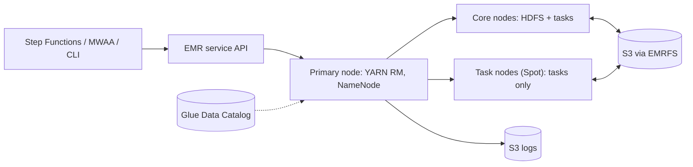
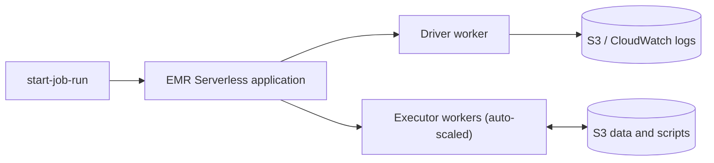
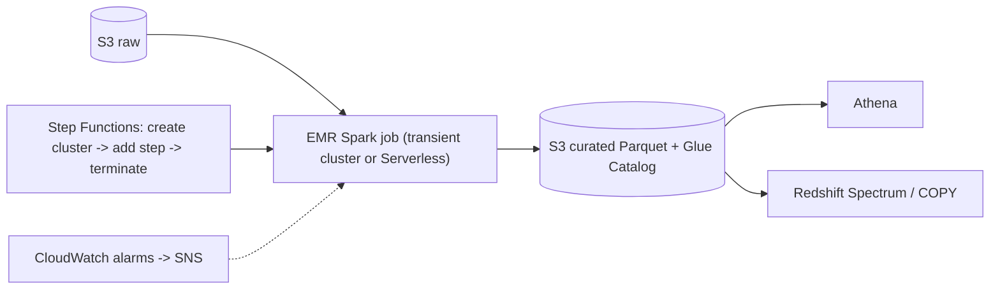
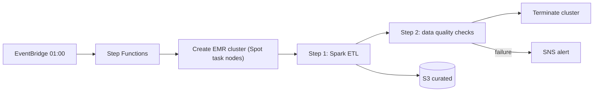
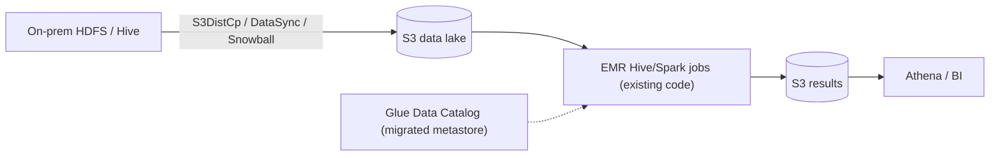
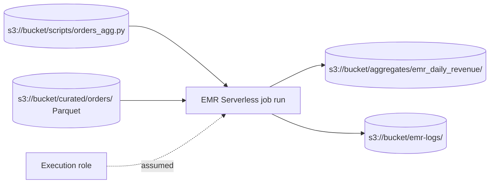

# Amazon EMR — Data Engineering Study Notes (0–2 YOE)

> Self-contained notes: fundamentals → implementation → interview preparation.
> EMR release labels, application versions, instance types and pricing change frequently. Use a currently supported release from the EMR Release Guide (the `emr-7.x` placeholder below is an example) and confirm details in the docs linked at the end.

**Contents**
1. Introduction
2. Architecture and Working Mechanism
3. Core Concepts and Terminology
4. Data Engineering Use Cases
5. Hands-on Implementation (mini-project)
6. Interview Preparation (10 conceptual + 5 scenario + 3 troubleshooting, all answered)
7. Revision and Quick Reference

---

## 1. Introduction

### What is Amazon EMR?
**Amazon EMR** (formerly Elastic MapReduce) is a managed big data platform that runs open-source frameworks — **Apache Spark, Hadoop (HDFS, YARN, MapReduce), Hive, Presto/Trino, HBase, Flink** and more — on AWS. You can run EMR in three ways:

| Deployment option | What you get |
|---|---|
| **EMR on EC2** | A cluster of EC2 instances (primary, core, task nodes) that EMR provisions, configures and monitors |
| **EMR Serverless** | No clusters: create an *application*, submit *job runs*; EMR provisions and scales workers automatically |
| **EMR on EKS** | Run Spark jobs on an existing Amazon EKS (Kubernetes) cluster |

### Why was it introduced and what problem does it solve?
Setting up Hadoop/Spark clusters is difficult: installing software, tuning configurations, handling failed nodes, scaling. EMR (launched in 2009) automates provisioning and configuration so you can start a cluster in minutes and pay per second. Because data can live in **S3** rather than inside the cluster, you can create clusters only when needed and delete them afterwards.

### Why is it important in Data Engineering?
EMR is the AWS home of **large-scale Spark and Hadoop processing**. It is used when you need more control or lower cost than Glue for big, long-running, or specialised jobs: custom Spark configurations, special libraries, Hive/Presto, HBase, Spot-based cost optimisation, or migrating existing on-premises Hadoop workloads.

### When should you use it?
- Large batch ETL (hundreds of GB to PB) with Spark.
- Migrating Hadoop/Hive/Spark jobs from on-premises with minimal rewrite.
- Workloads that need control over cluster size, instance types, Spot usage, Spark/Hadoop configuration or non-Spark engines.
- Interactive analytics/notebooks (EMR Studio) on big data.

### When should you avoid it?
| Situation | Better option |
|---|---|
| Small/medium ETL and you want minimum ops | AWS Glue |
| Ad hoc SQL on S3 | Athena |
| Warehouse-style BI with many concurrent users | Redshift |
| Tiny event-driven tasks | Lambda |
| Team with no cluster tuning skills and sporadic jobs | EMR Serverless or Glue |

### Simple real-world example
Every night a transient EMR cluster starts, runs a Spark job that reads 2 TB of clickstream Parquet from S3, aggregates it and writes results back to S3, then terminates itself. The company pays for a few hours of compute instead of a 24/7 cluster.

### Brief comparison with alternatives
| | EMR | Glue | Databricks | Dataproc (GCP) |
|---|---|---|---|---|
| Model | Managed clusters or Serverless/EKS | Serverless Spark ETL | Managed lakehouse platform | Managed Spark/Hadoop |
| Control | High (instance types, configs, software) | Medium | High | High |
| Ops effort | Medium (EC2) / Low (Serverless) | Lowest | Medium | Medium |
| Cost levers | Spot, Graviton, transient clusters | Worker count, Flex | DBU + cloud | Preemptible VMs |
| Best for | Custom/large big data | Standard ETL + Catalog | Collaborative lakehouse/ML | Same role on GCP |

---

## 2. Architecture and Working Mechanism

### Overall architecture (EMR on EC2)
An EMR cluster contains three node types:
- **Primary node (master):** coordinates the cluster, runs YARN ResourceManager, HDFS NameNode, web UIs and, with Spark in cluster mode, often the Spark driver application master.
- **Core nodes:** run tasks **and** store HDFS data (DataNode + NodeManager).
- **Task nodes (optional):** run tasks only (no HDFS), ideal for Spot instances and elastic scaling.

**YARN** allocates cluster CPU/memory as containers to applications; Spark executors run inside YARN containers. Persistent data usually lives in **S3** accessed through **EMRFS** (`s3://`), while HDFS on instance/EBS storage is for temporary intermediate data and is lost when the cluster terminates.

### EMR Serverless architecture
You create an **application** (type Spark or Hive, release label, optional pre-initialised capacity, auto start/stop). Each **job run** executes with an **execution role**; EMR provisions workers (drivers/executors) on demand and releases them after the job. No nodes to manage.

### Major components
- **Release label** (e.g. `emr-7.x.y`) — a bundle of compatible application versions.
- **Applications** — Spark, Hive, Hadoop, Presto/Trino, HBase, Flink, Livy, Jupyter, etc.
- **Steps** — units of work submitted to a cluster (e.g. `spark-submit`).
- **Bootstrap actions** — scripts run on each node at startup (install libraries).
- **Instance groups/fleets** — how node capacity is defined.
- **Managed scaling / auto scaling** — adjusts nodes with workload.
- **EMR Studio / notebooks** — interactive development.
- **Glue Data Catalog integration** — shared Hive metastore.
- **IAM roles** — service role, EC2 instance profile, (Serverless: job execution role).
- **Logs** — to S3 (`--log-uri`), plus CloudWatch/Spark History Server.

### End-to-end flow (EMR on EC2 transient cluster)
1. You (or an orchestrator) call `RunJobFlow`/`aws emr create-cluster` with release, applications, instance configuration, steps and log location.
2. EMR launches EC2 instances in your VPC subnet, runs bootstrap actions, installs applications and starts YARN/HDFS daemons.
3. Cluster state moves to `RUNNING`; steps execute (e.g. `spark-submit` through `command-runner.jar`).
4. Executors read input from S3 via EMRFS, process data in parallel, shuffle between nodes, and write results to S3.
5. After steps complete, the cluster terminates automatically (`--auto-terminate`) or waits for more work (`WAITING`).
6. Logs are archived to S3; you pay per second of EC2 + EMR charges while running.

### Mermaid — EMR on EC2 cluster


### Mermaid — EMR Serverless


### Explanation of components
- **Primary/core/task** — control plane, storage+compute, elastic compute.
- **S3 + EMRFS** — durable storage separate from cluster life.
- **Glue Catalog** — shared table metadata with Athena/Glue.
- **Serverless application/job run** — compute created on demand with an execution role.
- **Logs on S3** — essential because cluster nodes disappear.

### Practical Data Engineering architecture


---

## 3. Core Concepts and Important Terminologies

### 3.1 Cluster lifecycle: transient vs long-running
- **Transient cluster:** created for a job and terminated when done (`--auto-terminate`). Cheapest for scheduled batch.
- **Long-running cluster:** stays up for interactive use, streaming or frequent jobs; needs scaling, patching and monitoring.
- **States:** `STARTING` → `BOOTSTRAPPING` → `RUNNING` → `WAITING` → `TERMINATING` → `TERMINATED` (or `TERMINATED_WITH_ERRORS`).
- **Mistake:** forgetting termination on a transient cluster (continued billing); keeping data only in HDFS.

### 3.2 Node types and what runs where
| Node | Runs | Data | Spot-safe? |
|---|---|---|---|
| Primary | Resource manager, NameNode, web UIs | Metadata | No (single point; use on-demand) |
| Core | NodeManager + DataNode | HDFS blocks | Risky (losing core loses HDFS data) |
| Task | NodeManager only | None | Yes — ideal |
Use **on-demand** for primary and core, **Spot** for task nodes (diversified instance types).

### 3.3 Storage: HDFS vs EMRFS (S3) vs EBS/instance store
- **HDFS:** distributed file system on core nodes; fast, but ephemeral and sized by the cluster.
- **EMRFS/S3:** durable, cheap, decoupled — **store inputs/outputs in S3** so clusters can be deleted.
- **Instance store/EBS:** local disks hosting HDFS, Spark shuffle and temp data; size EBS volumes appropriately.
- **Mistake:** relying on HDFS for final data; undersized disks causing "No space left on device".

### 3.4 YARN and Spark on EMR
- **YARN** schedules containers across NodeManagers. Spark runs on YARN with a **driver** (coordinates) and **executors** (workers).
- **Deploy mode:** `cluster` (driver on a core/task node — recommended for steps, survives submitter disconnect) vs `client` (driver where submitted, e.g. primary node/notebook).
- **Executor sizing:** pick cores/memory per executor to fit instance capacity (leave memory for OS/YARN/overhead). `maximizeResourceAllocation` classification can auto-configure Spark based on instance type; **dynamic allocation** (default on EMR) scales executors with workload.
```bash
spark-submit --deploy-mode cluster \
  --conf spark.sql.adaptive.enabled=true \
  --conf spark.executor.memory=8g --conf spark.executor.cores=4 \
  s3://my-lake/scripts/job.py s3://my-lake/curated/orders/ s3://my-lake/aggregates/orders/
```

### 3.5 Steps and bootstrap actions
- **Step:** a unit of work run on the cluster, e.g. a Spark application via `command-runner.jar`. `ActionOnFailure` can be `CANCEL_AND_WAIT`, `CONTINUE`, or `TERMINATE_CLUSTER`.
- **Bootstrap action:** script executed on every node at launch (install Python packages, configure OS). Runs before applications start.
```bash
aws emr add-steps --cluster-id j-XXXX --steps \
  Type=Spark,Name=orders-agg,ActionOnFailure=CONTINUE,\
Args=[--deploy-mode,cluster,s3://my-lake/scripts/orders_agg.py,s3://my-lake/curated/orders/,s3://my-lake/aggregates/orders/]
```
- **Mistake:** installing packages in the step instead of bootstrap/packaged environment (slow/failing); bootstrap scripts that fail and block cluster startup.

### 3.5b Creating a classic EMR on EC2 cluster (CLI)
```bash
aws emr create-default-roles     # creates EMR_DefaultRole and EMR_EC2_DefaultRole (once)

aws emr create-cluster --name "orders-batch" \
  --release-label emr-7.5.0 \                # example: use a current emr-7.x release
  --applications Name=Spark \
  --instance-groups \
    InstanceGroupType=MASTER,InstanceCount=1,InstanceType=m5.xlarge \
    InstanceGroupType=CORE,InstanceCount=2,InstanceType=m5.xlarge \
    InstanceGroupType=TASK,InstanceCount=2,InstanceType=m5.xlarge,Market=SPOT \
  --use-default-roles --log-uri s3://my-lake/emr-logs/ \
  --auto-terminate \
  --steps Type=Spark,Name=orders-agg,ActionOnFailure=TERMINATE_CLUSTER,Args=[--deploy-mode,cluster,s3://my-lake/scripts/orders_agg.py,s3://my-lake/curated/orders/,s3://my-lake/aggregates/orders/]
```
(Instance types and availability vary by Region; the cluster needs a subnet — the default VPC is used if not specified. Verify syntax with `aws emr create-cluster help`.)

### 3.6 Instance groups vs instance fleets
- **Instance groups:** one instance type per group (simple).
- **Instance fleets:** up to several instance types per node role with a **target capacity** mixing on-demand and Spot units; EMR picks available capacity — improves Spot availability and cost.
- **Mistake:** a single Spot instance type in one AZ → capacity failures.

### 3.7 Scaling: managed scaling and auto scaling
- **EMR managed scaling:** EMR automatically resizes the cluster (within min/max you set) based on workload metrics, optimising for core/task mix.
- **Custom auto scaling policies** (instance groups): CloudWatch-metric rules.
- **Serverless:** automatic scale-out/in per job; optional **pre-initialised capacity** for fast start.
- **Mistake:** scaling core nodes down (HDFS decommissioning delays) instead of task nodes.

### 3.8 Spot instances best practices
Use Spot for **task nodes**; keep primary/core on-demand; diversify instance types/AZs (fleets); use shorter jobs/checkpointing; allow graceful decommissioning; accept interruptions with Spark's retry behaviour; set max Spot price at on-demand cap. Savings can be large but jobs must tolerate node loss.

### 3.9 EMR Serverless essentials
- **Application:** type (Spark/Hive), release label, architecture, network config (optional VPC), pre-initialised capacity, `autoStart`/`autoStop` (idle timeout), max capacity limits.
- **Job run:** `sparkSubmit` entry point + args + Spark parameters; run under an **execution role**; logs to S3/CloudWatch.
- **Billing:** per vCPU-hour, memory GB-hour and storage while workers run.
- **Why it matters:** no cluster management, great for intermittent jobs. **Limits:** less low-level control, some applications/config unsupported — check docs.
```bash
aws emr-serverless create-application --name retail-spark --type SPARK \
  --release-label emr-7.5.0 \
  --auto-stop-configuration '{"enabled":true,"idleTimeoutMinutes":5}'
```

### 3.10 EMR on EKS (know the idea)
Run Spark jobs as pods on EKS using **virtual clusters** mapped to Kubernetes namespaces; useful when your organisation standardises on Kubernetes and wants shared, multi-tenant capacity.

### 3.11 Glue Data Catalog as Hive metastore
EMR can use the Glue Data Catalog for Spark/Hive/Presto metadata so tables are shared with Athena and Glue. Enable via the cluster configuration classification (`spark-hive-site`: `hive.metastore.client.factory.class=com.amazonaws.glue.catalog.metastore.AWSGlueDataCatalogHiveClientFactory`) or console option.

### 3.12 Security: roles, encryption, networking
- **EMR service role** (EMR_DefaultRole): lets EMR manage EC2/other resources.
- **EC2 instance profile** (EMR_EC2_DefaultRole): permissions of code running on nodes (access S3/Glue/DynamoDB). Restrict it to least privilege; EMRFS can map different S3 roles per user/prefix.
- **Security configuration:** encryption at rest (EBS/local disk/S3 with SSE/CSE) and in transit (TLS), Kerberos.
- **Network:** run in private subnets; use VPC endpoints for S3; security groups; **EMR Block Public Access**.
- **Serverless:** execution role defines job permissions.

### 3.13 Logging and debugging
- Cluster logs to S3 (`--log-uri`): `steps/<id>/stderr.gz`, `controller.gz`, `containers/application_*/container_*/stderr.gz`.
- **Spark History Server** and YARN ResourceManager UIs (via persistent app UI or SSH tunnel/EMR console links).
- CloudWatch metrics (YARN memory available, HDFS utilisation, apps running).
- **Mistake:** not enabling log URI, then losing logs when the cluster terminates.

### 3.14 Performance optimisation checklist
- Use **Parquet/ORC** with snappy/zstd; partition by common filters; avoid tiny files (compact).
- Use the **EMRFS S3-optimized committer** (default for Spark on recent releases) for faster, safer S3 writes.
- Enable **adaptive query execution (AQE)** for skew/partition coalescing; broadcast small tables.
- Right-size executors/partitions; avoid collecting data to the driver; cache only reused data.
- Use Graviton instances for price-performance where supported; keep compute in the same Region/AZ as S3 and use a S3 gateway endpoint.

---

## 4. Data Engineering Use Cases

### Real-world use cases
- Large-scale ETL/ELT from raw to curated lake tables.
- Hive/Presto SQL on big data; Hadoop workload migrations.
- Feature engineering and large-scale ML preprocessing.
- Log processing and clickstream sessionisation.
- Streaming with Spark Structured Streaming or Flink on long-running clusters.
- Interactive analysis with EMR Studio notebooks.

### Batch processing
Orchestrator creates a transient cluster (or submits an EMR Serverless job), runs Spark steps reading S3, writes partitioned Parquet back, registers partitions, and terminates. Backfills are parameterised reruns.

### Real-time / streaming
Spark Structured Streaming or Flink on a long-running EMR cluster consuming Kinesis/MSK, writing to S3/Iceberg/OpenSearch. For fully managed alternatives consider Managed Service for Apache Flink or Glue streaming.

### Pipeline example 1 — Nightly transient cluster


### Pipeline example 2 — Hadoop migration


### Why a Data Engineer chooses EMR
Control over software and hardware, strong cost optimisation (Spot, Graviton, transient clusters), compatibility with open-source ecosystems and existing Hadoop/Hive jobs, and scale to petabytes. Choose Glue for simple serverless ETL, Athena for ad hoc SQL, Redshift for warehouse BI.

---

## 5. Hands-on Implementation

### Mini-project: Aggregate daily revenue with a PySpark job on EMR Serverless

**1. Objective:** Run a PySpark job on **EMR Serverless** that reads partitioned Parquet orders from S3, computes daily revenue/orders/customers and writes Parquet results back to S3.

**2. Business problem:** The business wants a daily revenue summary generated by a scalable Spark job without managing clusters; jobs run intermittently so serverless billing fits.

**3. Architecture**


**4. Prerequisites and setup**
- The S3 bucket and curated Parquet from the S3 notes (`curated/orders/order_date=.../part-0000.parquet`).
- Permissions to create IAM roles and EMR Serverless applications.
- Variables: `ACCOUNT`, `REGION`, `BUCKET`, and `RELEASE` — a currently supported EMR release label (EMR Serverless supports EMR releases 6.6.0 and above; check the docs, e.g. `emr-7.5.0`).
- **Costs:** EMR Serverless charges per vCPU-hour/GB-hour while workers run (a small job costs cents) plus S3. The application stops when idle if auto-stop is enabled. Delete everything afterwards.

**5–6. Implementation and code**

*Step 1 — PySpark script `orders_agg.py`*
```python
import sys
from pyspark.sql import SparkSession, functions as F

if len(sys.argv) != 3:
    raise SystemExit("usage: orders_agg.py <input_path> <output_path>")
src, dst = sys.argv[1], sys.argv[2]

spark = SparkSession.builder.appName("orders-daily-revenue").getOrCreate()

df = spark.read.parquet(src)             # partition column order_date is discovered from folders
print("Input rows:", df.count())

daily = (df.groupBy("order_date")
           .agg(F.round(F.sum("amount"), 2).alias("revenue"),
                F.count("*").alias("orders"),
                F.countDistinct("customer_id").alias("customers"))
           .orderBy("order_date"))

daily.show(truncate=False)
daily.coalesce(1).write.mode("overwrite").parquet(dst)    # small result: one file
spark.stop()
```
```bash
ACCOUNT=$(aws sts get-caller-identity --query Account --output text)
REGION=ap-south-1
BUCKET=retail-datalake-$ACCOUNT-$REGION
RELEASE=emr-7.5.0          # example; choose a supported release
aws s3 cp orders_agg.py s3://$BUCKET/scripts/orders_agg.py
```

*Step 2 — Job execution role*
```bash
cat > emrs-trust.json <<'EOF'
{"Version":"2012-10-17","Statement":[{"Effect":"Allow",
 "Principal":{"Service":"emr-serverless.amazonaws.com"},"Action":"sts:AssumeRole"}]}
EOF
cat > emrs-perms.json <<EOF
{"Version":"2012-10-17","Statement":[
 {"Effect":"Allow","Action":["s3:GetObject","s3:ListBucket"],
  "Resource":["arn:aws:s3:::$BUCKET","arn:aws:s3:::$BUCKET/scripts/*","arn:aws:s3:::$BUCKET/curated/*"]},
 {"Effect":"Allow","Action":["s3:PutObject","s3:GetObject","s3:DeleteObject"],
  "Resource":["arn:aws:s3:::$BUCKET/aggregates/*","arn:aws:s3:::$BUCKET/emr-logs/*"]}]}
EOF
aws iam create-role --role-name EmrServerlessJobRole --assume-role-policy-document file://emrs-trust.json
aws iam put-role-policy --role-name EmrServerlessJobRole --policy-name s3-access --policy-document file://emrs-perms.json
ROLE_ARN=arn:aws:iam::$ACCOUNT:role/EmrServerlessJobRole
```

*Step 3 — Create and start the application*
```bash
APP_ID=$(aws emr-serverless create-application --name retail-spark --type SPARK \
  --release-label $RELEASE \
  --auto-stop-configuration '{"enabled":true,"idleTimeoutMinutes":5}' \
  --query applicationId --output text)
aws emr-serverless start-application --application-id $APP_ID
aws emr-serverless get-application --application-id $APP_ID --query application.state
```
Wait until the state is `STARTED`.

*Step 4 — Submit the job run*
```bash
JOB_ID=$(aws emr-serverless start-job-run --application-id $APP_ID \
  --execution-role-arn $ROLE_ARN --name orders-daily-revenue \
  --job-driver "{
    \"sparkSubmit\": {
      \"entryPoint\": \"s3://$BUCKET/scripts/orders_agg.py\",
      \"entryPointArguments\": [\"s3://$BUCKET/curated/orders/\", \"s3://$BUCKET/aggregates/emr_daily_revenue/\"],
      \"sparkSubmitParameters\": \"--conf spark.executor.cores=2 --conf spark.executor.memory=4g --conf spark.executor.instances=2 --conf spark.driver.cores=2 --conf spark.driver.memory=4g\"
    }}" \
  --configuration-overrides "{\"monitoringConfiguration\":{\"s3MonitoringConfiguration\":{\"logUri\":\"s3://$BUCKET/emr-logs/\"}}}" \
  --query jobRunId --output text)

# poll until a terminal state
while true; do
  S=$(aws emr-serverless get-job-run --application-id $APP_ID --job-run-id $JOB_ID --query jobRun.state --output text)
  echo "state: $S"; [[ "$S" =~ ^(SUCCESS|FAILED|CANCELLED)$ ]] && break; sleep 15
done
```

**7. Explanation of the code**
- The script reads the partitioned Parquet directory; Spark discovers `order_date` from folder names, groups by date and computes revenue, order count and distinct customers. `coalesce(1)` writes one small output file (don't do this for large outputs).
- The execution role (trusted by `emr-serverless.amazonaws.com`) grants read access to the script and data and write access to outputs and logs — least privilege by prefix.
- The application auto-stops after 5 idle minutes to avoid charges. `sparkSubmitParameters` size one driver and two executors for this tiny job.

**8. Expected output**
Job run ends in `SUCCESS`. The driver log (`stdout`) shows:
```
Input rows: 200
+----------+-------+------+---------+
|order_date|revenue|orders|customers|
+----------+-------+------+---------+
|2026-11-15|12345.67|50   |18       |
...
```
(Values depend on your generated data.) An output Parquet file appears under `aggregates/emr_daily_revenue/`.

**9. Validation and testing**
```bash
aws s3 ls s3://$BUCKET/aggregates/emr_daily_revenue/ --recursive
aws s3 ls s3://$BUCKET/emr-logs/applications/$APP_ID/jobs/$JOB_ID/ --recursive
aws s3 cp s3://$BUCKET/emr-logs/applications/$APP_ID/jobs/$JOB_ID/SPARK_DRIVER/stdout.gz - | gunzip | head -30
```
Cross-check the totals with the Athena or Glue results from earlier notes — the numbers should match. Rerun the job; output is overwritten (idempotent).

**10. Common errors and troubleshooting**
| Error | Cause | Fix |
|---|---|---|
| Job `FAILED`: `AccessDenied` on S3 | Execution role missing prefixes | Update role policy for script/data/output/log paths |
| `ValidationException` on release label | Unsupported/misspelled release | Use a supported `emr-x.y.z` label |
| Application stays `CREATED`/won't start | Capacity/limits or network config | Check application `stateDetails`, service quotas, subnets if VPC configured |
| `Path does not exist` | Wrong input path/prefix | Verify S3 paths; ensure data exists |
| Job cancelled for exceeding limits | Maximum capacity/timeouts | Adjust application maximum capacity/job timeout |

**11. Cost considerations and cleanup**
Workers are billed while jobs run; stopped applications do not incur compute charges (storage of pre-initialised capacity would). Clean up:
```bash
aws emr-serverless stop-application --application-id $APP_ID
# wait until STOPPED, then:
aws emr-serverless delete-application --application-id $APP_ID
aws iam delete-role-policy --role-name EmrServerlessJobRole --policy-name s3-access
aws iam delete-role --role-name EmrServerlessJobRole
aws s3 rm s3://$BUCKET/aggregates/emr_daily_revenue/ --recursive
aws s3 rm s3://$BUCKET/emr-logs/ --recursive
aws s3 rm s3://$BUCKET/scripts/orders_agg.py
```

**Optional extension:** run the same script as a step on a transient EMR on EC2 cluster using the `create-cluster` command in section 3.5b and compare startup time, control and cost. Remember to terminate the cluster (`--auto-terminate`) and delete logs.

