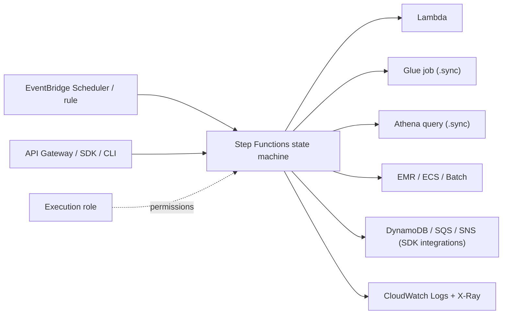
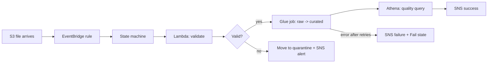
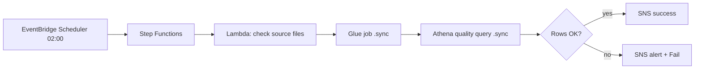
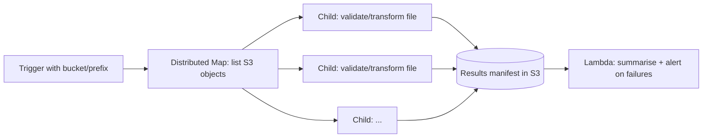
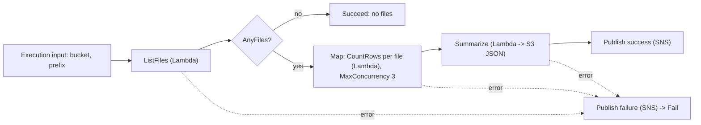

# AWS Step Functions — Data Engineering Study Notes (0–2 YOE)

> Self-contained notes: fundamentals → implementation → interview preparation.
> Step Functions limits, service integrations and pricing change; confirm numeric quotas and integration details in the official docs linked at the end.

**Contents**
1. Introduction
2. Architecture and Working Mechanism
3. Core Concepts and Terminology
4. Data Engineering Use Cases
5. Hands-on Implementation (mini-project)
6. Interview Preparation (10 conceptual + 5 scenario + 3 troubleshooting, all answered)
7. Revision and Quick Reference

---

## 1. Introduction

### What is AWS Step Functions?
**AWS Step Functions** is a serverless **workflow orchestration** service. You describe a workflow as a **state machine** — a set of **states** (steps) and the transitions between them — using the **Amazon States Language (ASL)**, a JSON-based language (a visual editor, **Workflow Studio**, generates it for you). Step Functions runs the workflow, tracks every step, retries failures, runs branches in parallel and records the execution history. Steps can call AWS services directly (Lambda, Glue, EMR, ECS, Athena, SNS, SQS, DynamoDB and 200+ other services through AWS SDK integrations).

### Why was it introduced and what problem does it solve?
Real pipelines have many steps: validate → transform → load → notify, with branches, retries and error handling. Gluing these together with Lambda calling Lambda, cron jobs or custom code makes failures hard to see and recover from. Step Functions moves the **control flow** (order, retries, waiting, branching, error handling) out of your code and into a managed, visual, auditable service, so each step can stay small.

### Why is it important in Data Engineering?
It is the AWS-native orchestrator for serverless data pipelines: start Glue jobs and wait for completion, run Athena queries, fan out over thousands of S3 files, call Lambda for validation, send SNS alerts on failure, and resume from the failed step. Data engineers must understand state types, error handling, input/output processing and how Step Functions differs from Airflow.

### When should you use it?
- Orchestrating AWS-service-based pipelines (Glue, EMR, Athena, Lambda, Batch).
- Workflows needing retries, branching, parallelism or waiting for long jobs.
- Event-driven workflows triggered by EventBridge/S3/API calls.
- Human approval or callback-style workflows.
- Large-scale fan-out over S3 objects with **Distributed Map**.

### When should you avoid it?
| Situation | Better option |
|---|---|
| Complex DAGs with hundreds of tasks, Python-defined dynamic DAGs, backfills, many non-AWS integrations | Apache Airflow (Amazon MWAA) |
| Simple chain of two Glue jobs | Glue workflow/trigger |
| Data transformation itself (heavy compute) | Glue/EMR/Lambda — Step Functions only orchestrates |
| Pass large payloads between steps | Store in S3 and pass the reference |
| Very simple scheduling | EventBridge Scheduler |

### Simple real-world example
Every night EventBridge starts a state machine: check that today's files exist → run a Glue job and wait for it to finish → run an Athena quality-check query → if it passes publish a success message to SNS, otherwise publish a failure alert. If Glue fails, Step Functions retries it twice and then routes to the alert step.

### Brief comparison with alternatives
| | Step Functions | Airflow (MWAA) | Glue workflows | Lambda chaining |
|---|---|---|---|---|
| Definition | JSON ASL / visual | Python DAGs | Console graph of jobs/crawlers | Code |
| Strengths | Native AWS integrations, serverless, retries/branching, no servers | Rich operators, scheduling, backfill, community | Simple Glue-only chains | Tiny flows |
| Cost model | Per state transition (Standard) or requests+duration (Express) | Environment hourly cost | Free (pay for jobs) | Lambda only |
| Scheduling/backfill | Needs EventBridge | Built in | Triggers | Needs EventBridge |

---

## 2. Architecture and Working Mechanism

### Overall architecture
A **state machine** is a definition (ASL) plus an IAM **execution role**. Starting it creates an **execution** with JSON input. Step Functions moves through states, calling integrated services with the role's permissions, passing JSON between states, and recording each event in the execution history. Two **workflow types** exist: **Standard** (durable, up to one year, exactly-once workflow execution, full history) and **Express** (short, high-volume, up to 5 minutes, at-least-once or at-most-once, logging to CloudWatch).

### Major components
- **State machine** — the workflow definition.
- **Execution** — one run of a state machine (unique name within a state machine for Standard).
- **States** — Task, Choice, Parallel, Map, Wait, Pass, Succeed, Fail.
- **Service integrations** — optimised integrations and AWS SDK integrations to call services.
- **IAM role** — permissions used for those calls.
- **Execution history/logs** — events, inputs, outputs, errors; CloudWatch Logs and X-Ray.
- **Triggers** — EventBridge (rules/Scheduler), API Gateway, SDK/CLI, S3 events via EventBridge, other state machines.

### End-to-end flow
1. A trigger calls `StartExecution` with JSON input (and optionally a name).
2. Step Functions begins at `StartAt`, applies input processing, and runs the state.
3. For a **Task**, it calls the integrated service using the execution role. With **Request Response** it continues immediately; with **Run a Job (`.sync`)** it waits until the job finishes; with **Wait for Callback (`.waitForTaskToken`)** it pauses until `SendTaskSuccess/Failure` is called with the token.
4. Output is processed (`ResultSelector`, `ResultPath`, `OutputPath`) and passed to the next state; **Choice** states branch on data; **Map/Parallel** fan out.
5. On error, **Retry** rules and **Catch** rules decide whether to retry or route to a handler state.
6. The execution ends in `SUCCEEDED`, `FAILED`, `TIMED_OUT` or `ABORTED`; history is retained (Standard) for the documented period.

### Mermaid architecture


### Explanation of components
- **Triggers** start executions; Step Functions is not a scheduler by itself.
- **Task integrations** perform the actual work in other services.
- **Execution role** limits what the workflow can call.
- **CloudWatch/X-Ray** provide observability beyond the console graph.

### Practical Data Engineering architecture


---

## 3. Core Concepts and Important Terminologies

### 3.1 State machines and Amazon States Language (ASL)
- **Definition:** A JSON document with `StartAt` and `States`. Each state has a `Type` and usually a `Next` (or `End: true`).
- **Why it matters:** The definition is your workflow code; it is versioned and can be deployed via CloudFormation/SAM/Terraform/CDK.
```json
{
  "Comment": "Hello workflow",
  "StartAt": "SayHello",
  "States": {
    "SayHello": { "Type": "Pass", "Result": {"msg": "hello"}, "End": true }
  }
}
```
- **Query languages:** states can use **JSONPath** (classic: `InputPath`, `Parameters`, `ResultPath`...) or **JSONata** (newer, set with `QueryLanguage`, using `Arguments`/`Output`/`Assign` and variables). Know both exist; new workflows can choose either — check current docs.
- **Mistakes:** mixing JSONPath and JSONata fields in one state incorrectly; forgetting `End`/`Next`.

### 3.2 State types
| State | Purpose |
|---|---|
| **Task** | Do work: call Lambda or another service |
| **Choice** | Branch using conditions on data (`StringEquals`, `NumericGreaterThan`, `BooleanEquals`, ...) |
| **Parallel** | Run branches simultaneously, all with the same input; output is an array |
| **Map** | Run the same steps for each item of an array (inline) or for items in S3 (Distributed Map) |
| **Wait** | Pause for seconds or until a timestamp |
| **Pass** | Pass/transform data (testing, shaping) |
| **Succeed / Fail** | End the execution successfully / with error and cause |

### 3.3 Standard vs Express workflows
| | Standard | Express |
|---|---|---|
| Max duration | Up to 1 year | Up to 5 minutes |
| Execution semantics | Exactly-once workflow execution | At-least-once (async) / at-most-once (sync) |
| History | Stored in Step Functions (viewable, API) | CloudWatch Logs only |
| Rate | High but limited start rate | Very high (100,000+/s order) |
| Billing | Per state transition | Per request + duration and memory |
| Best for | ETL pipelines, long jobs, human approvals | High-volume event processing, IoT, short transformations |
**Mistake:** choosing Standard for millions of tiny short executions (expensive) or Express for long pipelines (5-minute limit, no durable history).

### 3.4 Service integrations and patterns
- **Optimised integrations** (Lambda, Glue, EMR, Athena, ECS/Fargate, Batch, SNS, SQS, DynamoDB, Step Functions, SageMaker, Bedrock, EventBridge...) and **AWS SDK integrations** (call almost any API).
- **Integration patterns** (set via the resource ARN suffix):
  - **Request Response** — `arn:aws:states:::sns:publish`: call and continue.
  - **Run a Job `.sync`** — `arn:aws:states:::glue:startJobRun.sync`: wait for completion; failure becomes a task error.
  - **Wait for Callback `.waitForTaskToken`** — pass `$$.Task.Token`, pause until `SendTaskSuccess/SendTaskFailure`.
```json
"RunGlueJob": {
  "Type": "Task",
  "Resource": "arn:aws:states:::glue:startJobRun.sync",
  "Parameters": { "JobName": "orders-etl",
                  "Arguments": { "--run_date.$": "$.run_date" } },
  "ResultPath": "$.glue",
  "Next": "CheckQuality"
}
```
- **Mistakes:** using Request Response for a long job and moving on before it finishes; forgetting IAM permissions for each integration.

### 3.5 Input and output processing (JSONPath style)
Each state's data flows through five stages:
| Field | Role |
|---|---|
| `InputPath` | Select part of the input to pass into the state |
| `Parameters` / `ItemSelector` | Build the payload sent to the service (keys ending in `.$` read from input/context) |
| `ResultSelector` | Choose/reshape fields from the service response |
| `ResultPath` | Where to put the result inside the original input (`$.glue`) — `null` discards it |
| `OutputPath` | Final filter of what is passed on |
- Context object `$$` offers execution details (`$$.Execution.Id`, `$$.Map.Item.Value`, `$$.Task.Token`).
- **Intrinsic functions:** `States.Format`, `States.JsonToString`, `States.StringToJson`, `States.Array`, `States.ArrayLength`, `States.UUID`, `States.Hash`, etc.
- **Mistake:** overwriting the whole input because `ResultPath` is `$` (default); losing earlier data.

### 3.6 Error handling: Retry and Catch
- **Errors:** specific names (`States.TaskFailed`, `States.Timeout`, `Lambda.ServiceException`, custom errors) or the wildcard `States.ALL`.
- **Retry:** `ErrorEquals`, `IntervalSeconds`, `MaxAttempts`, `BackoffRate`, optional `MaxDelaySeconds` and `JitterStrategy`.
- **Catch:** after retries are exhausted, route to a handler state; `ResultPath` stores error info (`{"Error": ..., "Cause": ...}`).
```json
"Retry": [{
  "ErrorEquals": ["Lambda.ServiceException","Lambda.TooManyRequestsException","States.Timeout"],
  "IntervalSeconds": 2, "MaxAttempts": 3, "BackoffRate": 2.0, "JitterStrategy": "FULL"
}],
"Catch": [{ "ErrorEquals": ["States.ALL"], "ResultPath": "$.error", "Next": "NotifyFailure" }]
```
- **Timeouts:** `TimeoutSeconds` on tasks and `HeartbeatSeconds` for long/callback tasks; otherwise a task may wait very long.
- **Mistakes:** retrying non-idempotent tasks blindly; catching everything and hiding failures; no timeout on callbacks.

### 3.7 Parallel, Map and Distributed Map
- **Parallel:** fixed branches (e.g. run quality check and metadata update together).
- **Map (inline):** iterate over a JSON array in the input; `MaxConcurrency` limits parallelism; history size limits apply (best for small arrays).
- **Distributed Map:** processes huge datasets by launching child workflow executions; reads items directly from **S3** (list objects, CSV, JSON, S3 inventory) with `ItemReader`, supports very high concurrency (up to ten thousand child executions in parallel — check quota), batching, tolerated failure thresholds, and result writing to S3.
```json
"ProcessFiles": {
  "Type": "Map",
  "ItemReader": { "Resource": "arn:aws:states:::s3:listObjectsV2",
                  "Parameters": { "Bucket.$": "$.bucket", "Prefix": "raw/orders/" } },
  "MaxConcurrency": 50,
  "ItemProcessor": { "ProcessorConfig": { "Mode": "DISTRIBUTED", "ExecutionType": "EXPRESS" },
    "StartAt": "ProcessOne",
    "States": { "ProcessOne": { "Type": "Task", "Resource": "arn:aws:states:::lambda:invoke",
       "Parameters": {"FunctionName": "process-file", "Payload.$": "$"}, "End": true } } },
  "End": true
}
```
- **Mistakes:** inline Map for 100,000 items (hits history limits); unbounded concurrency overloading downstream systems.

### 3.8 Payload and history limits
State input/output is limited (about 256 KiB per state payload — check quotas). Standard executions also have a maximum number of history events (25,000), so long loops need a Map/child-workflow strategy. **Pattern:** store data in S3/DynamoDB and pass pointers (bucket/key) between states.

### 3.9 Executions: naming, idempotency and redrive
- **Start:** `aws stepfunctions start-execution --state-machine-arn ARN --name my-run-2026-11-19 --input '{...}'`.
- **Idempotency:** Standard executions with the **same name and same input** within the retention window return the existing execution instead of starting a new one (different input with the same name errors) — use deterministic names like `orders-2026-11-19` to prevent duplicate daily runs.
- **Redrive:** a failed/timed-out Standard execution can be **redriven** from the failed state (within a time limit after the execution ends), preserving prior successful steps.
- **Mistake:** assuming a retry starts from scratch or that names can be reused indefinitely.

### 3.10 Triggers and scheduling
EventBridge **Scheduler** or rules (cron/rate or S3/other events), API Gateway, SDKs, CLI, Step Functions calling Step Functions. For daily data pipelines pair EventBridge Scheduler with a deterministic execution name.

### 3.11 Monitoring, logging and debugging
- Console **graph view** with state-by-state status and input/output.
- CloudWatch metrics (`ExecutionsFailed`, `ExecutionThrottled`, `ExecutionTime`) with alarms; CloudWatch Logs (log level `ALL`/`ERROR`/`FATAL`) — required for Express debugging; X-Ray tracing.
- EventBridge events for execution status changes (e.g. alert on `FAILED`).

### 3.12 Security
The state machine's **execution role** must trust `states.amazonaws.com` and grant the actions it calls (e.g. `lambda:InvokeFunction`, `glue:StartJobRun`, `sns:Publish`). Use least privilege per state machine; the caller needs `states:StartExecution`. Use resource policies/KMS for sensitive data; avoid putting secrets in state input.

---

## 4. Data Engineering Use Cases

### Real-world use cases
- Daily ETL orchestration (Glue → Athena/Redshift → notifications).
- Event-driven file processing with validation and quarantine.
- Large-scale fan-out over S3 objects (Distributed Map).
- ML pipelines (SageMaker training/evaluation) and data science workflows.
- Long-running workflows with callbacks/human approvals.
- Cost-aware cluster lifecycle: create EMR cluster → add steps → terminate.

### Batch processing
EventBridge Scheduler starts a Standard workflow per date; states run Glue jobs with `.sync`, parallel quality checks and a final success/failure notification. Reruns use new execution names or redrive.

### Real-time / event-driven
Express workflows react to high-volume events (e.g. via EventBridge/SQS/API Gateway) for short validations/enrichments; Standard workflows handle longer per-event processes.

### Pipeline example 1 — Nightly lake pipeline


### Pipeline example 2 — Fan-out over many files


### Why a Data Engineer chooses Step Functions
No servers or schedulers to run; native retries/error handling; visual debugging; direct service integrations remove glue code; scales from a few runs to massive fan-out; pay per transition. Choose Airflow when you need Python-defined DAGs, backfills and a broad third-party ecosystem.

---

## 5. Hands-on Implementation

### Mini-project: Orders file pipeline with validation, parallel processing and failure alerts

**1. Objective:** Build a Standard state machine that lists CSV files under an S3 prefix, processes each file in parallel (Map), writes a summary to S3 and sends success/failure notifications through SNS, with Retry and Catch.

**2. Business problem:** A partner drops order files under `raw/orders/`. A scheduled workflow must check for files, compute row counts and revenue per file, publish a summary, and alert the team if anything fails.

**3. Architecture**


**4. Prerequisites and setup**
- The S3 bucket and `raw/orders/` CSV data from the S3 notes (header `order_id,customer_id,amount,order_date`).
- AWS CLI, permission to create IAM roles, Lambda, SNS and Step Functions resources.
- Variables: `ACCOUNT`, `REGION`, `BUCKET`.
- **Costs:** Standard workflows are billed per state transition (a monthly free tier exists); Lambda/SNS usage here is tiny. Check pricing.

**5–6. Implementation and code**

*Step 1 — SNS topic (optionally subscribe your email)*
```bash
ACCOUNT=$(aws sts get-caller-identity --query Account --output text)
REGION=ap-south-1
BUCKET=retail-datalake-$ACCOUNT-$REGION
TOPIC_ARN=$(aws sns create-topic --name pipeline-alerts --region $REGION --query TopicArn --output text)
# optional: aws sns subscribe --topic-arn $TOPIC_ARN --protocol email --notification-endpoint you@example.com
```

*Step 2 — Lambda function `pipeline_fn.py` (one function, several actions)*
```python
import csv, io, json
from datetime import datetime, timezone
import boto3

s3 = boto3.client("s3")

def lambda_handler(event, context):
    action = event["action"]
    if action == "list":
        files = []
        for page in s3.get_paginator("list_objects_v2").paginate(
                Bucket=event["bucket"], Prefix=event["prefix"]):
            files += [o["Key"] for o in page.get("Contents", []) if o["Key"].endswith(".csv")]
        return {"files": files, "count": len(files)}

    if action == "count_rows":
        body = s3.get_object(Bucket=event["bucket"], Key=event["key"])["Body"].read().decode()
        rows = list(csv.DictReader(io.StringIO(body)))
        return {"key": event["key"], "rows": len(rows),
                "amount": round(sum(float(r["amount"]) for r in rows), 2)}

    if action == "summarize":
        results = event["results"]
        summary = {"files": len(results),
                   "rows": sum(r["rows"] for r in results),
                   "amount": round(sum(r["amount"] for r in results), 2),
                   "generated_at": datetime.now(timezone.utc).isoformat()}
        key = f"pipeline-summaries/summary-{datetime.now(timezone.utc):%Y%m%dT%H%M%S}.json"
        s3.put_object(Bucket=event["bucket"], Key=key, Body=json.dumps(summary).encode())
        summary["summary_key"] = key
        return summary

    raise ValueError(f"unknown action {action}")
```
```bash
cat > lambda-trust.json <<'EOF'
{"Version":"2012-10-17","Statement":[{"Effect":"Allow","Principal":{"Service":"lambda.amazonaws.com"},"Action":"sts:AssumeRole"}]}
EOF
cat > lambda-perms.json <<EOF
{"Version":"2012-10-17","Statement":[
 {"Effect":"Allow","Action":["s3:ListBucket"],"Resource":"arn:aws:s3:::$BUCKET"},
 {"Effect":"Allow","Action":["s3:GetObject"],"Resource":"arn:aws:s3:::$BUCKET/raw/*"},
 {"Effect":"Allow","Action":["s3:PutObject"],"Resource":"arn:aws:s3:::$BUCKET/pipeline-summaries/*"}]}
EOF
aws iam create-role --role-name SfnDemoLambdaRole --assume-role-policy-document file://lambda-trust.json
aws iam attach-role-policy --role-name SfnDemoLambdaRole --policy-arn arn:aws:iam::aws:policy/service-role/AWSLambdaBasicExecutionRole
aws iam put-role-policy --role-name SfnDemoLambdaRole --policy-name s3 --policy-document file://lambda-perms.json
zip fn.zip pipeline_fn.py ; sleep 10
FN_ARN=$(aws lambda create-function --function-name sfn-demo-fn --runtime python3.12 \
  --role arn:aws:iam::$ACCOUNT:role/SfnDemoLambdaRole --handler pipeline_fn.lambda_handler \
  --zip-file fileb://fn.zip --timeout 60 --region $REGION --query FunctionArn --output text)
```

*Step 3 — State machine definition `orders_pipeline.asl.json`*
```json
{
  "Comment": "Orders file pipeline",
  "StartAt": "ListFiles",
  "States": {
    "ListFiles": {
      "Type": "Task",
      "Resource": "arn:aws:states:::lambda:invoke",
      "Parameters": {
        "FunctionName": "${FN_ARN}",
        "Payload": { "action": "list", "bucket.$": "$.bucket", "prefix.$": "$.prefix" }
      },
      "ResultSelector": { "files.$": "$.Payload.files", "count.$": "$.Payload.count" },
      "ResultPath": "$.listing",
      "Retry": [{ "ErrorEquals": ["Lambda.ServiceException","Lambda.TooManyRequestsException","Lambda.SdkClientException"],
                  "IntervalSeconds": 2, "MaxAttempts": 3, "BackoffRate": 2.0 }],
      "Catch": [{ "ErrorEquals": ["States.ALL"], "ResultPath": "$.error", "Next": "NotifyFailure" }],
      "Next": "AnyFiles"
    },
    "AnyFiles": {
      "Type": "Choice",
      "Choices": [{ "Variable": "$.listing.count", "NumericGreaterThan": 0, "Next": "ProcessFiles" }],
      "Default": "NoFiles"
    },
    "NoFiles": { "Type": "Succeed", "Comment": "Nothing to do today" },
    "ProcessFiles": {
      "Type": "Map",
      "ItemsPath": "$.listing.files",
      "MaxConcurrency": 3,
      "ItemSelector": { "bucket.$": "$.bucket", "key.$": "$$.Map.Item.Value" },
      "ItemProcessor": {
        "ProcessorConfig": { "Mode": "INLINE" },
        "StartAt": "CountRows",
        "States": {
          "CountRows": {
            "Type": "Task",
            "Resource": "arn:aws:states:::lambda:invoke",
            "Parameters": { "FunctionName": "${FN_ARN}",
                            "Payload": { "action": "count_rows", "bucket.$": "$.bucket", "key.$": "$.key" } },
            "OutputPath": "$.Payload",
            "Retry": [{ "ErrorEquals": ["Lambda.ServiceException","Lambda.TooManyRequestsException"],
                        "IntervalSeconds": 2, "MaxAttempts": 2, "BackoffRate": 2.0 }],
            "End": true
          }
        }
      },
      "ResultPath": "$.results",
      "Catch": [{ "ErrorEquals": ["States.ALL"], "ResultPath": "$.error", "Next": "NotifyFailure" }],
      "Next": "Summarize"
    },
    "Summarize": {
      "Type": "Task",
      "Resource": "arn:aws:states:::lambda:invoke",
      "Parameters": { "FunctionName": "${FN_ARN}",
                      "Payload": { "action": "summarize", "bucket.$": "$.bucket", "results.$": "$.results" } },
      "ResultSelector": { "summary.$": "$.Payload" },
      "ResultPath": "$.final",
      "Catch": [{ "ErrorEquals": ["States.ALL"], "ResultPath": "$.error", "Next": "NotifyFailure" }],
      "Next": "NotifySuccess"
    },
    "NotifySuccess": {
      "Type": "Task",
      "Resource": "arn:aws:states:::sns:publish",
      "Parameters": { "TopicArn": "${TOPIC_ARN}",
                      "Subject": "Orders pipeline succeeded",
                      "Message.$": "States.JsonToString($.final.summary)" },
      "End": true
    },
    "NotifyFailure": {
      "Type": "Task",
      "Resource": "arn:aws:states:::sns:publish",
      "Parameters": { "TopicArn": "${TOPIC_ARN}",
                      "Subject": "Orders pipeline FAILED",
                      "Message.$": "States.Format('Error: {} Cause: {}', $.error.Error, $.error.Cause)" },
      "Next": "FailState"
    },
    "FailState": { "Type": "Fail", "Error": "PipelineFailed", "Cause": "See SNS alert and execution history" }
  }
}
```

*Step 4 — Step Functions role, create and run*
```bash
cat > sfn-trust.json <<'EOF'
{"Version":"2012-10-17","Statement":[{"Effect":"Allow","Principal":{"Service":"states.amazonaws.com"},"Action":"sts:AssumeRole"}]}
EOF
cat > sfn-perms.json <<EOF
{"Version":"2012-10-17","Statement":[
 {"Effect":"Allow","Action":"lambda:InvokeFunction","Resource":["$FN_ARN","$FN_ARN:*"]},
 {"Effect":"Allow","Action":"sns:Publish","Resource":"$TOPIC_ARN"}]}
EOF
aws iam create-role --role-name SfnOrdersPipelineRole --assume-role-policy-document file://sfn-trust.json
aws iam put-role-policy --role-name SfnOrdersPipelineRole --policy-name perms --policy-document file://sfn-perms.json
sleep 10

sed -e "s|\${FN_ARN}|$FN_ARN|g" -e "s|\${TOPIC_ARN}|$TOPIC_ARN|g" orders_pipeline.asl.json > definition.json
SM_ARN=$(aws stepfunctions create-state-machine --name orders-pipeline --type STANDARD \
  --definition file://definition.json \
  --role-arn arn:aws:iam::$ACCOUNT:role/SfnOrdersPipelineRole --region $REGION \
  --query stateMachineArn --output text)

EXEC_ARN=$(aws stepfunctions start-execution --state-machine-arn $SM_ARN \
  --name run-$(date +%Y%m%d-%H%M%S) \
  --input "{\"bucket\":\"$BUCKET\",\"prefix\":\"raw/orders/\"}" --query executionArn --output text)
aws stepfunctions describe-execution --execution-arn $EXEC_ARN --query '{status:status,output:output}'
```

*Step 5 — Test the other paths*
```bash
# No files path (empty prefix) -> Succeed at NoFiles
aws stepfunctions start-execution --state-machine-arn $SM_ARN --name nofiles-$(date +%s) \
  --input "{\"bucket\":\"$BUCKET\",\"prefix\":\"does-not-exist/\"}"
# Failure path (bucket does not exist) -> Catch -> SNS -> Fail
aws stepfunctions start-execution --state-machine-arn $SM_ARN --name fail-$(date +%s) \
  --input '{"bucket":"bucket-that-does-not-exist-12345","prefix":"raw/"}'
```

**7. Explanation of the code**
- `ListFiles` calls Lambda through the optimised integration; `ResultSelector` keeps only `files` and `count`, and `ResultPath` stores them under `$.listing`, preserving the original `bucket` and `prefix`.
- The `Choice` state routes to `NoFiles` (Succeed) when there are no files.
- The inline `Map` runs `CountRows` for each file key with at most three at a time; `ItemSelector` builds each item's input; the array of results is stored under `$.results`.
- `Summarize` writes a JSON summary to S3 and returns it; `NotifySuccess` publishes it to SNS.
- Each Task has `Retry` for transient Lambda errors and `Catch` that routes to `NotifyFailure` then `Fail`, storing the error under `$.error`.

**8. Expected output**
First execution `SUCCEEDED` with output similar to:
```json
{"final":{"summary":{"files":1,"rows":200,"amount":51234.56,"summary_key":"pipeline-summaries/summary-20261119T101500.json","generated_at":"..."}}, ...}
```
The second run ends `SUCCEEDED` at `NoFiles`; the third ends `FAILED` with error `PipelineFailed` after an SNS failure message.

**9. Validation and testing**
```bash
aws s3 ls s3://$BUCKET/pipeline-summaries/
aws stepfunctions get-execution-history --execution-arn $EXEC_ARN --query 'events[].type' --output text
aws stepfunctions list-executions --state-machine-arn $SM_ARN --query 'executions[].[name,status]' --output table
```
Open the Step Functions console graph view to see each state's input/output. If you subscribed an email address to the topic, confirm that success and failure messages arrive. Test a retry by temporarily setting the Lambda timeout to 1 second and observe `TaskFailed`/retry events.

**10. Common errors and troubleshooting**
| Error | Cause | Fix |
|---|---|---|
| `AccessDeniedException` at a Task | Execution role missing `lambda:InvokeFunction`/`sns:Publish` | Update role policy (include `:*` for function versions) |
| `States.Runtime`: JSONPath not found | Wrong path (e.g. `$.listing.files`) or `ResultPath` overwrote data | Check `ResultPath`/`ResultSelector` and inspect state input |
| `States.DataLimitExceeded` | Payload too large | Store in S3 and pass references |
| Execution name already exists | Reused name within the retention window | Use a unique/deterministic name |
| Map returns empty results | `ItemsPath` points to wrong array | Verify the input at the Map state |

**11. Cost considerations and cleanup**
Cost is minimal here. Clean up:
```bash
aws stepfunctions delete-state-machine --state-machine-arn $SM_ARN
aws lambda delete-function --function-name sfn-demo-fn
aws sns delete-topic --topic-arn $TOPIC_ARN
aws iam delete-role-policy --role-name SfnOrdersPipelineRole --policy-name perms
aws iam delete-role --role-name SfnOrdersPipelineRole
aws iam delete-role-policy --role-name SfnDemoLambdaRole --policy-name s3
aws iam detach-role-policy --role-name SfnDemoLambdaRole --policy-arn arn:aws:iam::aws:policy/service-role/AWSLambdaBasicExecutionRole
aws iam delete-role --role-name SfnDemoLambdaRole
aws s3 rm s3://$BUCKET/pipeline-summaries/ --recursive
```

---

## 6. Interview Preparation — Questions WITH Answers

### A. Conceptual Questions (10)

**Q1. What is AWS Step Functions and why use it in data pipelines?**
Step Functions is a serverless workflow orchestrator. You define a state machine in Amazon States Language (JSON) — states, transitions, branching, retries, error handling — and the service runs it, tracking each step. It integrates natively with Glue, EMR, Athena, Lambda, SNS, SQS, DynamoDB and 200+ services. For data pipelines it removes control-flow code from Lambdas, gives visual execution history, handles retries and failure routing, and can wait for long jobs (`.sync`). *Keywords: state machine, ASL, execution, Task/Choice/Map/Parallel, Retry/Catch, service integration.*

**Q2. Compare Standard and Express workflows.**
**Standard**: durable, up to one year, exactly-once workflow execution, full execution history in the service, billed per state transition — suited to ETL, long jobs, approvals, auditability. **Express**: up to five minutes, very high start rates, at-least-once (async) or at-most-once (sync) semantics, history only via CloudWatch Logs, billed on requests and duration/memory — suited to high-volume short event processing. Choosing wrongly costs money (Standard for millions of tiny runs) or functionality (Express for long pipelines). Many designs use Standard parents with Express children.

**Q3. Explain the main state types.**
**Task** performs work (Lambda, Glue, SDK call). **Choice** branches on conditions. **Parallel** runs fixed branches concurrently and returns an array of their outputs. **Map** repeats a sub-workflow over array items (inline) or S3 objects (Distributed Map). **Wait** delays. **Pass** forwards/transforms data. **Succeed** and **Fail** end the execution (Fail records an error and cause). A good answer also mentions `Next`/`End`, `Retry`/`Catch` on Task/Map/Parallel and that states pass JSON.

**Q4. What are the three service integration patterns?**
**Request Response** (default): call the service and move on as soon as the API call returns (e.g. `sns:publish`). **Run a Job (`.sync`)**: Step Functions waits for the job to finish (Glue, EMR steps, ECS, Batch, Athena) and fails the state if the job fails — ideal for pipelines. **Wait for Callback (`.waitForTaskToken`)**: Step Functions passes a task token to an external system and pauses until it calls `SendTaskSuccess`/`SendTaskFailure` — for human approval or external systems. Setting heartbeat/timeouts prevents indefinite waits.

**Q5. How does Step Functions handle input and output between states?**
Each state receives JSON. With JSONPath, `InputPath` selects input, `Parameters` builds the service payload, `ResultSelector` picks fields from the result, `ResultPath` decides where to merge the result into the original input (default replaces it), and `OutputPath` filters what is passed on. `$$` exposes context (execution ID, Map item, task token). Intrinsic functions like `States.Format` and `States.JsonToString` help. Newer workflows may use JSONata. Typical mistake: leaving `ResultPath` as default and losing earlier data.

**Q6. How do Retry and Catch work, and what are best practices?**
`Retry` lists error names with `IntervalSeconds`, `MaxAttempts`, `BackoffRate` (and jitter); it re-runs the same state for matching errors. After retries are exhausted, `Catch` routes to a fallback state, storing error info with `ResultPath`. Best practices: retry only transient/idempotent errors (Lambda service errors, throttling, timeouts), use exponential backoff and jitter, set `TimeoutSeconds` and `HeartbeatSeconds`, catch specific errors before a general `States.ALL`, and always end with notification and a Fail state so failures are visible.

**Q7. Compare Parallel, inline Map and Distributed Map.**
**Parallel**: a fixed set of different branches run together with the same input. **Inline Map**: same steps for each item in a JSON array within the state input; limited by payload/history sizes; control concurrency with `MaxConcurrency`. **Distributed Map**: designed for massive scale — reads items directly from S3 (objects, CSV/JSON files, inventory), runs each batch as a child workflow execution (often Express) with very high concurrency, supports tolerated failure thresholds and writes results to S3. Use Distributed Map for thousands to millions of files.

**Q8. What limits should you remember (payload, history) and how do you work around them?**
State inputs/outputs are limited (around 256 KiB), and Standard executions have a maximum history event count (25,000). Workarounds: pass **references** (S3 keys, DynamoDB IDs) instead of data; use `ResultSelector`/`OutputPath` to keep payloads small; use Distributed Map or child state machines to avoid long histories; avoid tight loops of Wait/Choice states. Confirm current limits in the Quotas page because they can change.

**Q9. Step Functions vs Airflow (MWAA) vs Glue workflows — when would you choose each?**
Step Functions: serverless, AWS-native orchestration with strong retry/error features and no scheduling/backfill UI of its own; best for event-driven and service-integrated flows. Airflow: Python-defined DAGs, schedules, backfills, huge ecosystem of operators, better for complex data-platform scheduling across many systems (costs a running environment). Glue workflows: simple chains of Glue crawlers/jobs. Many teams combine them: Airflow triggers Step Functions for AWS-service subflows or EventBridge triggers Step Functions for event-driven pipelines.

**Q10. How do you make workflows idempotent and monitor them?**
Use deterministic execution names (e.g. `orders-2026-11-19`) — a Standard execution with the same name and input returns the existing run instead of starting a duplicate. Make tasks idempotent (overwrite partitions, upserts). Monitor with CloudWatch metrics (`ExecutionsFailed`, `ExecutionThrottled`, `ExecutionTime`), alarms, EventBridge rules on execution status changes (`FAILED`, `TIMED_OUT`), CloudWatch Logs (needed for Express), and X-Ray tracing. Use **redrive** to restart failed Standard executions from the failed state.

### B. Scenario-Based Questions (5)

**S1. Orchestrate a daily pipeline: wait for files, run a Glue job, run an Athena quality query, then notify.**
*Solution:* EventBridge Scheduler → Standard state machine: `Lambda/S3 check` → `Choice` → `Glue startJobRun.sync` (with Retry/Catch) → `Athena startQueryExecution.sync` + `GetQueryResults` → `Choice` on result → `SNS publish`. Name executions by date for idempotency. *Why:* native `.sync` waits for jobs without polling code. *Alternatives:* MWAA if the team needs backfills/UI scheduling; Glue workflow for Glue-only chains. *Trade-off:* ASL JSON can get verbose — use Workflow Studio/IaC.

**S2. You must process 3 million small files in S3 with a validation Lambda.**
*Solution:* **Distributed Map** with `ItemReader` listing S3 (or an S3 Inventory manifest), batch items (e.g. 100 per child), concurrency limited to what the validation Lambda and downstream can tolerate, `ToleratedFailurePercentage` for bad files, and results written to S3 for a summary step. *Why:* inline Map would exceed history/payload limits. *Alternatives:* compact files first and use Glue/EMR; SQS + Lambda. *Trade-off:* cost per child execution — batching reduces it.

**S3. A payment approval step requires a manager's decision before loading data to production.**
*Solution:* use `.waitForTaskToken`: the task sends an SNS/SQS message (or writes to DynamoDB) containing the task token and a link; an API Gateway + Lambda endpoint calls `SendTaskSuccess`/`SendTaskFailure` when the manager approves/rejects; set `HeartbeatSeconds`/`TimeoutSeconds` and a Catch for timeouts (escalation). *Why:* workflow pauses without consuming compute. *Alternatives:* poll a DynamoDB flag with Wait/Choice loops (less elegant). *Trade-off:* must secure the callback endpoint and protect the token.

**S4. A downstream API is flaky; occasional 5xx errors fail the pipeline.**
*Solution:* put a Lambda/HTTP task with `Retry` for specific retryable errors, exponential backoff and jitter, a sensible `MaxAttempts` and `TimeoutSeconds`; make the API call idempotent (idempotency key); after retries are exhausted `Catch` to a state that writes the failed payload to an SQS DLQ/S3 and alerts. *Why:* resilience without custom retry code. *Alternatives:* circuit breaker in Lambda; EventBridge Pipes. *Trade-off:* long backoffs extend execution time and cost.

**S5. 50,000 events/second must each run a 3-step validation lasting about one second. Which workflow type?**
*Solution:* **Express** workflows (async) triggered via EventBridge/API Gateway/SQS (through Lambda), with CloudWatch Logs enabled at ERROR level, idempotent steps (at-least-once). *Why:* Standard's per-transition pricing and start-rate limits don't fit; Express bills requests plus duration. *Alternatives:* a Lambda function doing all steps (cheaper if no orchestration is needed); Kinesis + Lambda. *Trade-off:* no durable history, five-minute limit, duplicates possible.

### C. Troubleshooting Questions (3)

**T1. Execution fails with `States.Runtime` "Invalid path" or `States.DataLimitExceeded`.**
*Root causes:* JSONPath references a field that doesn't exist (because a previous state's `ResultPath` overwrote the input or `ResultSelector` dropped the field); the service response is a different shape than expected; payload exceeds the limit (large lists/results). *Debug approach:* open the failed state in the console and compare **input vs output**; check the previous states' `ResultPath`/`OutputPath`; use `get-execution-history`; test the data shape in Workflow Studio. *Fix:* correct paths; use `ResultSelector` to keep only needed fields; store large data in S3 and pass references; use Distributed Map for large arrays.

**T2. A Task fails with `AccessDeniedException` (or `States.TaskFailed` with permission errors).**
*Root causes:* the state machine execution role lacks the action (`lambda:InvokeFunction`, `glue:StartJobRun`/`GetJobRun`, `sns:Publish`, `athena:StartQueryExecution` plus S3/Glue permissions for the query); resource ARNs wrong (missing version `:*`); cross-account missing permissions; the called service's own role (e.g. Glue job role) lacks access. *Debug:* read the error and cause in the history event; identify which role is denied (state machine role vs service role); check the docs for the required IAM actions per integration; use CloudTrail. *Fix:* add least-privilege permissions for each integration (including those needed by `.sync` patterns), correct ARNs, and rerun/redrive.

**T3. An execution stays `RUNNING` for a long time or hits a timeout.**
*Root causes:* `.sync` task waiting on a long or stuck job; `.waitForTaskToken` where the token was never returned; Wait states; Map concurrency limits slowing progress; no `TimeoutSeconds`/`HeartbeatSeconds`; downstream throttling with long retries. *Debug:* execution graph shows the active state; check the underlying job (Glue job run, ECS task, Athena query) status; verify the callback system actually calls `SendTaskSuccess`; review retry intervals/backoff. *Fix:* add timeouts and heartbeats with Catch handlers, reduce backoff, fix the downstream job, and use `stop-execution` for stuck runs; redrive after fixing.

---

## 7. Revision and Quick Reference

### Key takeaways
- Step Functions orchestrates workflows using ASL state machines — it doesn't do heavy compute itself.
- Standard = long, durable, exactly-once workflow, per-transition billing; Express = short, high-volume, cheaper per request.
- Use `.sync` for jobs, `.waitForTaskToken` for callbacks.
- Retry/Catch + notifications + Fail state make pipelines production-ready.
- Pass references, not large payloads.

### Commonly forgotten details
- `ResultPath` default replaces input — use it to preserve data.
- IAM: the execution role needs permissions for every integration and function version ARN (`:*`).
- Express has no console history — enable CloudWatch Logs.
- Standard history limit (25,000 events) and payload limit (~256 KiB).
- Execution names are unique; same name + same input returns the existing execution for Standard.
- Distributed Map reads S3 directly; inline Map doesn't scale to millions.
- A scheduler is separate (EventBridge).
- Callback tasks need timeouts/heartbeats.

### Important commands and syntax
```bash
aws stepfunctions create-state-machine --name n --definition file://def.json --role-arn <role> --type STANDARD
aws stepfunctions start-execution --state-machine-arn <arn> --name run-1 --input '{"k":"v"}'
aws stepfunctions describe-execution --execution-arn <arn>
aws stepfunctions get-execution-history --execution-arn <arn>
aws stepfunctions list-executions --state-machine-arn <arn> --status-filter FAILED
aws stepfunctions stop-execution --execution-arn <arn>
aws stepfunctions redrive-execution --execution-arn <arn>
aws stepfunctions send-task-success --task-token <token> --task-output '{"ok":true}'
```
```json
{"Retry":[{"ErrorEquals":["States.TaskFailed"],"IntervalSeconds":5,"MaxAttempts":3,"BackoffRate":2.0}],
 "Catch":[{"ErrorEquals":["States.ALL"],"ResultPath":"$.error","Next":"HandleError"}]}
```

### Frequently used configurations
Workflow type, logging level (ALL/ERROR/FATAL), X-Ray tracing, `TimeoutSeconds`, `HeartbeatSeconds`, `MaxConcurrency`, `ToleratedFailurePercentage`, retry/backoff settings, `ResultPath`/`ResultSelector`, QueryLanguage (JSONPath vs JSONata), EventBridge schedule/rule.

### Common errors and solutions
| Error | Solution |
|---|---|
| `States.Runtime` path errors | Fix JSONPath/ResultPath, inspect input/output |
| `States.DataLimitExceeded` | Use S3 references |
| `States.Timeout` | Increase/handle timeouts, fix slow task |
| `AccessDeniedException` | Add role permissions per integration |
| `ExecutionAlreadyExists` | Unique name or reuse behaviour |
| `Lambda.TooManyRequestsException` | Retry with backoff, concurrency limits |

### Service limitations
Payload size limit; Standard history event limit; start-rate/throttling quotas; Express max 5 minutes; Express history only in CloudWatch; no built-in cron (needs EventBridge); not suitable for heavy compute or extremely large DAGs; confirm quotas in docs.

### Performance and cost optimisation
Choose Express for high-volume short flows; reduce state transitions (combine steps, use SDK integrations instead of extra Lambdas); batch in Distributed Map; limit concurrency; avoid polling loops (use `.sync`); keep payloads small; log at ERROR level in production.

### Security best practices
Least-privilege execution roles per state machine; separate invoker permissions (`states:StartExecution`); encrypt data and avoid secrets in inputs; use Secrets Manager via Lambda/SDK; restrict callback endpoints; enable logging/auditing with CloudTrail; use `aws:SourceArn` conditions for service-to-service permissions where available.

### Connections with other AWS services
EventBridge (triggers), Lambda, Glue, EMR, Athena, ECS/Batch, SNS/SQS, DynamoDB, S3 (Distributed Map, payload offload), API Gateway, SageMaker, CloudWatch/X-Ray, IAM, CloudFormation/SAM/CDK.

### Quick revision cheat sheet
```
State machine (ASL) -> execution -> states: Task | Choice | Parallel | Map | Wait | Pass | Succeed | Fail
Patterns: Request-Response | .sync (wait for job) | .waitForTaskToken (callback)
Data: InputPath -> Parameters -> ResultSelector -> ResultPath -> OutputPath ; $$ context
Errors: Retry (backoff) then Catch -> notify -> Fail
Standard (<=1y, exactly-once, per transition) vs Express (<=5min, high volume)
Scale: Distributed Map over S3 ; payload ~256KiB -> pass S3 references
```

### 10 rapid-fire revision questions
1. **Language used to define state machines?** Amazon States Language (JSON).
2. **Max duration of Express workflows?** Five minutes.
3. **Which pattern waits for a Glue job to finish?** Run a Job (`.sync`).
4. **Which state runs the same steps over an array?** Map.
5. **What does `ResultPath` control?** Where the task result is placed in the state's input.
6. **How do you pause for human approval?** `.waitForTaskToken` callback pattern.
7. **Which service schedules a state machine?** EventBridge (Scheduler or rules).
8. **How to avoid payload limit problems?** Pass S3/DynamoDB references.
9. **What does Catch do?** Routes to a fallback state after errors/retries.
10. **What restarts a failed Standard execution from its failed state?** Redrive.

---

## Official AWS documentation
- AWS Step Functions Developer Guide — https://docs.aws.amazon.com/step-functions/latest/dg/welcome.html
- Amazon States Language — https://docs.aws.amazon.com/step-functions/latest/dg/concepts-amazon-states-language.html
- Standard vs Express workflows — https://docs.aws.amazon.com/step-functions/latest/dg/choosing-workflow-type.html
- Service integration patterns — https://docs.aws.amazon.com/step-functions/latest/dg/connect-to-resource.html
- Error handling — https://docs.aws.amazon.com/step-functions/latest/dg/concepts-error-handling.html
- Distributed Map — https://docs.aws.amazon.com/step-functions/latest/dg/state-map-distributed.html
- Redriving executions — https://docs.aws.amazon.com/step-functions/latest/dg/redrive-executions.html
- Quotas — https://docs.aws.amazon.com/step-functions/latest/dg/service-quotas.html
- Pricing — https://aws.amazon.com/step-functions/pricing/
- Boto3 Step Functions reference — https://boto3.amazonaws.com/v1/documentation/api/latest/reference/services/stepfunctions.html
