# Amazon S3 — End-to-End Notes

> **Purpose:** Practical, repository-ready notes for learning Amazon Simple Storage Service (Amazon S3), with an emphasis on AWS fundamentals and data engineering use cases.
>
> **Primary source:** [What is Amazon S3? — AWS User Guide](https://docs.aws.amazon.com/AmazonS3/latest/userguide/Welcome.html)
>
> **Documentation checked:** 4 November 2026. AWS documentation and service capabilities evolve; use the linked AWS pages for current limits, regional availability, and pricing.

---

## Table of Contents

1. [What is Amazon S3?](#1-what-is-amazon-s3)
2. [Why use S3?](#2-why-use-s3)
3. [Core object-storage model](#3-core-object-storage-model)
4. [Bucket types](#4-bucket-types)
5. [Buckets, Regions, names, and namespaces](#5-buckets-regions-names-and-namespaces)
6. [Objects, keys, prefixes, and metadata](#6-objects-keys-prefixes-and-metadata)
7. [S3 storage classes](#7-s3-storage-classes)
8. [Lifecycle management](#8-lifecycle-management)
9. [Versioning and delete markers](#9-versioning-and-delete-markers)
10. [Replication](#10-replication)
11. [S3 Object Lock](#11-s3-object-lock)
12. [Security and access management](#12-security-and-access-management)
13. [Encryption and data protection](#13-encryption-and-data-protection)
14. [S3 event notifications](#14-s3-event-notifications)
15. [Multipart upload](#15-multipart-upload)
16. [Consistency and concurrent writes](#16-consistency-and-concurrent-writes)
17. [Monitoring, logging, and analytics](#17-monitoring-logging-and-analytics)
18. [Accessing S3: Console, CLI, SDK, and REST API](#18-accessing-s3-console-cli-sdk-and-rest-api)
19. [S3 in data engineering](#19-s3-in-data-engineering)
20. [Cost management considerations](#20-cost-management-considerations)
21. [Practical AWS CLI examples](#21-practical-aws-cli-examples)
22. [Python example with Boto3](#22-python-example-with-boto3)
23. [Common interview questions](#23-common-interview-questions)
24. [Quick revision sheet](#24-quick-revision-sheet)
25. [Official AWS references](#25-official-aws-references)

---

## 1. What is Amazon S3?

**Amazon Simple Storage Service (Amazon S3)** is an AWS object storage service. It is designed to store and protect data with high scalability, availability, security, and performance.

S3 is commonly used for:

- Data lakes and big-data analytics.
- Application assets, static website content, and mobile application data.
- Backup, restore, and disaster-recovery workflows.
- Long-term archive and regulatory retention.
- IoT data, logs, media, and enterprise application files.
- Tabular data and machine-learning vector embeddings through newer S3 bucket types.

S3 is an **object storage service**, not a traditional block-storage file system. Data is stored as objects inside buckets and accessed by object keys through S3 APIs.

### S3 at a glance

| Term | Meaning |
|---|---|
| Bucket | Container that holds objects |
| Object | Stored data plus metadata |
| Key | Unique name of an object within a bucket |
| Version ID | Identifies a particular object version when versioning is enabled |
| Region | AWS geographical Region selected when a bucket is created |
| Storage class | Storage tier assigned to an object |
| Bucket policy | Resource-based policy controlling access to a bucket and its objects |

### Visual: S3 object-storage model

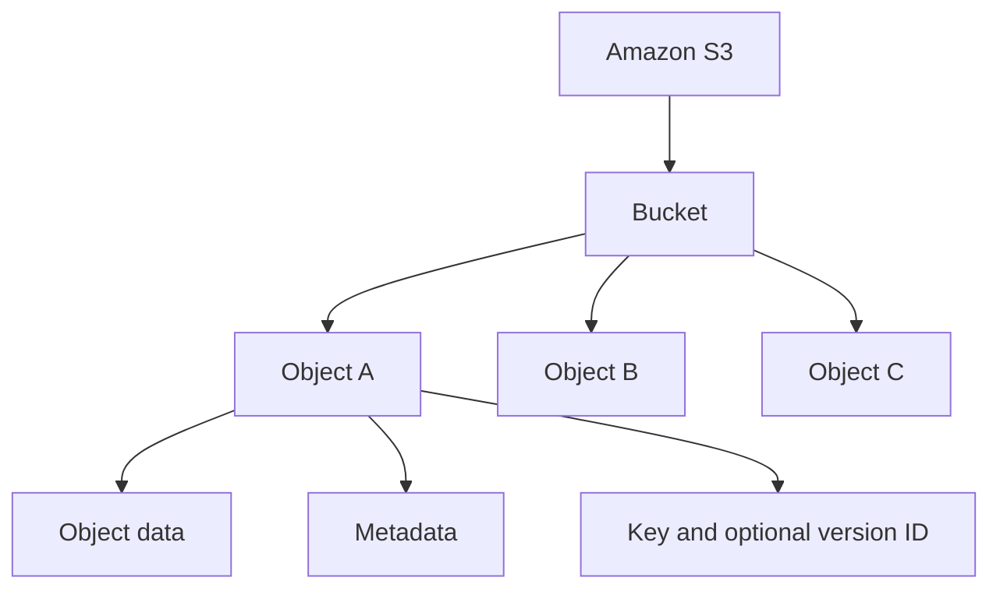

---

## 2. Why use S3?

S3 provides storage management and access-control capabilities so an organization can organize, protect, monitor, and optimize stored data.

Important characteristics and capabilities include:

- **Scalability:** Store very large numbers of objects without provisioning a traditional file-server capacity in advance.
- **Durability and availability choices:** Storage classes are designed for different durability, availability, latency, and retrieval requirements.
- **Security:** Private-by-default resources, IAM policies, bucket policies, Block Public Access, access points, and encryption.
- **Data protection:** Versioning, replication, Object Lock, and lifecycle rules.
- **Event integration:** Object-related events can trigger SNS, SQS, Lambda, or EventBridge workflows.
- **Analytics integration:** S3 data can be used by services such as Athena, Redshift, EMR, and Apache Spark.
- **Visibility:** CloudWatch metrics, CloudTrail, server access logging, Storage Lens, and Inventory.

### Common use cases

| Use case | Example |
|---|---|
| Data lake | Store raw, cleaned, and curated datasets |
| Backup | Retain application or database backups |
| Archive | Keep infrequently accessed records for long periods |
| Static assets | Store images, documents, and downloadable files |
| Event-driven processing | Trigger processing when new files arrive |
| Analytics | Query and process files with Athena, Spark, or other engines |
| ML data | Store training data and vector data in supported S3 bucket types |

---

## 3. Core object-storage model

The basic S3 hierarchy is:

```text
AWS Account
└── AWS Region
    └── S3 Bucket
        ├── Object: customers/2026/part-0001.parquet
        ├── Object: customers/2026/part-0002.parquet
        └── Object: orders/2026/part-0001.parquet
```

For a general purpose bucket, the apparent folder structure is normally represented by **object-key prefixes**. The key is still a string; the slash character is used as a delimiter to make keys look hierarchical.

### Object identity

An object is identified by:

```text
Bucket name + Object key + Optional version ID
```

For example:

```text
Bucket: company-data-lake
Key:    raw/orders/year=2026/month=11/orders.parquet
Version: (present when versioning is enabled)
```

The key `raw/orders/year=2026/month=11/orders.parquet` identifies one object within the bucket. If versioning is enabled, the same key can have multiple versions.

---

## 4. Bucket types

The current S3 overview describes four bucket types. They are designed for different data and performance requirements.

| Bucket type | Main purpose | Important characteristics |
|---|---|---|
| **General purpose bucket** | Most general S3 workloads | Original S3 bucket type; recommended for most use cases and access patterns; supports broad storage-class choices |
| **Directory bucket** | Low-latency and certain data-residency workloads | Organizes objects using directory-style structure; Availability Zone directory buckets support S3 Express One Zone |
| **Table bucket** | Tabular data and analytics | Purpose-built for Apache Iceberg tables; can be queried using services including Athena, Redshift, and Spark |
| **Vector bucket** | Vector embeddings and similarity search | Stores and queries vector data using vector indexes; supports dimensions, distance metrics, and metadata configuration |

### 4.1 General purpose buckets

- Recommended for most use cases and access patterns.
- Objects can use the supported S3 storage classes, except S3 Express One Zone.
- Bucket names use an AWS namespace. In the shared global namespace, a name must be unique across accounts within an AWS partition.
- Buckets and objects are private by default.

### 4.2 Directory buckets

- Designed for low-latency or data-residency use cases.
- Directory buckets in Availability Zones support S3 Express One Zone.
- S3 Express One Zone is intended for latency-sensitive workloads that benefit from single-digit millisecond object operations.
- Directory buckets have public access disabled by default, and that behavior cannot be changed.
- Directory-bucket authorization and API behavior have differences from general purpose buckets; check the relevant AWS documentation before reusing general-purpose-bucket instructions.

### 4.3 Table buckets

- Designed for tabular data such as transactions, sensor records, and ad impressions.
- S3 Tables are purpose-built for tables stored in Apache Iceberg format.
- They are designed for analytics and machine-learning workloads.
- AWS documents integrations with Athena, Redshift, and Apache Spark.
- Table buckets and tables are private and cannot be made public; access is granted through IAM identity- and resource-based policies.

### 4.4 Vector buckets

- Designed to store and query vector embeddings.
- Organize vectors using vector indexes.
- Index configuration can include vector dimensions, distance metrics such as cosine similarity, and metadata configuration.
- Can be integrated with services such as Amazon Bedrock and Amazon OpenSearch.

### Visual: choosing a bucket type

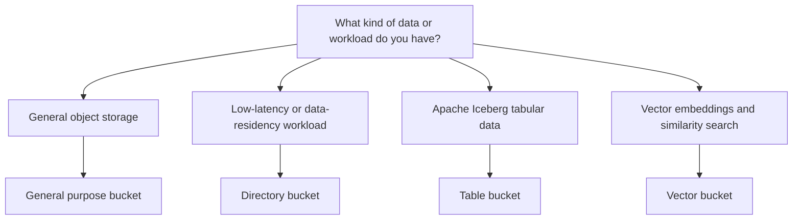

---

## 5. Buckets, Regions, names, and namespaces

### Buckets

A bucket is the top-level container for objects in S3. When creating a bucket, select its name and Region.

Important points:

- A bucket name cannot be changed after creation.
- A bucket's Region cannot be changed after creation.
- The bucket identifies the account responsible for storage and data-transfer charges.
- Buckets are also used to aggregate S3 usage reporting.
- Bucket naming rules vary by bucket type; follow the corresponding AWS naming rules.

### Regions

Choose a Region based on factors such as:

- Latency to applications and users.
- Data-residency or regulatory requirements.
- Service availability.
- Cost, including transfer and replication costs.

Objects remain in the Region where the bucket is located unless you explicitly transfer or replicate them elsewhere.

### General purpose bucket namespace

AWS documents multiple namespaces for general purpose buckets:

- **Shared global namespace:** Bucket names are unique across all AWS accounts in an AWS partition.
- **Account regional namespace:** A name is unique to the account and Region namespace as documented by AWS.

AWS partitions include standard AWS Regions (`aws`), China Regions (`aws-cn`), AWS GovCloud (US) (`aws-us-gov`), and the European Sovereign Cloud partition (`aws-eusc`).

---

## 6. Objects, keys, prefixes, and metadata

### Objects

An S3 object consists of:

1. **Object data:** The bytes being stored, such as a CSV, Parquet file, image, JSON document, or backup.
2. **Object metadata:** Name-value pairs describing the object.
3. **Object key:** The unique name of the object within its bucket.
4. **Version ID (optional):** Identifies a specific version when bucket versioning is enabled.

Metadata can include system-defined values such as the last-modified date and HTTP metadata such as `Content-Type`. Applications can also set custom metadata when storing an object.

### Keys

An object key is the unique identifier of an object inside its bucket. It is not a separate folder path in the general purpose bucket model.

Example:

```text
raw/sales/year=2026/month=11/part-00001.parquet
```

The key includes the characters `raw/sales/year=2026/month=11/part-00001.parquet`.

### Prefixes and folder-like organization

A prefix is a string at the beginning of an object key. A slash (`/`) is often used as a delimiter to create a folder-like naming convention.

Example keys:

```text
raw/orders/orders-001.json
raw/orders/orders-002.json
raw/customers/customers-001.json
processed/orders/year=2026/month=11/part-0001.parquet
curated/sales/year=2026/month=11/part-0001.parquet
```

The prefixes help organize data and can be used in access-control rules. In general purpose buckets, these prefixes do not represent traditional physical directories.

### Tags

Object tags are key-value pairs that can be used to:

- Categorize and organize objects.
- Support cost allocation and analysis.
- Apply access-control rules based on object tags.

### Visual: bucket, prefix, and key

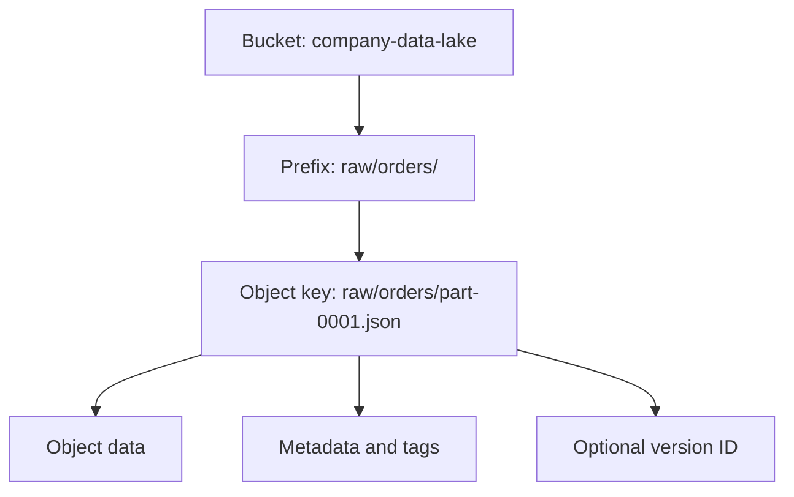

---

## 7. S3 storage classes

Each S3 object has a storage class. If no storage class is specified during upload, S3 Standard is the default for general purpose bucket objects.

Choose a storage class based on access frequency, latency, availability, resilience, retrieval requirements, and cost—not simply the lowest storage price.

### Storage-class comparison

| Storage class | Typical use case | Retrieval behavior | Key considerations |
|---|---|---|---|
| **S3 Standard** | Frequently accessed data | Millisecond access | General-purpose default; designed for frequent access |
| **S3 Intelligent-Tiering** | Unknown or changing access patterns | Automatic access-tier optimization | Monitoring and automation fee; no retrieval fees for its access tiers as documented by AWS |
| **S3 Standard-IA** | Long-lived, infrequently accessed data | Millisecond access | Retrieval fees; minimum storage duration and minimum billable object size apply |
| **S3 One Zone-IA** | Infrequently accessed, recreatable data | Millisecond access | Stored in one Availability Zone; not resilient to loss of that AZ |
| **S3 Express One Zone** | Latency-sensitive workloads | Single-digit millisecond access target | Single-AZ storage class used with directory buckets |
| **S3 Glacier Instant Retrieval** | Rarely accessed archive that needs fast retrieval | Millisecond access | Minimum storage duration and retrieval charges apply |
| **S3 Glacier Flexible Retrieval** | Long-term archive where retrieval can take minutes to hours | Restore before access | Archive storage; minimum duration and retrieval charges apply |
| **S3 Glacier Deep Archive** | Very long-term archive | Restore can take hours | Lowest-cost S3 archive tier; minimum duration and retrieval charges apply |
| **Reduced Redundancy Storage (RRS)** | Legacy/noncritical reproducible data | Millisecond access | AWS recommends not using this class; Standard is more cost-effective |

### Intelligent-Tiering access tiers

S3 Intelligent-Tiering automatically moves objects between access tiers based on access patterns. AWS documents:

- Frequent Access tier.
- Infrequent Access tier.
- Archive Instant Access tier.
- Optional Archive Access tier.
- Optional Deep Archive Access tier.

Objects smaller than 128 KB are not monitored for automatic tiering and remain in the Frequent Access tier, according to the storage-class documentation. Archive Access and Deep Archive Access require asynchronous retrieval and restoration before access.

### Important storage-class considerations

- Standard-IA and One Zone-IA are intended for objects larger than 128 KB that are expected to be stored for at least 30 days.
- Glacier Instant Retrieval and Glacier Flexible Retrieval have a 90-day minimum storage duration in the comparison table; Deep Archive has a 180-day minimum.
- Retrieval fees can apply to infrequent-access and archive classes.
- One Zone-IA and Express One Zone are not designed to be resilient to the physical loss of an Availability Zone in the same way as multi-AZ classes.
- Check the current AWS pricing page before choosing a class; charges also depend on requests, retrieval, transitions, and data transfer.

### Visual: storage-class selection

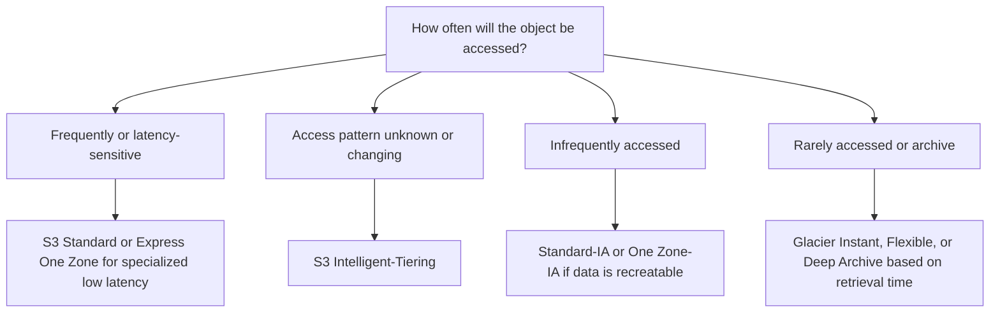

---

## 8. Lifecycle management

**S3 Lifecycle** helps manage objects automatically over time. A lifecycle configuration contains rules that apply to a group of objects.

Two primary action types are:

### 8.1 Transition actions

Move objects to another storage class when they reach a specified age or meet the rule's filter conditions.

Example policy concept:

- Keep newly uploaded data in S3 Standard.
- Move older data to Standard-IA after its frequent-access period.
- Move long-term archive data to S3 Glacier Flexible Retrieval.

### 8.2 Expiration actions

Delete objects when they reach the configured expiration point.

Examples:

- Delete temporary processing files after a retention period.
- Expire short-lived application logs.
- Expire old object versions when the retention policy allows it.

### Important lifecycle behavior

- Lifecycle rules can apply to existing objects as well as objects uploaded after the rule is created.
- Transition requests can have costs.
- Some storage classes have minimum storage durations and minimum billable object sizes.
- Lifecycle expiration can create delete markers in versioning-enabled buckets; it does not necessarily permanently remove all historical versions.
- A lifecycle configuration can be used to manage current and noncurrent versions.
- For general purpose buckets, a bucket policy cannot prevent S3 Lifecycle from performing actions configured by a lifecycle rule.

### Visual: example object lifecycle

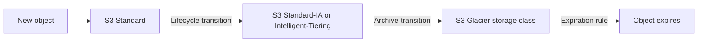

**Design note:** The ages and destination classes in a lifecycle policy must reflect business retention, recovery-time requirements, access patterns, and the current AWS pricing model.

---

## 9. Versioning and delete markers

**S3 Versioning** maintains multiple variants of an object in the same bucket. It can help recover from accidental overwrites and deletions.

### Versioning states

A general purpose bucket can be:

- **Unversioned:** Versioning has not been enabled.
- **Versioning-enabled:** S3 stores multiple versions of objects.
- **Versioning-suspended:** Versioning is suspended; existing versions remain, but new writes follow suspended-versioning behavior.

### How versioning works

- Each new object version receives a unique version ID.
- Existing objects when versioning is first enabled have a `null` version ID.
- Overwriting an object creates a new version instead of replacing the previous version permanently.
- Deleting an object without specifying a version ID generally adds a **delete marker** as the current version in a versioning-enabled bucket.
- Previous versions remain stored until they are explicitly deleted or managed through lifecycle rules.

### Delete marker

A delete marker is a special version that makes an object appear deleted in normal listings and reads. It does not immediately erase previous object versions.

To recover an object hidden by a delete marker, remove the delete marker so that an older version becomes current. Permanently deleting a specific version is a separate operation and cannot be undone.

### Visual: versioning and delete marker

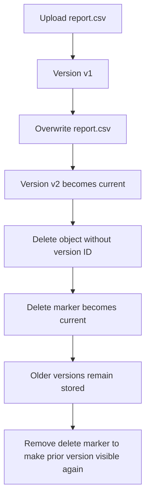

### Versioning best practices

- Enable versioning when recovery from accidental overwrites or deletes is important.
- Use lifecycle rules to manage noncurrent versions and expired delete markers.
- Understand that versioning can increase storage usage because prior versions remain stored.
- For replication, both source and destination buckets must have versioning enabled.
- Do not confuse a delete marker with permanent deletion of all object versions.

---

## 10. Replication

S3 Replication automatically copies objects and their metadata and tags from a source bucket to one or more destination buckets.

Common replication patterns:

- **Same-Region Replication (SRR):** Replicate objects to a bucket in the same AWS Region.
- **Cross-Region Replication (CRR):** Replicate objects to a bucket in a different AWS Region.

Possible reasons to use replication include:

- Compliance and data-residency requirements.
- Maintaining copies in a separate account or Region.
- Reducing access latency for geographically distributed users.
- Operational recovery and data protection.

### Key requirements and considerations

- Source and destination buckets must have versioning enabled.
- S3 needs permission to replicate objects on your behalf.
- Source and destination Regions must be enabled for the relevant accounts.
- Cross-Region transfer can incur data-transfer charges; review current pricing.
- Replication is a copy mechanism, not a substitute for a well-designed backup and recovery policy.

### Visual: cross-Region replication

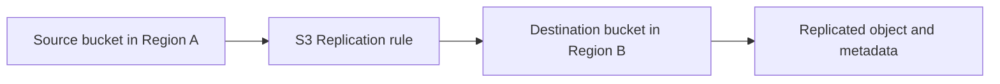

---

## 11. S3 Object Lock

**S3 Object Lock** helps prevent objects from being deleted or overwritten for a fixed period or indefinitely. It implements a write-once-read-many (WORM) model.

Object Lock works with versioning-enabled buckets.

### Retention controls

- **Retention period:** A time period during which an object version is protected.
- **Legal hold:** A hold with no automatic expiration; it remains until explicitly removed.

### Retention modes

| Mode | Behavior |
|---|---|
| **Governance mode** | Users with specific permissions can bypass governance retention; ordinary users cannot change or delete protected versions |
| **Compliance mode** | A protected version cannot be overwritten or deleted by any user, including the AWS account root user, until retention expires |

A legal hold can protect an object version independently of a retention period.

### When to consider Object Lock

- Regulatory or legal retention requirements.
- WORM retention for records and audit data.
- Additional protection against accidental or malicious deletion.

**Important:** Understand the retention mode and operational consequences before enabling Object Lock. Compliance-mode protection is intentionally difficult to bypass.

---

## 12. Security and access management

S3 buckets and objects are private by default. Access must be explicitly granted through the applicable identity- and resource-based controls.

### 12.1 IAM identity-based policies

IAM policies can be attached to IAM users, groups, and roles. They specify which S3 actions an identity can perform on which resources.

Examples of actions include:

- `s3:ListBucket` — list objects in a bucket.
- `s3:GetObject` — read an object.
- `s3:PutObject` — upload an object.
- `s3:DeleteObject` — delete an object.

The required permissions depend on the API operation and resource type. Check the S3 API permissions reference for exact requirements.

### 12.2 Bucket policies

A bucket policy is a resource-based IAM policy attached to a bucket. It can allow or deny access based on policy elements such as:

- Principal (who is making the request).
- Action (what operation is requested).
- Resource (which bucket or object is targeted).
- Condition (additional request attributes, such as source network or other supported condition keys).

Bucket policies are useful for bucket-wide and prefix-specific access rules, including cross-account access.

### 12.3 S3 Block Public Access

S3 Block Public Access provides settings to block public access to buckets and objects. AWS recommends keeping Block Public Access enabled unless there is a well-understood requirement to disable a setting.

### 12.4 S3 Object Ownership and ACLs

- S3 Object Ownership controls ownership behavior for objects uploaded to a bucket.
- The default **Bucket owner enforced** setting disables ACLs and makes the bucket owner own the objects.
- AWS recommends policies over ACLs for most modern use cases.
- Keep ACLs disabled unless an application specifically requires object-level ACL behavior.

### 12.5 Access points

An S3 access point is a named network endpoint with its own access point policy. Access points simplify access management for shared datasets.

An access point can be configured to accept requests only from a VPC. Access point policies work with the policy attached to the underlying bucket.

### 12.6 Other access-management capabilities

- **IAM Access Analyzer for S3:** Helps evaluate and monitor bucket access policies.
- **S3 Access Grants:** Supports granting access to S3 data for IAM identities and supported corporate-directory identities.
- **Multi-Region Access Points:** Provide a global endpoint for requests across buckets in multiple Regions.
- **Prefixes and tags:** Can help organize data and scope access rules.

### Visual: simplified S3 access path

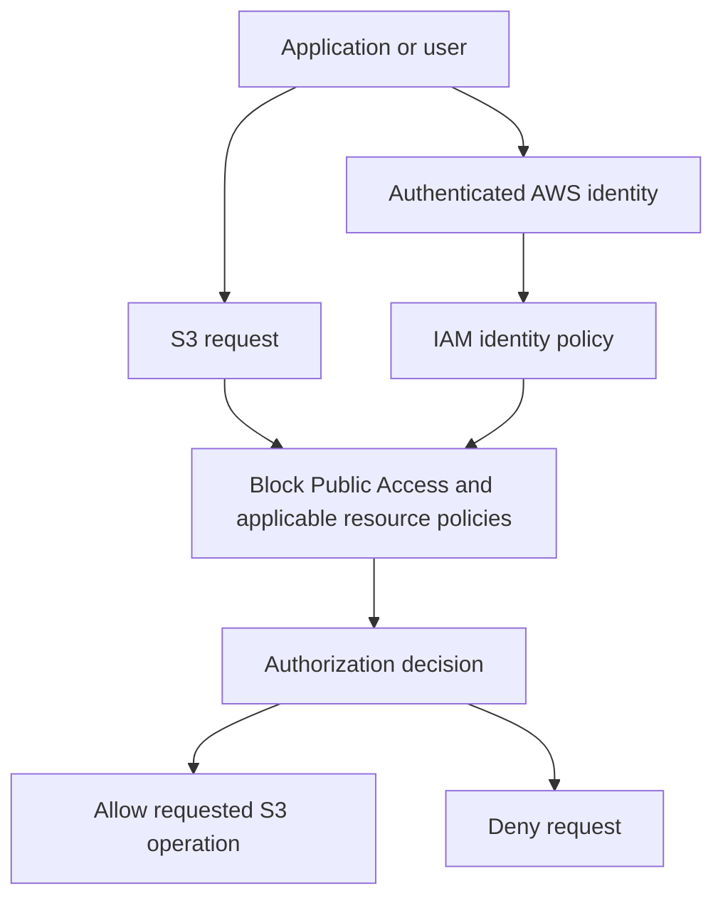

This diagram is a conceptual overview. Actual authorization evaluation can involve multiple policy types, explicit denies, service control policies, permissions boundaries, session policies, access point policies, and other applicable controls.

### Security checklist

- Keep S3 Block Public Access enabled by default.
- Grant only the permissions required by the workload.
- Prefer IAM roles for applications and compute services instead of embedding long-lived credentials.
- Prefer bucket policies and IAM policies over ACLs unless ACLs are explicitly needed.
- Review cross-account access carefully.
- Use Access Analyzer and CloudTrail to help review access and activity.
- Encrypt data and use secure transport.

---

## 13. Encryption and data protection

S3 protects data both **in transit** and **at rest**.

### Encryption in transit

Use HTTPS with TLS when sending requests to S3. The AWS documentation also describes client-side encryption as an option in which the application encrypts data before sending it to S3.

### Server-side encryption

For server-side encryption, S3 encrypts objects before saving them to disks in AWS data centers and decrypts them when they are downloaded.

AWS documents the following server-side encryption choices:

| Encryption option | Key management concept |
|---|---|
| **SSE-S3** | S3-managed encryption keys; default baseline for S3 buckets and new uploads |
| **SSE-KMS** | Uses AWS Key Management Service keys |
| **DSSE-KMS** | Dual-layer server-side encryption using AWS KMS keys |
| **SSE-C** | Uses customer-provided encryption keys with the request |

S3 automatically encrypts new object uploads at rest with SSE-S3 by default. A bucket can be configured to use another supported default encryption option, or the encryption type can be specified in the request where supported.

### Additional data-protection features

- Versioning helps recover previous object versions.
- Replication copies objects to destination buckets.
- Object Lock can protect object versions from deletion or overwrite.
- Lifecycle policies manage storage transitions and expiration.
- IAM, bucket policies, Block Public Access, and access points control access.

### Visual: protection layers

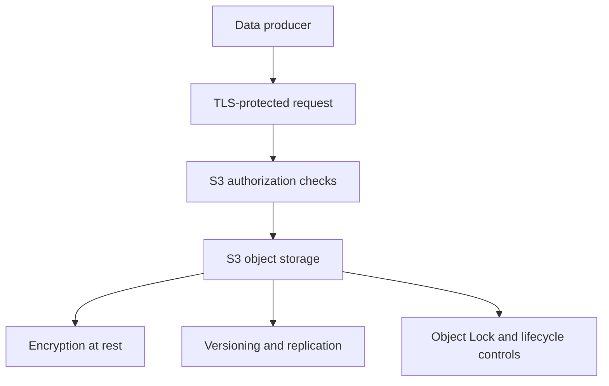

---

## 14. S3 event notifications

S3 Event Notifications can publish messages when selected events occur in a bucket. A notification configuration specifies:

1. Which events to watch.
2. Which destination receives the notification.
3. Optional filtering rules, such as object key prefix or suffix.

### Common event categories

Examples include:

- Object creation events.
- Object removal events.
- Object restore events.
- Replication events.
- Lifecycle expiration and transition events.
- Object tagging and retention events.

### Supported notification destinations

S3 can send notifications to:

- Amazon SNS topics.
- Amazon SQS queues.
- AWS Lambda functions.
- Amazon EventBridge.

### Delivery semantics

- S3 Event Notifications are designed for **at-least-once delivery**.
- Notifications are typically delivered within seconds, but can take a minute or longer.
- Events are not guaranteed to arrive in the same order in which the operations occurred.
- Duplicate notifications can occur.

Therefore, event-driven processing should be designed to be **idempotent** and tolerant of duplicate or out-of-order events.

### Visual: event-driven S3 ingestion

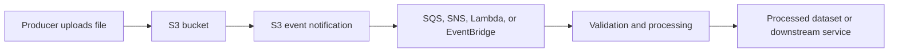

### Example data-engineering flow

1. A source system uploads a JSON or CSV file to an S3 landing prefix.
2. S3 emits an object-created event.
3. The event is delivered to SQS, Lambda, or EventBridge.
4. A consumer validates the event and identifies the bucket and object key.
5. The consumer reads the object and processes it.
6. The pipeline writes the output to a processed or curated prefix.

**Avoid recursive trigger loops:** If a Lambda function writes output back to the same bucket and the bucket notification also watches that output prefix, the function can trigger itself. Use separate input/output buckets or carefully scoped prefix/suffix filters.

---

## 15. Multipart upload

Multipart upload allows a single object to be uploaded as a collection of parts.

### How multipart upload works

1. Initiate the multipart upload.
2. Upload each part independently; parts can be uploaded in parallel and in any order.
3. If a part fails, retry that part without retransmitting successful parts.
4. Complete the multipart upload.
5. S3 assembles the parts into the final object.

If the upload is not completed successfully, S3 does not create the final object from those uploaded parts. The upload should be completed or aborted so that stored parts do not continue to incur storage charges.

### Benefits

- Improved throughput through parallel part uploads.
- Recovery from network failures by retrying only failed parts.
- Suitable for large objects.

AWS recommends considering multipart upload for objects around 100 MB or larger.

### Visual: multipart upload

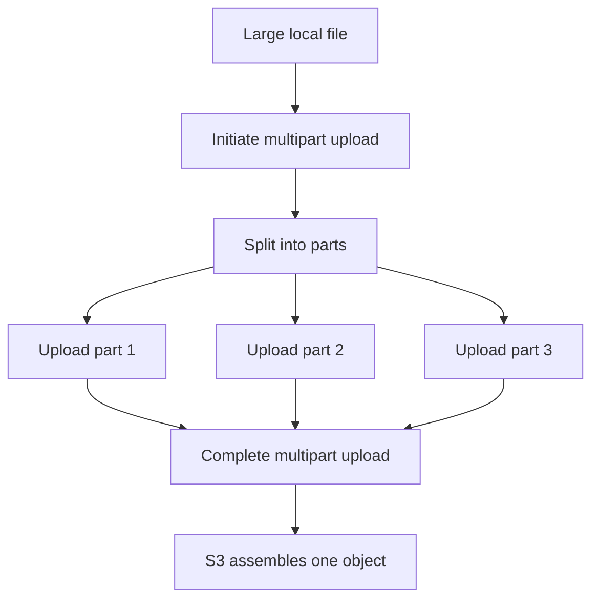

### Multipart upload best practices

- Use multipart upload for large objects where it improves throughput and retry behavior.
- Choose part sizes and concurrency based on the workload and current S3 limits.
- Retry failed parts rather than restarting the whole upload when possible.
- Abort incomplete uploads when they are no longer required.
- Consider a lifecycle rule to abort incomplete multipart uploads if your workflow may leave them behind.

---

## 16. Consistency and concurrent writes

Amazon S3 provides **strong read-after-write consistency** for object PUT and DELETE operations in all AWS Regions.

After a successful write:

- A subsequent GET can read the new object data.
- A subsequent LIST can include the newly written object.
- After a successful delete, a subsequent GET does not return the deleted object, and LIST does not include it.
- Reads of relevant object metadata and tags are also strongly consistent as described in the S3 consistency documentation.

### Atomic updates for one key

Updates to a single key are atomic. A reader gets either the old object data or the new object data; it does not get a partially written object.

### Concurrent writes

S3 does not provide an application-level object lock for concurrent writers to the same key. If concurrent PUT requests target the same key, the request with the latest timestamp wins according to S3's documented behavior. If applications need a different conflict-resolution model, they must implement it.

### Consistency is not a multi-object transaction

S3 consistency is key-based. It does not provide an atomic transaction across multiple object keys. If a workflow needs coordinated updates across keys, implement application-level commit/manifest logic or use a suitable transactional table format/service.

### Bucket configuration consistency

Bucket configuration changes use an eventual consistency model. AWS notes that after enabling versioning for the first time, it can take time for the change to propagate; the guide recommends waiting 15 minutes before issuing object write or delete operations.

### Visual: strong consistency after PUT

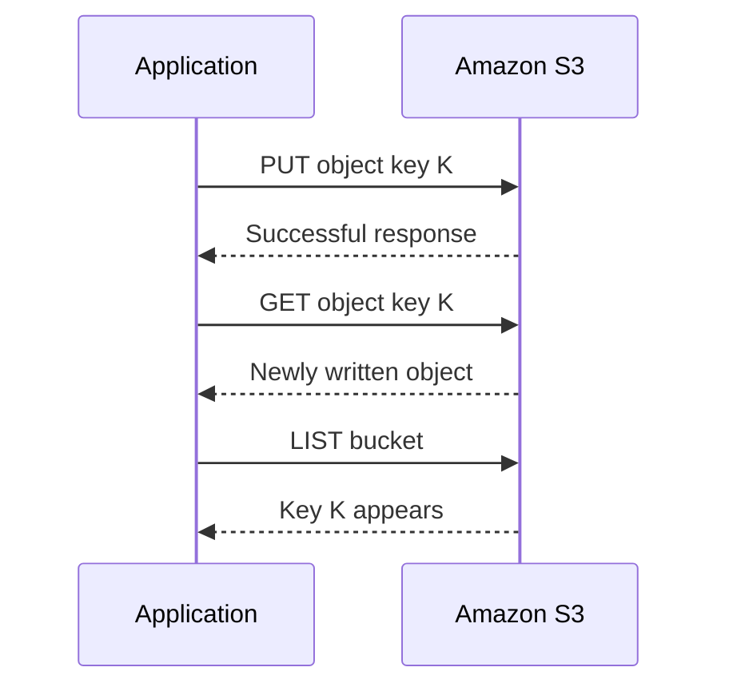

---

## 17. Monitoring, logging, and analytics

S3 provides monitoring and analytics capabilities to understand how buckets and objects are used.

| Tool | Purpose |
|---|---|
| **Amazon CloudWatch metrics for S3** | Monitor operational metrics and configure billing alerts for supported metrics |
| **AWS CloudTrail** | Record S3 API activity performed by users, roles, and AWS services |
| **S3 Server Access Logging** | Record detailed requests made to a bucket |
| **S3 Storage Lens** | Aggregate storage usage and activity metrics across accounts, Regions, buckets, and prefixes |
| **S3 Storage Class Analysis** | Analyze access patterns to inform storage-class decisions |
| **S3 Inventory** | Produce reports about objects and metadata, including properties such as encryption and replication status |
| **AWS Trusted Advisor** | Identify relevant optimization, security, performance, and quota recommendations |

### Monitoring questions to ask

- Which buckets and prefixes consume the most storage?
- Which object types or age groups dominate storage usage?
- Are objects encrypted as expected?
- Are replication rules keeping up with workload requirements?
- Are there unexpectedly public or broadly accessible resources?
- Are request patterns or estimated costs changing?
- Are lifecycle rules transitioning and expiring the expected objects?

### Visual: S3 observability

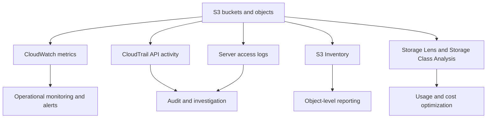

---

## 18. Accessing S3: Console, CLI, SDK, and REST API

AWS supports several ways to interact with S3.

### 18.1 AWS Management Console

A web-based user interface for creating buckets, uploading objects, configuring access, and managing S3 features.

### 18.2 AWS Command Line Interface (CLI)

The AWS CLI lets you issue S3 commands from Windows, macOS, and Linux terminals and automate operations in scripts.

### 18.3 AWS SDKs

AWS SDKs provide language-specific libraries for accessing S3 programmatically. The SDK handles tasks such as request signing, retries, and error handling.

Examples include SDKs for Python, Java, .NET, JavaScript, and other supported languages.

### 18.4 Amazon S3 REST API

S3 exposes an HTTP REST API for creating, reading, listing, and deleting buckets and objects. When using the REST API directly, the application must construct and sign authenticated requests appropriately.

AWS recommends using REST APIs or SDKs rather than the deprecated SOAP API for new development.

### Visual: ways to access S3

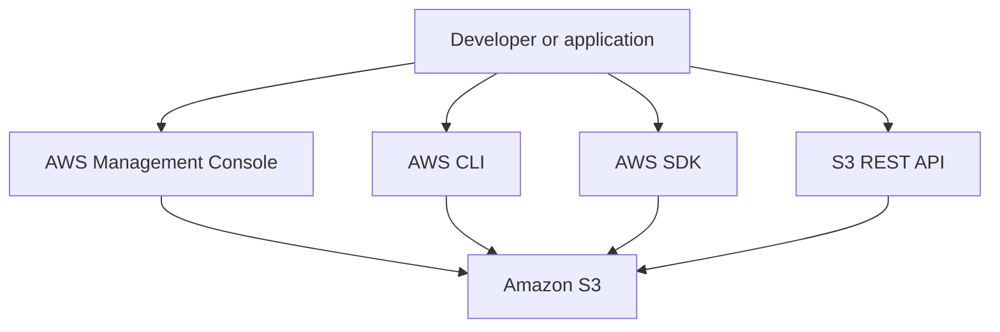

---

## 19. S3 in data engineering

S3 is commonly used as the storage layer for data lakes and cloud data platforms.

### 19.1 Typical data-lake zones

A simple organization pattern is:

```text
s3://company-data-lake/
├── landing/
│   └── source=crm/ingest_date=2026-11-04/
├── raw/
│   └── source=crm/entity=customer/
├── curated/
│   └── domain=sales/table=orders/
└── quarantine/
    └── source=crm/reason=invalid-schema/
```

This is an example key layout, not a special S3 directory feature. General purpose buckets use object keys and prefixes to represent this organization.

### 19.2 Example architecture: batch ingestion

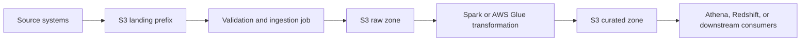

### 19.3 Example architecture: event-driven ingestion

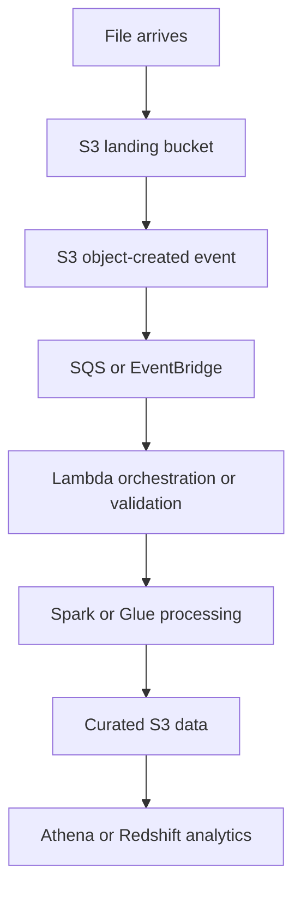

### 19.4 S3 and analytics services

The AWS S3 overview identifies integrations and related services such as:

- **Amazon Athena:** Query data stored in S3 using SQL.
- **Amazon EMR:** Run big-data frameworks using AWS-managed cluster infrastructure and S3 data.
- **Amazon Redshift:** Use S3 as part of analytics and data-loading workflows.
- **Apache Spark:** Read and write datasets in S3 as part of distributed processing.
- **AWS Transfer Family:** Transfer files into and out of S3 using managed file-transfer protocols.

### 19.5 Data-engineering design considerations

- Use predictable prefixes for source, entity, date, and processing stage.
- Keep raw source data when retention and replay requirements justify it.
- Separate landing, raw, curated, and quarantine data to make pipeline responsibilities explicit.
- Use object metadata and tags where they help cataloging, governance, or cost allocation.
- Use lifecycle policies to manage aging data and noncurrent versions.
- Make event-triggered consumers idempotent because notifications can be duplicated or out of order.
- Avoid writing output into a prefix that triggers the same consumer unless recursion is intentionally controlled.
- Prefer columnar analytical formats such as Parquet when appropriate for downstream query patterns; the format choice is a data-platform design decision, not an S3 storage-class setting.
- For Iceberg table data, understand the distinction between ordinary objects in a general purpose bucket and managed S3 Tables in table buckets.

---

## 20. Cost management considerations

S3 pricing is usage-based. The AWS overview emphasizes that customers pay for the services and resources they use. Actual charges depend on the pricing dimensions applicable to the bucket, Region, storage class, requests, retrieval, transitions, and data transfer.

Cost considerations include:

1. **Storage volume:** Total bytes retained and the storage class used.
2. **Request volume:** PUT, GET, LIST, and other request types.
3. **Retrieval:** Some infrequent-access and archive classes charge for retrieving data.
4. **Minimum storage duration:** Early deletion or transition can result in minimum-duration charges.
5. **Minimum billable object size:** Certain classes have minimum billable object sizes.
6. **Lifecycle transitions:** Transition requests can have charges.
7. **Replication and transfer:** Cross-Region or external data transfers can add charges.
8. **Versioning:** Previous versions remain stored and contribute to storage usage.
9. **Incomplete multipart uploads:** Uploaded parts consume storage until the multipart upload is completed or aborted.
10. **Monitoring features:** Some analytics or tiering features have monitoring costs.

### Cost optimization workflow

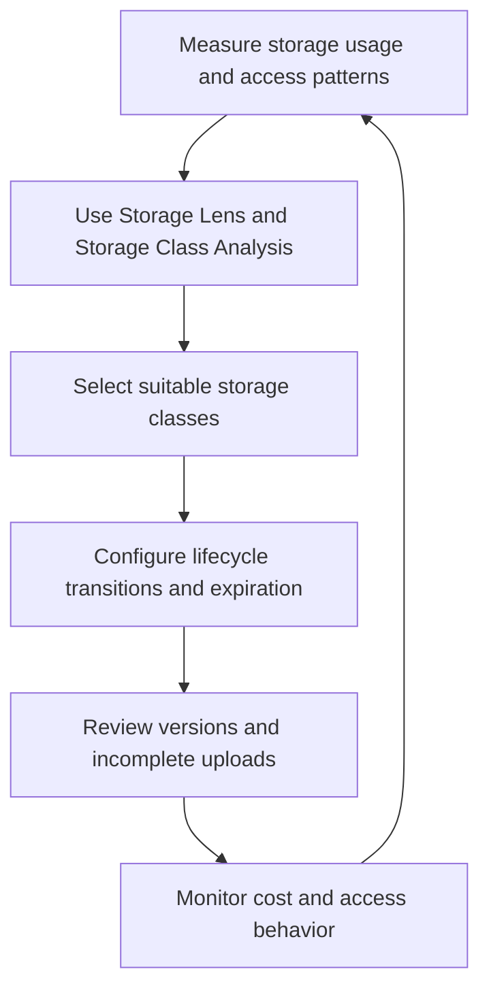

**Always verify:** Current prices, retrieval times, minimum durations, regional availability, and feature-specific charges on the [Amazon S3 pricing page](https://aws.amazon.com/s3/pricing/).

---

## 21. Practical AWS CLI examples

> These are illustrative commands for a general purpose bucket. Replace bucket names, Region, and object keys with values from your own AWS account. Ensure your CLI credentials and IAM permissions are configured first.

### Create a bucket

```bash
aws s3api create-bucket \
  --bucket my-unique-data-bucket-12345 \
  --region ap-south-1 \
  --create-bucket-configuration LocationConstraint=ap-south-1
```

### List buckets

```bash
aws s3 ls
```

### Upload a file

```bash
aws s3 cp ./orders.csv s3://my-unique-data-bucket-12345/raw/orders/orders.csv
```

### List objects under a prefix

```bash
aws s3 ls s3://my-unique-data-bucket-12345/raw/orders/
```

### Download an object

```bash
aws s3 cp \
  s3://my-unique-data-bucket-12345/raw/orders/orders.csv \
  ./orders.csv
```

### Copy an object

```bash
aws s3 cp \
  s3://my-unique-data-bucket-12345/raw/orders/orders.csv \
  s3://my-unique-data-bucket-12345/backup/orders/orders.csv
```

### Inspect object metadata

```bash
aws s3api head-object \
  --bucket my-unique-data-bucket-12345 \
  --key raw/orders/orders.csv
```

### Enable versioning

```bash
aws s3api put-bucket-versioning \
  --bucket my-unique-data-bucket-12345 \
  --versioning-configuration Status=Enabled
```

After enabling versioning for the first time, follow AWS guidance on propagation time before issuing object write or delete operations.

### Inspect versioning configuration

```bash
aws s3api get-bucket-versioning \
  --bucket my-unique-data-bucket-12345
```

### Remove a local copy

```bash
rm ./orders.csv
```

This last command deletes a local file only; it does not delete the S3 object.

---

## 22. Python example with Boto3

> This is a practical SDK illustration. It assumes Boto3 is installed and AWS credentials are supplied through a supported credential provider (for example, an IAM role, AWS CLI profile, or environment-based credentials). Do not hardcode access keys in source code.

### Upload and inspect an object

```python
from __future__ import annotations

import logging
from pathlib import Path

import boto3
from botocore.exceptions import BotoCoreError, ClientError


logging.basicConfig(level=logging.INFO)
logger = logging.getLogger(__name__)


def upload_file_to_s3(
    file_path: str,
    bucket_name: str,
    object_key: str,
) -> None:
    """Upload a local file to an S3 bucket and inspect its metadata."""
    path = Path(file_path)
    if not path.is_file():
        raise FileNotFoundError(f"File does not exist: {path}")

    s3 = boto3.client("s3")

    try:
        s3.upload_file(str(path), bucket_name, object_key)
        logger.info("Uploaded s3://%s/%s", bucket_name, object_key)

        response = s3.head_object(Bucket=bucket_name, Key=object_key)
        logger.info("Object size: %s bytes", response.get("ContentLength"))
        logger.info("Last modified: %s", response.get("LastModified"))
        logger.info("Encryption: %s", response.get("ServerSideEncryption"))

    except (BotoCoreError, ClientError) as exc:
        logger.exception("S3 operation failed")
        raise RuntimeError("Unable to upload or inspect S3 object") from exc


if __name__ == "__main__":
    upload_file_to_s3(
        file_path="orders.csv",
        bucket_name="my-unique-data-bucket-12345",
        object_key="raw/orders/orders.csv",
    )
```

### List objects with a paginator

```python
import boto3
from botocore.exceptions import BotoCoreError, ClientError


def list_s3_objects(bucket_name: str, prefix: str = "") -> list[str]:
    """Return object keys under a prefix, handling paginated results."""
    s3 = boto3.client("s3")
    keys: list[str] = []
    paginator = s3.get_paginator("list_objects_v2")

    try:
        for page in paginator.paginate(Bucket=bucket_name, Prefix=prefix):
            for item in page.get("Contents", []):
                keys.append(item["Key"])
    except (BotoCoreError, ClientError) as exc:
        raise RuntimeError("Unable to list S3 objects") from exc

    return keys
```

---

## 23. Common interview questions

### Fundamentals

**1. What is Amazon S3?**

Amazon S3 is an AWS object storage service. It stores objects inside buckets and provides management, security, data-protection, event, and monitoring features.

**2. What is the difference between a bucket and an object?**

A bucket is a container for objects. An object is the stored data plus its metadata, identified by a key within the bucket.

**3. What is an S3 object key?**

A key is the unique name of an object within a bucket. Prefixes such as `raw/orders/` are part of the key string and provide folder-like organization in general purpose buckets.

**4. Is S3 a file system?**

S3 is object storage. General purpose bucket prefixes can look like directories, but they are not traditional physical directories.

**5. What are the four bucket types described in the current S3 overview?**

General purpose, directory, table, and vector buckets.

### Storage and lifecycle

**6. What is an S3 storage class?**

A storage class defines the storage tier associated with an object. The appropriate class depends on access frequency, latency, availability, retrieval needs, and cost.

**7. When would you use S3 Intelligent-Tiering?**

When object access patterns are unknown or change over time and automatic movement between supported access tiers is useful.

**8. What is the difference between Standard-IA and One Zone-IA?**

Standard-IA stores data redundantly across multiple Availability Zones. One Zone-IA stores data in one Availability Zone and is less resilient to the loss of that Zone.

**9. What is S3 Lifecycle?**

A set of rules that can transition objects between storage classes or expire objects based on configured filters and timing.

**10. Can lifecycle rules affect objects that already exist?**

Yes. AWS documents that a newly added lifecycle configuration applies to existing as well as new objects that match the rule.

### Data protection and security

**11. What is S3 Versioning?**

A feature that stores multiple versions of an object in a bucket so previous versions can be retrieved or restored.

**12. What is a delete marker?**

A special current version that makes an object appear deleted in a versioning-enabled bucket while previous versions remain stored.

**13. What is the difference between an IAM policy and a bucket policy?**

An IAM identity-based policy is attached to an identity such as a role or user. A bucket policy is a resource-based policy attached to a bucket.

**14. What is S3 Block Public Access?**

A collection of settings that helps prevent public access to S3 buckets and objects.

**15. What is S3 Object Lock?**

A WORM-based data-protection capability that can prevent object versions from being deleted or overwritten for a retention period or under a legal hold.

**16. What is the difference between SSE-S3 and SSE-KMS?**

SSE-S3 uses S3-managed keys. SSE-KMS uses AWS KMS keys and integrates with KMS key-management controls.

### Events and performance

**17. What are S3 Event Notifications?**

Notifications generated for selected bucket events and sent to destinations such as SNS, SQS, Lambda, or EventBridge.

**18. Are S3 Event Notifications exactly once and ordered?**

No. They are designed for at-least-once delivery and are not guaranteed to arrive in event order. Consumers should tolerate duplicates and out-of-order events.

**19. What is multipart upload?**

A method of uploading one object as multiple independently uploaded parts, which can improve throughput and allow failed parts to be retried.

**20. What is S3 strong consistency?**

After successful object PUT or DELETE operations, subsequent reads and listings reflect the changes. S3 does not provide atomic transactions across multiple object keys.

### Data engineering scenarios

**21. How would you trigger a data pipeline when a file lands in S3?**

Configure an S3 event notification and deliver the event to SQS, SNS, Lambda, or EventBridge. A consumer validates the event and starts the processing workflow.

**22. Why should an S3 event-driven consumer be idempotent?**

S3 event notifications can be duplicated or arrive out of order. Idempotent processing prevents duplicate deliveries from producing unintended repeated effects.

**23. How would you organize a data lake in S3?**

Use clear bucket and prefix conventions for landing, raw, curated, and quarantine datasets, with source/entity/date partitions where appropriate.

**24. How would you reduce S3 storage costs?**

Analyze access patterns, choose appropriate storage classes, configure lifecycle transitions and expiration, control old versions, and review retrieval, request, transfer, and incomplete multipart-upload costs.

---

## 24. Quick revision sheet

| Concept | Remember |
|---|---|
| S3 | AWS object storage service |
| Bucket | Container for objects |
| Object | Data plus metadata |
| Key | Unique identifier inside a bucket |
| Prefix | Key-name prefix used for logical organization |
| Version ID | Identifies an object version |
| General purpose bucket | Default choice for most object-storage use cases |
| Directory bucket | Low-latency and data-residency use cases |
| Table bucket | Apache Iceberg tabular data |
| Vector bucket | Vector embeddings and similarity search |
| S3 Standard | Frequently accessed data |
| S3 Intelligent-Tiering | Unknown or changing access patterns |
| Standard-IA | Infrequent access with multi-AZ resilience |
| One Zone-IA | Infrequent access where one-AZ storage is acceptable |
| Glacier classes | Archive and long-term retention |
| Lifecycle | Automatic transition and expiration rules |
| Versioning | Retains multiple object versions |
| Delete marker | Makes an object appear deleted while older versions remain |
| Replication | Copies objects and metadata to destination buckets |
| Object Lock | WORM protection for object versions |
| Bucket policy | Resource-based access policy for a bucket |
| Block Public Access | Helps prevent unintended public access |
| SSE-S3 | Server-side encryption with S3-managed keys |
| SSE-KMS | Server-side encryption with AWS KMS keys |
| Event notifications | At-least-once, potentially duplicated and out of order |
| Multipart upload | Uploads one object as multiple parts |
| Strong consistency | Successful object writes/deletes are reflected in subsequent reads/listings |
| CloudTrail | Records S3 API activity |
| CloudWatch | Metrics and alarms |
| Storage Lens | Storage usage and activity insights |
| S3 Inventory | Object and metadata reports |

---

## 25. Official AWS references

The notes are a learning summary, not a replacement for AWS service documentation. Use these sources for detailed procedures, feature limitations, API permissions, regional support, and current pricing.

### Primary guide

- [What is Amazon S3?](https://docs.aws.amazon.com/AmazonS3/latest/userguide/Welcome.html)

### Core concepts and operations

- [Amazon S3 buckets](https://docs.aws.amazon.com/AmazonS3/latest/userguide/UsingBucket.html)
- [Working with objects](https://docs.aws.amazon.com/AmazonS3/latest/userguide/UsingObjects.html)
- [Object keys](https://docs.aws.amazon.com/AmazonS3/latest/userguide/object-keys.html)
- [S3 Versioning](https://docs.aws.amazon.com/AmazonS3/latest/userguide/Versioning.html)
- [S3 data consistency model](https://docs.aws.amazon.com/AmazonS3/latest/userguide/Welcome.html#ConsistencyModel)

### Storage and protection

- [S3 storage classes](https://docs.aws.amazon.com/AmazonS3/latest/userguide/storage-class-intro.html)
- [S3 Lifecycle](https://docs.aws.amazon.com/AmazonS3/latest/userguide/object-lifecycle-mgmt.html)
- [S3 Replication](https://docs.aws.amazon.com/AmazonS3/latest/userguide/replication.html)
- [S3 Object Lock](https://docs.aws.amazon.com/AmazonS3/latest/userguide/object-lock.html)
- [Protecting data with encryption](https://docs.aws.amazon.com/AmazonS3/latest/userguide/UsingEncryption.html)
- [Access control in Amazon S3](https://docs.aws.amazon.com/AmazonS3/latest/userguide/access-management.html)

### Events, uploads, and monitoring

- [S3 Event Notifications](https://docs.aws.amazon.com/AmazonS3/latest/userguide/EventNotifications.html)
- [Event notification types and destinations](https://docs.aws.amazon.com/AmazonS3/latest/userguide/notification-how-to-event-types-and-destinations.html)
- [Multipart upload overview](https://docs.aws.amazon.com/AmazonS3/latest/userguide/mpuoverview.html)
- [Monitoring tools](https://docs.aws.amazon.com/AmazonS3/latest/userguide/monitoring-automated-manual.html)
- [S3 Storage Lens](https://docs.aws.amazon.com/AmazonS3/latest/userguide/storage_lens.html)
- [S3 Inventory](https://docs.aws.amazon.com/AmazonS3/latest/userguide/storage-inventory.html)

### Tools and pricing

- [AWS CLI command reference for S3](https://docs.aws.amazon.com/cli/latest/reference/s3/)
- [Boto3 S3 documentation](https://boto3.amazonaws.com/v1/documentation/api/latest/reference/services/s3.html)
- [Amazon S3 pricing](https://aws.amazon.com/s3/pricing/)

---

## Suggested repository location

```text
 data-engineering-notes/
 └── AWS/
     └── S3/
         └── aws_s3_end_to_end_notes.md
```

## Learning checklist

- [ ] Explain the S3 object, bucket, key, prefix, and version model.
- [ ] Compare the four current S3 bucket types.
- [ ] Choose a storage class for frequent, infrequent, changing, and archive workloads.
- [ ] Explain lifecycle transition and expiration actions.
- [ ] Explain versioning, delete markers, and recovery.
- [ ] Describe replication and Object Lock use cases.
- [ ] Explain IAM policies, bucket policies, Block Public Access, and access points.
- [ ] Compare SSE-S3, SSE-KMS, DSSE-KMS, and SSE-C at a high level.
- [ ] Design an event-driven S3 ingestion flow that handles duplicates.
- [ ] Explain multipart uploads and incomplete-upload cleanup.
- [ ] Explain strong read-after-write consistency and its limits.
- [ ] Use CloudWatch, CloudTrail, Storage Lens, and Inventory for visibility.
- [ ] Demonstrate basic S3 upload, download, listing, and metadata inspection with CLI or Boto3.

---

**End of notes.**
