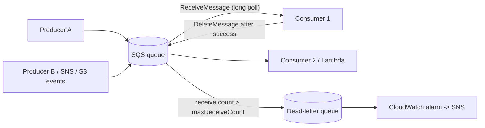
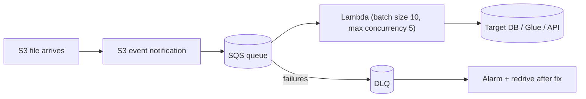
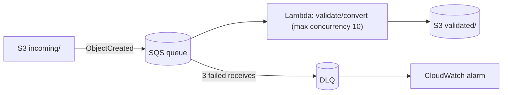
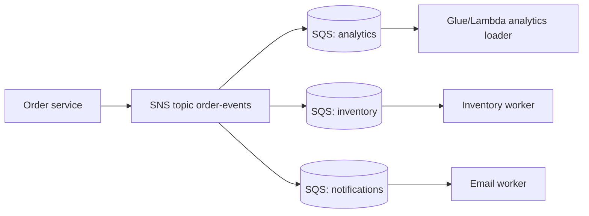
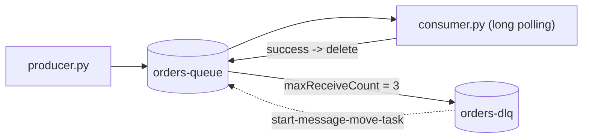

# Amazon SQS — Data Engineering Study Notes (0–2 YOE)

> Self-contained notes: fundamentals → implementation → interview preparation.
> SQS quotas and features evolve (for example, the maximum message size was raised to 1 MiB in August 2025). Confirm numbers on the quotas page linked at the end.

**Contents**
1. Introduction
2. Architecture and Working Mechanism
3. Core Concepts and Terminology
4. Data Engineering Use Cases
5. Hands-on Implementation (mini-project)
6. Interview Preparation (10 conceptual + 5 scenario + 3 troubleshooting, all answered)
7. Revision and Quick Reference

---

## 1. Introduction

### What is Amazon SQS?
**Amazon Simple Queue Service (SQS)** is a fully managed **message queue**. A **producer** sends messages to a **queue**; one or more **consumers** poll the queue, process messages and delete them when done. Messages are stored redundantly across multiple Availability Zones until they are deleted or expire. There are two queue types: **Standard** (very high throughput, at-least-once delivery, best-effort ordering) and **FIFO** (ordered within a message group, deduplication, exactly-once processing semantics within limits).

### Why was it introduced and what problem does it solve?
SQS (one of the first AWS services) solves **decoupling**: the sender doesn't need the receiver to be online or as fast as it is. The queue **buffers** bursts, lets consumers scale independently, and survives consumer failures because unprocessed messages stay in the queue. It removes the need to run and patch message brokers.

### Why is it important in Data Engineering?
SQS is a building block for resilient ingestion and processing: buffering events before writing to a database, throttling load to fragile sinks, distributing work across many workers, retry handling with dead-letter queues, and fan-out when paired with SNS. Many pipelines use "S3 event → SQS → Lambda/worker" so spikes don't overwhelm downstream systems.

### When should you use it?
- Buffering and smoothing bursts between components.
- Work queues where each message should be processed by one worker.
- Retrying failed work with DLQs and visibility timeouts.
- Decoupling microservices and pipeline stages.
- Triggering Lambda with controlled batching/concurrency.

### When should you avoid it?
| Situation | Better option |
|---|---|
| Multiple independent consumers each need every message, with replay | Kinesis Data Streams / MSK (or SNS fan-out to multiple queues) |
| Ordered, replayable stream analytics | Kinesis / MSK |
| Pub/sub push notifications to many subscribers | SNS / EventBridge |
| Complex routing by event content across services | EventBridge |
| Very large payloads (many MiB) | S3 + message pointer |
| JMS/AMQP/MQTT protocol compatibility | Amazon MQ |

### Simple real-world example
A web app places order events in an SQS queue. During a sale, 20,000 orders per minute arrive but the inventory database can handle 5,000/minute. Workers pull messages at their own pace; the queue grows temporarily and drains afterwards, so no orders are lost.

### Brief comparison with alternatives
| | SQS | SNS | Kinesis Data Streams | EventBridge | Amazon MQ |
|---|---|---|---|---|---|
| Model | Queue (pull) | Pub/sub (push) | Ordered stream log (pull) | Event bus/router | Managed ActiveMQ/RabbitMQ |
| Consumers per message | One (competing) | Many subscribers | Many (independent) | Many targets | Depends on broker |
| Replay | No (deleted after processing) | No | Yes (retention) | Archive/replay | Limited |
| Ordering | FIFO queues per group | FIFO topics | Per shard | No guarantee | Broker dependent |

---

## 2. Architecture and Working Mechanism

### Overall architecture
SQS is a regional, distributed service. A queue stores messages on multiple servers and AZs. Producers call the API (`SendMessage`/`SendMessageBatch`). Consumers call `ReceiveMessage`, which returns messages and makes them **invisible** for the **visibility timeout**. After successful processing the consumer calls `DeleteMessage`. If it doesn't delete in time, the message becomes visible again for another attempt.

### Major components
- **Queue** — Standard or FIFO; has attributes (retention, visibility timeout, delay, max message size, redrive policy, encryption, access policy).
- **Message** — body (text), attributes, `MessageId`, `ReceiptHandle`; FIFO adds group ID and deduplication ID.
- **Producers / consumers** — apps, Lambda, EC2/ECS workers, AWS services (SNS, S3 events, EventBridge).
- **Visibility timeout** — hides a message while a consumer works on it.
- **Dead-letter queue (DLQ)** — receives messages that failed too many times (`maxReceiveCount`).
- **Polling modes** — short polling and long polling.
- **Access policy and encryption** — queue policy, SSE.

### Message lifecycle
1. Producer sends a message; SQS stores it (replicated).
2. A consumer polls; SQS returns the message and starts the visibility timeout (receive count +1).
3. Consumer processes and calls `DeleteMessage` using the **receipt handle** → message removed permanently.
4. If the consumer crashes or is slow, the visibility timeout expires and the message reappears; another consumer receives it.
5. If receive count exceeds `maxReceiveCount`, SQS moves it to the DLQ.
6. If never deleted, the message expires at the end of the retention period.

### Mermaid architecture


### Explanation of components
- **Queue** buffers messages; **consumers** compete for them (each message goes to one consumer at a time).
- **Visibility timeout** prevents two consumers from processing the same message simultaneously (but duplicates are still possible).
- **DLQ** isolates problem messages for inspection.
- **Alarm** notifies when DLQ depth rises.

### Practical Data Engineering architecture


---

## 3. Core Concepts and Important Terminologies

### 3.1 Standard vs FIFO queues
| | Standard | FIFO |
|---|---|---|
| Throughput | Nearly unlimited | Limited per queue (hundreds per second, up to thousands with batching; higher-throughput mode available — check quotas) |
| Delivery | At-least-once (duplicates possible) | Exactly-once processing (deduplication within 5 minutes) |
| Ordering | Best-effort | Strict per **message group** |
| Name | Any | Must end with `.fifo` |
| Use | Most data pipelines, high volume | Order-sensitive workflows (per customer/order), no duplicates |
- **FIFO concepts:** `MessageGroupId` (messages in the same group are delivered in order, one group processed by one consumer at a time) and `MessageDeduplicationId` (or content-based deduplication) which discards duplicate sends within the deduplication window.
- **Mistakes:** using one group ID for everything (serialises the whole queue); expecting FIFO throughput like Standard; converting a Standard queue to FIFO (not possible — create a new queue).
```python
sqs.send_message(QueueUrl=fifo_url, MessageBody=json.dumps(evt),
                 MessageGroupId=str(evt["customer_id"]),
                 MessageDeduplicationId=evt["event_id"])
```

### 3.2 Sending and receiving messages (Boto3)
```python
import json, boto3
sqs = boto3.client("sqs", region_name="ap-south-1")
url = sqs.get_queue_url(QueueName="orders-queue")["QueueUrl"]

# Send in batches of up to 10 (one API call = lower cost)
sqs.send_message_batch(QueueUrl=url, Entries=[
    {"Id": str(i), "MessageBody": json.dumps({"order_id": i, "amount": 10 * i})}
    for i in range(10)])

# Receive with long polling
resp = sqs.receive_message(QueueUrl=url, MaxNumberOfMessages=10,
                           WaitTimeSeconds=20, VisibilityTimeout=60,
                           AttributeNames=["All"], MessageAttributeNames=["All"])
for m in resp.get("Messages", []):
    process(json.loads(m["Body"]))
    sqs.delete_message(QueueUrl=url, ReceiptHandle=m["ReceiptHandle"])
```
- Batch size limit: up to 10 messages per batch call (total size within the payload limit).
- **Mistakes:** forgetting `delete_message` (messages return and repeat); using the `MessageId` instead of `ReceiptHandle` to delete; sending one message per API call (cost).

### 3.3 Visibility timeout
- **Definition:** Period after a message is received during which it is hidden from other consumers. Default **30 seconds** (range 0 s to 12 hours).
- **Why it matters:** Must be longer than the time needed to process a message, otherwise duplicates occur. You can extend it per message with `ChangeMessageVisibility` for slow tasks.
- **Lambda tip:** set the queue visibility timeout to at least **6 × the function timeout** (AWS guidance) so retries and batching don't make messages visible while still processing.
- **Mistake:** short timeout + long processing = repeated processing and DLQ spillover.

### 3.4 Short polling vs long polling
- **Short polling** queries a subset of servers and may return empty responses even when messages exist.
- **Long polling** (`WaitTimeSeconds` 1–20) waits until a message arrives (queries all servers), reducing empty responses and cost. **Use long polling by default.**
- Queue attribute `ReceiveMessageWaitTimeSeconds` sets the default.

### 3.5 Retention, delay and size
- **Retention period:** 60 seconds to 14 days (default 4 days). Messages not deleted by then are lost.
- **Delay queue / message timers:** delay delivery of new messages up to 15 minutes (queue-level `DelaySeconds`, or per-message in Standard queues).
- **Maximum message size:** up to **1 MiB** (increased from 256 KiB in August 2025; the queue's `MaximumMessageSize` attribute controls it — older queues may keep a lower configured value, so check). For larger payloads store data in S3 and send a pointer.
- **Mistakes:** assuming messages live forever; sending large payloads and hitting size limits.

### 3.6 Dead-letter queues (DLQs) and redrive
- **Definition:** A DLQ is a normal queue that receives messages from a source queue after they have been received `maxReceiveCount` times without being deleted.
- **Redrive policy** on the source queue: `{"deadLetterTargetArn":"...","maxReceiveCount":3}`. The DLQ must be the same type (Standard↔Standard, FIFO↔FIFO) and in the same account/Region. Set DLQ retention longer than the source queue (e.g. 14 days).
- **Redrive to source:** after fixing the bug, move messages back with `StartMessageMoveTask` (console "Start DLQ redrive").
- **Alarm** on `ApproximateNumberOfMessagesVisible` > 0 for the DLQ.
```bash
aws sqs create-queue --queue-name orders-dlq --attributes MessageRetentionPeriod=1209600
aws sqs create-queue --queue-name orders-queue --attributes '{
  "VisibilityTimeout":"30",
  "RedrivePolicy":"{\"deadLetterTargetArn\":\"arn:aws:sqs:ap-south-1:111122223333:orders-dlq\",\"maxReceiveCount\":\"3\"}"}'
```
- **Mistakes:** `maxReceiveCount` of 1 (a transient failure kills the message); no monitoring of the DLQ.

### 3.7 At-least-once delivery and idempotency
Standard queues can deliver a message more than once; consumers can also crash after processing but before deleting. Design **idempotent consumers**: use a unique business ID (order_id) with conditional writes/upserts, or track processed IDs in DynamoDB. FIFO reduces duplicates from producers but processing can still repeat after visibility timeout expiry.

### 3.8 Security: policies and encryption
- **Queue (resource) policy:** controls who can send/receive — needed for cross-account, SNS topics, S3 and EventBridge to deliver messages.
```json
{"Version":"2012-10-17","Statement":[{
  "Sid":"AllowSnsToSend","Effect":"Allow","Principal":{"Service":"sns.amazonaws.com"},
  "Action":"sqs:SendMessage","Resource":"arn:aws:sqs:ap-south-1:111122223333:orders-queue",
  "Condition":{"ArnEquals":{"aws:SourceArn":"arn:aws:sns:ap-south-1:111122223333:orders-topic"}}}]}
```
- **Encryption at rest:** SSE-SQS (default, SQS-managed keys) or SSE-KMS with your key (then producers/consumers and services like SNS/S3 need KMS permissions). In transit: HTTPS.
- **Mistakes:** forgetting the queue policy for SNS/S3; using SSE-KMS without granting the service principal `kms:GenerateDataKey`/`kms:Decrypt`.

### 3.9 SQS with Lambda (event source mapping)
Lambda polls SQS and invokes your function with batches. Key settings: `BatchSize` (up to 10 for standard without a batching window; up to 10,000 with a window), `MaximumBatchingWindowInSeconds`, **`ScalingConfig.MaximumConcurrency`** (limit concurrent invocations, minimum 2), **`ReportBatchItemFailures`** (partial batch response), queue visibility timeout ≥ function timeout (recommended 6×), DLQ on the queue. See the Lambda notes for details.

### 3.10 Scaling consumers
Queue depth drives scaling: use CloudWatch metrics `ApproximateNumberOfMessagesVisible` and `ApproximateAgeOfOldestMessage`; auto scale workers on "backlog per instance" (messages ÷ workers). Throttle consumers to protect downstream systems (limit concurrency). SQS itself scales automatically.

### 3.11 Monitoring metrics
| Metric | Meaning |
|---|---|
| `ApproximateNumberOfMessagesVisible` | Backlog waiting to be processed |
| `ApproximateNumberOfMessagesNotVisible` | In-flight (received, not deleted) |
| `ApproximateAgeOfOldestMessage` | Processing lag — alarm on this |
| `NumberOfMessagesSent/Received/Deleted` | Throughput and failures (received >> deleted suggests retries) |
| `NumberOfEmptyReceives` | Wasted polls (use long polling) |

### 3.12 Large messages and fan-out
- Large payloads: store in S3, send the S3 key (the **SQS Extended Client Library** automates this), now needed only above the size limit.
- **Fan-out:** publish to an SNS topic with multiple SQS subscriptions so each consumer type gets its own queue (and own DLQ). Use SNS **filter policies** to send only relevant messages. See the SNS notes.

### 3.13 Pricing basics
Billed per request (each API call; payloads are billed in 64 KB chunks) with a monthly free tier; batching and long polling reduce cost. Data transfer out may apply. Confirm on the pricing page.

---

## 4. Data Engineering Use Cases

### Real-world use cases
- Buffering ingestion events before database/warehouse writes.
- Work distribution: file-processing tasks for ETL workers.
- Rate-limiting calls to third-party APIs.
- Retry/error isolation with DLQs.
- Decoupling pipeline stages across teams or accounts.
- S3 event → SQS → Lambda/Glue-trigger pipelines.

### Batch processing
A scheduler enqueues one message per file/partition/date; a fleet of workers (ECS, Batch, EC2) pulls tasks, processes them in parallel and deletes messages on success; failures go to a DLQ for later reprocessing.

### Real-time / streaming
SQS suits near-real-time **event buffering** (seconds latency) with at-least-once semantics, not ordered replayable streams. For ordered, replayable high-volume streams use Kinesis/MSK; SQS can still buffer events between stream consumers and slower sinks.

### Pipeline example 1 — S3 file processing with backpressure


### Pipeline example 2 — Fan-out with SNS


### Why a Data Engineer chooses SQS
It is simple, durable, serverless and cheap; it absorbs bursts, protects slow sinks, supports retries/DLQs, and integrates natively with Lambda, SNS, S3 and EventBridge. Choose Kinesis/MSK when you need ordering across many records with replay and multiple independent readers; choose EventBridge/SNS for routing and notification.

---

## 5. Hands-on Implementation

### Mini-project: Reliable order processing with retries and a dead-letter queue

**1. Objective:** Create a queue with a DLQ, send order messages (including one "poison" message), run a consumer that deletes successes, and observe the poison message moving to the DLQ after three failed receives; then inspect and redrive it.

**2. Business problem:** Orders must be processed even when some messages are malformed. Bad messages must not block good ones and must be preserved for investigation.

**3. Architecture**


**4. Prerequisites and setup**
- AWS CLI configured; Python 3 with Boto3 (`pip install boto3`).
- Your identity needs SQS permissions (`sqs:*` for the lab).
- Variables: `REGION`.
- **Costs:** SQS free tier covers this lab (about a million requests per month); no resources incur ongoing cost, but delete queues at the end.

**5–6. Implementation and code**

*Step 1 — Create the queues (`setup.py`)*
```python
import json, boto3
REGION = "ap-south-1"
sqs = boto3.client("sqs", region_name=REGION)

dlq_url = sqs.create_queue(QueueName="orders-dlq",
                           Attributes={"MessageRetentionPeriod": "1209600"})["QueueUrl"]
dlq_arn = sqs.get_queue_attributes(QueueUrl=dlq_url,
                                   AttributeNames=["QueueArn"])["Attributes"]["QueueArn"]

q_url = sqs.create_queue(QueueName="orders-queue", Attributes={
    "VisibilityTimeout": "10",              # short for the demo; use realistic values in production
    "ReceiveMessageWaitTimeSeconds": "10",  # default long polling
    "RedrivePolicy": json.dumps({"deadLetterTargetArn": dlq_arn, "maxReceiveCount": "3"})
})["QueueUrl"]
print("main:", q_url)
print("dlq :", dlq_url)
```

*Step 2 — Producer (`producer.py`)*
```python
import json, sys, boto3
sqs = boto3.client("sqs", region_name="ap-south-1")
url = sqs.get_queue_url(QueueName="orders-queue")["QueueUrl"]

orders = [{"order_id": f"O-{i:03d}", "customer_id": i % 5, "amount": 10.0 * i} for i in range(1, 10)]
orders.append({"order_id": "O-BAD", "customer_id": 1, "amount": "not-a-number"})   # poison message

entries = [{"Id": str(i), "MessageBody": json.dumps(o),
            "MessageAttributes": {"source": {"DataType": "String", "StringValue": "web"}}}
           for i, o in enumerate(orders)]
resp = sqs.send_message_batch(QueueUrl=url, Entries=entries)
print("sent:", len(resp.get("Successful", [])), "failed:", len(resp.get("Failed", [])))
```

*Step 3 — Consumer (`consumer.py`)*
```python
import json, boto3
sqs = boto3.client("sqs", region_name="ap-south-1")
url = sqs.get_queue_url(QueueName="orders-queue")["QueueUrl"]

processed = set()          # in-memory idempotency for this demo (use DynamoDB in real systems)
idle_polls = 0
while idle_polls < 4:      # stop after ~4 consecutive empty long polls
    resp = sqs.receive_message(QueueUrl=url, MaxNumberOfMessages=10, WaitTimeSeconds=10,
                               AttributeNames=["ApproximateReceiveCount"],
                               MessageAttributeNames=["All"])
    msgs = resp.get("Messages", [])
    if not msgs:
        idle_polls += 1
        continue
    idle_polls = 0
    for m in msgs:
        rc = m["Attributes"]["ApproximateReceiveCount"]
        try:
            order = json.loads(m["Body"])
            if order["order_id"] in processed:
                print("duplicate skipped", order["order_id"])
            else:
                amount = float(order["amount"])          # raises ValueError for the poison message
                processed.add(order["order_id"])
                print(f"processed {order['order_id']} amount={amount} (receive #{rc})")
            sqs.delete_message(QueueUrl=url, ReceiptHandle=m["ReceiptHandle"])
        except Exception as e:
            # Do NOT delete: the message becomes visible again after the visibility timeout
            print(f"FAILED {m['MessageId']} receive #{rc}: {e}")
print("consumer finished; processed", len(processed), "orders")
```

*Step 4 — Run and observe*
```bash
python setup.py
python producer.py
python consumer.py
```

*Step 5 — Inspect the DLQ and redrive*
```bash
REGION=ap-south-1
DLQ_URL=$(aws sqs get-queue-url --queue-name orders-dlq --region $REGION --query QueueUrl --output text)
aws sqs get-queue-attributes --queue-url $DLQ_URL --attribute-names ApproximateNumberOfMessages --region $REGION
aws sqs receive-message --queue-url $DLQ_URL --max-number-of-messages 1 --visibility-timeout 0 --region $REGION
# After fixing the consumer bug, move DLQ messages back to the source queue:
DLQ_ARN=$(aws sqs get-queue-attributes --queue-url $DLQ_URL --attribute-names QueueArn --query Attributes.QueueArn --output text --region $REGION)
aws sqs start-message-move-task --source-arn $DLQ_ARN --region $REGION
```
(`--visibility-timeout 0` lets you peek without hiding the message. Redriving the poison message without fixing the data will make it fail again — it demonstrates the mechanism.)

**7. Explanation of the code**
- The main queue has a 10-second visibility timeout, long polling and a redrive policy sending messages to the DLQ after three receives.
- The producer sends ten messages in one batch call, including a malformed amount.
- The consumer deletes a message only after successful processing. For the poison message the exception prevents deletion, so after 10 seconds it becomes visible again; the receive count rises 1 → 2 → 3, and then SQS moves it to the DLQ.
- A set of processed order IDs demonstrates idempotency (in production use a persistent store).

**8. Expected output**
```
sent: 10 failed: 0
processed O-001 amount=10.0 (receive #1)
...
FAILED <id> receive #1: could not convert string to float: 'not-a-number'
FAILED <id> receive #2: ...
FAILED <id> receive #3: ...
consumer finished; processed 9 orders
```
The DLQ then shows `ApproximateNumberOfMessages: 1`.

**9. Validation and testing**
```bash
aws sqs get-queue-attributes --queue-url $DLQ_URL --attribute-names All --region $REGION
aws sqs get-queue-attributes --queue-url $(aws sqs get-queue-url --queue-name orders-queue --query QueueUrl --output text) \
  --attribute-names ApproximateNumberOfMessages ApproximateNumberOfMessagesNotVisible
```
Main queue counts should be 0 after the run (give the DLQ move a few seconds). Send a second poison message and watch the metrics in CloudWatch (`NumberOfMessagesReceived` vs `NumberOfMessagesDeleted`).

**10. Common errors and troubleshooting**
| Error | Cause | Fix |
|---|---|---|
| `AWS.SimpleQueueService.NonExistentQueue` | Wrong name/Region | Check `--region` and queue name |
| Message never reaches DLQ | Redrive policy missing/`maxReceiveCount` too high; consumer deleting failures | Verify the policy, don't delete on error |
| `AccessDenied` | Identity lacks SQS permission | Add permissions |
| Consumer exits immediately | Queue empty/producer not run | Run the producer first |
| `InvalidParameterValue` creating FIFO queue | Name doesn't end with `.fifo` / missing attribute | Use `.fifo` and `FifoQueue=true` |

**11. Cost considerations and cleanup**
Free-tier friendly. Delete queues to leave no residue (and avoid orphaned alarms):
```bash
aws sqs delete-queue --queue-url $(aws sqs get-queue-url --queue-name orders-queue --query QueueUrl --output text --region $REGION) --region $REGION
aws sqs delete-queue --queue-url $DLQ_URL --region $REGION
```

---

## 6. Interview Preparation — Questions WITH Answers

### A. Conceptual Questions (10)

**Q1. What is Amazon SQS and why is it used?**
SQS is a managed message queue that decouples producers and consumers. Producers send messages; consumers poll and process them at their own speed; messages are stored durably across AZs until deleted or expired. Benefits: buffering bursts, independent scaling, resilience to consumer failure, retry handling with DLQs, no servers to run. *Keywords: decoupling, queue, at-least-once, visibility timeout, DLQ, long polling, standard vs FIFO.* In data pipelines it protects slow sinks and enables work distribution.

**Q2. Compare Standard and FIFO queues.**
Standard: nearly unlimited throughput, at-least-once delivery (duplicates possible) and best-effort ordering. FIFO: strict ordering within a **message group**, exactly-once processing via deduplication (5-minute window), lower throughput (with batching and high-throughput modes it can be raised — check quotas), queue name ends with `.fifo`. Choose Standard for high-volume pipelines with idempotent consumers; FIFO when order or duplicate avoidance matters (per customer/order). In FIFO, a poison message can block its group until it's handled or sent to the DLQ.

**Q3. What is the visibility timeout and how do you choose its value?**
It's the time a received message stays hidden from other consumers while the first consumer processes it (default 30 s, max 12 h). If the consumer doesn't delete the message before it expires, the message becomes visible again and may be processed twice. Set it longer than the maximum processing time (and for Lambda at least the function timeout — AWS recommends 6× including retries), or extend dynamically with `ChangeMessageVisibility`. Too short → duplicates; too long → slow recovery after consumer crashes.

**Q4. Explain short polling vs long polling.**
Short polling returns immediately and samples a subset of servers, so it may return empty responses even if messages exist, creating more (billable) empty requests. Long polling (`WaitTimeSeconds` up to 20) waits for messages to arrive and queries all servers, reducing empty receives, cost and latency. Best practice: enable long polling (queue attribute `ReceiveMessageWaitTimeSeconds` or per request). Watch `NumberOfEmptyReceives` to detect wasteful polling.

**Q5. What is a dead-letter queue and how does redrive work?**
A DLQ is a queue that receives messages that couldn't be processed successfully after `maxReceiveCount` attempts (configured by a redrive policy on the source queue). It isolates "poison" messages so they don't block or repeatedly consume capacity. Use a longer retention period on the DLQ, alarm on its depth, inspect messages, fix the bug, then **redrive** (`StartMessageMoveTask`) to send messages back to the source queue. The DLQ must be the same queue type and account/Region as the source.

**Q6. SQS delivers at least once — what does that mean for your code?**
A message may be delivered more than once (consumer crash after processing, visibility timeout expiry, internal redundancy in Standard queues). Consumers must be **idempotent**: processing the same message twice yields the same result — e.g. upsert by business key, conditional writes with an idempotency table, deterministic output paths. FIFO deduplicates producer retries within five minutes but cannot protect against consumer-side reprocessing. Include a unique ID in every message.

**Q7. What are the key queue attributes (retention, delay, size)?**
Retention: 60 seconds–14 days (default 4 days) — messages are deleted when it expires. Delay queue (`DelaySeconds` up to 15 minutes) delays delivery of new messages; message timers set per-message delay on Standard queues. Maximum message size: up to 1 MiB (raised from 256 KiB in 2025; check the queue's configured `MaximumMessageSize`). Others: visibility timeout, receive wait time, redrive policy, KMS settings, queue policy. For larger payloads, put data in S3 and send the key.

**Q8. How do SQS, SNS, Kinesis and EventBridge differ?**
SQS: pull-based queue — each message processed by one consumer, no replay. SNS: push pub/sub delivering copies to many subscribers (including SQS queues, Lambda, HTTP, email/SMS). Kinesis Data Streams: ordered, sharded stream with retention/replay and multiple independent consumers. EventBridge: event bus with content-based rules, many AWS and SaaS sources/targets, schedules and archive/replay. Common pattern: SNS/EventBridge fan-out to multiple SQS queues, each with its own consumer and DLQ.

**Q9. How does SQS integrate with Lambda and how do you scale/control it?**
Lambda's event source mapping polls the queue and invokes functions with batches. Configure `BatchSize` and optional batching window, **partial batch responses** (`ReportBatchItemFailures`) so only failed messages return to the queue, and **`MaximumConcurrency`** on the mapping (or reserved concurrency) to limit parallelism and protect downstream systems. Set the queue visibility timeout ≥ function timeout (6× recommended), add a DLQ to the queue, and make handlers idempotent. Lambda scales polling with queue depth automatically.

**Q10. How do you secure an SQS queue?**
Use IAM policies for principals and a **queue policy** (resource policy) for cross-account access or to allow services like SNS, S3 and EventBridge to send (use `aws:SourceArn`/`aws:SourceAccount` conditions). Encrypt at rest with SSE-SQS (default) or SSE-KMS (grant the producing service and consumers KMS permissions). Use HTTPS, VPC endpoints (PrivateLink) for private access, least-privilege actions (`sqs:SendMessage`, `ReceiveMessage`, `DeleteMessage`), and CloudTrail for auditing. Don't put secrets in message bodies.

### B. Scenario-Based Questions (5)

**S1. Traffic spikes make consumers fall behind; the backlog grows for hours.**
*Solution:* monitor `ApproximateNumberOfMessagesVisible` and `ApproximateAgeOfOldestMessage`; auto scale consumers (ECS/EC2 target tracking on "backlog per instance", or Lambda concurrency via the mapping); raise batch sizes where safe; optimise per-message processing; ensure downstream capacity (DB connections) via limits; set alarms on age. *Why:* the queue buffers the spike; scaling drains it. *Alternatives:* increase retention to avoid data loss; split workloads into priority queues. *Trade-off:* more consumers can overload downstream; cost vs latency.

**S2. A few malformed messages keep failing and slow processing; ops can't see them.**
*Solution:* configure a DLQ with `maxReceiveCount` (e.g. 3–5), a long DLQ retention, a CloudWatch alarm on DLQ depth, log failures with message IDs, and fix/redrive after correcting code or data. Validate messages early and send known-bad messages directly to a "quarantine" queue/S3 with the reason. *Why:* isolates bad data without blocking healthy flow. *Alternatives:* store failures in S3/DynamoDB for analysis. *Trade-off:* must triage the DLQ regularly or it becomes a graveyard.

**S3. Updates for the same customer must be processed in order, but different customers can run in parallel.**
*Solution:* use a **FIFO queue** with `MessageGroupId = customer_id`, and `MessageDeduplicationId` (or content-based deduplication); run multiple consumers so different groups are processed concurrently; use batching and high-throughput FIFO if volume requires. *Why:* ordering is guaranteed per group while groups scale in parallel. *Alternatives:* Kinesis with partition key per customer (replayable stream). *Trade-off:* FIFO throughput and group-level head-of-line blocking if one message fails.

**S4. Lambda processes some SQS messages twice, creating duplicate rows.**
*Solution:* make the handler idempotent (conditional write keyed by message/business ID or upsert), use **partial batch responses** so only failures retry, raise the queue visibility timeout above the function timeout (≥ 6×), reduce function runtime/timeouts, and add a DLQ. *Why:* at-least-once delivery and timeouts cause reprocessing; idempotency makes it harmless. *Alternatives:* FIFO queue (limits duplicates but doesn't remove idempotency need). *Trade-off:* extra lookup per message.

**S5. One event must reach analytics, inventory and notification systems independently, each with its own retry behaviour.**
*Solution:* publish to an **SNS topic** and subscribe three **SQS queues** (each with a DLQ), applying subscription filter policies; each consumer scales and retries independently. Add queue policies allowing SNS to send. *Why:* fan-out decouples consumers and isolates failures. *Alternatives:* EventBridge with multiple targets; Kinesis with several consumers (if replay needed). *Trade-off:* more queues to manage; messages in each queue are billed separately.

### C. Troubleshooting Questions (3)

**T1. The same message is processed repeatedly or consumers see duplicates.**
*Root causes:* visibility timeout shorter than processing time; consumers not deleting messages after success (missing `DeleteMessage`/wrong receipt handle); crash after processing before delete; Lambda timeouts or whole-batch failures re-delivering successful items; Standard queue at-least-once behaviour. *Debug approach:* compare `NumberOfMessagesReceived` vs `NumberOfMessagesDeleted`; check `ApproximateReceiveCount` on messages; measure processing time vs visibility timeout; review consumer logs for exceptions/timeouts. *Fix:* increase visibility timeout (or call `ChangeMessageVisibility` for long tasks), delete only after success, use partial batch responses, implement idempotency, and add a DLQ with a sensible `maxReceiveCount`.

**T2. The console shows messages in the queue but consumers receive nothing.**
*Root causes:* messages are "in flight" (not visible) held by another consumer; delay queue/message timer delaying visibility; consumer polling the wrong queue/Region or using short polling; IAM/queue policy or KMS permissions missing (`kms:Decrypt`); Lambda mapping disabled or throttled; messages filtered by FIFO group lock (a group is being processed). *Debug:* check `ApproximateNumberOfMessagesVisible` vs `NotVisible` vs `Delayed`; confirm queue URL/Region; use `receive-message` with `--wait-time-seconds 20`; examine IAM and KMS errors in the response; check Lambda event source mapping state and `Throttles`. *Fix:* wait for/extend visibility timeouts, fix polling configuration/permissions, enable long polling and correct the queue URL.

**T3. Producers get `AccessDenied` or messages from SNS/S3 never arrive.**
*Root causes:* the queue policy doesn't allow the service principal (`sns.amazonaws.com`, `s3.amazonaws.com`, `events.amazonaws.com`) or lacks `aws:SourceArn` match; cross-account principal not allowed; SSE-KMS queue with a key policy that doesn't allow the sender; SNS subscription not confirmed or raw message delivery misconfigured; wrong queue ARN. *Debug approach:* review the queue policy JSON; check the SNS delivery status logs or S3/EventBridge target errors; CloudTrail for `AccessDenied`; verify KMS key policy; test with `aws sqs send-message` using the same principal. *Fix:* add a correct `Allow` statement with `Principal` service and `aws:SourceArn` condition; grant KMS permissions (`kms:GenerateDataKey`, `kms:Decrypt`) to the sender; reconfirm subscriptions.

---

## 7. Revision and Quick Reference

### Key takeaways
- SQS decouples and buffers; consumers poll, process, delete.
- Standard = high throughput, at-least-once; FIFO = ordered per group, deduplicated.
- Visibility timeout, long polling and DLQs are the three essential settings.
- Design idempotent consumers.
- Fan-out = SNS + multiple SQS queues.

### Commonly forgotten details
- You must delete messages — otherwise they reappear.
- Retention default is 4 days (max 14).
- Visibility timeout default 30 s; for Lambda use ≥ function timeout (6× recommended).
- DLQ must match the queue type; give it longer retention.
- FIFO name ends in `.fifo`; group ID controls parallelism.
- SQS→Lambda partial batch response needs `ReportBatchItemFailures`.
- Queue policies are needed for SNS/S3/EventBridge/cross-account.
- Message size limit is now up to 1 MiB, but check the queue attribute.

### Important commands and syntax
```bash
aws sqs create-queue --queue-name q --attributes VisibilityTimeout=60,ReceiveMessageWaitTimeSeconds=20
aws sqs send-message --queue-url URL --message-body '{"a":1}'
aws sqs send-message-batch --queue-url URL --entries file://entries.json
aws sqs receive-message --queue-url URL --max-number-of-messages 10 --wait-time-seconds 20
aws sqs delete-message --queue-url URL --receipt-handle HANDLE
aws sqs change-message-visibility --queue-url URL --receipt-handle H --visibility-timeout 120
aws sqs get-queue-attributes --queue-url URL --attribute-names All
aws sqs purge-queue --queue-url URL
aws sqs start-message-move-task --source-arn DLQ_ARN
```

### Frequently used configurations
`VisibilityTimeout`, `ReceiveMessageWaitTimeSeconds`, `MessageRetentionPeriod`, `DelaySeconds`, `MaximumMessageSize`, `RedrivePolicy` (`maxReceiveCount`), `FifoQueue`/`ContentBasedDeduplication`, SSE (SQS-managed vs KMS), queue policy, Lambda mapping (`BatchSize`, `MaximumBatchingWindowInSeconds`, `ScalingConfig.MaximumConcurrency`, `FunctionResponseTypes`).

### Common errors and solutions
| Error | Solution |
|---|---|
| Duplicate processing | Idempotency, longer visibility timeout, delete after success |
| Messages stuck in flight | Visibility timeout, consumer crashes — wait/extend |
| `AccessDenied` | Queue policy/IAM/KMS |
| `ReceiptHandleIsInvalid` | Handle expired/invalid after timeout — reprocess |
| Messages lost | Retention expired or purged |
| DLQ filling | Fix bug, validate input, redrive |

### Service limitations
Not a replayable stream; no strict global ordering in Standard; FIFO throughput limits; message size limit (up to 1 MiB); retention max 14 days; visibility timeout max 12 hours; batch operations limited to 10 messages; polling-based (no push to consumers except via Lambda mapping); at-least-once duplicates.

### Performance and cost optimisation
Use long polling and batch sends/receives; right-size visibility timeouts; avoid excessive empty receives; scale consumers on backlog; keep payloads small (S3 pointers for big data); use SNS filter policies to reduce unnecessary messages; set Lambda concurrency limits.

### Security best practices
Least-privilege IAM; queue policies with `aws:SourceArn`; SSE-SQS/KMS; VPC endpoints; HTTPS enforcement (`aws:SecureTransport`); monitor DLQ and anomalies; avoid sensitive data in messages or encrypt payloads; use separate queues per trust boundary.

### Connections with other AWS services
SNS (fan-out), Lambda (event source), S3 (event notifications), EventBridge (targets), Step Functions (SDK integration/callbacks), ECS/EC2/Batch (workers), CloudWatch (metrics/alarms), KMS, IAM, DynamoDB (idempotency store).

### Quick revision cheat sheet
```
Producer -> Queue (replicated) -> Consumer: receive (hidden for visibility timeout) -> process -> delete
Else: reappears -> after maxReceiveCount -> DLQ -> alarm -> fix -> redrive
Standard: at-least-once, unordered, huge throughput | FIFO: group order + dedup, lower throughput
Long polling (WaitTimeSeconds up to 20) | batch up to 10 | retention 60s-14d | visibility 0-12h
Lambda: ReportBatchItemFailures, MaximumConcurrency, visibility >= 6x timeout
```

### 10 rapid-fire revision questions
1. **What must a consumer do after successful processing?** Delete the message.
2. **Default visibility timeout?** 30 seconds.
3. **Maximum retention period?** 14 days.
4. **Which queue type preserves order within a group?** FIFO.
5. **What reduces empty receives and cost?** Long polling.
6. **What does maxReceiveCount control?** After how many receives a message moves to the DLQ.
7. **Can a Standard queue deliver duplicates?** Yes (at-least-once).
8. **How do you fan out one event to several queues?** SNS topic with multiple SQS subscriptions.
9. **What lets SNS or S3 send to a queue?** A queue (resource) policy.
10. **Which API extends processing time for one message?** `ChangeMessageVisibility`.

---

## Official AWS documentation
- Amazon SQS Developer Guide — https://docs.aws.amazon.com/AWSSimpleQueueService/latest/SQSDeveloperGuide/welcome.html
- Standard vs FIFO queues — https://docs.aws.amazon.com/AWSSimpleQueueService/latest/SQSDeveloperGuide/sqs-queue-types.html
- Visibility timeout — https://docs.aws.amazon.com/AWSSimpleQueueService/latest/SQSDeveloperGuide/sqs-visibility-timeout.html
- Dead-letter queues — https://docs.aws.amazon.com/AWSSimpleQueueService/latest/SQSDeveloperGuide/sqs-dead-letter-queues.html
- Quotas — https://docs.aws.amazon.com/AWSSimpleQueueService/latest/SQSDeveloperGuide/quotas-queues.html
- Using Lambda with SQS — https://docs.aws.amazon.com/lambda/latest/dg/with-sqs.html
- SQS pricing — https://aws.amazon.com/sqs/pricing/
- Boto3 SQS reference — https://boto3.amazonaws.com/v1/documentation/api/latest/reference/services/sqs.html
