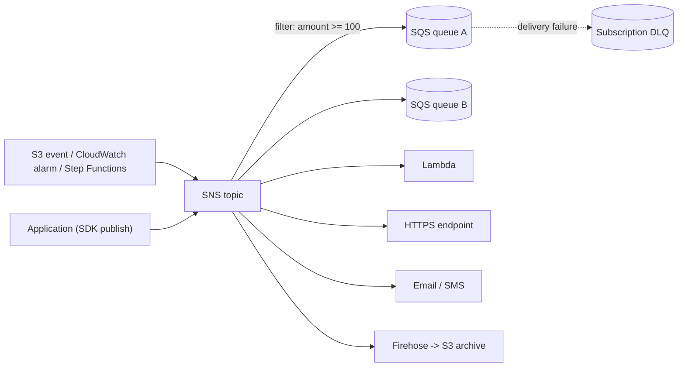
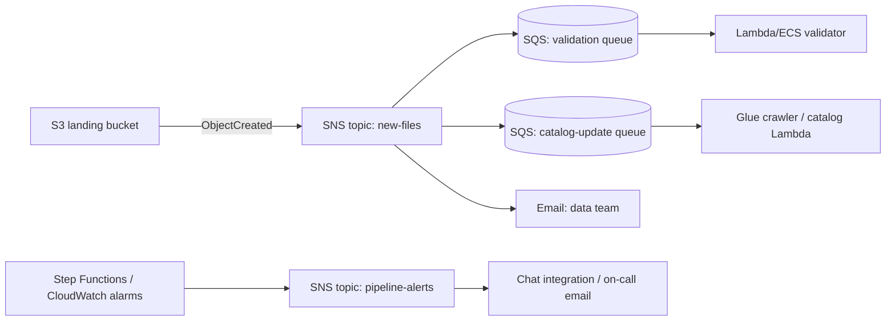
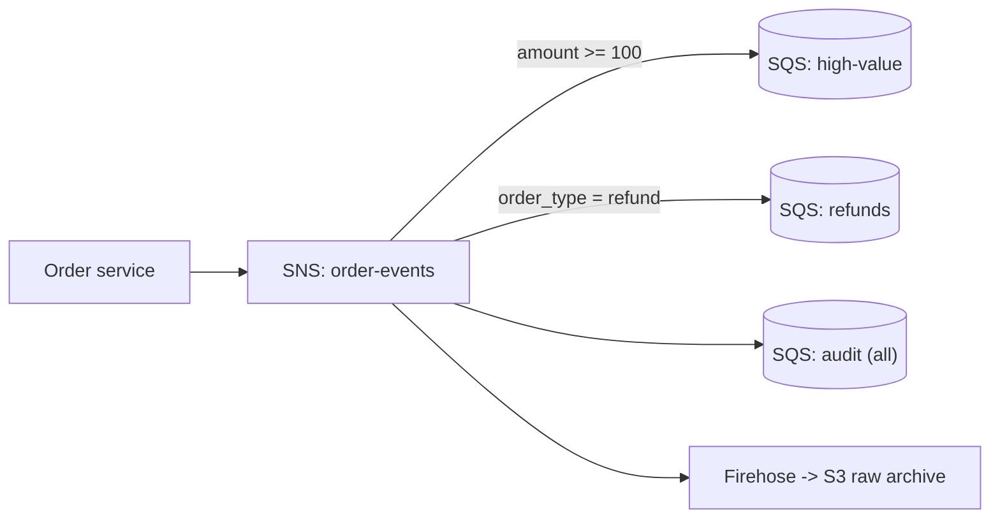
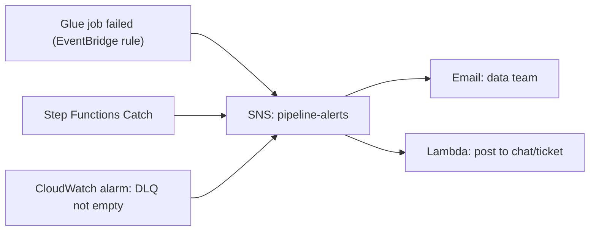
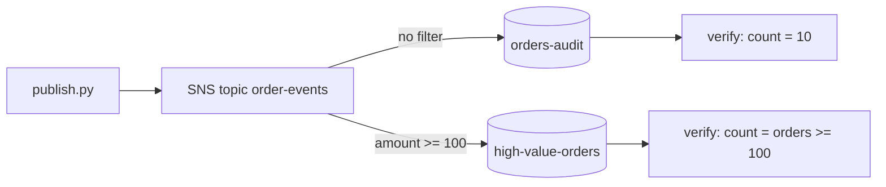

# Amazon SNS — Data Engineering Study Notes (0–2 YOE)

> Self-contained notes: fundamentals → implementation → interview preparation.
> SNS quotas, protocols and pricing evolve (for example, topics can now be configured for payloads up to 1 MiB via the `MaximumMessageSize` attribute). Confirm numbers in the docs linked at the end.

**Contents**
1. Introduction
2. Architecture and Working Mechanism
3. Core Concepts and Terminology
4. Data Engineering Use Cases
5. Hands-on Implementation (mini-project)
6. Interview Preparation (10 conceptual + 5 scenario + 3 troubleshooting, all answered)
7. Revision and Quick Reference

---

## 1. Introduction

### What is Amazon SNS?
**Amazon Simple Notification Service (SNS)** is a fully managed **publish/subscribe (pub/sub)** messaging service. A **publisher** sends a message to a **topic**; SNS **pushes** a copy to every **subscription** on that topic. Subscribers can be Amazon SQS queues, AWS Lambda functions, HTTP/HTTPS endpoints, Amazon Data Firehose streams, email/email-JSON, SMS, and mobile push endpoints. SNS has two topic types: **Standard** (high throughput, at-least-once, best-effort ordering) and **FIFO** (ordering and deduplication, delivering to SQS queues and other supported endpoints).

### Why was it introduced and what problem does it solve?
Without pub/sub, a service that must tell many other systems about an event has to know each of them and call them one by one. SNS decouples the sender from receivers: the publisher sends once; new subscribers can be added or removed without changing the publisher. It also provides a managed way to send human notifications (email/SMS).

### Why is it important in Data Engineering?
- **Fan-out:** one event (new file, order, pipeline status) drives multiple independent pipelines — typically SNS → several SQS queues/Lambdas.
- **Alerting:** CloudWatch alarms, Step Functions, Glue/EMR failures and data-quality checks notify teams through SNS (email, SMS, chat integrations).
- **Event notifications:** S3, Redshift, DMS, Auto Scaling and many services can publish to SNS.

### When should you use it?
- Broadcasting one event to many consumers (fan-out).
- Notifying people or systems about pipeline success/failure.
- Triggering Lambda or HTTP endpoints from events.
- Filtering events so each subscriber receives only relevant messages.

### When should you avoid it?
| Situation | Better option |
|---|---|
| Need buffering and consumers that pull at their own pace | SQS (or SNS → SQS) |
| Need replay of past events and ordering per key | Kinesis Data Streams / MSK |
| Content-based routing with many AWS/SaaS sources and schedules | EventBridge |
| Rich HTML email campaigns | Amazon SES |
| Large payloads beyond the topic's maximum | S3 + message pointer |

### Simple real-world example
A new file arrives in S3. S3 sends an event to an SNS topic. SNS delivers copies to (1) an SQS queue feeding a validation worker, (2) a Lambda that updates a catalog, and (3) an email address of the data team. The S3 bucket only knows about the topic, not the three consumers.

### Brief comparison with alternatives
| | SNS | SQS | EventBridge | Kinesis Data Streams |
|---|---|---|---|---|
| Model | Push pub/sub | Pull queue | Event bus + rules | Ordered log (pull) |
| Delivery | Copy to each subscriber | One consumer per message | To matching targets | Each consumer reads independently |
| Buffering | No (retries, DLQ) | Yes | Retries, DLQ | Yes (retention) |
| Filtering | Subscription filter policies | No (filter in consumer) | Rich event patterns | Consumer-side |
| Replay | No (FIFO archive optional) | No | Archive/replay | Yes |

---

## 2. Architecture and Working Mechanism

### Overall architecture
SNS is a regional, highly available service. A **topic** has an ARN, an access policy and optional encryption. When you **publish**, SNS stores the message redundantly and fans it out to all **confirmed subscriptions**, applying each subscription's **filter policy** to decide whether to deliver. For each delivery SNS uses the protocol-specific retry policy; failures can go to a **subscription dead-letter queue (an SQS queue)**.

### Major components
- **Topic** — logical access point (Standard or FIFO).
- **Publisher** — app, AWS service (S3, CloudWatch alarms, Step Functions, DMS...), or SDK/CLI.
- **Subscription** — protocol + endpoint + optional filter policy, redrive policy and raw message delivery settings.
- **Message** — body (up to the topic's maximum size), optional **message attributes**, optional `Subject` (email).
- **Filter policy** — JSON rules matching message attributes or the message body.
- **Delivery policy/retries** — protocol-specific retry behaviour.
- **DLQ (subscription redrive policy)** — SQS queue for undeliverable messages.
- **Topic policy** — resource policy controlling who can publish/subscribe.

### End-to-end flow
1. A publisher calls `Publish` (or an AWS service publishes) to the topic ARN with message and attributes.
2. SNS authorises the call (IAM + topic policy) and stores the message durably.
3. For each subscription SNS evaluates the **filter policy**; matching ones are delivered.
4. SNS delivers to the endpoint: SQS `SendMessage`, Lambda async invoke, HTTP POST, email, etc. (with raw message delivery SQS/HTTP receive just the message body; otherwise a JSON envelope with metadata).
5. If delivery fails, SNS retries per policy; after retries are exhausted the message is dropped or sent to the subscription DLQ.
6. Delivery success/failure metrics go to CloudWatch; optional delivery status logs record each attempt.

### Mermaid architecture


### Explanation of components
- **Topic** is the fan-out hub; **subscriptions** define who receives what.
- **Filter policies** reduce noise; **raw message delivery** simplifies payloads for SQS/HTTP.
- **DLQ** captures messages SNS could not deliver.
- **Firehose subscription** is a convenient archive path to S3.

### Practical Data Engineering architecture


---

## 3. Core Concepts and Important Terminologies

### 3.1 Topics: Standard vs FIFO
| | Standard topic | FIFO topic |
|---|---|---|
| Throughput | Very high | Lower (ordered) |
| Ordering | Best-effort | Strict within a message group |
| Duplicates | Possible (at-least-once) | Deduplicated (deduplication ID / content-based) |
| Name | Any | Ends with `.fifo` |
| Subscribers | SQS, Lambda, HTTP(S), email, SMS, mobile push, Firehose | SQS queues (FIFO and, per current docs, Standard) and other supported endpoints — check docs |
- **FIFO needs** `MessageGroupId` (and `MessageDeduplicationId` unless content-based dedup is on).
- **Mistake:** choosing FIFO "just in case" and then hitting throughput limits; subscribing a Standard queue to a FIFO topic expecting ordering.
```python
sns.create_topic(Name="orders.fifo",
                 Attributes={"FifoTopic": "true", "ContentBasedDeduplication": "true"})
```

### 3.2 Publishing messages (Boto3)
```python
import json, boto3
sns = boto3.client("sns", region_name="ap-south-1")
resp = sns.publish(
    TopicArn="arn:aws:sns:ap-south-1:111122223333:order-events",
    Message=json.dumps({"order_id": "O-1", "amount": 250.0}),
    MessageAttributes={
        "amount":     {"DataType": "Number", "StringValue": "250.0"},
        "order_type": {"DataType": "String", "StringValue": "online"}})
print(resp["MessageId"])
```
- **Batch publish:** `publish_batch` sends up to 10 messages per call.
- **Message size:** default maximum is 256 KiB per message (body + attributes); topics can be configured up to 1 MiB with the `MaximumMessageSize` attribute (see docs). For larger payloads use S3 and publish a pointer.
- **Mistakes:** forgetting message attributes needed by filter policies; publishing huge payloads.

### 3.3 Subscriptions and protocols
| Protocol | Delivery | Notes |
|---|---|---|
| `sqs` | To an SQS queue | Needs a queue policy; best for durable fan-out |
| `lambda` | Async invoke | Needs a Lambda resource policy (console adds it; CLI does not) |
| `https`/`http` | POST to a URL | Endpoint must confirm the subscription (`SubscribeURL`) and return 2xx |
| `email`, `email-json` | To a mailbox | Recipient must click the confirmation link |
| `sms` | Text message | Region/origination identity rules, spending limits |
| `firehose` | To Amazon Data Firehose | Archive to S3/OpenSearch etc. |
| `application` | Mobile push | Platform endpoints |
- **Confirmation:** email/HTTP subscriptions stay `PendingConfirmation` until confirmed; unconfirmed subscriptions receive nothing.

### 3.4 Message filtering (filter policies)
- **Definition:** A JSON policy on a **subscription** that decides which messages it receives, evaluated by SNS before delivery (saves processing and cost).
- **Attribute-based (default):** match message attributes.
```json
{ "order_type": ["online"],
  "amount": [{ "numeric": [">=", 100] }],
  "region": [{ "anything-but": ["test"] }] }
```
- **Payload-based:** set `FilterPolicyScope` to `MessageBody` to filter on JSON body fields.
- **Operators:** exact match, `prefix`, `anything-but`, `numeric`, `exists`, `or` logic via arrays; multiple keys are ANDed.
- **Mistakes:** the publisher omits the attribute (message not delivered to filtered subscribers); wrong data type (`Number` vs `String`).

### 3.5 Fan-out with SQS and raw message delivery
The **fanout pattern** subscribes multiple SQS queues to one topic. Each queue gets its own copy, buffers it and has its own consumers, retries and DLQ.
- **Queue policy** must allow `sns.amazonaws.com` to `sqs:SendMessage` with `aws:SourceArn` = topic ARN.
- **Raw message delivery** (`RawMessageDelivery=true`): SQS receives the original body (and message attributes as SQS attributes) without the SNS JSON envelope. Without it, consumers must parse `Message` out of the envelope.
```json
{"Version":"2012-10-17","Statement":[{"Effect":"Allow","Principal":{"Service":"sns.amazonaws.com"},
 "Action":"sqs:SendMessage","Resource":"<queue-arn>",
 "Condition":{"ArnEquals":{"aws:SourceArn":"<topic-arn>"}}}]}
```

### 3.6 Delivery retries and dead-letter queues
- SNS retries failed deliveries according to protocol-specific policies (for HTTP(S) a configurable delivery policy; for SQS/Lambda a built-in policy with long retry windows).
- **Subscription DLQ:** attach a **redrive policy** (`deadLetterTargetArn` → an SQS queue) so messages that exhaust retries are saved. The DLQ's queue policy must allow SNS to send.
- **Mistake:** assuming SNS stores messages for later pickup — without a DLQ, undeliverable messages are dropped after retries.

### 3.7 Delivery status logging and metrics
Enable **delivery status logging** (CloudWatch Logs) per protocol to record successes/failures. Key CloudWatch metrics: `NumberOfMessagesPublished`, `NumberOfNotificationsDelivered`, `NumberOfNotificationsFailed`, `NumberOfNotificationsFilteredOut`, `PublishSize`, `SMSMonthToDateSpentUSD`.

### 3.8 Security
- **Topic policy** (resource policy) allows other accounts/services to publish (e.g. S3, CloudWatch alarms, EventBridge) with `aws:SourceArn`/`aws:SourceAccount` conditions.
- **Encryption at rest:** SSE with an AWS KMS key; publishers and services need `kms:GenerateDataKey`/`kms:Decrypt` on that key.
- **In transit:** HTTPS; enforce with `aws:SecureTransport`.
- **VPC endpoints** (PrivateLink) for private publishing; IAM for least privilege (`sns:Publish`, `sns:Subscribe`).
- **Mistake:** SSE-KMS topic with S3/CloudWatch publishing but no key policy allowing those services.

### 3.9 FIFO topics: archive and replay (know the idea)
FIFO topics can optionally archive messages for a retention period and support replay to subscribers, a limited recovery tool; confirm current behaviour in the docs.

### 3.10 SMS and mobile push (awareness)
SNS can send SMS messages and mobile push notifications. SMS has sandbox/spending limits and country-specific registration rules; data engineers mostly use email, SQS, Lambda and chat integrations instead.

### 3.11 Pricing basics
You pay per publish request (in 64 KB chunks) and per delivery depending on protocol (deliveries to SQS and Lambda in the same Region carry no per-delivery charge; HTTP, email and SMS differ), with a monthly free tier. Check the pricing page.

---

## 4. Data Engineering Use Cases

### Real-world use cases
- Pipeline success/failure alerts (Step Functions, Glue, EMR, CloudWatch alarms → SNS → email/on-call).
- Fan-out of new-data events to multiple pipelines.
- Data quality alerts and SLA breach notifications.
- Triggering downstream systems via HTTPS webhooks.
- Archiving all events to S3 through a Firehose subscription.

### Batch processing
When a daily batch finishes, the orchestrator publishes a "dataset ready" message; downstream teams' queues receive it (filtered by dataset name) and start their jobs. Failures publish to an alert topic.

### Real-time / streaming
SNS gives near-real-time push notifications and fan-out for event-driven systems (S3 → SNS → SQS/Lambda). For ordered, replayable, very high-volume streams use Kinesis/MSK; SNS can fan out derived events or alerts from stream processing.

### Pipeline example 1 — Fan-out with filtering


### Pipeline example 2 — Operational alerting


### Why a Data Engineer chooses SNS
It is the simplest way to fan out events and send alerts: one publish, many subscribers, built-in filtering and retries, native integration with S3, CloudWatch, Step Functions and SQS. Choose SQS when consumers need to pull/buffer, EventBridge for richer routing and SaaS integration, Kinesis for ordered replayable streams.

---

## 5. Hands-on Implementation

### Mini-project: Event fan-out with filtering from SNS to two SQS queues

**1. Objective:** Create an SNS topic, subscribe two SQS queues (one receiving all orders, one only high-value orders via a filter policy), publish test orders, and verify routing.

**2. Business problem:** An order service emits events. The audit team needs every event; the fraud team only needs orders of 100 or more. The publisher must not know about either consumer.

**3. Architecture**


**4. Prerequisites and setup**
- AWS CLI configured, Python 3 with Boto3.
- Permissions for SNS and SQS in your account.
- **Costs:** negligible and within the free tier; resources are deleted by the cleanup script.

**5–6. Implementation and code**

*Step 1 — Create everything and publish (`fanout_demo.py`)*
```python
import json, time, boto3

REGION = "ap-south-1"
sns = boto3.client("sns", region_name=REGION)
sqs = boto3.client("sqs", region_name=REGION)

topic_arn = sns.create_topic(Name="order-events")["TopicArn"]

def make_queue(name):
    url = sqs.create_queue(QueueName=name)["QueueUrl"]
    arn = sqs.get_queue_attributes(QueueUrl=url, AttributeNames=["QueueArn"])["Attributes"]["QueueArn"]
    policy = {"Version": "2012-10-17", "Statement": [{
        "Effect": "Allow", "Principal": {"Service": "sns.amazonaws.com"},
        "Action": "sqs:SendMessage", "Resource": arn,
        "Condition": {"ArnEquals": {"aws:SourceArn": topic_arn}}}]}
    sqs.set_queue_attributes(QueueUrl=url, Attributes={"Policy": json.dumps(policy)})
    return url, arn

audit_url, audit_arn = make_queue("orders-audit")
hv_url, hv_arn = make_queue("high-value-orders")

def subscribe(queue_arn, filter_policy=None):
    attrs = {"RawMessageDelivery": "true"}
    if filter_policy:
        attrs["FilterPolicy"] = json.dumps(filter_policy)
    return sns.subscribe(TopicArn=topic_arn, Protocol="sqs", Endpoint=queue_arn,
                         Attributes=attrs, ReturnSubscriptionArn=True)["SubscriptionArn"]

subscribe(audit_arn)                                             # receives everything
subscribe(hv_arn, {"amount": [{"numeric": [">=", 100]}]})       # only amount >= 100
time.sleep(5)                                                    # let subscriptions settle

orders = [{"order_id": f"O-{i:02d}", "amount": float(a), "type": "online" if i % 2 else "store"}
          for i, a in enumerate([20, 150, 99.99, 100, 500, 35, 250, 80, 101, 10], start=1)]
for o in orders:
    sns.publish(TopicArn=topic_arn, Message=json.dumps(o),
                MessageAttributes={
                    "amount": {"DataType": "Number", "StringValue": str(o["amount"])},
                    "order_type": {"DataType": "String", "StringValue": o["type"]}})
print("published", len(orders), "orders; expected high-value:",
      sum(1 for o in orders if o["amount"] >= 100))
time.sleep(5)

def drain(url):
    got = []
    while True:
        r = sqs.receive_message(QueueUrl=url, MaxNumberOfMessages=10, WaitTimeSeconds=3,
                                MessageAttributeNames=["All"])
        msgs = r.get("Messages", [])
        if not msgs:
            return got
        for m in msgs:
            got.append(json.loads(m["Body"])["order_id"])
            sqs.delete_message(QueueUrl=url, ReceiptHandle=m["ReceiptHandle"])

print("audit queue     :", sorted(drain(audit_url)))
print("high-value queue:", sorted(drain(hv_url)))

# save names for cleanup
json.dump({"topic": topic_arn, "queues": [audit_url, hv_url]}, open("resources.json", "w"))
```

*Step 2 — Cleanup script (`cleanup.py`)*
```python
import json, boto3
REGION = "ap-south-1"
res = json.load(open("resources.json"))
sns = boto3.client("sns", region_name=REGION); sqs = boto3.client("sqs", region_name=REGION)
for sub in sns.list_subscriptions_by_topic(TopicArn=res["topic"])["Subscriptions"]:
    if sub["SubscriptionArn"].startswith("arn:"):
        sns.unsubscribe(SubscriptionArn=sub["SubscriptionArn"])
sns.delete_topic(TopicArn=res["topic"])
for q in res["queues"]:
    sqs.delete_queue(QueueUrl=q)
print("cleaned up")
```

*Step 3 — Run*
```bash
python fanout_demo.py
```

**7. Explanation of the code**
- `make_queue` creates a queue and attaches a **queue policy** allowing only this topic (`aws:SourceArn`) to send to it.
- `subscribe` uses `RawMessageDelivery` so consumers receive the original JSON body, and an optional **filter policy** on the `amount` message attribute (numeric ≥ 100).
- Orders are published with `amount` as a `Number` attribute — required for numeric filtering — and `order_type` as a `String` attribute.
- The `drain` function reads and deletes messages from each queue to verify routing.

**8. Expected output**
```
published 10 orders; expected high-value: 5
audit queue     : ['O-01','O-02','O-03','O-04','O-05','O-06','O-07','O-08','O-09','O-10']
high-value queue: ['O-02','O-04','O-05','O-07','O-09']
```
(Amounts 150, 100, 500, 250, 101 are ≥ 100.)

**9. Validation and testing**
```bash
aws sns list-subscriptions-by-topic --topic-arn <TOPIC_ARN> \
  --query 'Subscriptions[].[Endpoint,SubscriptionArn]'
aws sns get-subscription-attributes --subscription-arn <SUB_ARN> --query 'Attributes.FilterPolicy'
aws cloudwatch get-metric-statistics --namespace AWS/SNS --metric-name NumberOfNotificationsFilteredOut \
  --dimensions Name=TopicName,Value=order-events --start-time $(date -u -d '15 min ago' +%FT%TZ) \
  --end-time $(date -u +%FT%TZ) --period 300 --statistics Sum
```
Edit the filter policy (e.g. `amount >= 200`) with `aws sns set-subscription-attributes`, publish again and confirm only matching orders arrive. (`date -d` is GNU syntax; adjust on macOS.)

**Optional extension — subscription DLQ:** create an SQS queue `sns-dlq` with a policy allowing SNS to send, then set the subscription attribute `RedrivePolicy` to `{"deadLetterTargetArn":"<dlq-arn>"}` so undeliverable messages are captured.

**10. Common errors and troubleshooting**
| Symptom | Cause | Fix |
|---|---|---|
| Queue gets nothing | Missing/incorrect queue policy; subscription pending | Add the policy with correct `aws:SourceArn`; check subscription status |
| High-value queue empty | Attribute not published as `Number` or filter wrong | Publish `DataType: Number`; check `FilterPolicy` |
| Body wrapped in SNS JSON envelope | `RawMessageDelivery` not enabled | Set attribute to `true` |
| `AuthorizationError` on publish | Caller lacks `sns:Publish` or topic policy denies | Update IAM/topic policy |
| `InvalidParameter: FilterPolicy` | Invalid JSON/operator | Validate policy syntax |

**11. Cost considerations and cleanup**
All resources are low-cost; delete them anyway:
```bash
python cleanup.py
```

---

## 6. Interview Preparation — Questions WITH Answers

### A. Conceptual Questions (10)

**Q1. What is Amazon SNS and how does it work?**
SNS is a managed publish/subscribe service. Publishers send messages to a **topic**; SNS pushes a copy to every confirmed **subscription** (SQS, Lambda, HTTP/S, email, SMS, mobile push, Firehose). Publishers don't know subscribers, so you can add consumers without changing the sender. SNS stores messages durably across AZs, applies subscription **filter policies**, retries failed deliveries and can send undeliverable messages to a DLQ. *Keywords: topic, subscription, fan-out, push, filter policy, at-least-once.*

**Q2. How do SNS, SQS and EventBridge differ, and when do you combine them?**
SNS pushes copies of one message to many subscribers (no buffering). SQS is a pull queue that buffers messages for one consumer group. EventBridge is an event bus with content-based rules, schedules, SaaS sources, archive/replay and many targets. Combine SNS + SQS for durable fan-out: SNS distributes, each SQS queue buffers for its own consumer with its own DLQ. Use EventBridge when routing depends on event content across many sources/targets or you need schedules/replay; use SNS when you need simple fan-out, email/SMS notifications or very high fan-out throughput.

**Q3. Standard vs FIFO topics?**
Standard topics provide high throughput, at-least-once delivery and best-effort ordering to many protocol types. FIFO topics provide strict ordering within a message group and deduplication, with lower throughput, and deliver to FIFO (and certain other) SQS endpoints — check the docs for current subscriber support. FIFO requires `MessageGroupId` and a deduplication ID or content-based deduplication. Choose FIFO for ordered, duplicate-free workflows (e.g. financial updates per account); otherwise Standard.

**Q4. What are subscription protocols and why must some be confirmed?**
Protocols include `sqs`, `lambda`, `https/http`, `email`, `email-json`, `sms`, `firehose` and mobile push. Email and HTTP(S) subscriptions require **confirmation** (clicking a link or the endpoint visiting `SubscribeURL`) to prevent abuse; until confirmed they remain `PendingConfirmation` and receive nothing. SQS and Lambda subscriptions in the same account are confirmed automatically if permissions are correct, but SQS needs a queue policy and Lambda needs a resource policy permitting SNS.

**Q5. Explain SNS message filtering.**
A **filter policy** on a subscription defines which messages that subscriber receives, so SNS filters before delivery. By default it matches **message attributes** (String, Number); with `FilterPolicyScope=MessageBody` it matches JSON body fields. Supported matching includes exact values, `prefix`, `anything-but`, `numeric` ranges, `exists` and OR via arrays; different keys are ANDed. Benefits: less consumer processing and cost, cleaner routing. Gotchas: publishers must include the attributes (with correct data types), otherwise messages don't match; check `NumberOfNotificationsFilteredOut`.

**Q6. What is the SNS→SQS fan-out pattern and what is raw message delivery?**
Subscribe several SQS queues to one topic; each queue receives its own copy and each consumer group scales and retries independently with its own DLQ. Requirements: a queue policy allowing `sns.amazonaws.com` to `sqs:SendMessage` with `aws:SourceArn` set to the topic. **Raw message delivery** removes the SNS JSON envelope so consumers get exactly the published message body (and attributes as SQS message attributes). Without it, consumers must parse the envelope's `Message` field.

**Q7. How does SNS handle delivery failures?**
SNS retries according to protocol-specific delivery policies (HTTP(S) delivery policies are configurable; SQS/Lambda use built-in policies with extended retry windows). If all retries fail, SNS drops the message unless the subscription has a **redrive policy** pointing to an SQS DLQ, which stores it for investigation. Delivery status logging to CloudWatch Logs records attempts. Always set a DLQ for important subscriptions and alarm on `NumberOfNotificationsFailed` and DLQ depth.

**Q8. What are message attributes, size limits and the message structure?**
Message attributes are typed metadata (`String`, `Number`, `Binary`) sent with the message, used for filtering and consumer logic. The default maximum message size is 256 KiB (body plus attributes), and topics can be configured for larger payloads (up to 1 MiB) via `MaximumMessageSize`; check current docs. For bigger data use S3 and send a pointer. Messages delivered without raw delivery arrive wrapped in a JSON envelope (`Type`, `MessageId`, `TopicArn`, `Message`, `Timestamp`, `MessageAttributes`, ...). `MessageStructure=json` allows per-protocol message bodies.

**Q9. How do you secure SNS topics?**
Control access with IAM policies and the **topic policy** (to allow S3, CloudWatch alarms, EventBridge or other accounts to publish, with `aws:SourceArn`/`aws:SourceAccount` conditions). Encrypt at rest using SSE-KMS (grant publishers/services `kms:GenerateDataKey`/`kms:Decrypt`), enforce HTTPS with `aws:SecureTransport`, use VPC endpoints for private publishing, restrict who can subscribe (`sns:Subscribe`), and confirm HTTPS endpoints' identity. Avoid sensitive data in messages or protect with message data protection/encryption.

**Q10. How do you monitor SNS and what drives cost?**
CloudWatch metrics: `NumberOfMessagesPublished`, `NumberOfNotificationsDelivered`, `NumberOfNotificationsFailed`, `NumberOfNotificationsFilteredOut`, and SMS spend metrics; enable delivery status logging for details; monitor subscription DLQs. Cost depends on publishes and deliveries by protocol (SQS and Lambda deliveries are typically free of delivery charges, while HTTP, email and SMS differ) plus data transfer; use filter policies, batch publishing and avoid SMS where possible. Always verify against the pricing page.

### B. Scenario-Based Questions (5)

**S1. Send alerts when a Step Functions pipeline or Glue job fails, and also notify on DLQ build-up.**
*Solution:* create an `pipeline-alerts` topic; subscribe the on-call email/distribution list and a Lambda or chat integration; have Step Functions' Catch path publish via the `sns:publish` integration, an EventBridge rule route Glue `FAILED` job state-change events to the topic, and a CloudWatch alarm on the DLQ's `ApproximateNumberOfMessagesVisible` use the topic as its action. *Why:* one topic centralises alerts. *Alternatives:* EventBridge → chat targets directly; PagerDuty via HTTPS subscription. *Trade-off:* alert fatigue — use severity topics and filter policies.

**S2. One "new data" event must trigger three pipelines, each at its own pace and with different failure handling.**
*Solution:* S3 (or the orchestrator) publishes to a topic; subscribe three SQS queues (each with a DLQ) using SNS→SQS fan-out and raw message delivery; each pipeline consumes independently; use filter policies if pipelines care about particular prefixes/dataset names. *Why:* queues buffer, isolate failures and scale independently. *Alternatives:* EventBridge with three targets. *Trade-off:* more resources; each queue incurs requests.

**S3. An HTTPS webhook subscriber is down for an hour and messages are lost.**
*Problem:* HTTP retries eventually exhaust. *Solution:* configure the subscription's delivery policy (longer/backoff retries) and a **redrive DLQ**; better, subscribe an SQS queue (buffer) and let a worker call the webhook, retrying under your control; alarm on `NumberOfNotificationsFailed`; redrive DLQ messages after recovery. *Why:* SNS is push without durable buffering; SQS provides it. *Alternatives:* EventBridge API destinations with retry/DLQ. *Trade-off:* extra queue and worker.

**S4. Another AWS account must publish order events to your topic and your SQS consumers are in a third account.**
*Solution:* add a **topic policy** allowing the other account's principal (or `aws:PrincipalOrgID`) to `sns:Publish`; allow subscriptions from the consumer account via `sns:Subscribe`; the queue policy in the consumer account must allow your topic ARN as source; handle KMS key policies if encrypted. *Why:* resource policies enable cross-account pub/sub without sharing credentials. *Alternatives:* EventBridge cross-account bus. *Trade-off:* policy complexity and confused-deputy risks — always scope by `aws:SourceArn`/account.

**S5. Account updates must be applied in order and never twice, with several downstream consumers.**
*Solution:* use a **FIFO topic** with `MessageGroupId = account_id` and deduplication; subscribe FIFO SQS queues for each consumer; consumers process each group in order; still make consumers idempotent. *Why:* FIFO topic + FIFO queue maintains order per group. *Alternatives:* Kinesis with partition key per account if replay is needed. *Trade-off:* lower throughput and per-group head-of-line blocking.

### C. Troubleshooting Questions (3)

**T1. A subscriber isn't receiving messages.**
*Root causes:* subscription `PendingConfirmation` (email/HTTP); filter policy doesn't match message attributes/types or the publisher omits attributes; missing queue policy/Lambda permission; wrong topic/Region; subscriber endpoint errors; SSE-KMS permission issues; raw delivery assumptions. *Debug approach:* `aws sns list-subscriptions-by-topic` (check status and endpoint), `get-subscription-attributes` (FilterPolicy, RawMessageDelivery, RedrivePolicy); publish a test message without attributes to an unfiltered subscription; check CloudWatch metrics (`NumberOfNotificationsFilteredOut`, `Failed`) and delivery status logs; inspect the SQS queue policy. *Fix:* confirm the subscription, correct the filter policy and attribute data types, add the proper resource policy, then retest.

**T2. `NumberOfNotificationsFailed` is rising or messages land in the subscription DLQ.**
*Root causes:* HTTP endpoint returning 4xx/5xx or timing out; Lambda function missing permission/throttled/erroring; SQS queue deleted or policy/KMS denying; email bounce; SMS opt-out/spending limit. *Debug:* enable delivery status logging and read the failure reason and status codes; check Lambda `Throttles`/`Errors`; call the endpoint manually; inspect DLQ messages. *Fix:* repair the endpoint or permissions, increase endpoint capacity/retry policy, add buffering (SQS) between SNS and a fragile system, redrive DLQ messages after recovery.

**T3. Publishing fails with `AuthorizationError`/`KMSAccessDenied`, or S3/CloudWatch can't publish to the topic.**
*Root causes:* caller's IAM policy lacks `sns:Publish`; topic policy doesn't allow the service principal (`s3.amazonaws.com`, `cloudwatch.amazonaws.com`, `events.amazonaws.com`) or missing `aws:SourceArn`; topic encrypted with a KMS key whose policy doesn't allow the service/publisher; wrong Region or topic ARN. *Debug approach:* read the exact error; review the topic access policy (`get-topic-attributes`); check the KMS key policy for `kms:GenerateDataKey`/`Decrypt` grants to the publisher/service; use CloudTrail to find denied calls; test publish with CLI as the same principal. *Fix:* add Allow statements with proper principals/conditions, grant KMS permissions, or use an AWS-managed key where service integration requires it.

---

## 7. Revision and Quick Reference

### Key takeaways
- SNS = push-based pub/sub: one publish, many subscribers.
- Use SNS→SQS for durable fan-out; filter policies for routing.
- Standard for scale; FIFO for order + dedup.
- No buffering: use SQS and DLQs for reliability.
- Topic policies and KMS permissions are common pitfalls.

### Commonly forgotten details
- Email/HTTP subscriptions need confirmation.
- Filter policies need correctly typed message attributes (`Number` vs `String`).
- SQS subscribers need a queue policy; Lambda needs a resource permission.
- Enable raw message delivery to avoid the SNS envelope.
- SNS doesn't store messages for later pickup; use DLQ/SQS.
- SSE-KMS requires key permissions for publishers/services.
- FIFO topics need group/dedup IDs; names end with `.fifo`.
- Default max message size 256 KiB (configurable higher — check docs).

### Important commands and syntax
```bash
aws sns create-topic --name my-topic
aws sns subscribe --topic-arn ARN --protocol sqs --notification-endpoint QUEUE_ARN \
  --attributes RawMessageDelivery=true,FilterPolicy='{"amount":[{"numeric":[">=",100]}]}'
aws sns subscribe --topic-arn ARN --protocol email --notification-endpoint me@example.com
aws sns publish --topic-arn ARN --message '{"a":1}' \
  --message-attributes '{"amount":{"DataType":"Number","StringValue":"150"}}'
aws sns list-subscriptions-by-topic --topic-arn ARN
aws sns set-subscription-attributes --subscription-arn SUB --attribute-name FilterPolicy --attribute-value '{...}'
aws sns get-topic-attributes --topic-arn ARN
aws sns delete-topic --topic-arn ARN
```

### Frequently used configurations
Topic type (Standard/FIFO), `ContentBasedDeduplication`, SSE KMS key, topic policy, subscription `FilterPolicy`/`FilterPolicyScope`, `RawMessageDelivery`, `RedrivePolicy` (DLQ), delivery retry policy (HTTP), delivery status logging, `MaximumMessageSize`.

### Common errors and solutions
| Error | Solution |
|---|---|
| No messages at subscriber | Confirm subscription, filters, queue/Lambda permissions |
| `AuthorizationError` | Fix IAM/topic policy |
| `KMSAccessDenied` | Grant KMS permissions to publisher/service |
| `InvalidParameter` FilterPolicy | Fix JSON/operators/types |
| HTTP endpoint failures | Fix endpoint, add DLQ/retries, buffer with SQS |
| Messages dropped | Configure DLQ and monitoring |

### Service limitations
Push model without buffering; at-least-once delivery (Standard); limited ordering; message size limit; FIFO throughput limits; no replay on Standard topics; email/SMS not for high-volume transactional mail/text (use SES/Pinpoint-type services); subscription and filter policy limits (check quotas).

### Performance and cost optimisation
Use filter policies; batch publishes (`publish_batch`); prefer SQS/Lambda subscribers (no per-delivery charge); avoid SMS for bulk; keep payloads small; avoid unnecessary topic proliferation; archive with Firehose rather than custom consumers.

### Security best practices
Least-privilege topic and IAM policies with source conditions; SSE-KMS where needed with correct key policy; enforce HTTPS; VPC endpoints; verify/confirm endpoints; restrict `Subscribe`; monitor with CloudTrail; avoid sensitive data in notification text.

### Connections with other AWS services
SQS, Lambda, S3 events, CloudWatch alarms, EventBridge, Step Functions, Firehose, KMS, IAM, DMS/Redshift/Auto Scaling notifications, Chatbot/chat integrations (via SNS), SES/Pinpoint for email/SMS campaigns.

### Quick revision cheat sheet
```
Publisher -> Topic -> [filter policy] -> Subscriptions: SQS | Lambda | HTTPS | Email | SMS | Firehose
Fan-out = SNS + many SQS (queue policy + RawMessageDelivery)
Reliability: retries + subscription DLQ (SQS) ; SNS itself doesn't buffer
Standard (scale, at-least-once) vs FIFO (order+dedup, groups)
Filter on message attributes (typed) or body
Security: topic policy + SourceArn, KMS key policy
```

### 10 rapid-fire revision questions
1. **Is SNS push or pull?** Push.
2. **What gives durable per-consumer buffering behind SNS?** SQS queues subscribed to the topic.
3. **What must email subscribers do?** Confirm the subscription.
4. **What attribute type is needed for numeric filter policies?** `Number`.
5. **What removes the SNS JSON envelope for SQS?** Raw message delivery.
6. **Where do undeliverable messages go?** The subscription's DLQ (an SQS queue) if configured.
7. **Which topic type preserves order within a group?** FIFO.
8. **What lets S3 publish to a topic?** The topic's access policy allowing `s3.amazonaws.com` with source conditions.
9. **Which metric shows filtered messages?** `NumberOfNotificationsFilteredOut`.
10. **Default maximum message size?** 256 KiB (configurable higher on newer topics).

---

## Official AWS documentation
- Amazon SNS Developer Guide — https://docs.aws.amazon.com/sns/latest/dg/welcome.html
- Message filtering — https://docs.aws.amazon.com/sns/latest/dg/sns-message-filtering.html
- Fanout to SQS — https://docs.aws.amazon.com/sns/latest/dg/sns-sqs-as-subscriber.html
- FIFO topics — https://docs.aws.amazon.com/sns/latest/dg/sns-fifo-topics.html
- Message delivery retries and DLQs — https://docs.aws.amazon.com/sns/latest/dg/sns-message-delivery-retries.html
- Large message payloads — https://docs.aws.amazon.com/sns/latest/dg/large-message-payloads.html
- Security — https://docs.aws.amazon.com/sns/latest/dg/security.html
- SNS pricing — https://aws.amazon.com/sns/pricing/
- Boto3 SNS reference — https://boto3.amazonaws.com/v1/documentation/api/latest/reference/services/sns.html
