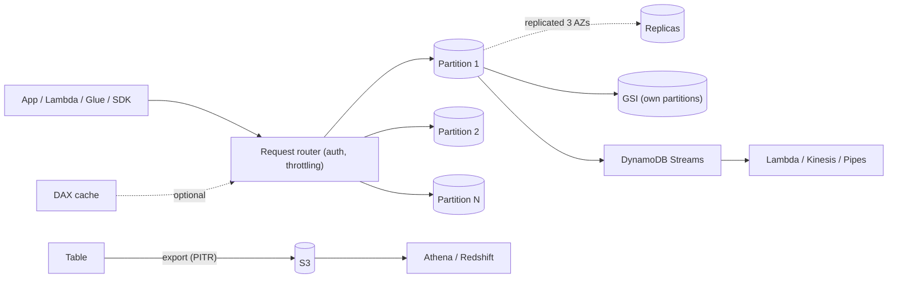
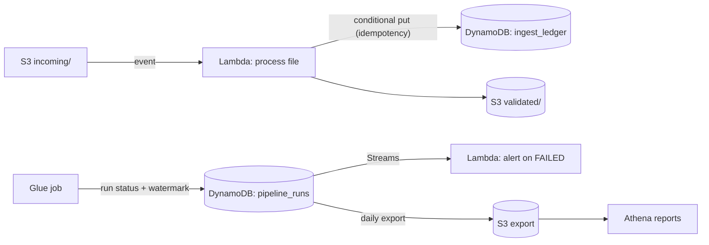
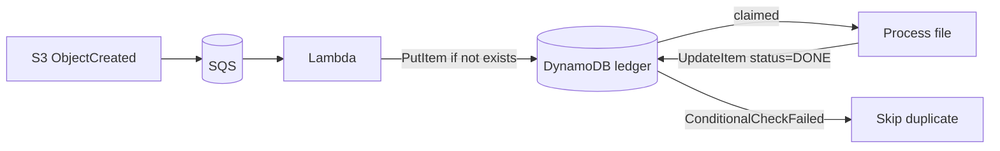
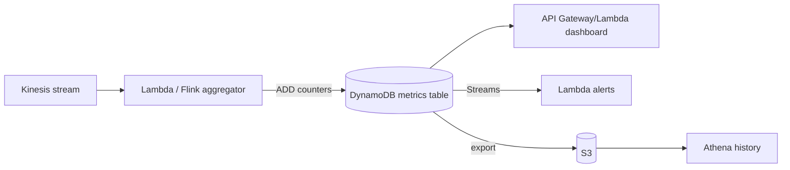
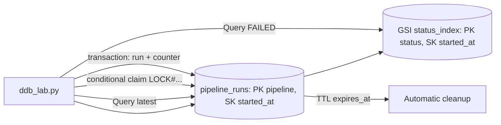

# Amazon DynamoDB — Data Engineering Study Notes (0–2 YOE)

> Self-contained notes: fundamentals → implementation → interview preparation.
> DynamoDB quotas, capacity defaults and pricing change over time; confirm numeric limits in the official docs linked at the end.

**Contents**
1. Introduction
2. Architecture and Working Mechanism
3. Core Concepts and Terminology
4. Data Engineering Use Cases
5. Hands-on Implementation (mini-project)
6. Interview Preparation (10 conceptual + 5 scenario + 3 troubleshooting, all answered)
7. Revision and Quick Reference

---

## 1. Introduction

### What is Amazon DynamoDB?
**Amazon DynamoDB** is a fully managed, serverless **NoSQL key-value and document database** that delivers single-digit-millisecond reads and writes at virtually any scale. You create **tables**, store **items** (rows) made of **attributes** (columns), and access them mainly by **primary key**. There are no servers, no patching and no manual sharding: DynamoDB partitions data automatically and replicates it across three Availability Zones.

### Why was it introduced and what problem does it solve?
Relational databases are difficult to scale horizontally and require capacity planning, indexing tuning and maintenance windows. DynamoDB (inspired by Amazon's Dynamo paper) was built for workloads with **predictable low latency at massive scale** — shopping carts, session stores, gaming leaderboards — without the operational burden.

### Why is it important in Data Engineering?
Data engineers use DynamoDB as the **operational store inside pipelines**:
- **Idempotency/ledger tables** (which files or messages were already processed).
- **Job/pipeline state and metadata** (run history, watermarks, configuration).
- **Low-latency serving** of precomputed features, lookups and real-time aggregates.
- **Checkpoint/lease tables** for streaming consumers (KCL uses DynamoDB).
- **Change data capture** through DynamoDB Streams into Lambda, Kinesis or the lake.

### When should you use it?
- Known access patterns that look up items by key or small key ranges.
- Very high request rates with consistent low latency.
- Serverless architectures (Lambda + DynamoDB).
- State/metadata stores for pipelines; time-limited data using TTL.

### When should you avoid it?
| Situation | Better option |
|---|---|
| Ad hoc analytics, joins, aggregations across the whole table | Athena/Redshift on a DynamoDB **export to S3** (or zero-ETL to Redshift) |
| Complex relational queries and multi-table transactions with flexible queries | Aurora/RDS |
| Full-text search | OpenSearch |
| Very large items (> 400 KB) or blobs | S3 + pointer in DynamoDB |
| Unknown or constantly changing query patterns | Relational/search/analytics engines |

### Simple real-world example
A Lambda function processes files from S3. Before processing, it writes `file_id` to a DynamoDB table with a condition "only if not exists". If the write fails with a conditional-check error, the file was already processed, so the function skips it — protecting against duplicate S3 events.

### Brief comparison with alternatives
| | DynamoDB | RDS/Aurora | DocumentDB/MongoDB | ElastiCache (Redis) |
|---|---|---|---|---|
| Model | Key-value/document | Relational SQL | Document | In-memory key-value |
| Scale | Horizontal, automatic | Vertical + replicas | Cluster based | Memory-bound |
| Latency | Single-digit ms | ms | ms | Sub-ms |
| Query flexibility | Key-based + indexes | Full SQL/joins | Rich queries | Key/structure ops |
| Ops | Serverless | Managed instances | Managed clusters | Managed clusters |

---

## 2. Architecture and Working Mechanism

### Overall architecture
A DynamoDB **table** is split into **partitions** (storage and throughput units) managed by the service. Each item's **partition key** value is hashed to determine which partition stores it; items with the same partition key are stored together, ordered by the **sort key** if one exists. Every write is synchronously replicated to multiple AZs (a write is acknowledged after a majority of replicas persist it). Requests go through a **request router** that authenticates, authorises and routes to the right partition.

### Major components
- **Table / item / attribute** — items are schemaless except for the key attributes.
- **Primary key** — partition key, or partition key + sort key (composite).
- **Secondary indexes** — GSI and LSI for alternate access patterns.
- **Capacity** — on-demand or provisioned read/write capacity units.
- **DynamoDB Streams** — ordered change log of item changes (24 hours).
- **TTL** — automatic expiry of items.
- **DAX** — in-memory cache for microsecond reads (optional).
- **Global tables** — multi-Region replication.
- **Backups** — on-demand backups, point-in-time recovery (PITR), export to S3.

### End-to-end flow of a write and a read
1. Client calls `PutItem` (SDK/CLI/PartiQL) with IAM-signed request.
2. The request router hashes the partition key, finds the partition leader and checks capacity (throttles if exceeded).
3. The leader writes to its log/B-tree and replicates to other AZs; once enough replicas confirm, the write is acknowledged. Secondary indexes and Streams are updated asynchronously (GSIs are eventually consistent).
4. For `GetItem`, the default is an **eventually consistent read** served from any replica; with `ConsistentRead=True` it is served by the leader (a strongly consistent read).
5. `Query` retrieves items with one partition key value (and an optional sort-key condition) returning up to 1 MB per page with `LastEvaluatedKey` for pagination.

### Mermaid architecture


### Explanation of components
- **Request router** enforces IAM and capacity; **partitions** hold data by key hash.
- **GSI** has separate partitions; it lags the base table slightly.
- **Streams** deliver ordered changes per item to consumers.
- **Export to S3** supports analytics without consuming table capacity.

### Practical Data Engineering architecture


---

## 3. Core Concepts and Important Terminologies

### 3.1 Tables, items and data types
- **Item size limit:** 400 KB including attribute names and values.
- **Data types:** scalar (String `S`, Number `N`, Binary `B`, Boolean, Null), document (List `L`, Map `M`), set (String/Number/Binary sets).
- **Schema:** only key attributes are defined up front; other attributes can differ per item.
- **Mistakes:** storing large blobs; using Python `float` with Boto3 (use `Decimal`); long attribute names in huge tables (they count towards size).

### 3.2 Primary key: partition key and sort key
- **Simple primary key:** partition key only (unique per item).
- **Composite primary key:** partition key + sort key; items with the same partition key form an **item collection** ordered by sort key; the pair must be unique.
- **Why it matters:** The key design decides how data is distributed and what you can query efficiently. Reads by key are fast; anything else needs an index or a scan.
- **Hot partition:** a partition receiving a disproportionate share of traffic (e.g. partition key = today's date or a celebrity ID). Each partition has throughput limits (approximately 3,000 RCU and 1,000 WCU per partition), so choose **high-cardinality, evenly accessed** keys.
- **Example key design:** `pipeline` (PK) + `started_at` (SK) lets you fetch the latest runs of a pipeline with one query.

### 3.3 Read/write operations
| Operation | Use |
|---|---|
| `PutItem` | Create/replace an item |
| `GetItem` | Read one item by full key |
| `UpdateItem` | Modify attributes (supports atomic counters and expressions) |
| `DeleteItem` | Remove an item |
| `Query` | Read items with one partition key + optional sort key condition (efficient) |
| `Scan` | Read the whole table (or index) — slow/expensive; avoid in production paths |
| `BatchGetItem` / `BatchWriteItem` | Up to 100 reads / 25 writes per call (partial failures must be retried via `UnprocessedItems`) |
| `TransactGetItems` / `TransactWriteItems` | ACID across multiple items (up to 100 items, 4 MB total) |
```python
import boto3
from boto3.dynamodb.conditions import Key
table = boto3.resource("dynamodb", region_name="ap-south-1").Table("pipeline_runs")
table.put_item(Item={"pipeline": "orders_etl", "started_at": "2026-11-19T02:00:00Z", "status": "RUNNING"})
resp = table.query(KeyConditionExpression=Key("pipeline").eq("orders_etl"),
                   ScanIndexForward=False, Limit=5)      # newest first
print(resp["Items"])
```

### 3.4 Read consistency
- **Eventually consistent read** (default): may return slightly stale data; costs half the RCU.
- **Strongly consistent read** (`ConsistentRead=True`): returns the latest committed data; not available on GSIs or global-table cross-Region reads.
- **Transactional reads/writes:** serializable isolation at roughly double the capacity cost.

### 3.5 Capacity units and capacity modes
- **RCU (read capacity unit):** one strongly consistent read per second up to 4 KB (two eventually consistent reads; a transactional read costs two RCUs).
- **WCU (write capacity unit):** one write per second up to 1 KB (a transactional write costs two WCUs).
- **Example:** reading a 7 KB item strongly consistent = 2 RCUs (rounds up to 8 KB); writing a 2.5 KB item = 3 WCUs.
- **On-demand mode:** pay per request, no capacity planning, scales instantly to prior peaks and beyond (with documented behaviour) — best for unpredictable/new workloads.
- **Provisioned mode:** you set RCU/WCU (with **auto scaling**) — cheaper at steady, predictable load; throttles if exceeded.
- **Table classes:** **Standard** and **Standard-IA** (lower storage cost, higher request cost) for rarely accessed data.
- **Mistakes:** provisioning too low (throttling) or leaving large provisioned capacity idle; using on-demand for very steady heavy traffic where provisioned is cheaper.

### 3.6 Secondary indexes: GSI vs LSI
| | Global Secondary Index (GSI) | Local Secondary Index (LSI) |
|---|---|---|
| Keys | Any partition key + optional sort key | Same partition key as table, different sort key |
| Created | Anytime | Only at table creation |
| Consistency | Eventually consistent reads only | Eventual or strong |
| Capacity | Its own (provisioned) or shared on-demand | Shares the table's capacity |
| Size limit | None extra | 10 GB per partition key value (item collection) |
- **Projection:** choose `KEYS_ONLY`, `INCLUDE` (selected attributes) or `ALL` — fewer projected attributes mean lower cost.
- **Throttling:** writes to the base table can be throttled if a GSI lacks write capacity (provisioned mode).
- **Mistakes:** querying on non-key attributes with `Scan`/filters instead of creating an index; projecting everything.

### 3.6b Query vs Scan and filter expressions
- `Query` reads only the items for a partition key (and sort-key range) — cost depends on data **read**.
- `FilterExpression` is applied **after** reading and does not reduce consumed capacity (you still pay for what was read).
- `Scan` reads every item (1 MB per call); use parallel scan or export to S3 for analytics.
- **Pagination:** if `LastEvaluatedKey` is present, call again with `ExclusiveStartKey`.
```python
items, kwargs = [], {"KeyConditionExpression": Key("pipeline").eq("orders_etl")}
while True:
    r = table.query(**kwargs)
    items += r["Items"]
    if "LastEvaluatedKey" not in r:
        break
    kwargs["ExclusiveStartKey"] = r["LastEvaluatedKey"]
```

### 3.7 Conditional writes, update expressions and idempotency
- **Condition expressions** make writes safe: `attribute_not_exists(pk)` (insert only if new), version checks for **optimistic locking**, state-transition checks.
- **Update expressions** modify attributes without reading first: `SET`, `REMOVE`, `ADD` (atomic counters), `DELETE` (from sets).
- **Idempotency pattern:**
```python
from botocore.exceptions import ClientError
try:
    table.put_item(Item={"pipeline": "LOCK#orders_etl", "started_at": "2026-11-19",
                         "owner": "run-123"},
                   ConditionExpression="attribute_not_exists(pipeline)")
    print("claimed")
except ClientError as e:
    if e.response["Error"]["Code"] == "ConditionalCheckFailedException":
        print("already claimed — skip")
    else:
        raise
```
- **Atomic counter:** `UpdateExpression="ADD runs :one"`.
- **Reserved words:** use `ExpressionAttributeNames` (`#s` for `status`).

### 3.8 Transactions
`TransactWriteItems` performs up to 100 actions (Put/Update/Delete/ConditionCheck) atomically across items and tables in the same Region; all succeed or none do (`TransactionCanceledException` otherwise). Costs double capacity. Use for multi-item invariants (e.g. record run + update counter).

### 3.9 Time to Live (TTL)
Mark an attribute (Number, epoch seconds) as the TTL attribute; DynamoDB deletes expired items in the background at no write cost, typically within a few days of expiry (not instantly), so queries should still filter out expired items if exactness matters. Deleted items appear in Streams (as service deletions). **Use for:** ledgers, sessions, temporary state.

### 3.10 DynamoDB Streams and change data capture
A stream captures item-level changes (INSERT, MODIFY, REMOVE) in order per item and keeps them for **24 hours**. Choose a **StreamViewType**: `KEYS_ONLY`, `NEW_IMAGE`, `OLD_IMAGE`, `NEW_AND_OLD_IMAGES`. Consume with Lambda (event source mapping), the Kinesis Client Library adapter, EventBridge Pipes, or send changes to **Kinesis Data Streams for DynamoDB** (longer retention, multiple consumers). Use cases: alerts on FAILED runs, replicating to OpenSearch/S3, aggregating counters.

### 3.11 Backups, PITR, export and import
- **On-demand backups** and **point-in-time recovery** (restore to any second in the last 35 days) don't consume table capacity.
- **Export to S3** (DynamoDB JSON or Amazon Ion) from PITR snapshots without using RCUs — the standard path to analytics (Athena/Glue/Redshift). **Import from S3** creates new tables from files. Incremental exports are available.
- **Zero-ETL integrations** with Redshift/OpenSearch exist for near-real-time analytics (check docs).

### 3.12 Global tables, DAX (awareness)
- **Global tables:** multi-Region, multi-active replication for DR and low-latency global access; conflict resolution is last-writer-wins by default (newer consistency modes exist — check docs).
- **DAX:** managed in-memory cache for read-heavy workloads (microsecond reads); it adds a cluster to manage and eventual consistency semantics.

### 3.13 Data modelling basics
1. **List access patterns first** (what questions will you ask?).
2. Design keys and indexes to answer them with `GetItem`/`Query`.
3. Prefer **single-table design** when it makes sense (related entities share a table using prefixed keys like `ORDER#123`, `CUST#9`), but keep it understandable.
4. Avoid hot keys: add suffixes/sharding (`date#shard-3`) for heavy writes.
5. Denormalise: duplicate data to avoid joins.
**Mistake:** modelling like a relational schema, then relying on scans.

### 3.14 Security and monitoring
- **IAM** policies with fine-grained access (`dynamodb:LeadingKeys`, attribute-level conditions), encryption at rest (default; can use KMS keys), VPC gateway endpoint for private access, CloudTrail for management/data events.
- **Metrics:** `ConsumedReadCapacityUnits`, `ConsumedWriteCapacityUnits`, `ThrottledRequests`, `ReadThrottleEvents`, `WriteThrottleEvents`, `SuccessfulRequestLatency`, `SystemErrors`, `UserErrors`, `ReturnedItemCount`. Use **Contributor Insights** to find hot keys.

---

## 4. Data Engineering Use Cases

### Real-world use cases
- Idempotency and file-processing ledgers.
- Pipeline metadata: run history, watermarks, job configuration, data catalog extensions.
- Serving precomputed features/aggregates for applications and APIs.
- Streaming state/checkpoints (KCL leases).
- Session/state stores with TTL.
- CDC from application tables into the lake via Streams or export to S3.

### Batch processing
Batch jobs write run status and watermarks to DynamoDB (`pipeline_runs`, `watermarks`); the next run reads the last watermark with one `GetItem`. Daily **export to S3** feeds analytics without scanning the live table.

### Real-time / streaming
Lambda or Flink consumers update DynamoDB with real-time aggregates (counters, latest values) that dashboards or APIs read at low latency; Streams trigger downstream actions; Kinesis checkpointing uses DynamoDB leases.

### Pipeline example 1 — Idempotent file ingestion


### Pipeline example 2 — Metrics serving and analytics


### Why a Data Engineer chooses DynamoDB
Zero-ops, predictable millisecond performance, conditional writes for idempotency, Streams for CDC, TTL for cleanup and seamless Lambda integration — ideal for pipeline state and low-latency lookups. Use S3 + Athena/Redshift for analytics and Aurora for relational needs.

---

## 5. Hands-on Implementation

### Mini-project: Pipeline run-tracking table with idempotent claims, GSI queries, TTL and transactions

**1. Objective:** Build a DynamoDB table that tracks ETL pipeline runs, query the latest runs and failures with a GSI, claim a daily run idempotently with a conditional write, update status safely, and use an atomic counter and a transaction.

**2. Business problem:** A data platform team needs to answer: "What are the last runs of pipeline X?", "Which runs failed in the last 3 days?" and "Make sure the nightly job is started only once per day", all with millisecond latency and no servers.

**3. Architecture**


**4. Prerequisites and setup**
- AWS CLI configured; Python 3 with Boto3 (`pip install boto3`).
- Permissions for DynamoDB (create/delete tables, read/write items).
- **Costs:** the table uses on-demand billing; this lab costs fractions of a cent. Delete the table at the end.

**5–6. Implementation and code (`ddb_lab.py`)**
```python
import random, time
from datetime import datetime, timedelta, timezone
from decimal import Decimal
import boto3
from boto3.dynamodb.conditions import Key
from boto3.dynamodb.types import TypeSerializer
from botocore.exceptions import ClientError

REGION, TABLE = "ap-south-1", "pipeline_runs"
ddb = boto3.resource("dynamodb", region_name=REGION)
client = ddb.meta.client
ser = TypeSerializer()

def wait_active():
    while True:
        d = client.describe_table(TableName=TABLE)["Table"]
        gsi_ok = all(g["IndexStatus"] == "ACTIVE" for g in d.get("GlobalSecondaryIndexes", []))
        if d["TableStatus"] == "ACTIVE" and gsi_ok:
            return
        time.sleep(3)

def create_table():
    ddb.create_table(
        TableName=TABLE,
        KeySchema=[{"AttributeName": "pipeline", "KeyType": "HASH"},
                   {"AttributeName": "started_at", "KeyType": "RANGE"}],
        AttributeDefinitions=[{"AttributeName": "pipeline", "AttributeType": "S"},
                              {"AttributeName": "started_at", "AttributeType": "S"},
                              {"AttributeName": "status", "AttributeType": "S"}],
        GlobalSecondaryIndexes=[{"IndexName": "status_index",
            "KeySchema": [{"AttributeName": "status", "KeyType": "HASH"},
                          {"AttributeName": "started_at", "KeyType": "RANGE"}],
            "Projection": {"ProjectionType": "ALL"}}],
        BillingMode="PAY_PER_REQUEST")
    wait_active()
    client.update_time_to_live(TableName=TABLE,
        TimeToLiveSpecification={"Enabled": True, "AttributeName": "expires_at"})
    print("table ready with GSI and TTL")

def seed():
    table = ddb.Table(TABLE)
    random.seed(7)
    now = datetime.now(timezone.utc)
    with table.batch_writer() as bw:                    # handles batching + retries of unprocessed items
        for pipeline in ["orders_etl", "clickstream_etl", "customers_sync"]:
            for d in range(10):
                started = now - timedelta(days=d, hours=1)
                status = random.choices(["SUCCEEDED", "FAILED"], weights=[85, 15])[0]
                bw.put_item(Item={
                    "pipeline": pipeline, "started_at": started.isoformat(timespec="seconds"),
                    "status": status, "rows": random.randint(1_000, 50_000),
                    "duration_s": random.randint(60, 900),
                    "expires_at": int((started + timedelta(days=30)).timestamp())})
    print("seeded 30 runs")

def demo():
    table = ddb.Table(TABLE)

    # 1) Latest 3 runs of a pipeline (Query, newest first)
    r = table.query(KeyConditionExpression=Key("pipeline").eq("orders_etl"),
                    ScanIndexForward=False, Limit=3)
    print("\nLatest orders_etl runs:")
    for i in r["Items"]:
        print("  ", i["started_at"], i["status"], int(i["rows"]))

    # 2) Failures in the last 3 days across pipelines (GSI Query)
    cutoff = (datetime.now(timezone.utc) - timedelta(days=3)).isoformat(timespec="seconds")
    r = table.query(IndexName="status_index",
                    KeyConditionExpression=Key("status").eq("FAILED") & Key("started_at").gte(cutoff))
    print("\nFAILED in last 3 days:", [(i["pipeline"], i["started_at"]) for i in r["Items"]])

    # 3) Idempotent claim: only the first caller wins
    def claim(owner):
        try:
            table.put_item(Item={"pipeline": "LOCK#orders_etl",
                                 "started_at": datetime.now(timezone.utc).strftime("%Y-%m-%d"),
                                 "owner": owner,
                                 "expires_at": int(time.time()) + 86400 * 2},
                           ConditionExpression="attribute_not_exists(pipeline)")
            return True
        except ClientError as e:
            if e.response["Error"]["Code"] == "ConditionalCheckFailedException":
                return False
            raise
    print("\nclaim #1:", claim("run-A"), " claim #2:", claim("run-B"))

    # 4) Safe state transition RUNNING -> SUCCEEDED (conditional update)
    key = {"pipeline": "orders_etl", "started_at": "2026-12-31T00:00:00"}
    table.put_item(Item={**key, "status": "RUNNING"})
    def finish(expected_old):
        try:
            table.update_item(Key=key,
                UpdateExpression="SET #s = :new, finished_at = :f",
                ConditionExpression="#s = :old",
                ExpressionAttributeNames={"#s": "status"},
                ExpressionAttributeValues={":new": "SUCCEEDED", ":old": expected_old,
                                           ":f": datetime.now(timezone.utc).isoformat()})
            return "updated"
        except ClientError as e:
            return e.response["Error"]["Code"]
    print("finish (expects RUNNING):", finish("RUNNING"))
    print("finish again (expects RUNNING):", finish("RUNNING"))

    # 5) Atomic counter
    for _ in range(3):
        table.update_item(Key={"pipeline": "STATS#orders_etl", "started_at": "counters"},
                          UpdateExpression="ADD runs :one", ExpressionAttributeValues={":one": 1})
    print("counter:", table.get_item(Key={"pipeline": "STATS#orders_etl", "started_at": "counters"},
                                     ConsistentRead=True)["Item"]["runs"])

    # 6) Transaction: record a run AND bump the counter atomically
    started = datetime.now(timezone.utc).isoformat(timespec="seconds")
    client.transact_write_items(TransactItems=[
        {"Put": {"TableName": TABLE, "Item": {k: ser.serialize(v) for k, v in {
            "pipeline": "orders_etl", "started_at": started, "status": "SUCCEEDED",
            "rows": 123, "expires_at": int(time.time()) + 86400 * 30}.items()}}},
        {"Update": {"TableName": TABLE,
            "Key": {"pipeline": {"S": "STATS#orders_etl"}, "started_at": {"S": "counters"}},
            "UpdateExpression": "ADD runs :one",
            "ExpressionAttributeValues": {":one": {"N": "1"}}}}])
    print("transaction committed; counter now:",
          table.get_item(Key={"pipeline": "STATS#orders_etl", "started_at": "counters"},
                         ConsistentRead=True)["Item"]["runs"])

if __name__ == "__main__":
    import sys
    cmd = sys.argv[1]
    {"create": create_table, "seed": seed, "demo": demo}[cmd]()
```
```bash
python ddb_lab.py create
python ddb_lab.py seed
python ddb_lab.py demo
```

**7. Explanation of the code**
- The table's key (`pipeline` + `started_at`) supports "latest runs for one pipeline" via `Query` with `ScanIndexForward=False`. The `status_index` GSI answers "which runs failed recently" without a scan.
- `batch_writer` batches puts (25 per request) and retries unprocessed items.
- `claim()` uses `attribute_not_exists(pipeline)` so only the first writer succeeds — an idempotency lock (also given a TTL so locks self-clean).
- The conditional update implements a state machine: the transition succeeds only if the current status matches the expected one; a second attempt fails with `ConditionalCheckFailedException`.
- `ADD runs :one` increments atomically on the server; the transaction writes a run item and updates the counter together or not at all.
- Numbers must be ints/`Decimal`, not floats, with the Boto3 resource API.

**8. Expected output**
```
table ready with GSI and TTL
seeded 30 runs

Latest orders_etl runs:
   2026-11-19T0x:..+00:00 SUCCEEDED 32110
   ...
FAILED in last 3 days: [('clickstream_etl', '2026-11-17T..'), ...]

claim #1: True  claim #2: False
finish (expects RUNNING): updated
finish again (expects RUNNING): ConditionalCheckFailedException
counter: 3
transaction committed; counter now: 4
```
(Dates, statuses and the number of failures vary.)

**9. Validation and testing**
```bash
aws dynamodb describe-table --table-name pipeline_runs --query 'Table.{Status:TableStatus,Items:ItemCount,Billing:BillingModeSummary}'
aws dynamodb describe-time-to-live --table-name pipeline_runs
aws dynamodb query --table-name pipeline_runs --key-condition-expression "pipeline = :p" \
  --expression-attribute-values '{":p":{"S":"orders_etl"}}' --max-items 3
aws dynamodb scan --table-name pipeline_runs --select COUNT      # for comparison: reads everything
```
Check `ItemCount` (it updates roughly every six hours; use `scan --select COUNT` for an exact count). Run `demo` again: claim #1 should now fail because today's lock exists.

**10. Common errors and troubleshooting**
| Error | Cause | Fix |
|---|---|---|
| `TypeError: Float types are not supported` | Used Python `float` | Use `int` or `Decimal` |
| `ValidationException: Query condition missed key schema element` | Query without the partition key (or wrong index) | Provide the partition key; use the right index |
| `ValidationException: reserved keyword` | Attribute named `status` etc. | Use `ExpressionAttributeNames` |
| `ResourceNotFoundException` | Table not ACTIVE/created or wrong Region | Wait for ACTIVE; check Region |
| `ConditionalCheckFailedException` | Condition false (expected for duplicate claims) | Handle it as a normal control path |
| `TransactionCanceledException` | A condition failed or conflict | Inspect `CancellationReasons`, retry if transient |

**11. Cost considerations and cleanup**
On-demand with tiny traffic costs almost nothing. Delete the table (this also removes the GSI):
```bash
aws dynamodb delete-table --table-name pipeline_runs --region ap-south-1
```

---

## 6. Interview Preparation — Questions WITH Answers

### A. Conceptual Questions (10)

**Q1. What is DynamoDB and when would a data engineer use it?**
DynamoDB is a serverless, fully managed NoSQL key-value/document database with single-digit-millisecond latency at any scale, replicated across three AZs. Data engineers use it for **operational pipeline state**: idempotency ledgers, run history and watermarks, configuration, low-latency serving of precomputed results, streaming checkpoints and TTL-based temporary state. It's not for ad hoc analytics or relational joins — export to S3 and use Athena/Redshift for that. *Keywords: partition key, sort key, on-demand, conditional writes, Streams, TTL, GSI.*

**Q2. Explain partition key and sort key, and what a hot partition is.**
The partition key is hashed to choose the physical partition; with a sort key, items sharing the same partition key are stored together in sort order and can be queried by range. The key pair uniquely identifies an item. A **hot partition** (or hot key) happens when traffic concentrates on one key value (e.g. today's date as partition key), exceeding per-partition throughput (about 3,000 RCU/1,000 WCU) and causing throttling even though the table has spare capacity overall. Prevent with high-cardinality keys, write sharding (`key#random-suffix`), caching hot reads (DAX/ElastiCache) and monitoring with Contributor Insights.

**Q3. What read consistency options does DynamoDB offer?**
**Eventually consistent** reads (default) are cheaper (half the RCU) and may return slightly stale data; **strongly consistent** reads (`ConsistentRead=true`) return the most recent committed write but cost more and aren't supported on GSIs; **transactional** reads provide ACID snapshot semantics at double the cost. Choose strong consistency for read-after-write needs (e.g. checking whether a claim exists) and eventual consistency for analytics-like lookups and dashboards where small lag is acceptable.

**Q4. Compare on-demand and provisioned capacity modes, and calculate RCU/WCU.**
On-demand: pay per request, no planning, scales automatically — good for new or spiky workloads. Provisioned: you specify RCU/WCU (with auto scaling), cheaper for steady predictable traffic but throttles if exceeded. **Calculations:** 1 RCU = one strongly consistent read ≤ 4 KB per second (two eventually consistent); 1 WCU = one write ≤ 1 KB per second. Reading 100 items/s of 6 KB with strong consistency: 6 KB rounds up to 8 KB = 2 RCU per read → 200 RCU; eventually consistent → 100 RCU. Writing 50 items/s of 2.5 KB = 3 WCU each → 150 WCU.

**Q5. When do you use Query vs Scan, and what do filter expressions do?**
`Query` uses the partition key (and optional sort-key condition) to read only the relevant items — efficient and predictable. `Scan` reads the whole table/index (1 MB per call) — slow and costly, acceptable only for small tables or one-off jobs (use parallel scan or export to S3 for large analytics). A `FilterExpression` is applied after items are read, so it reduces returned data but **not** consumed capacity. Design keys/indexes so important access patterns use Query; handle pagination via `LastEvaluatedKey`.

**Q6. Explain GSIs and LSIs and when to use each.**
A **GSI** has its own partition/sort key (any attributes), can be added anytime, has its own capacity (provisioned mode) and supports only eventually consistent reads; updates propagate asynchronously. An **LSI** shares the table's partition key with an alternative sort key, must be created with the table, shares capacity, supports strong reads and limits each item collection to 10 GB. Use GSIs for new access patterns (e.g. query by `status`); LSIs for alternate sort orders within one partition key. Project only needed attributes to control cost, and ensure GSI write capacity doesn't throttle the base table.

**Q7. How do conditional writes support idempotency and optimistic locking?**
A `ConditionExpression` makes a write succeed only if a condition holds. `attribute_not_exists(pk)` on `PutItem` implements "claim once" (idempotency ledger): the second attempt fails with `ConditionalCheckFailedException`, which you treat as "already processed". A version attribute (`version = :expected`) with an increment implements optimistic locking, and status conditions implement safe state machines (`RUNNING → SUCCEEDED`). Conditions are evaluated atomically at the item level without extra reads. For multi-item invariants use `TransactWriteItems`.

**Q8. What is TTL and what are its caveats?**
Time to Live lets you designate a Number attribute holding an epoch-seconds expiry time; DynamoDB deletes expired items in the background without consuming write capacity, and deletions appear in Streams. Caveats: deletion is not immediate (typically within days after expiry), so queries should filter items past expiry if exactness matters; TTL attribute must be a Number in seconds (not milliseconds); it doesn't apply to GSIs separately (the base item is deleted and the index follows). Great for sessions, locks and short-lived pipeline state.

**Q9. What are DynamoDB Streams and how are they used in pipelines?**
Streams are an ordered, per-item log of INSERT/MODIFY/REMOVE events retained for 24 hours, with configurable images (`KEYS_ONLY`, `NEW_IMAGE`, `OLD_IMAGE`, `NEW_AND_OLD_IMAGES`). You consume them with Lambda (event source mapping), KCL, or EventBridge Pipes; alternatively stream changes into **Kinesis Data Streams** for longer retention and multiple consumers. Use cases: alert on FAILED runs, maintain derived tables/search indexes, forward changes to S3 for the lake, aggregate counters. Consumers must be idempotent and handle retries.

**Q10. How do you model data in DynamoDB and run analytics on it?**
Start from **access patterns**, then design the primary key and indexes to satisfy each with `Get`/`Query`; denormalise and consider single-table design (prefixes like `PIPELINE#`, `RUN#`) while avoiding hot keys. Analytics aren't DynamoDB's strength: enable **PITR** and **export to S3** (no impact on table capacity), then query with Athena/Glue/Redshift; or use zero-ETL/Streams-based replication for near-real-time. Avoid full table scans in production paths, and keep large objects in S3.

### B. Scenario-Based Questions (5)

**S1. A Lambda processing S3 events sometimes handles the same file twice.**
*Solution:* create a ledger table keyed by `file_id` (`bucket/key#etag/version`); before processing do `PutItem` with `attribute_not_exists(file_id)`; on `ConditionalCheckFailedException` skip; on failure delete/mark the claim so retries can proceed; add TTL to expire old entries. *Why:* conditional writes are atomic, so only one invocation wins. *Alternatives:* SQS FIFO deduplication, Powertools idempotency utility (which uses DynamoDB). *Trade-off:* an extra write per event and handling of "stuck" claims (use states and TTL).

**S2. A table keyed by `date` receives 5,000 writes/second for the current date and throttles.**
*Problem:* all writes hit one partition key (hot partition). *Solution:* **write sharding** — use `date#shard` with shard = hash(id) % N (e.g. 10–20) so writes spread across partitions; query all shards for a date (N parallel queries) and merge; or change the partition key to a higher-cardinality attribute (e.g. `device_id`) with date as sort key. *Why:* throughput is per partition. *Alternatives:* buffer in SQS/Kinesis and batch writes. *Trade-off:* more complex reads (scatter-gather).

**S3. Analysts want to run SQL over the DynamoDB orders table without affecting production.**
*Solution:* enable **PITR**, schedule **export to S3** (Parquet-friendly via Glue conversion, or DynamoDB JSON/Ion), catalogue in Glue and query with Athena; for fresher data use Streams → Kinesis Firehose → S3, or zero-ETL integration with Redshift/OpenSearch. *Why:* exports don't consume table capacity and keep analytics separate. *Alternatives:* scan into a warehouse (slow, expensive). *Trade-off:* data freshness depends on export frequency; additional storage.

**S4. DynamoDB costs are increasing with a large table of mostly cold data.**
*Solution:* review billing mode (switch steady workloads to provisioned with auto scaling or use reserved capacity; keep on-demand for spiky), enable **TTL** to delete obsolete items, use the **Standard-IA table class** for rarely accessed tables, trim GSIs/projections (use `KEYS_ONLY`/`INCLUDE`), compress or move large attributes to S3, avoid `Scan`, use eventually consistent reads where possible, and cache hot reads with DAX. *Why:* cost = storage + requests + indexes. *Alternatives:* archive old data to S3 via export/Streams. *Trade-off:* IA class raises per-request costs.

**S5. A dashboard needs the latest per-minute metrics for 10,000 devices with millisecond reads and auto-expiry after 7 days.**
*Solution:* table with PK `device_id`, SK `minute_ts`; consumers (Lambda/Flink) write aggregates; set TTL `expires_at` = now + 7 days; query latest N minutes with `Query(ScanIndexForward=False, Limit=N)`; use on-demand capacity and consider DAX for very hot reads; use Streams or export to S3 for historical analysis. *Why:* key design matches the access pattern; TTL bounds storage. *Alternatives:* Timestream for time-series analytics. *Trade-off:* DynamoDB lacks time-series functions — aggregate before writing.

### C. Troubleshooting Questions (3)

**T1. Requests fail with `ProvisionedThroughputExceededException` or `ThrottlingException`.**
*Root causes:* provisioned capacity too low or auto scaling lagging a burst; a hot partition; a GSI with insufficient write capacity throttling base-table writes; large scans/queries consuming capacity; retry storms without backoff; on-demand table suddenly exceeding prior peak by a large factor. *Debug approach:* CloudWatch `ThrottledRequests`, `ReadThrottleEvents`/`WriteThrottleEvents` (per table and index), `ConsumedRCU/WCU` vs provisioned; enable **Contributor Insights** to find hot keys; check access patterns for scans. *Fix:* raise capacity or switch to on-demand, spread keys (write sharding), increase GSI capacity, add exponential backoff with jitter (SDKs retry by default), cache hot reads (DAX), reduce scans.

**T2. Queries return fewer items than expected, or you get `ValidationException`.**
*Root causes:* not paginating (`LastEvaluatedKey` ignored — results are limited to 1 MB per page); `FilterExpression` hiding results/after-read filtering; querying a GSI (eventually consistent) right after a write; wrong key condition (missing partition key equality); reserved keywords (`status`, `name`) not escaped; using floats; expired TTL items not yet deleted appearing in results. *Debug:* log the raw response including `Count`, `ScannedCount` and `LastEvaluatedKey`; check the key schema with `describe-table`; review the expression syntax. *Fix:* loop on `LastEvaluatedKey`, use `ExpressionAttributeNames`/`Values`, supply the partition key, use strong reads on the base table when needed, convert floats to `Decimal`, filter expired items.

**T3. `ConditionalCheckFailedException` or `TransactionCanceledException` occurs unexpectedly.**
*Root causes:* duplicate delivery legitimately failing the "not exists" condition; item already in a different state; concurrent writers (optimistic lock mismatch); transaction contention or exceeding limits (items, 4 MB); ConditionCheck on a missing item; idempotency token reuse with different parameters (`IdempotentParameterMismatch`). *Debug approach:* read the error's `CancellationReasons` (for transactions) and use `ReturnValuesOnConditionCheckFailure=ALL_OLD` to see the existing item; log the condition and item state; review concurrency. *Fix:* treat expected condition failures as control flow (skip/retry), re-read and retry on version conflicts, shorten/split transactions, use unique idempotency tokens, and fix state-machine logic.

---

## 7. Revision and Quick Reference

### Key takeaways
- DynamoDB = serverless key-value/document NoSQL with millisecond latency; design **keys for access patterns**.
- Use Query (not Scan), indexes for extra access paths, conditional writes for idempotency.
- On-demand for unpredictable workloads; provisioned + auto scaling for steady ones.
- TTL, Streams, PITR and S3 export are key operational/DE features.
- Analytics belong in S3 + Athena/Redshift, not scans.

### Commonly forgotten details
- Item limit 400 KB; Query/Scan page limit 1 MB.
- RCU = 4 KB strong read; WCU = 1 KB write; eventual reads cost half; transactions double.
- Filters don't reduce read cost.
- GSIs are eventually consistent; LSIs must be created with the table.
- Floats aren't allowed in Boto3 (use `Decimal`).
- TTL deletes within days, not instantly; value in epoch seconds.
- BatchWrite max 25 items; BatchGet max 100; transaction max 100 items/4 MB.
- Streams retain data 24 hours; PITR 35 days.
- Hot keys cause throttling even with spare table capacity.

### Important commands and syntax
```bash
aws dynamodb create-table --table-name T --attribute-definitions AttributeName=pk,AttributeType=S AttributeName=sk,AttributeType=S \
  --key-schema AttributeName=pk,KeyType=HASH AttributeName=sk,KeyType=RANGE --billing-mode PAY_PER_REQUEST
aws dynamodb put-item --table-name T --item '{"pk":{"S":"a"},"sk":{"S":"1"}}' --condition-expression "attribute_not_exists(pk)"
aws dynamodb get-item --table-name T --key '{"pk":{"S":"a"},"sk":{"S":"1"}}' --consistent-read
aws dynamodb query --table-name T --key-condition-expression "pk = :p" --expression-attribute-values '{":p":{"S":"a"}}'
aws dynamodb update-time-to-live --table-name T --time-to-live-specification Enabled=true,AttributeName=expires_at
aws dynamodb update-continuous-backups --table-name T --point-in-time-recovery-specification PointInTimeRecoveryEnabled=true
aws dynamodb export-table-to-point-in-time --table-arn ARN --s3-bucket B --export-format DYNAMODB_JSON
aws dynamodb delete-table --table-name T
```
```python
table.update_item(Key=k, UpdateExpression="ADD cnt :i", ExpressionAttributeValues={":i": 1})
table.query(IndexName="gsi", KeyConditionExpression=Key("status").eq("FAILED"))
```

### Frequently used configurations
Billing mode, auto scaling targets, table class, GSI projections, TTL attribute, Streams view type, PITR, KMS encryption, deletion protection, Contributor Insights, global table replicas, `ConsistentRead`, SDK retry settings.

### Common errors and solutions
| Error | Solution |
|---|---|
| Throttling | Increase capacity/on-demand, fix hot keys, backoff |
| `ValidationException` | Fix key schema/expressions/types/reserved words |
| `ConditionalCheckFailedException` | Expected control flow or logic bug |
| `ResourceNotFoundException` | Table/index name or Region/status |
| `ItemCollectionSizeLimitExceeded` | LSI 10 GB limit — redesign |
| Missing items in results | Paginate, check filters/consistency |

### Service limitations
400 KB item limit; limited query flexibility (key-based); 1 MB per Query/Scan page; LSI constraints; transaction limits; GSI eventual consistency; TTL not exact; no joins; Streams 24-hour retention; throughput per partition limits; global tables conflict resolution semantics; check current quotas.

### Performance and cost optimisation
Design for access patterns; avoid scans; spread keys; project minimal attributes; use eventually consistent reads; batch operations; TTL cleanup; right billing mode (provisioned+auto scaling for steady load); Standard-IA for cold tables; DAX for hot reads; export to S3 for analytics.

### Security best practices
Least-privilege IAM (resource-level, `LeadingKeys` conditions); encryption at rest with KMS where required; VPC gateway endpoint; fine-grained access per table/index; CloudTrail data events for sensitive tables; PITR/backups for recovery; deletion protection; no secrets in items.

### Connections with other AWS services
Lambda (triggers, idempotency), Kinesis (streams/KCL checkpoints), S3 (export/import), Athena/Glue/Redshift (analytics), Streams + EventBridge Pipes, Step Functions (SDK integration), API Gateway, DAX, CloudWatch (metrics/alarms), IAM/KMS, DMS (as a target).

### Quick revision cheat sheet
```
Table -> items (<=400KB) ; PK (hash) [+ SK] ; Query by PK, Scan = avoid
RCU: 4KB strong read ; WCU: 1KB write ; eventual = half ; transaction = double
GSI (any keys, eventual, anytime) | LSI (same PK, create-time, 10GB collection)
Conditional write = idempotency/locking ; ADD = atomic counter ; Transact up to 100 items
TTL (epoch sec) ; Streams (24h) ; PITR (35d) ; Export to S3 for analytics
Hot partition -> shard the key
```

### 10 rapid-fire revision questions
1. **Maximum item size?** 400 KB.
2. **What does 1 RCU represent?** One strongly consistent read per second of up to 4 KB.
3. **What does 1 WCU represent?** One write per second of up to 1 KB.
4. **Which operation should you avoid for large tables?** `Scan`.
5. **How do you insert an item only if it doesn't exist?** `ConditionExpression="attribute_not_exists(pk)"`.
6. **Which index can be added after table creation?** A GSI.
7. **What format must the TTL attribute use?** Number, epoch seconds.
8. **How long does DynamoDB Streams retain records?** 24 hours.
9. **How to analyse a DynamoDB table with Athena?** Export to S3 (from PITR) and query it.
10. **Which Python type must replace `float` with Boto3?** `Decimal`.

---

## Official AWS documentation
- Amazon DynamoDB Developer Guide — https://docs.aws.amazon.com/amazondynamodb/latest/developerguide/Introduction.html
- Core components (tables, items, keys) — https://docs.aws.amazon.com/amazondynamodb/latest/developerguide/HowItWorks.CoreComponents.html
- Read/write capacity modes — https://docs.aws.amazon.com/amazondynamodb/latest/developerguide/capacity-mode.html
- Secondary indexes — https://docs.aws.amazon.com/amazondynamodb/latest/developerguide/SecondaryIndexes.html
- Condition expressions — https://docs.aws.amazon.com/amazondynamodb/latest/developerguide/Expressions.ConditionExpressions.html
- Transactions — https://docs.aws.amazon.com/amazondynamodb/latest/developerguide/transactions.html
- TTL — https://docs.aws.amazon.com/amazondynamodb/latest/developerguide/TTL.html
- Streams — https://docs.aws.amazon.com/amazondynamodb/latest/developerguide/Streams.html
- Export to S3 — https://docs.aws.amazon.com/amazondynamodb/latest/developerguide/S3DataExport.HowItWorks.html
- Service quotas — https://docs.aws.amazon.com/amazondynamodb/latest/developerguide/ServiceQuotas.html
- DynamoDB pricing — https://aws.amazon.com/dynamodb/pricing/
- Boto3 DynamoDB reference — https://boto3.amazonaws.com/v1/documentation/api/latest/reference/services/dynamodb.html
