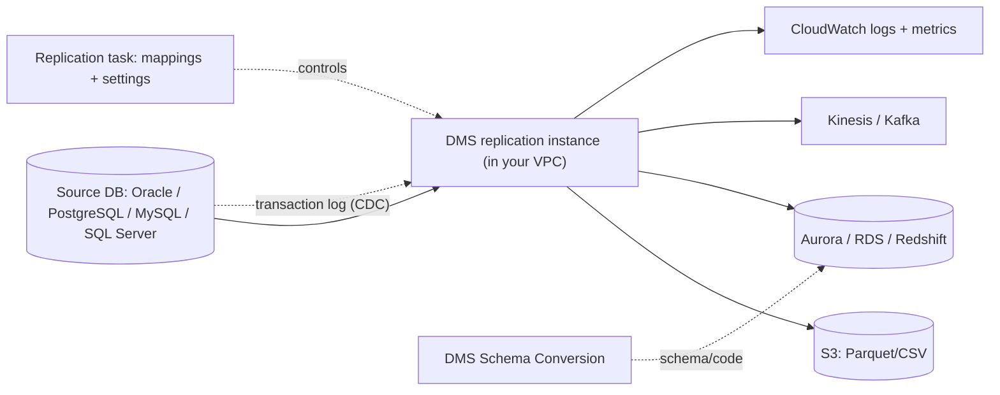
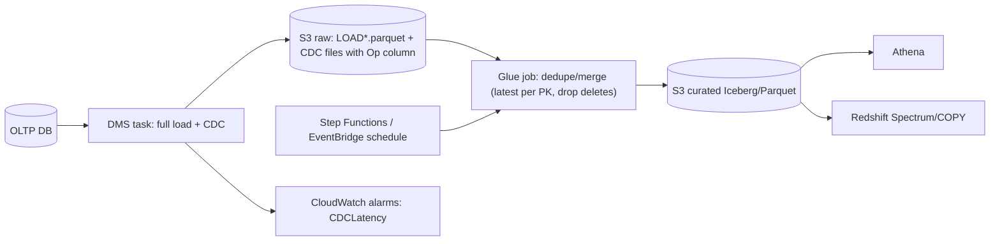
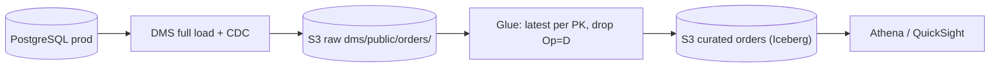
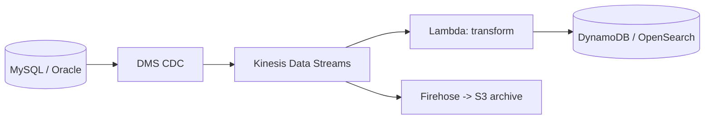
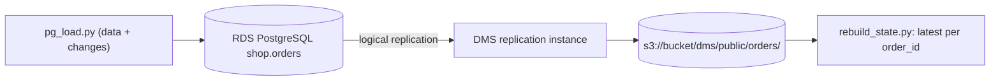

# AWS DMS — Data Engineering Study Notes (0–2 YOE)

> Self-contained notes: fundamentals → implementation → interview preparation.
> DMS engine/version support, instance classes, free-tier terms and pricing change often. Confirm details in the official docs linked at the end before you build or budget.

**Contents**
1. Introduction
2. Architecture and Working Mechanism
3. Core Concepts and Terminology
4. Data Engineering Use Cases
5. Hands-on Implementation (mini-project)
6. Interview Preparation (10 conceptual + 5 scenario + 3 troubleshooting, all answered)
7. Revision and Quick Reference

---

## 1. Introduction

### What is AWS DMS?
**AWS Database Migration Service (DMS)** is a managed service that **migrates data between databases and data stores** and can **continuously replicate ongoing changes** using **change data capture (CDC)**. The source and target can be the same engine (homogeneous, e.g. MySQL → Aurora MySQL) or different engines (heterogeneous, e.g. Oracle → PostgreSQL). Targets include relational databases, Amazon S3 (CSV/Parquet), Amazon DynamoDB, Amazon Redshift, Amazon Kinesis Data Streams, Apache Kafka/MSK, OpenSearch and more. DMS runs on a **replication instance** (or in **DMS Serverless** mode) that reads the source and writes to the target.

### Why was it introduced and what problem does it solve?
Moving a live production database used to mean long downtime and custom scripts. DMS performs an initial **full load** while the source stays online, then applies the changes that happen during and after the load (CDC) until you cut over. This minimises downtime and removes the need to build and maintain replication tooling.

### Why is it important in Data Engineering?
DMS is one of the most common ways to **ingest operational (OLTP) databases into the data lake or warehouse**: DMS → S3 (Parquet) → Glue/Athena/Redshift, or DMS → Kinesis/Kafka for streaming. It gives data engineers incremental change data without querying production tables repeatedly or writing triggers.

### When should you use it?
- Database migrations to AWS with minimal downtime.
- Continuous replication of an OLTP database to S3/Redshift/Kinesis for analytics.
- Consolidating several databases into one target.
- Keeping a read replica-like copy in a different engine for reporting.

### When should you avoid it?
| Situation | Better option |
|---|---|
| Same-engine migration where native tools are simpler (e.g. `pg_dump`, logical replication, RDS read replicas, Aurora clone) | Native replication/backups |
| Complex transformations during replication | Replicate raw then transform with Glue/dbt/Spark |
| Converting stored procedures, triggers and complex schema objects | **DMS Schema Conversion** / manual rewrite (DMS migrates data, not all schema objects) |
| Near-real-time replication from Aurora/RDS/DynamoDB straight into Redshift | **Zero-ETL integrations** |
| Event streaming from application code | Kinesis/MSK producers |

### Simple real-world example
A retailer's orders live in an on-premises Oracle database. DMS performs a full load of the `ORDERS` table to S3 as Parquet, then streams every insert/update/delete as small CDC files. Glue merges these into a lake table nightly, so analysts query fresh data in Athena without touching Oracle.

### Brief comparison with alternatives
| | DMS | Glue JDBC jobs | Debezium on MSK/Kafka Connect | Zero-ETL |
|---|---|---|---|---|
| Capture | Log-based CDC, managed | Query-based (timestamps/PKs) | Log-based CDC, self-managed | Managed replication (supported sources only) |
| Ops effort | Low–medium | Low | High | Lowest (limited sources/targets) |
| Latency | Seconds–minutes | Batch intervals | Seconds | Seconds–minutes |
| Targets | Many | Anything Spark can write | Kafka then sinks | Redshift/OpenSearch/etc. |
| Deletes captured | Yes | Hard (query-based misses deletes) | Yes | Yes |

---

## 2. Architecture and Working Mechanism

### Overall architecture
A DMS setup has four parts: a **replication instance** (compute running the replication engine in your VPC), a **source endpoint**, a **target endpoint** and a **replication task** that defines what to move and how. The task reads from the source — via a table scan for the full load, and via the database's transaction log for CDC — and writes to the target.

### Major components
- **Replication instance** — an EC2-based host (instance class such as `dms.t3.*`, `dms.c5.*`, `dms.r5.*`) with allocated storage and optional Multi-AZ; it needs network access to source and target.
- **Endpoint** — connection details for a source or target (engine, host, port, credentials, SSL, extra connection attributes).
- **Replication task** — migration type, table mappings, task settings.
- **Table mappings** — JSON **selection rules** (which schemas/tables) and **transformation rules** (rename, add columns, remove columns, filters).
- **Task settings** — LOB mode, parallel load, validation, error handling, logging.
- **DMS Serverless** — replication capacity (DCUs) provisioned automatically, no instance sizing.
- **Premigration assessments, data validation, CloudWatch metrics/logs** — quality and monitoring.
- **DMS Schema Conversion** — converts schema/code for heterogeneous migrations.

### Migration types
| Type | What it does |
|---|---|
| **Full load** | One-time copy of existing data |
| **CDC only** | Replicates changes from a chosen start point onwards |
| **Full load + CDC** | Copies existing data, then replicates changes made during and after the load until you stop |

### End-to-end flow (full load + CDC)
1. The task starts and DMS caches changes from the source's transaction log while the full load runs.
2. Tables are loaded in parallel (configurable) to the target.
3. After the full load, cached changes are applied, then **ongoing replication** continues in near real time.
4. At cut-over, you stop writes to the source, wait for latency to reach zero and switch applications to the target (for migrations) or leave the task running (for analytics feeds).
5. Metrics (CDC latency, throughput) and task logs are published to CloudWatch.

### Mermaid architecture


### Explanation of components
- **Replication instance** does the work; size it for throughput and memory (CDC changes are buffered).
- **Endpoints** abstract connectivity; **task** describes scope and behaviour.
- **Transaction logs** (binlog, WAL, redo logs, transaction log) are how CDC sees changes without touching tables.
- **CloudWatch** tracks latency and errors.

### Practical Data Engineering architecture


---

## 3. Core Concepts and Important Terminologies

### 3.1 Replication instances (and Serverless)
- **Definition:** The compute resource that runs replication tasks. It is an EC2-based instance in a **replication subnet group** (subnets in at least two AZs for Multi-AZ).
- **Sizing:** CPU/memory depend on table count, LOBs, parallelism and CDC volume. Insufficient memory leads to swapping to disk and slow tasks. Allocate storage for logs and cached changes.
- **Multi-AZ:** standby instance for high availability.
- **DMS Serverless:** you define minimum/maximum **DMS Capacity Units (DCUs)**; DMS scales capacity automatically — less sizing work, good for variable workloads.
- **Mistakes:** undersized instance; forgetting that CDC cache needs storage; leaving instances running after a migration (cost).

### 3.2 Endpoints
- **Source endpoint** examples: Oracle, SQL Server, MySQL/MariaDB, PostgreSQL, MongoDB/DocumentDB, SAP ASE, Db2, S3.
- **Target endpoint** examples: the above plus Amazon Redshift, S3, DynamoDB, Kinesis Data Streams, Apache Kafka/MSK, OpenSearch, Neptune.
- **Connection test:** `aws dms test-connection` verifies the replication instance can reach the endpoint — always run it.
- **Credentials:** can be supplied directly or via **AWS Secrets Manager**; use SSL for in-transit encryption where supported.
- **Extra connection attributes** tune engine-specific behaviour.

### 3.3 Replication tasks and migration types
Task settings include migration type (full load, CDC, full load + CDC), **table preparation mode** for the target (`DO_NOTHING`, `DROP_AND_CREATE`, `TRUNCATE_BEFORE_LOAD`), LOB mode, `StopTaskCachedChangesApplied`, error handling and logging. Start types: `start-replication` (new) or `resume-processing`/`reload-target`.

### 3.4 Table mappings: selection and transformation rules
```json
{
  "rules": [
    { "rule-type": "selection", "rule-id": "1", "rule-name": "include-orders",
      "object-locator": { "schema-name": "public", "table-name": "orders" },
      "rule-action": "include" },
    { "rule-type": "transformation", "rule-id": "2", "rule-name": "add-source-system",
      "rule-target": "column", "object-locator": { "schema-name": "public", "table-name": "orders" },
      "rule-action": "add-column", "value": "source_system",
      "expression": "'pg-prod'", "data-type": { "type": "string", "length": 20 } },
    { "rule-type": "transformation", "rule-id": "3", "rule-name": "rename-schema",
      "rule-target": "schema", "object-locator": { "schema-name": "public" },
      "rule-action": "rename", "value": "sales" }
  ]
}
```
- **Wildcards:** `%` matches any characters (`"table-name": "%"`).
- **Filters:** column filters restrict rows (e.g. a date range) during load/CDC.
- **Mistakes:** forgetting that DMS only replicates tables that match a selection rule; assuming every object type (views, procedures) is migrated.

### 3.5 Change data capture (CDC) per engine
DMS reads changes from the source's log, so the source must be configured to **retain and expose** them:
| Source | Typical requirement |
|---|---|
| MySQL/MariaDB | Binary logging enabled with `binlog_format=ROW`; sufficient binlog retention (on RDS set retention hours) |
| PostgreSQL | Logical replication enabled (`wal_level=logical`; on RDS `rds.logical_replication=1`, reboot required); uses a replication slot (can hold WAL if the task stops) |
| Oracle | ARCHIVELOG mode + supplemental logging; LogMiner or Binary Reader |
| SQL Server | MS-Replication or MS-CDC enabled on tables; full recovery model |
- **Primary keys:** tables without a primary key complicate CDC (and updates/deletes on some targets); add PKs or accept limitations.
- **Mistakes:** logs purged before DMS reads them; abandoned replication slots filling the disk; DML on tables not captured.

### 3.6 S3 as a target (very common for DE)
- **File formats:** CSV (default) or **Parquet** (`DataFormat=parquet`, with compression options).
- **Layout:** `s3://bucket/<bucket-folder>/<schema>/<table>/` containing full-load files named like `LOAD00000001.parquet` and CDC files named by timestamp. Optional **date partitioning** (`DatePartitionEnabled`, `DatePartitionSequence`) creates folders by date for CDC files.
- **Op column:** CDC rows include an `Op` column with `I` (insert), `U` (update) or `D` (delete); set `IncludeOpForFullLoad=true` to add `Op='I'` to full-load files for consistency. `TimestampColumnName` adds a commit/arrival timestamp column to order changes.
- **Important:** S3 files are append-only change records, not a merged table. You must **merge** (take the latest row per primary key by timestamp, drop deletes) in Glue/Athena/Redshift or write to a table format like Iceberg.
- **Deletes/updates:** for PostgreSQL without `REPLICA IDENTITY FULL`, delete/update "before" images may contain only key columns.
```bash
aws dms create-endpoint --endpoint-identifier tgt-s3 --endpoint-type target --engine-name s3 \
  --s3-settings 'ServiceAccessRoleArn=arn:aws:iam::111122223333:role/DmsS3Role,BucketName=my-lake,BucketFolder=dms,DataFormat=parquet,IncludeOpForFullLoad=true,TimestampColumnName=dms_ts'
```

### 3.7 LOBs and data types
Large objects (LOBs: CLOB/BLOB/text) can slow replication. **LOB modes:** *limited* (truncate at a max size — fastest), *full* (migrate entire LOBs — slower), *inline*. Choose limited when you know max sizes. Data type mappings differ by engine pair; verify with premigration assessment and sample comparisons.

### 3.8 Performance and parallelism
- Full load parallelism: `MaxFullLoadSubTasks` (tables loaded in parallel, default 8), **parallel load** for partitioned/large tables (`parallel-load` rules), commit rate and `BatchApplyEnabled` for target apply.
- Use a replication instance with adequate CPU, memory and network; place it close to the source/target; avoid cross-Region traffic.
- Large initial loads: consider loading big tables in segments, disabling target indexes/FKs temporarily, and using bulk-friendly target settings.

### 3.9 Data validation and premigration assessments
- **Data validation** compares source and target rows after load/CDC and reports mismatches (adds load on both sides).
- **Premigration assessment** checks prerequisites, unsupported data types, missing PKs and settings before you start.
- **Mistake:** skipping validation and discovering truncated LOBs or type issues after cutover.

### 3.10 DMS Schema Conversion (heterogeneous migrations)
DMS migrates mainly **tables, primary keys and data**; it doesn't convert stored procedures, functions, triggers or all indexes/constraints. **DMS Schema Conversion** (successor to the AWS Schema Conversion Tool) assesses and converts schema and code from engines like Oracle/SQL Server to PostgreSQL/Aurora, flagging items needing manual work. For homogeneous migrations, use native tools to move schema objects.

### 3.11 Monitoring and logging
CloudWatch metrics per task: `CDCLatencySource` (lag reading from source), `CDCLatencyTarget` (lag applying to target), `CDCIncomingChanges`, `FullLoadThroughputRowsTarget`, `FreeableMemory`, `SwapUsage`, `CPUUtilization`, `FreeStorageSpace`. Enable **task logging** (CloudWatch Logs) at an appropriate severity, check `awsdms_apply_exceptions` and table statistics (`describe-table-statistics`) for errors. Alarm on rising CDC latency.

### 3.12 Security and networking
- Run replication instances in a **VPC**; security groups must allow the instance to reach source/target ports; the DB must allow the replication instance's IP/SG.
- IAM service roles: `dms-vpc-role` (create subnet groups via API/CLI), `dms-cloudwatch-logs-role`, and endpoint roles (e.g. an S3 role trusted by `dms.amazonaws.com`).
- **Encryption:** KMS for replication instance storage and target data; SSL to endpoints; secrets in Secrets Manager.
- Source access needs a **least-privilege DB user** with replication privileges.
- **Hybrid connectivity:** VPN/Direct Connect for on-premises sources.

---

## 4. Data Engineering Use Cases

### Real-world use cases
- Replicating OLTP databases into an S3 data lake (raw CDC zone).
- Loading Amazon Redshift from operational databases.
- Streaming change events to Kinesis/MSK for real-time processing.
- Database migrations (on-premises → RDS/Aurora, Oracle → PostgreSQL) with minimal downtime.
- Cross-account/Region replication and consolidation of shards into one analytics database.

### Batch processing
DMS lands full-load files once, then CDC files continuously; a scheduled Glue/Spark job (hourly/daily) reads new CDC files, deduplicates (latest per key by timestamp), applies deletes and updates a curated table (Iceberg/Hudi/Delta or partition rewrites).

### Real-time / streaming
DMS → Kinesis Data Streams (or MSK) → Lambda/Flink/Firehose gives second-level latency; consumers apply changes to DynamoDB, OpenSearch or lake tables. DMS can include control/metadata records and transaction details for ordering.

### Pipeline example 1 — OLTP to lake with merge


### Pipeline example 2 — CDC streaming


### Why a Data Engineer chooses DMS
Managed, log-based CDC with broad source/target support and minimal impact on the source; faster to implement than building replication; simple S3 landing for lakehouse patterns. Choose Glue JDBC for simple batch snapshots, Zero-ETL for supported Aurora/RDS-to-Redshift paths, Debezium/Kafka Connect when you need open-source CDC control, and native database replication for same-engine moves.

---

## 5. Hands-on Implementation

### Mini-project: Replicate an RDS PostgreSQL table to S3 as Parquet (full load + CDC)

**1. Objective:** Use DMS to replicate a PostgreSQL `orders` table to S3, observe the full-load file and CDC files (inserts/updates/deletes with the `Op` column), and rebuild the current table state from the change files.

**2. Business problem:** Analysts need operational orders data in the lake with changes arriving continuously, without querying the production database.

**3. Architecture**


**4. Prerequisites and setup**
- AWS CLI and permissions to create RDS, DMS, IAM, EC2 security groups.
- A default VPC with subnets in at least two AZs; Python 3 with `boto3`, `psycopg2-binary`, `pandas`, `pyarrow`.
- The S3 bucket from the S3 notes.
- **Costs — important:** RDS and the DMS replication instance are billed hourly while they exist (small instances cost cents per hour; free-tier eligibility depends on your account type and date — verify). Complete the lab in a few hours and run the **cleanup** section.
- This lab uses a publicly accessible RDS instance and a publicly accessible replication instance for simplicity; production designs use private subnets, VPC endpoints for S3 and Secrets Manager.

**5–6. Implementation and code**

*Step 1 — Variables, security group and RDS parameter group*
```bash
ACCOUNT=$(aws sts get-caller-identity --query Account --output text)
REGION=ap-south-1
BUCKET=retail-datalake-$ACCOUNT-$REGION
DBPASS='ChangeMe-Lab-2026!'                 # lab only; use Secrets Manager in real projects
VPC=$(aws ec2 describe-vpcs --filters Name=isDefault,Values=true --query 'Vpcs[0].VpcId' --output text)
SUBNETS=$(aws ec2 describe-subnets --filters Name=vpc-id,Values=$VPC --query 'Subnets[].SubnetId' --output text)
MYIP=$(curl -s https://checkip.amazonaws.com)

SG=$(aws ec2 create-security-group --group-name dms-lab-sg --description "DMS lab" --vpc-id $VPC --query GroupId --output text)
aws ec2 authorize-security-group-ingress --group-id $SG --protocol tcp --port 5432 --source-group $SG      # DMS -> RDS
aws ec2 authorize-security-group-ingress --group-id $SG --protocol tcp --port 5432 --cidr $MYIP/32         # you -> RDS

PGFAMILY=$(aws rds describe-db-engine-versions --engine postgres --default-only \
  --query 'DBEngineVersions[0].DBParameterGroupFamily' --output text)
aws rds create-db-parameter-group --db-parameter-group-name dms-pg \
  --db-parameter-group-family $PGFAMILY --description "logical replication for DMS"
aws rds modify-db-parameter-group --db-parameter-group-name dms-pg \
  --parameters ParameterName=rds.logical_replication,ParameterValue=1,ApplyMethod=pending-reboot
```

*Step 2 — Create the database (takes several minutes)*
```bash
aws rds create-db-instance --db-instance-identifier dms-lab-pg --engine postgres \
  --db-instance-class db.t3.micro --allocated-storage 20 \
  --master-username dmsadmin --master-user-password "$DBPASS" --db-name shop \
  --vpc-security-group-ids $SG --db-parameter-group-name dms-pg \
  --publicly-accessible --backup-retention-period 1 --no-multi-az --region $REGION
aws rds wait db-instance-available --db-instance-identifier dms-lab-pg
DBHOST=$(aws rds describe-db-instances --db-instance-identifier dms-lab-pg \
  --query 'DBInstances[0].Endpoint.Address' --output text)
echo $DBHOST
```
Because `rds.logical_replication` is a static parameter, confirm it is applied (reboot if status shows `pending-reboot`):
```bash
aws rds describe-db-instances --db-instance-identifier dms-lab-pg \
  --query 'DBInstances[0].DBParameterGroups'
aws rds reboot-db-instance --db-instance-identifier dms-lab-pg && aws rds wait db-instance-available --db-instance-identifier dms-lab-pg
```

*Step 3 — Create the table and sample data (`pg_load.py`)*
```python
import sys, random, psycopg2
HOST, PASSWORD = sys.argv[2], sys.argv[3]
conn = psycopg2.connect(host=HOST, dbname="shop", user="dmsadmin", password=PASSWORD, port=5432, connect_timeout=15)
conn.autocommit = True
cur = conn.cursor()
cmd = sys.argv[1]

if cmd == "load":
    cur.execute("""CREATE TABLE IF NOT EXISTS public.orders (
        order_id   SERIAL PRIMARY KEY,
        customer_id INT NOT NULL,
        amount     NUMERIC(10,2) NOT NULL,
        status     TEXT NOT NULL DEFAULT 'NEW',
        updated_at TIMESTAMP NOT NULL DEFAULT now())""")
    random.seed(1)
    for _ in range(100):
        cur.execute("INSERT INTO public.orders (customer_id, amount) VALUES (%s, %s)",
                    (random.randint(1, 20), round(random.uniform(5, 500), 2)))
    print("loaded 100 rows")

elif cmd == "change":
    cur.execute("INSERT INTO public.orders (customer_id, amount, status) VALUES (7, 999.99, 'NEW') RETURNING order_id")
    print("inserted order", cur.fetchone()[0])
    cur.execute("UPDATE public.orders SET status='SHIPPED', updated_at=now() WHERE order_id IN (1,2,3)")
    cur.execute("DELETE FROM public.orders WHERE order_id = 4")
    print("applied 1 insert, 3 updates, 1 delete")
```
```bash
pip install psycopg2-binary pandas pyarrow boto3
python pg_load.py load $DBHOST "$DBPASS"
```

*Step 4 — IAM roles for DMS*
```bash
cat > dms-trust.json <<'EOF'
{"Version":"2012-10-17","Statement":[{"Effect":"Allow","Principal":{"Service":"dms.amazonaws.com"},"Action":"sts:AssumeRole"}]}
EOF
# VPC management role (required name) - skip if it already exists in your account
aws iam create-role --role-name dms-vpc-role --assume-role-policy-document file://dms-trust.json 2>/dev/null
aws iam attach-role-policy --role-name dms-vpc-role --policy-arn arn:aws:iam::aws:policy/service-role/AmazonDMSVPCManagementRole
# Role DMS uses to write to S3
cat > dms-s3.json <<EOF
{"Version":"2012-10-17","Statement":[
 {"Effect":"Allow","Action":["s3:PutObject","s3:DeleteObject","s3:PutObjectTagging"],"Resource":"arn:aws:s3:::$BUCKET/dms/*"},
 {"Effect":"Allow","Action":["s3:ListBucket","s3:GetBucketLocation"],"Resource":"arn:aws:s3:::$BUCKET"}]}
EOF
aws iam create-role --role-name DmsS3Role --assume-role-policy-document file://dms-trust.json
aws iam put-role-policy --role-name DmsS3Role --policy-name s3 --policy-document file://dms-s3.json
sleep 15
```

*Step 5 — Replication subnet group and instance*
```bash
aws dms create-replication-subnet-group --replication-subnet-group-identifier dms-lab-subnets \
  --replication-subnet-group-description "dms lab" --subnet-ids $SUBNETS
RI_ARN=$(aws dms create-replication-instance --replication-instance-identifier dms-lab-ri \
  --replication-instance-class dms.t3.micro --allocated-storage 20 \
  --vpc-security-group-ids $SG --replication-subnet-group-identifier dms-lab-subnets \
  --publicly-accessible --no-multi-az --query ReplicationInstance.ReplicationInstanceArn --output text)
aws dms wait replication-instance-available --filters Name=replication-instance-arn,Values=$RI_ARN
```

*Step 6 — Endpoints and connection tests*
```bash
SRC_ARN=$(aws dms create-endpoint --endpoint-identifier src-pg --endpoint-type source --engine-name postgres \
  --server-name $DBHOST --port 5432 --database-name shop --username dmsadmin --password "$DBPASS" \
  --query Endpoint.EndpointArn --output text)
TGT_ARN=$(aws dms create-endpoint --endpoint-identifier tgt-s3 --endpoint-type target --engine-name s3 \
  --s3-settings "ServiceAccessRoleArn=arn:aws:iam::$ACCOUNT:role/DmsS3Role,BucketName=$BUCKET,BucketFolder=dms,DataFormat=parquet,IncludeOpForFullLoad=true,TimestampColumnName=dms_ts" \
  --query Endpoint.EndpointArn --output text)
aws dms test-connection --replication-instance-arn $RI_ARN --endpoint-arn $SRC_ARN
aws dms test-connection --replication-instance-arn $RI_ARN --endpoint-arn $TGT_ARN
sleep 30
aws dms describe-connections --filters Name=endpoint-arn,Values=$SRC_ARN,$TGT_ARN \
  --query 'Connections[].[EndpointIdentifier,Status,LastFailureMessage]' --output table
```
Both should show `successful`.

*Step 7 — Table mappings and task*
```bash
cat > mappings.json <<'EOF'
{"rules":[{"rule-type":"selection","rule-id":"1","rule-name":"orders",
 "object-locator":{"schema-name":"public","table-name":"orders"},"rule-action":"include"}]}
EOF
TASK_ARN=$(aws dms create-replication-task --replication-task-identifier orders-to-s3 \
  --source-endpoint-arn $SRC_ARN --target-endpoint-arn $TGT_ARN --replication-instance-arn $RI_ARN \
  --migration-type full-load-and-cdc --table-mappings file://mappings.json \
  --query ReplicationTask.ReplicationTaskArn --output text)
aws dms wait replication-task-ready --filters Name=replication-task-arn,Values=$TASK_ARN
aws dms start-replication-task --replication-task-arn $TASK_ARN --start-replication-task-type start-replication
```

*Step 8 — Watch progress, then generate changes*
```bash
aws dms describe-replication-tasks --filters Name=replication-task-arn,Values=$TASK_ARN \
  --query 'ReplicationTasks[0].[Status,ReplicationTaskStats.FullLoadProgressPercent]'
aws dms describe-table-statistics --replication-task-arn $TASK_ARN \
  --query 'TableStatistics[].[TableName,FullLoadRows,Inserts,Updates,Deletes,TableState]' --output table
aws s3 ls s3://$BUCKET/dms/public/orders/

python pg_load.py change $DBHOST "$DBPASS"
sleep 60
aws s3 ls s3://$BUCKET/dms/public/orders/
```

*Step 9 — Rebuild the current table state from change files (`rebuild_state.py`)*
```python
import io, sys, boto3, pandas as pd

bucket = sys.argv[1]
s3 = boto3.client("s3")
frames = []
for page in s3.get_paginator("list_objects_v2").paginate(Bucket=bucket, Prefix="dms/public/orders/"):
    for obj in page.get("Contents", []):
        if obj["Key"].endswith(".parquet"):
            body = s3.get_object(Bucket=bucket, Key=obj["Key"])["Body"].read()
            df = pd.read_parquet(io.BytesIO(body))
            df["_file"] = obj["Key"]
            frames.append(df)

allrows = pd.concat(frames, ignore_index=True)
print("change records:", len(allrows), "\nOp counts:\n", allrows["Op"].value_counts().to_string())

# latest record per primary key (order by timestamp, then file name), then drop deletes
latest = (allrows.sort_values(["dms_ts", "_file"])
                 .groupby("order_id", as_index=False).tail(1))
current = latest[latest["Op"] != "D"].drop(columns=["_file"])
print("current rows:", len(current))
print(current.sort_values("order_id").head(5).to_string(index=False))
```
```bash
python rebuild_state.py $BUCKET
```

**7. Explanation of the code**
- The parameter group enables **logical replication**, which DMS needs for PostgreSQL CDC.
- The security group lets the replication instance reach RDS on 5432 (self-referencing rule) and lets your IP load data.
- The S3 endpoint writes **Parquet** with an `Op` column (`IncludeOpForFullLoad=true`) and a timestamp column `dms_ts` for ordering.
- The task type `full-load-and-cdc` loads the 100 existing rows, then streams the later insert/update/delete.
- `rebuild_state.py` demonstrates the merge logic you would implement in Glue: sort by timestamp, keep the latest change per key, remove deleted keys.

**8. Expected output**
After the full load: `FullLoadRows 100` and `LOAD00000001.parquet` in S3. After the changes and a minute of waiting:
```
change records: 105
Op counts:
 I    101
 U      3
 D      1
current rows: 100
```
(100 initial + 1 insert − 1 delete = 100 current rows; counts of change records may vary slightly depending on how DMS emits updates.)

**9. Validation and testing**
```bash
python - <<'EOF'
import psycopg2, sys
c = psycopg2.connect(host="<DBHOST>", dbname="shop", user="dmsadmin", password="<DBPASS>")
cur = c.cursor(); cur.execute("select count(*) from public.orders"); print("source rows:", cur.fetchone()[0])
EOF
aws cloudwatch get-metric-statistics --namespace AWS/DMS --metric-name CDCLatencyTarget \
  --dimensions Name=ReplicationInstanceIdentifier,Value=dms-lab-ri Name=ReplicationTaskIdentifier,Value=<task-resource-id> \
  --start-time $(date -u -d '30 min ago' +%FT%TZ) --end-time $(date -u +%FT%TZ) --period 300 --statistics Average
```
The source row count must equal the rebuilt current row count. Insert another row and confirm a new CDC file appears. (Replace placeholders; `date -d` is GNU syntax.)

**10. Common errors and troubleshooting**
| Error | Cause | Fix |
|---|---|---|
| Endpoint test fails (timeout) | Security group/VPC/public-access mismatch, wrong host | Allow 5432 from the DMS SG; ensure RDS is reachable from the replication instance |
| Task fails: logical decoding/replication slot error | `rds.logical_replication` not applied; user lacks `rds_replication` role | Reboot after parameter change; grant `rds_replication` to the user |
| `AccessDenied` writing to S3 | S3 role missing permissions or wrong trust | Check `DmsS3Role` policy and trust (`dms.amazonaws.com`) |
| No CDC files | Task still in full load, no changes yet, or latency | Wait; check task status and table statistics; generate changes |
| `Failed to create replication subnet group` | Missing `dms-vpc-role` | Create the role and attach `AmazonDMSVPCManagementRole` |

**11. Cost considerations and cleanup — do this promptly**
```bash
aws dms stop-replication-task --replication-task-arn $TASK_ARN; sleep 60
aws dms delete-replication-task --replication-task-arn $TASK_ARN
aws dms delete-endpoint --endpoint-arn $SRC_ARN; aws dms delete-endpoint --endpoint-arn $TGT_ARN
aws dms delete-replication-instance --replication-instance-arn $RI_ARN
aws dms wait replication-instance-deleted --filters Name=replication-instance-arn,Values=$RI_ARN 2>/dev/null
aws dms delete-replication-subnet-group --replication-subnet-group-identifier dms-lab-subnets
aws rds delete-db-instance --db-instance-identifier dms-lab-pg --skip-final-snapshot --delete-automated-backups
aws rds wait db-instance-deleted --db-instance-identifier dms-lab-pg
aws rds delete-db-parameter-group --db-parameter-group-name dms-pg
aws ec2 delete-security-group --group-id $SG
aws iam delete-role-policy --role-name DmsS3Role --policy-name s3; aws iam delete-role --role-name DmsS3Role
aws s3 rm s3://$BUCKET/dms/ --recursive
```
(Leave `dms-vpc-role` if other DMS resources use it. Stop the task before deleting to release the replication slot — an abandoned slot would otherwise retain WAL on the source.)

---

## 6. Interview Preparation — Questions WITH Answers

### A. Conceptual Questions (10)

**Q1. What is AWS DMS and what are its main use cases?**
DMS is a managed service that migrates data between databases/data stores and can keep them in sync using change data capture (CDC). Use cases: database migrations with minimal downtime, continuous replication of OLTP data into S3/Redshift/Kinesis for analytics, engine changes (heterogeneous migrations, together with schema conversion), and consolidating databases. It runs on a replication instance (or DMS Serverless) that reads the source and writes to the target. *Keywords: full load, CDC, replication instance, endpoint, task, table mappings, heterogeneous/homogeneous.*

**Q2. Describe DMS components: replication instance, endpoints and tasks.**
The **replication instance** is the compute (EC2-based, in a replication subnet group) that runs replication; size/memory affect performance and it can be Multi-AZ. **Endpoints** store connection details for the source and target (engine, host, credentials, SSL, extra connection attributes). A **replication task** defines migration type (full load, CDC, or both), table mappings (selection/transformation rules), target table preparation mode, LOB settings, validation and logging. You test connections from the instance to each endpoint before starting. **DMS Serverless** replaces instance sizing with automatically scaling DCU capacity.

**Q3. Explain the three migration types.**
**Full load** copies existing data once. **CDC only** replicates changes from a specified starting point (for example after a native backup restore). **Full load + CDC** copies existing data while caching changes, applies the cached changes after the load and then continues ongoing replication until you stop it — the usual choice for near-zero-downtime migrations and lake ingestion. For migrations you stop application writes, wait for latency to reach zero and then cut over.

**Q4. How does CDC work and what must be configured on the source?**
DMS reads the database's transaction log rather than querying tables: MySQL binary logs (`binlog_format=ROW`), PostgreSQL logical replication slots (`wal_level=logical`, on RDS `rds.logical_replication=1`), Oracle redo/archive logs with supplemental logging (LogMiner or Binary Reader), SQL Server CDC/replication. The source must be configured to enable and retain logs long enough, and the DMS user needs replication privileges. Primary keys are important for updates/deletes. Abandoned PostgreSQL replication slots can retain WAL and fill the source disk.

**Q5. Homogeneous vs heterogeneous migrations — what does DMS Schema Conversion do?**
Homogeneous migrations (same engine family, e.g. MySQL → Aurora MySQL) can often use native tools for schema and DMS for data/CDC. Heterogeneous migrations (e.g. Oracle → PostgreSQL) need schema/code conversion. DMS itself moves data (tables, primary keys); **DMS Schema Conversion** (successor to the AWS Schema Conversion Tool) assesses and converts schema objects and code (procedures, functions, views), highlighting items that need manual rewriting. Interview tip: DMS doesn't migrate everything — secondary indexes, constraints and code objects usually need separate handling.

**Q6. What are table mappings (selection and transformation rules)?**
Table mappings are JSON rules that tell the task what to replicate and how to reshape it. **Selection rules** include/exclude schemas and tables (wildcards like `%`) and can filter rows. **Transformation rules** rename schemas/tables/columns, add or remove columns, convert case, change data types and add prefixes/suffixes. Anything not matched by a selection rule is not replicated. Use transformation rules to add metadata such as `source_system`, or to rename schemas for the target.

**Q7. How does DMS write to S3 and how do you consume the output?**
For an S3 target DMS writes CSV or Parquet files under `bucket/folder/schema/table/`: full-load files named like `LOAD00000001.parquet` and later CDC files named by timestamp. CDC rows have an `Op` column (`I`, `U`, `D`), and you can add `IncludeOpForFullLoad` and `TimestampColumnName`. These files are **change records**, not a merged table, so you must deduplicate: take the latest record per primary key (ordered by the timestamp) and drop deletes — using Glue/Spark, Athena queries, Redshift MERGE, or table formats like Iceberg/Hudi. Optional date partitioning organises CDC folders.

**Q8. What are DMS data validation, premigration assessment and LOB handling?**
**Premigration assessments** check for unsupported data types, missing primary keys, source configuration and other risks before you start. **Data validation** compares rows between source and target during/after migration and reports mismatches (adds load and time). **LOB handling** options: *limited LOB mode* (truncate at a max size — fastest, use if sizes are known), *full LOB mode* (migrate entire LOBs, slower), and inline LOBs. Misconfigured LOB limits are a common cause of silent truncation.

**Q9. How do you size and tune DMS performance, and what do you monitor?**
Choose an instance class with enough CPU, memory and network for table count, parallelism and CDC volume (memory shortage causes swapping to disk), allocate sufficient storage, and place the instance near source/target. Tune full-load parallelism (`MaxFullLoadSubTasks`, parallel-load rules for big tables), batch apply settings, and LOB mode. Monitor CloudWatch metrics `CDCLatencySource` (reading from source) vs `CDCLatencyTarget` (applying to target), `FreeableMemory`, `SwapUsage`, `CPUUtilization`, `FreeStorageSpace`, and table statistics; alarm on rising latency.

**Q10. How do you secure and network DMS?**
Run replication instances in a VPC with security groups allowing access to source/target ports; use VPN/Direct Connect for on-premises sources; use SSL on endpoints; encrypt instance storage and target data with KMS; keep credentials in Secrets Manager; grant the DMS user only required database privileges; use service roles (`dms-vpc-role`, CloudWatch logs role and endpoint roles such as S3 access with trust for `dms.amazonaws.com`). In production avoid public accessibility: use private subnets with VPC endpoints for S3/Secrets Manager.

### B. Scenario-Based Questions (5)

**S1. Ingest an on-premises Oracle database into the data lake with ongoing changes.**
*Solution:* connect via VPN/Direct Connect; enable ARCHIVELOG and supplemental logging; create a DMS full-load + CDC task to an S3 target in Parquet with `Op` and timestamp columns; schedule a Glue job to merge changes into Iceberg tables (latest per key, apply deletes); orchestrate with Step Functions; monitor CDC latency. *Why:* log-based CDC avoids heavy queries on Oracle. *Alternatives:* Glue JDBC snapshots (no deletes), Oracle GoldenGate (licensing), Debezium. *Trade-off:* DMS output needs merge logic; Oracle log configuration overhead.

**S2. Migrate a 5 TB MySQL database to Aurora MySQL with under five minutes of downtime.**
*Solution:* create the target schema (native dump/schema-only), run a DMS **full load + CDC** task with large tables loaded in parallel, validate data, wait until `CDCLatencyTarget` is near zero, stop application writes, let latency reach zero, switch application connections to Aurora, then stop the task. Rehearse beforehand. *Why:* CDC keeps the target synchronised during the long load. *Alternatives:* Aurora read replica from RDS MySQL or native binlog replication (simpler for homogeneous). *Trade-off:* DMS doesn't migrate all schema objects; test thoroughly.

**S3. CDC latency keeps growing; the target is lagging by hours.**
*Approach:* compare `CDCLatencySource` and `CDCLatencyTarget`. If source latency is high: log reading issue (log retention, Oracle LogMiner settings, network, instance CPU/memory). If target latency is high: target apply is slow (indexes, constraints, small commits, S3 file batching, undersized instance). *Fixes:* larger instance/more memory, enable batch apply, tune parallelism, add target capacity or disable heavy triggers/indexes during load, adjust S3 batching settings, split heavy tables into separate tasks. *Why:* identifying which side lags directs tuning. *Trade-off:* more capacity costs more.

**S4. Analysts see deleted orders in the lake and stale statuses.**
*Problem:* DMS S3 files are append-only change records. *Solution:* add a merge step (Glue/Spark or Athena/Redshift): rank records per primary key by timestamp, keep the latest, exclude `Op = 'D'`, and write to a curated table (Iceberg/Hudi/Delta for efficient upserts); schedule frequently, and compact small CDC files. *Why:* converts change logs into current state. *Alternatives:* DMS to Redshift/Aurora directly; stream via Kinesis to a store that supports upserts. *Trade-off:* extra pipeline, but gives full history in the raw zone.

**S5. Choose between DMS to S3, DMS to Kinesis, Glue JDBC and zero-ETL for an Aurora PostgreSQL → analytics need.**
*Recommendation:* if the destination is Redshift and Aurora is a supported zero-ETL source, use **zero-ETL** (lowest ops). For a lake with CDC history use **DMS to S3**. For sub-minute event-driven processing use **DMS to Kinesis/MSK**. Use **Glue JDBC** only for small tables where daily snapshots suffice and deletes aren't critical. *Why:* match latency, ops effort and target. *Trade-off:* zero-ETL limits transformation options; DMS needs instance management.

### C. Troubleshooting Questions (3)

**T1. `test-connection` fails or the task can't connect to source/target.**
*Root causes:* security groups/NACLs not allowing the replication instance; DB not reachable (wrong host, private vs public, VPC peering/route missing); wrong credentials or missing DB privileges; SSL mismatch; DNS resolution problems; replication instance in a subnet without route to S3/Secrets Manager. *Debug approach:* read `LastFailureMessage` in `describe-connections`; verify security group rules and routes; test connectivity from a host in the same subnet (`nc -zv host port`); check DB logs and user privileges. *Fix:* open the needed ports from the DMS instance's SG, fix routes/endpoints, correct credentials/privileges and SSL settings, then retest.

**T2. The task fails or stops during CDC (log/slot/permission errors).**
*Root causes:* PostgreSQL logical replication not enabled or the user lacks `rds_replication`; replication slot dropped or invalid; MySQL binlogs purged before DMS read them or `binlog_format` not ROW; Oracle supplemental logging missing; SQL Server CDC not enabled; replication instance out of storage/memory; unsupported data type or table without PK causing apply errors. *Debug approach:* check task status and error in `describe-replication-tasks`, CloudWatch task logs (increase logging severity if needed), `awsdms_apply_exceptions` table on the target, source DB logs and configuration, instance metrics. *Fix:* enable/retain logs, grant privileges, increase binlog retention, enlarge the instance/storage, correct table mappings or data types, then `resume-processing` or reload the affected table.

**T3. Data in the target is incomplete, truncated or has type issues.**
*Root causes:* limited LOB mode truncating values; table not matched by a selection rule; filters excluding rows; datatype conversion (precision/scale, timestamps); target preparation mode truncating/dropping tables unexpectedly; unsupported objects (views, procedures, secondary indexes, constraints) not migrated; CDC not applied to tables lacking PKs. *Debug approach:* compare row counts and checksums, use DMS **data validation** and `describe-table-statistics` (look for `ValidationFailedRecords`, `TableState`), review mappings and LOB settings, sample columns for truncation. *Fix:* correct selection/transformation rules, increase LOB limits or use full LOB mode, add PKs or adjust handling, fix type mappings, reload affected tables, and apply missing schema objects with native tooling or Schema Conversion.

---

## 7. Revision and Quick Reference

### Key takeaways
- DMS = managed migration + CDC replication via a replication instance, endpoints and tasks.
- Full load + CDC = migrate while source stays online.
- CDC reads transaction logs — configure and retain them on the source.
- S3 targets contain change records (`Op` I/U/D) — you must merge them.
- DMS migrates data, not all schema objects — use Schema Conversion or native tools.

### Commonly forgotten details
- Test endpoint connections before starting tasks.
- PostgreSQL needs logical replication (reboot on RDS); abandoned slots fill disks.
- MySQL needs ROW binlog format and enough retention.
- Tables without primary keys cause trouble for CDC.
- Selection rules decide what's replicated; nothing else moves.
- LOB mode can truncate data silently.
- Replication instances and RDS cost money until deleted; stop tasks before deleting.
- DMS creates `dms-vpc-role` requirements for CLI/API subnet groups.
- DMS S3 output isn't a merged table.

### Important commands and syntax
```bash
aws dms create-replication-instance --replication-instance-identifier ri --replication-instance-class dms.t3.micro --allocated-storage 20
aws dms create-endpoint --endpoint-identifier src --endpoint-type source --engine-name postgres --server-name H --port 5432 --database-name db --username u --password p
aws dms test-connection --replication-instance-arn RI --endpoint-arn EP
aws dms describe-connections
aws dms create-replication-task --replication-task-identifier t --source-endpoint-arn S --target-endpoint-arn T --replication-instance-arn RI --migration-type full-load-and-cdc --table-mappings file://map.json
aws dms start-replication-task --replication-task-arn TASK --start-replication-task-type start-replication
aws dms describe-table-statistics --replication-task-arn TASK
aws dms stop-replication-task --replication-task-arn TASK
aws dms start-replication-task --replication-task-arn TASK --start-replication-task-type resume-processing
```

### Frequently used configurations
Migration type; table preparation mode (`DROP_AND_CREATE`, `TRUNCATE_BEFORE_LOAD`, `DO_NOTHING`); LOB mode/size; `MaxFullLoadSubTasks`; batch apply; validation enabled; logging; S3 settings (`DataFormat`, `IncludeOpForFullLoad`, `TimestampColumnName`, date partitioning); endpoint SSL mode; Multi-AZ; Serverless min/max DCU.

### Common errors and solutions
| Error | Solution |
|---|---|
| Connection test failed | Security group/route/credentials/SSL |
| Task stops with log/slot error | Enable/retain logs, replication privileges, slots |
| `AccessDenied` to S3 | Fix role policy/trust |
| High CDC latency | Identify source vs target lag; scale instance/tune |
| Truncated data | LOB settings |
| Missing tables | Selection rules/mappings |

### Service limitations
Doesn't migrate all schema objects; heterogeneous migrations need schema conversion; CDC depends on source log configuration; S3 target is change-log style; some data types/LOB behaviours need tuning; replication instance sizing matters; certain engine/version combinations are limited — check the supported sources/targets documentation.

### Performance and cost optimisation
Right-size the instance (or use Serverless); parallel load for large tables; limited LOB mode; avoid unnecessary tables via selection rules; delete instances/tasks after migrations; use Multi-AZ only when needed; place DMS near data; compact CDC files downstream; monitor latency to avoid over-provisioning.

### Security best practices
Private subnets and security groups; SSL endpoints; KMS encryption; Secrets Manager for credentials; least-privilege DB user and IAM roles; avoid public replication instances in production; CloudTrail for API auditing; restrict S3 target permissions to the DMS prefix.

### Connections with other AWS services
RDS/Aurora, S3, Redshift, Kinesis/MSK, DynamoDB, Glue/Athena (processing), Lake Formation (governance), Step Functions/EventBridge (orchestration), CloudWatch/SNS (monitoring), VPC/Direct Connect/VPN, KMS, Secrets Manager, Schema Conversion.

### Quick revision cheat sheet
```
Source DB --(full load + transaction log CDC)--> Replication instance --> Target (S3/Redshift/Aurora/Kinesis)
Objects: replication instance, endpoints (test!), task (mappings + settings)
CDC prerequisites: MySQL ROW binlog | PG logical replication | Oracle supplemental log | SQL Server CDC
S3 target: LOAD*.parquet + CDC files, Op=I/U/D, timestamp col -> merge latest per PK, drop D
Metrics: CDCLatencySource vs CDCLatencyTarget ; validation ; LOB limited mode
Schema objects -> Schema Conversion / native tools
```

### 10 rapid-fire revision questions
1. **What does CDC stand for?** Change data capture.
2. **Which migration type keeps replicating after the initial copy?** Full load + CDC.
3. **What runs replication tasks?** A replication instance (or DMS Serverless capacity).
4. **What defines which tables are replicated?** Table mappings (selection rules).
5. **What does the `Op` column indicate in S3 CDC files?** Insert (I), update (U) or delete (D).
6. **Which MySQL setting is required for CDC?** Row-based binary logging (`binlog_format=ROW`).
7. **Which RDS PostgreSQL parameter enables CDC?** `rds.logical_replication = 1`.
8. **Which metric shows lag applying changes?** `CDCLatencyTarget`.
9. **What converts schema/code for heterogeneous migrations?** DMS Schema Conversion.
10. **What must you do before deleting a PostgreSQL CDC task?** Stop it so the replication slot is released.

---

## Official AWS documentation
- AWS DMS User Guide — https://docs.aws.amazon.com/dms/latest/userguide/Welcome.html
- Replication instances — https://docs.aws.amazon.com/dms/latest/userguide/CHAP_ReplicationInstance.html
- Sources for DMS — https://docs.aws.amazon.com/dms/latest/userguide/CHAP_Source.html
- Targets for DMS — https://docs.aws.amazon.com/dms/latest/userguide/CHAP_Target.html
- Using Amazon S3 as a target — https://docs.aws.amazon.com/dms/latest/userguide/CHAP_Target.S3.html
- Table mapping — https://docs.aws.amazon.com/dms/latest/userguide/CHAP_Tasks.CustomizingTasks.TableMapping.html
- Data validation — https://docs.aws.amazon.com/dms/latest/userguide/CHAP_Validating.html
- DMS Schema Conversion — https://docs.aws.amazon.com/dms/latest/userguide/schema-conversion.html
- Monitoring with CloudWatch — https://docs.aws.amazon.com/dms/latest/userguide/CHAP_Monitoring.html
- DMS pricing — https://aws.amazon.com/dms/pricing/
- Boto3 DMS reference — https://boto3.amazonaws.com/v1/documentation/api/latest/reference/services/dms.html
