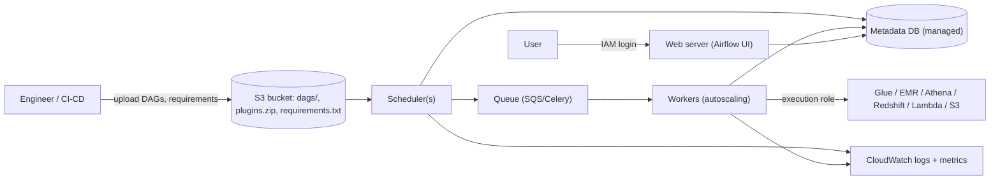
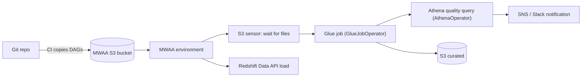
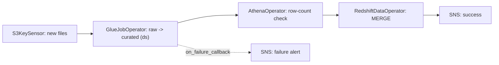
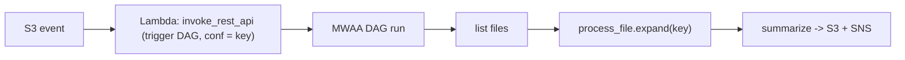
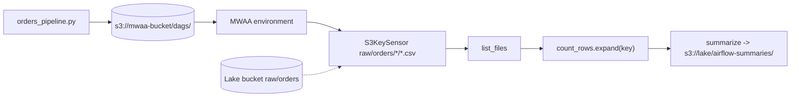

# Amazon MWAA — Data Engineering Study Notes (0–2 YOE)

> Self-contained notes: fundamentals → implementation → interview preparation.
> MWAA supports specific Apache Airflow versions (Airflow 2.x and, since late 2025, Airflow 3.x) and offers several environment classes; versions, classes, limits and pricing change. Confirm in the official docs linked at the end before creating an environment.

**Contents**
1. Introduction
2. Architecture and Working Mechanism
3. Core Concepts and Terminology
4. Data Engineering Use Cases
5. Hands-on Implementation (mini-project)
6. Interview Preparation (10 conceptual + 5 scenario + 3 troubleshooting, all answered)
7. Revision and Quick Reference

---

## 1. Introduction

### What is Amazon MWAA?
**Amazon Managed Workflows for Apache Airflow (MWAA)** is a managed service that runs **Apache Airflow** — the popular open-source platform for authoring, scheduling and monitoring workflows as Python code (**DAGs**, directed acyclic graphs). AWS operates the Airflow components (scheduler, workers, web server, metadata database), handles patching and scaling of workers, and integrates Airflow with AWS security, networking and logging. You supply DAG files (stored in S3), optional Python dependencies and plugins, and an IAM **execution role**.

### Why was it introduced and what problem does it solve?
Self-managing Airflow means provisioning servers or Kubernetes, configuring Celery/queues, a metadata database, upgrading, monitoring and securing it. MWAA removes that operational work: you create an **environment** and upload DAGs. It lets teams use Airflow's flexible Python DAGs, rich operators, scheduling and backfills without running the platform.

### Why is it important in Data Engineering?
Airflow is the industry-standard orchestrator for data pipelines. In AWS shops MWAA orchestrates Glue, EMR, Athena, Redshift, Lambda, Step Functions, Kubernetes jobs and external systems, with dependency management, retries, backfills, SLAs/alerts and a UI. Knowing both Airflow concepts and the MWAA operating model (S3-based deployment, execution role, networking) is a frequent interview topic.

### When should you use it?
- Many interdependent daily/hourly data pipelines with complex dependencies and backfills.
- Teams that already know Airflow or need Python-defined dynamic DAGs.
- Orchestration across AWS and non-AWS systems using Airflow providers.
- A central scheduler with UI, history, and retry controls.

### When should you avoid it?
| Situation | Better option |
|---|---|
| A few AWS-service steps triggered by events | Step Functions (serverless, no idle cost) |
| Simple Glue-only chains | Glue workflows/triggers |
| Very small teams with occasional jobs (an always-on environment is expensive) | Step Functions + EventBridge Scheduler |
| Heavy data processing inside Airflow workers | Offload to Glue/EMR/Athena/ECS (Airflow orchestrates; it doesn't compute) |
| You need unsupported Airflow versions/custom infrastructure | Self-managed Airflow on EKS/ECS |

### Simple real-world example
Every night at 01:00 an Airflow DAG waits for source files in S3, starts a Glue job, waits for it to finish, runs an Athena data-quality query, and notifies Slack/SNS if anything fails. Engineers change the DAG by committing Python to Git; CI copies it to the MWAA S3 bucket.

### Brief comparison with alternatives
| | MWAA | Step Functions | Self-managed Airflow | Glue workflows |
|---|---|---|---|---|
| Definition | Python DAGs | JSON/ASL | Python DAGs | Console graph |
| Cost model | Environment per hour + workers (idle cost) | Pay per transition/request | Infrastructure + ops effort | Free (pay for jobs) |
| Scheduling/backfill | Built in (UI, catchup, backfill) | Via EventBridge | Built in | Triggers |
| Operations | AWS-managed platform | Serverless | You | Serverless |
| Strengths | Rich ecosystem, complex dependencies | Event-driven, serverless | Full control | Simplicity |

---

## 2. Architecture and Working Mechanism

### Overall architecture
An MWAA **environment** is a collection of AWS-managed Airflow components running inside a service account but connected to **your VPC** through ENIs:
- **Scheduler(s)** — parse DAGs, create DAG runs, queue tasks.
- **Workers** — run task instances (Celery executor); a pool of containers that **autoscale** between a minimum and maximum count.
- **Web server** — Airflow UI/REST API (public or private access).
- **Metadata database** — Airflow state (managed, not directly accessible).
- **Queue** — an SQS-based Celery broker managed by the service.
Your **S3 bucket** (versioning enabled) holds `dags/`, `plugins.zip`, `requirements.txt` and an optional startup script. Logs go to **CloudWatch**.

### Major components in your account
- **S3 bucket** for DAGs and supporting files.
- **VPC** with two private subnets in different AZs (outbound access through NAT or VPC endpoints) and a security group.
- **Execution role** (trusted by MWAA) that Airflow tasks use to call AWS services.
- **KMS key** (optional customer-managed) for encryption.
- **CloudWatch log groups/metrics**.

### End-to-end flow
1. You upload `orders_pipeline.py` to `s3://<mwaa-bucket>/dags/`.
2. MWAA syncs the DAG folder to the scheduler and workers (within a few minutes); the DAG processor parses it and shows it in the UI.
3. The scheduler creates DAG runs on schedule or when triggered, and queues ready tasks.
4. A worker picks up a task and executes it using the **execution role** credentials (e.g. `S3KeySensor`, `GlueJobOperator`).
5. Task logs go to CloudWatch; state is saved in the metadata database; the UI shows progress.
6. MWAA scales workers up when tasks queue and down when idle (within min/max).

### Mermaid architecture


### Explanation of components
- **S3** is the deployment mechanism — no direct server access.
- **Scheduler/queue/workers** execute the DAGs; workers scale automatically.
- **Metadata DB** stores run history (not editable directly).
- **Web server** provides UI access controlled by IAM.
- **Execution role** is the identity tasks use for AWS API calls.

### Practical Data Engineering architecture


---

## 3. Core Concepts and Important Terminologies

### 3.1 Airflow fundamentals you need
- **DAG:** a Python file describing tasks and dependencies; Airflow parses DAG files repeatedly (so top-level code must be fast).
- **Task / Operator / Task Instance:** an operator is a template (e.g. `S3KeySensor`), a task is a configured operator inside a DAG, and a task instance is one run of that task for a DAG run.
- **DAG run:** one execution of the DAG for a **data interval** (`logical_date`, previously `execution_date`).
- **Scheduling:** `schedule` (cron/preset/timedelta/None), `start_date`, `catchup` (create missed runs), `max_active_runs`.
- **Dependencies:** `a >> b`, TaskFlow function calls.
- **Retries:** `retries`, `retry_delay`, `retry_exponential_backoff`; **trigger rules** (`all_success`, `all_done`, `one_failed`...).
- **XCom:** small data passing between tasks (store large data in S3).
- **Sensors:** wait for conditions (`S3KeySensor`); modes `poke` (holds a worker slot) or `reschedule` (frees it).
- **Pools/concurrency:** limit parallelism per resource.
- **Dynamic task mapping:** `.expand()` over runtime lists.
- **Idempotency:** tasks must be safely rerunnable (overwrite partitions, upserts).

### 3.2 Environment, versions and classes
- You choose an **Airflow version** from those MWAA supports (Airflow 2.x and Airflow 3.x at the time of writing — check docs).
- **Environment class** sets compute for scheduler/worker/web server (for example `mw1.micro`, `mw1.small`, `mw1.medium`, `mw1.large`, `mw1.xlarge`, `mw1.2xlarge`; availability by version/Region varies) and limits DAG capacity.
- **Workers:** minimum and maximum worker count; MWAA scales workers based on queued tasks.
- **Schedulers:** number of schedulers (more for many DAGs/high task throughput).
- **Updates:** changing the environment (version, class, requirements) triggers an update that can take 20–30 minutes.
- **Mistake:** using a micro/small class for hundreds of DAGs (slow parsing/scheduling).

### 3.3 DAG deployment via S3
- The S3 bucket must have **versioning enabled** and block public access; name starts with `airflow-` is not required but the bucket must be in the same Region.
- Folders/files: `dags/` (DAG files), `plugins.zip` (custom plugins, optional), `requirements.txt` (Python packages), `startup.sh` (optional startup script).
- Changes to `dags/` are picked up automatically (typically within a few minutes); changes to `requirements.txt`/`plugins.zip` require **updating the environment** to reference the new object version.
- Use CI/CD (CodePipeline/GitHub Actions) to sync DAGs: `aws s3 sync dags/ s3://bucket/dags/`.

### 3.4 Python dependencies, constraints and plugins
- `requirements.txt` should reference the official **Airflow constraints file** for your Airflow and Python version so versions stay compatible:
```
--constraint "https://raw.githubusercontent.com/apache/airflow/constraints-<AIRFLOW_VERSION>/constraints-<PYTHON_VERSION>.txt"
apache-airflow-providers-snowflake
pandas
```
- MWAA installs requirements on scheduler and workers at startup/update; failures show in CloudWatch (`requirements_install_ip`).
- For conflicting dependencies, isolate with `PythonVirtualenvOperator`/`ExternalPythonOperator` or run containers via ECS/EKS operators.
- **Mistakes:** installing packages without constraints (breaks Airflow), forgetting to update the environment after changing `requirements.txt`.

### 3.5 Execution role and AWS connections
- Tasks run with the **environment's execution role** (trusted by `airflow.amazonaws.com` and `airflow-env.amazonaws.com`). The default connection `aws_default` uses it, so AWS operators/hooks work without keys.
- Grant least privilege for what your DAGs call (S3 prefixes, `glue:StartJobRun`, `athena:StartQueryExecution`, etc.). Role needs base permissions for S3 DAG bucket, CloudWatch Logs/metrics, SQS (`airflow-celery-*` queues) and optionally KMS.
- **Mistake:** `AccessDenied` in tasks because the DAG-specific permissions were never added to the execution role.

### 3.6 Connections, variables and secrets backends
- **Connections** (credentials/endpoints) and **Variables** (config) can live in the Airflow metadata DB or in **AWS Secrets Manager** via the secrets backend configuration:
```
secrets.backend = airflow.providers.amazon.aws.secrets.secrets_manager.SecretsManagerBackend
secrets.backend_kwargs = {"connections_prefix": "airflow/connections", "variables_prefix": "airflow/variables"}
```
(set as Airflow configuration options in the MWAA environment; the role needs `secretsmanager:GetSecretValue`). Secrets Manager keeps credentials out of the Airflow UI/DB and supports rotation.
- **Mistake:** calling `Variable.get()` at DAG top level (runs on every parse).

### 3.7 Networking and web server access
- **VPC requirements:** two private subnets in different AZs. Environments need outbound access to AWS services — via NAT gateways or **VPC interface endpoints** (S3 gateway endpoint, CloudWatch Logs, SQS, KMS, ECR as needed).
- **Web server access mode:** `PUBLIC_NETWORK` (reachable over the internet with IAM-authenticated login) or `PRIVATE_ONLY` (reachable only from the VPC — needs VPN/bastion/endpoint).
- **Security groups** must allow self-referencing traffic between components.
- **Mistake:** private subnets without NAT/endpoints → environment stuck in `CREATING` or tasks can't reach AWS APIs.

### 3.8 Access control to the Airflow UI
Users sign in through the AWS console/IAM: policies grant `airflow:CreateWebLoginToken` for a role (**Admin, Op, User, Viewer, Public**). Use `AmazonMWAAWebServerAccess`-style policies scoped to the environment. CLI and REST access use `airflow:CreateCliToken`/`airflow:InvokeRestApi`.

### 3.9 Logging and monitoring
- **Log types** (CloudWatch Logs groups `airflow-<env>-DAGProcessing`, `Scheduler`, `Task`, `WebServer`, `Worker`): configurable log level.
- **Metrics** (CloudWatch namespace `AWS/MWAA` and Airflow metrics): `QueuedTasks`, `RunningTasks`, `SchedulerHeartbeat`, `ApproximateAgeOfOldestTask`, worker CPU/memory utilisation, DAG parsing metrics.
- **Alarms:** scheduler heartbeat missing, queued tasks growing, DAG failures; use Airflow callbacks (`on_failure_callback`) or SNS operators for alerts.

### 3.10 Operators and providers used in AWS data pipelines
`GlueJobOperator`, `GlueCrawlerOperator`, `AthenaOperator`, `EmrAddStepsOperator`/EMR Serverless operators, `RedshiftDataOperator`, `LambdaInvokeFunctionOperator`, `StepFunctionStartExecutionOperator`, `S3KeySensor`, `S3Hook`, `SnsPublishOperator`, `BatchOperator`, `EcsRunTaskOperator`. In Airflow 3, core operators like Bash/Python moved to the `standard` provider; imports for authoring use `airflow.sdk`.

### 3.11 Performance and best practices
- Keep DAG files light (no API/DB calls at import time); avoid thousands of DAGs per file.
- Use **dynamic task mapping**, pools and `max_active_tasks` to control concurrency.
- Prefer `deferrable` operators or `reschedule` sensors for long waits where supported.
- Offload heavy compute to Glue/EMR/Athena; Airflow is an orchestrator.
- Make tasks idempotent; use `catchup=False` unless you need backfills.
- Pass references (S3 keys) through XCom, not data.

### 3.12 Triggering DAGs externally
- UI trigger, `airflow dags trigger` via the MWAA CLI token API, or the Airflow REST API through `aws mwaa invoke-rest-api` (paths differ between Airflow 2 and 3).
- Event-driven pattern: S3 event → Lambda → trigger DAG run (or let a sensor/asset-based schedule detect new data).

### 3.13 Pricing (awareness)
Billing includes the **environment** per hour by class, **additional workers/schedulers** per hour, and metadata database storage; an environment bills continuously even when no DAGs run. Check the pricing page; delete dev environments you don't need.

---

## 4. Data Engineering Use Cases

### Real-world use cases
- End-to-end ELT orchestration (ingest → Glue/EMR → quality checks → publish).
- Backfills and reprocessing across date ranges.
- Cross-system workflows (SaaS APIs, on-premises databases, Snowflake, Redshift).
- ML pipeline scheduling (SageMaker training/batch transform).
- Data quality monitoring and SLA/alert workflows.
- Orchestrating Step Functions or Kubernetes jobs from a central scheduler.

### Batch processing
A daily DAG waits for upstream files (sensor), runs parameterised Glue jobs for the `ds` partition, validates outputs, loads Redshift via Data API, refreshes BI and posts a completion message. Backfills re-run the DAG for past dates with `airflow dags backfill`.

### Real-time / near-real-time
Airflow isn't a streaming engine. For near-real-time use event triggers (Lambda → DAG run) or frequent schedules (every 5–15 minutes); long-running streaming apps (Flink/Spark Streaming) are managed outside and monitored by Airflow sensors.

### Pipeline example 1 — Daily lake pipeline


### Pipeline example 2 — Event-triggered DAG with fan-out


### Why a Data Engineer chooses MWAA
Airflow's flexibility and ecosystem without operating it: Python DAGs under version control, rich retries/backfills/UI, many AWS operators, and AWS-integrated security/logging. Choose Step Functions for lightweight event-driven AWS workflows and to avoid idle environment cost.

---

## 5. Hands-on Implementation

### Mini-project: Orchestrate a file-processing DAG on MWAA (sensor + dynamic task mapping)

**1. Objective:** Create an MWAA environment, deploy a DAG that waits for CSV files in S3, processes each file in parallel with dynamic task mapping and writes a summary to S3, then trigger and monitor it.

**2. Business problem:** The data team needs a reliable scheduled workflow that waits for upstream files, processes each file, and records results — with retries and visibility.

**3. Architecture**


**4. Prerequisites and setup**
- Data in the lake bucket from the S3 notes: `raw/orders/ingest_date=.../orders.csv`.
- An AWS account/permissions to create MWAA, IAM, VPC resources. Python/Airflow knowledge helps.
- **Costs — important:** an MWAA environment bills hourly even when idle (the smallest class costs on the order of several dollars per day depending on class/Region) plus NAT gateway/VPC endpoint charges if you create them. Plan to finish within a few hours and **delete the environment** afterwards. Creation takes 20–30 minutes.
- Pick a **supported Airflow version** from the MWAA documentation (replace `<AIRFLOW_VERSION>` below).

**5–6. Implementation and code**

*Step 1 — Buckets, VPC and execution role*
```bash
ACCOUNT=$(aws sts get-caller-identity --query Account --output text)
REGION=ap-south-1
LAKE=retail-datalake-$ACCOUNT-$REGION
MW_BUCKET=mwaa-$ACCOUNT-$REGION
ENV_NAME=retail-mwaa

aws s3api create-bucket --bucket $MW_BUCKET --region $REGION --create-bucket-configuration LocationConstraint=$REGION
aws s3api put-bucket-versioning --bucket $MW_BUCKET --versioning-configuration Status=Enabled
aws s3api put-public-access-block --bucket $MW_BUCKET --public-access-block-configuration \
  BlockPublicAcls=true,IgnorePublicAcls=true,BlockPublicPolicy=true,RestrictPublicBuckets=true
```
**Networking (easiest path):** in the MWAA console choose **Create environment**; at the networking step choose **Create MWAA VPC** (a CloudFormation stack that creates a VPC with two private subnets, public subnets and NAT) and note the private subnet IDs and security group. (If you already have a VPC with two private subnets and NAT/VPC endpoints, use those.) The remaining steps use the CLI; you can also finish the environment creation in the console.
```bash
cat > mwaa-trust.json <<'EOF'
{"Version":"2012-10-17","Statement":[{"Effect":"Allow",
 "Principal":{"Service":["airflow.amazonaws.com","airflow-env.amazonaws.com"]},"Action":"sts:AssumeRole"}]}
EOF
cat > mwaa-perms.json <<EOF
{"Version":"2012-10-17","Statement":[
 {"Effect":"Allow","Action":"airflow:PublishMetrics","Resource":"arn:aws:airflow:$REGION:$ACCOUNT:environment/$ENV_NAME"},
 {"Effect":"Deny","Action":"s3:ListAllMyBuckets","Resource":["arn:aws:s3:::$MW_BUCKET","arn:aws:s3:::$MW_BUCKET/*"]},
 {"Effect":"Allow","Action":["s3:GetObject*","s3:GetBucket*","s3:List*"],"Resource":["arn:aws:s3:::$MW_BUCKET","arn:aws:s3:::$MW_BUCKET/*"]},
 {"Effect":"Allow","Action":["logs:CreateLogStream","logs:CreateLogGroup","logs:PutLogEvents","logs:GetLogEvents","logs:GetLogRecord","logs:GetLogGroupFields","logs:GetQueryResults"],
  "Resource":"arn:aws:logs:$REGION:$ACCOUNT:log-group:airflow-$ENV_NAME-*"},
 {"Effect":"Allow","Action":"logs:DescribeLogGroups","Resource":"*"},
 {"Effect":"Allow","Action":"cloudwatch:PutMetricData","Resource":"*"},
 {"Effect":"Allow","Action":["sqs:ChangeMessageVisibility","sqs:DeleteMessage","sqs:GetQueueAttributes","sqs:GetQueueUrl","sqs:ReceiveMessage","sqs:SendMessage"],
  "Resource":"arn:aws:sqs:$REGION:*:airflow-celery-*"},
 {"Effect":"Allow","Action":["s3:ListBucket"],"Resource":"arn:aws:s3:::$LAKE"},
 {"Effect":"Allow","Action":["s3:GetObject"],"Resource":"arn:aws:s3:::$LAKE/raw/*"},
 {"Effect":"Allow","Action":["s3:PutObject"],"Resource":"arn:aws:s3:::$LAKE/airflow-summaries/*"}]}
EOF
aws iam create-role --role-name MwaaExecutionRole --assume-role-policy-document file://mwaa-trust.json
aws iam put-role-policy --role-name MwaaExecutionRole --policy-name mwaa --policy-document file://mwaa-perms.json
```
(The base permissions mirror the AWS documentation's example execution role; compare with the current docs when creating your environment, and add KMS statements if you use a customer-managed key.)

*Step 2 — The DAG `orders_pipeline.py`*
```python
from datetime import datetime, timedelta
import csv, io, json

import boto3
try:
    from airflow.sdk import dag, task            # Airflow 3.x
except ImportError:
    from airflow.decorators import dag, task      # Airflow 2.x
from airflow.providers.amazon.aws.sensors.s3 import S3KeySensor

LAKE_BUCKET = "__BUCKET__"      # replaced with sed before upload

@dag(
    dag_id="orders_pipeline",
    schedule=None,                                  # trigger manually for the lab
    start_date=datetime(2026, 11, 1),
    catchup=False,
    max_active_runs=1,
    default_args={"retries": 2, "retry_delay": timedelta(minutes=1)},
    tags=["lab", "orders"],
)
def orders_pipeline():
    wait_for_files = S3KeySensor(
        task_id="wait_for_files",
        bucket_name=LAKE_BUCKET,
        bucket_key="raw/orders/*/*.csv",
        wildcard_match=True,
        poke_interval=30,
        timeout=600,
        mode="reschedule",                          # free the worker slot between checks
    )

    @task
    def list_files() -> list:
        s3 = boto3.client("s3")
        keys = []
        for page in s3.get_paginator("list_objects_v2").paginate(Bucket=LAKE_BUCKET, Prefix="raw/orders/"):
            keys += [o["Key"] for o in page.get("Contents", []) if o["Key"].endswith(".csv")]
        return keys

    @task
    def count_rows(key: str) -> dict:
        body = boto3.client("s3").get_object(Bucket=LAKE_BUCKET, Key=key)["Body"].read().decode()
        rows = list(csv.DictReader(io.StringIO(body)))
        return {"key": key, "rows": len(rows),
                "amount": round(sum(float(r["amount"]) for r in rows), 2)}

    @task
    def summarize(results: list, ds=None) -> dict:
        summary = {"run_date": ds, "files": len(results),
                   "rows": sum(r["rows"] for r in results),
                   "amount": round(sum(r["amount"] for r in results), 2)}
        key = f"airflow-summaries/{ds}/summary.json"
        boto3.client("s3").put_object(Bucket=LAKE_BUCKET, Key=key, Body=json.dumps(summary).encode())
        print("wrote", key, summary)
        return summary

    files = list_files()
    counts = count_rows.expand(key=files)           # dynamic task mapping: one task per file
    summarize(counts)
    wait_for_files >> files

orders_pipeline()
```
```bash
sed "s/__BUCKET__/$LAKE/" orders_pipeline.py > /tmp/orders_pipeline.py
aws s3 cp /tmp/orders_pipeline.py s3://$MW_BUCKET/dags/orders_pipeline.py
```

*Step 3 — Create the environment (CLI; or finish in the console)*
```bash
aws mwaa create-environment --name $ENV_NAME \
  --airflow-version <AIRFLOW_VERSION> \
  --source-bucket-arn arn:aws:s3:::$MW_BUCKET --dag-s3-path dags \
  --execution-role-arn arn:aws:iam::$ACCOUNT:role/MwaaExecutionRole \
  --network-configuration "SubnetIds=<PRIVATE_SUBNET_1>,<PRIVATE_SUBNET_2>,SecurityGroupIds=<SECURITY_GROUP>" \
  --environment-class mw1.small --min-workers 1 --max-workers 2 \
  --webserver-access-mode PUBLIC_ONLY \
  --logging-configuration '{"TaskLogs":{"Enabled":true,"LogLevel":"INFO"},"SchedulerLogs":{"Enabled":true,"LogLevel":"INFO"},"DagProcessingLogs":{"Enabled":true,"LogLevel":"INFO"}}' \
  --region $REGION
aws mwaa get-environment --name $ENV_NAME --query 'Environment.Status'
```
Wait (20–30 minutes) until the status is `AVAILABLE`. (If the class `mw1.small` or your chosen version isn't offered, pick a listed one; check `aws mwaa create-environment help`.)

*Step 4 — Open the UI, trigger and observe*
In the console open **MWAA → Environments → retail-mwaa → Open Airflow UI**. Find `orders_pipeline`, unpause it and click **Trigger**. Alternatively, for Airflow 2.x environments:
```bash
aws mwaa invoke-rest-api --name $ENV_NAME --method POST --path /dags/orders_pipeline/dagRuns --body '{}'
```
(REST paths differ in Airflow 3 — check the docs.)

**7. Explanation of the code**
- `S3KeySensor` in `reschedule` mode waits for matching files without holding a worker slot.
- `list_files` returns a list of keys (small data passed through XCom); `count_rows.expand(key=files)` creates **one mapped task instance per file**, running in parallel across workers.
- `summarize` receives the list of results, writes a JSON summary to S3 and returns it.
- `default_args` add two retries; `max_active_runs=1` prevents overlapping runs; `catchup=False` avoids unexpected backfills.
- All AWS calls use the environment's **execution role** through the default boto3 credential chain.

**8. Expected output**
In the Airflow UI Graph view: `wait_for_files` (success) → `list_files` → `count_rows` (mapped, e.g. `[0]`) → `summarize`. The `summarize` task log shows a line like:
`wrote airflow-summaries/2026-11-19/summary.json {'run_date': '2026-11-19', 'files': 1, 'rows': 200, 'amount': 51234.56}`

**9. Validation and testing**
```bash
aws s3 ls s3://$LAKE/airflow-summaries/ --recursive
aws s3 cp s3://$LAKE/airflow-summaries/<DATE>/summary.json -
aws logs describe-log-groups --log-group-name-prefix airflow-$ENV_NAME
```
Test retries and failure handling by temporarily changing `LAKE_BUCKET` to a wrong name, re-uploading the DAG, triggering, and watching retries then failure in the UI. Add more CSV files under `raw/orders/` to see more mapped task instances.

**10. Common errors and troubleshooting**
| Error | Cause | Fix |
|---|---|---|
| Environment stays `CREATING` / becomes `CREATE_FAILED` | Subnets lack NAT/endpoints, wrong security group rules, role trust/permissions, bucket versioning off | Review the environment's failure message and logs; fix networking/role/bucket |
| DAG doesn't appear in UI | Syntax/import error, wrong S3 path, still syncing | Check DAGProcessing logs; verify `dags/` path and wait a few minutes |
| `AccessDenied` in task logs | Execution role missing S3 permissions | Add prefix-scoped permissions and rerun |
| Sensor times out | Wrong key pattern/bucket | Verify `bucket_key` wildcard matches actual keys |
| `ImportError: airflow.sdk` or `airflow.decorators` | Wrong Airflow major version import | Use the try/except import shown |

**11. Cost considerations and cleanup — do this promptly**
```bash
aws mwaa delete-environment --name $ENV_NAME --region $REGION     # takes ~20 min
# after it is deleted:
aws s3 rm s3://$MW_BUCKET --recursive
aws s3api delete-bucket --bucket $MW_BUCKET
aws iam delete-role-policy --role-name MwaaExecutionRole --policy-name mwaa
aws iam delete-role --role-name MwaaExecutionRole
aws s3 rm s3://$LAKE/airflow-summaries/ --recursive
```
Delete the **MWAA VPC CloudFormation stack** (it contains NAT gateways that bill hourly) if you created one. Because the bucket is versioned, remove all object versions/delete markers before deleting it (console **Empty** is easiest).

---

## 6. Interview Preparation — Questions WITH Answers

### A. Conceptual Questions (10)

**Q1. What is Amazon MWAA and why use it instead of self-managing Airflow?**
MWAA is a managed Apache Airflow service. AWS runs the scheduler(s), Celery workers (autoscaling), web server and metadata database, and handles patching, scaling and integration with IAM, VPC, CloudWatch and S3. You provide DAGs, dependencies and an execution role. Benefits: no infrastructure to operate, built-in AWS security/logging, version support. Costs: an always-on environment per hour and less low-level control than self-managed Airflow. *Keywords: environment, DAG, S3 bucket, execution role, Celery workers, environment class.*

**Q2. Describe MWAA's architecture and components.**
An environment consists of schedulers (parse DAGs, create runs, queue tasks), workers (execute tasks, scaling between min and max), a web server (UI/REST), a managed metadata database and a managed queue — running in an AWS-managed account but connected to your VPC (two private subnets). Your S3 bucket stores `dags/`, `plugins.zip`, `requirements.txt` and `startup.sh`; logs and metrics go to CloudWatch; the execution role grants AWS access. Users reach the UI through IAM-authenticated login (public or private mode).

**Q3. How do you deploy and update DAGs, requirements and plugins?**
Upload DAG files to the S3 `dags/` prefix; MWAA syncs them automatically (typically within minutes). For `requirements.txt`, `plugins.zip` and `startup.sh`, upload new object versions and **update the environment** to point to them (this triggers a rolling update that can take 20–30 minutes). Use the Airflow constraints file for your version in `requirements.txt` to avoid dependency conflicts. In CI/CD you typically run `aws s3 sync` for DAGs and an environment update for dependency changes. Test dependency changes with the MWAA local runner or a dev environment first.

**Q4. What is the execution role and how are permissions managed?**
The execution role is the IAM role MWAA assumes (trusted by `airflow.amazonaws.com`/`airflow-env.amazonaws.com`) and its credentials are what boto3 and AWS providers use inside tasks (`aws_default`). It needs baseline permissions (read the DAG bucket, write logs, publish metrics, SQS for Celery queues, KMS if used) plus permissions for what DAGs call (S3 prefixes, Glue, Athena, Redshift Data API, Step Functions...). Follow least privilege, scope by resource, and consider separate environments for different trust boundaries since all DAGs share one role.

**Q5. How do environment classes, workers and schedulers affect performance and cost?**
The environment class (micro → 2xlarge) sets the compute for scheduler, workers and web server and the capacity for concurrent tasks/DAGs. Workers autoscale between `min-workers` and `max-workers` based on queued tasks; schedulers (more than one for HA/throughput) parse DAGs and schedule tasks. Undersized classes cause slow DAG parsing, queued tasks and scheduler lag; oversized ones waste money. Billing includes the environment per hour, additional workers/schedulers and storage, so tune min workers low, delete unused environments, and keep heavy compute outside Airflow.

**Q6. What networking is required for MWAA?**
Two private subnets in different AZs in one VPC with a security group allowing self-referencing traffic; outbound access to AWS services (S3, CloudWatch Logs, SQS, KMS, ECR...) via NAT gateways or VPC endpoints; and an Airflow web server access mode — public (internet-reachable with IAM login) or private (VPC-only, reachable via VPN/bastion/VPC endpoint). Tasks that call private resources (RDS, Redshift) need routing and security-group rules from the environment's security group. Most "stuck creating" problems are network issues.

**Q7. How are connections, variables and secrets handled?**
Connections (credentials, endpoints) and Variables (configuration) can be stored in the Airflow metadata DB via the UI, but production setups configure the **Secrets Manager secrets backend** so Airflow reads secrets at runtime (prefixes like `airflow/connections/<conn_id>`), keeping credentials out of the DB and enabling rotation. For AWS access prefer the execution role over stored keys. Avoid `Variable.get()` at DAG top level (it executes at every parse); use templating (`{{ var.value.x }}`) or fetch inside tasks.

**Q8. How do you monitor and troubleshoot MWAA?**
Use CloudWatch Logs groups for DAG processing, scheduler, task, worker and web server logs (configurable levels) and CloudWatch metrics (`QueuedTasks`, `RunningTasks`, scheduler heartbeat, worker CPU/memory, `ApproximateAgeOfOldestTask`). Alarm on missing scheduler heartbeat, queued-task growth and DAG failures; use Airflow callbacks or SNS operators for alerts. For DAG import errors look at DAG processing logs; for dependency install problems check the requirements install logs; for failing tasks open task logs in the UI.

**Q9. Compare MWAA with Step Functions and self-managed Airflow.**
MWAA: Python DAGs, schedules and backfills, huge operator ecosystem, always-on environment cost — best for large, interdependent data platforms and teams with Airflow skills. Step Functions: serverless JSON workflows with native AWS integrations, event-driven, pay per use, no scheduler/backfill UI — best for AWS-centric event workflows. Self-managed Airflow (EKS/ECS): maximum control and custom versions, but you operate everything. Often combined: MWAA schedules and triggers Step Functions/Glue/EMR.

**Q10. What are Airflow best practices on MWAA?**
Keep DAG files fast to parse (no top-level API/DB calls); make tasks idempotent (partition overwrite, upserts); pass references via XCom; use `reschedule`/deferrable sensors; use pools and concurrency settings to protect resources; use dynamic task mapping for variable fan-out; offload heavy compute to Glue/EMR/Athena; version DAGs in Git with CI/CD; separate dev/prod environments; set sensible retries with backoff and failure callbacks; pin dependencies with constraints; use Secrets Manager for credentials.

### B. Scenario-Based Questions (5)

**S1. You uploaded a DAG to S3 but it doesn't show up in the Airflow UI.**
*Approach:* confirm the path (`dags/` prefix), file extension and bucket/Region; check **DAG processing logs** for import errors (syntax errors, missing imports, packages not in `requirements.txt`, top-level code failing); verify the execution role can read the object; wait several minutes for sync; check the environment is `AVAILABLE`. *Fix:* correct the error, add missing dependencies via `requirements.txt` + environment update, re-upload. *Why:* the scheduler parses files and lists DAGs only if they import cleanly. *Trade-off:* dependency changes require a slow environment update; test locally with the MWAA local runner.

**S2. Tasks stay queued for long periods during the 2 a.m. rush.**
*Solution:* check `QueuedTasks` and `ApproximateAgeOfOldestTask`; raise `max-workers` (autoscaling) or move to a larger environment class; tune Airflow concurrency (`parallelism`, `max_active_tasks_per_dag`, pools); reduce worker slot hogging (use reschedule/deferrable sensors); stagger DAG schedules; offload heavy tasks to Glue/EMR; add schedulers if scheduling lag is the issue. *Why:* queueing indicates insufficient worker slots or concurrency limits. *Alternatives:* split critical DAGs into a separate environment. *Trade-off:* more workers cost more.

**S3. A new file in S3 should start a pipeline immediately, but the DAG is scheduled hourly.**
*Solution:* S3 event → EventBridge/Lambda → call the Airflow REST API (`aws mwaa invoke-rest-api`) or CLI token to create a DAG run with `conf` (the key), and have the DAG read `dag_run.conf`; or keep a frequent schedule with a sensor; or trigger Step Functions directly for event-driven flows. *Why:* external triggers give low latency without polling. *Alternatives:* Airflow asset/dataset-driven scheduling. *Trade-off:* Lambda needs IAM permission (`airflow:InvokeRestApi`/`CreateCliToken`) and error handling for failed triggers.

**S4. Adding a Python library to `requirements.txt` breaks the environment.**
*Solution:* use the Airflow **constraints file** for your Airflow/Python version, add compatible package versions, test with the MWAA local runner, roll back by pointing the environment to the previous `requirements.txt` object version; for conflicting libraries use `PythonVirtualenvOperator`/`ExternalPythonOperator`, or run the code in ECS/EKS/Lambda/Glue and call it from Airflow. *Why:* all components share one Python environment, so conflicts affect Airflow itself. *Trade-off:* virtualenv/containers add runtime overhead.

**S5. Leadership wants lower MWAA costs.**
*Solution:* right-size the environment class and set `min-workers` low with autoscaling; delete or schedule-shut-down dev/test environments (they bill while idle); consolidate small DAG sets into one environment (considering isolation needs); offload long waits to deferrable/reschedule sensors; move simple event-driven workflows to Step Functions; remove unnecessary NAT gateways by using VPC endpoints where appropriate; clean up unused DAG runs. *Why:* costs are mostly the always-on environment and workers. *Trade-off:* consolidation reduces isolation; heavy cost cutting can hurt performance.

### C. Troubleshooting Questions (3)

**T1. The environment is stuck in `CREATING` or ends in `CREATE_FAILED`/`UNAVAILABLE`.**
*Root causes:* private subnets without NAT or required VPC endpoints; security group lacking self-referencing rules; S3 bucket without versioning, wrong Region, or blocked access; execution role trust/permissions missing; service quota limits; subnets in the same AZ; KMS key policy not allowing MWAA. *Debug approach:* read the `LastUpdate.Error` in `aws mwaa get-environment`; check CloudWatch Logs groups created for the environment; verify route tables/NAT/endpoints; validate bucket versioning and public-access blocks; inspect the role trust policy. *Fix:* correct networking/role/bucket settings and recreate or update the environment.

**T2. DAG import errors or a failed `requirements.txt` update.**
*Root causes:* syntax errors; missing or incompatible packages; installing packages without constraints; wrong Airflow-major imports (`airflow.sdk` vs `airflow.decorators`); top-level code calling unavailable resources; `plugins.zip` structure wrong; requirements trying to download from the internet in a private network without access. *Debug:* DAG processing logs show the traceback; check the requirements install logs (worker/scheduler startup) in CloudWatch; test locally with the MWAA local runner. *Fix:* correct imports/syntax, add the constraints line and compatible versions, ensure NAT/endpoints/package mirror access, rebuild `plugins.zip` correctly, update the environment to a known-good object version.

**T3. Tasks fail with `AccessDenied`, cannot reach a private resource, or die with `SIGKILL`/memory errors.**
*Root causes:* execution role lacks permissions for the called service/prefix; resource policy or KMS blocks the role; security groups/routes don't allow access to RDS/Redshift or the internet; worker memory exhausted by heavy pandas/data processing in the worker (task killed). *Debug:* task logs show the exact AWS error; use CloudTrail/IAM policy simulator for the role; test connectivity from the same subnet; check worker memory/CPU metrics and the failing task's data volume. *Fix:* add least-privilege permissions, fix network rules, reduce in-worker processing (push work to Glue/EMR/Athena), increase environment class, process data in chunks, and set task `execution_timeout`/retries appropriately.

---

## 7. Revision and Quick Reference

### Key takeaways
- MWAA = managed Apache Airflow: you write DAGs; AWS runs the platform.
- Deploy via S3 (`dags/`, `requirements.txt`, `plugins.zip`, `startup.sh`); the bucket must be versioned.
- Tasks use the **execution role**; prefer Secrets Manager for credentials.
- VPC with two private subnets + NAT/endpoints; web server public or private.
- Costs accrue per environment hour — delete dev environments.

### Commonly forgotten details
- Changing `requirements.txt`/plugins requires an environment update (20–30 min).
- Use the Airflow constraints file in requirements.
- Environment needs outbound access to AWS services (NAT/VPC endpoints).
- DAG top-level code must be light (parsed continuously).
- Sensors: use `reschedule` (or deferrable) for long waits.
- Execution role is shared by all DAGs in the environment.
- Airflow 3 uses `airflow.sdk` for authoring and moves core operators to the standard provider.
- Heavy processing in workers can cause OOM kills.

### Important commands and syntax
```bash
aws mwaa create-environment --name E --airflow-version V --source-bucket-arn ARN --dag-s3-path dags --execution-role-arn ROLE \
  --network-configuration SubnetIds=s1,s2,SecurityGroupIds=sg --environment-class mw1.small --max-workers 2
aws mwaa get-environment --name E
aws mwaa update-environment --name E --requirements-s3-path requirements.txt --requirements-s3-object-version <ver>
aws mwaa list-environments
aws mwaa create-web-login-token --name E
aws mwaa invoke-rest-api --name E --method POST --path /dags/<dag_id>/dagRuns --body '{}'
aws mwaa delete-environment --name E
aws s3 sync ./dags s3://bucket/dags/
```
```python
from datetime import datetime
from airflow.decorators import dag, task    # Airflow 2.x (use airflow.sdk in 3.x)
@dag(schedule="@daily", start_date=datetime(2026, 1, 1), catchup=False)
def my_dag():
    @task
    def hello(): print("hi")
    hello()
my_dag()
```

### Frequently used configurations
Airflow version; environment class; `min/max workers`; scheduler count; web server access mode; log levels; Airflow config options (e.g. `core.default_task_retries`, `secrets.backend`), `requirements.txt` with constraints; startup script; DAG settings `catchup`, `max_active_runs`, `retries`, pools.

### Common errors and solutions
| Error | Solution |
|---|---|
| Environment creation fails | Networking/role/bucket versioning |
| DAG not visible | Check DAG processing logs, path, imports |
| Package install failure | Constraints, compatible versions, network access |
| `AccessDenied` in tasks | Execution role permissions |
| Queued tasks | More workers/concurrency/pools; offload compute |
| Task killed (SIGKILL) | Memory — move processing to Glue/EMR or larger class |

### Service limitations
Supported Airflow versions only; always-on cost; updates take time; limited direct access to the metadata DB; one execution role per environment; environment class limits on DAG count/concurrency; networking prerequisites; some Airflow features/providers constrained by managed setup — check the docs.

### Performance and cost optimisation
Right-size class/workers; keep DAG parsing light; use reschedule/deferrable sensors; offload heavy compute; schedule non-urgent DAGs off-peak; delete idle environments; use VPC endpoints vs NAT where appropriate; reduce log volume (INFO/WARNING) and set retention.

### Security best practices
Least-privilege execution role; Secrets Manager backend; private subnets and private web server where possible; KMS encryption; IAM-scoped UI access (`CreateWebLoginToken` with role); separate prod/dev environments; audit via CloudTrail; avoid secrets in DAG code; restrict S3 bucket access.

### Connections with other AWS services
S3 (DAGs/data), IAM, VPC, CloudWatch (logs/metrics/alarms), Secrets Manager/KMS, Glue/EMR/Athena/Redshift/Lambda/Step Functions/ECS/Batch/SageMaker (operators), SNS/SQS (notifications), CodePipeline/GitHub Actions (CI/CD), EventBridge/Lambda (triggers).

### Quick revision cheat sheet
```
Environment = scheduler(s) + workers (autoscale min..max) + web server + metadata DB (managed), in your VPC
Deploy: S3 versioned bucket -> dags/ (auto sync) | requirements.txt + plugins.zip (update environment)
Auth: execution role (tasks) ; IAM web login token (humans) ; Secrets Manager backend
Network: 2 private subnets (diff AZ) + NAT/endpoints ; web server public|private
DAG: light parse, idempotent, retries, reschedule sensors, .expand(), offload compute
Ops: CloudWatch logs/metrics; QueuedTasks; scheduler heartbeat; update takes 20-30 min
```

### 10 rapid-fire revision questions
1. **Where do you store DAGs for MWAA?** In the `dags/` folder of an S3 bucket.
2. **Which S3 setting is mandatory on the MWAA bucket?** Versioning enabled.
3. **What identity do tasks use for AWS calls?** The environment's execution role.
4. **What must you do after changing `requirements.txt`?** Update the environment to the new object version.
5. **How many subnets are required?** Two private subnets in different AZs.
6. **What scales between min and max?** Workers.
7. **Where do task logs go?** CloudWatch Logs.
8. **How do you avoid dependency conflicts?** Use the Airflow constraints file (and virtualenv/containers when needed).
9. **Which sensor mode frees the worker slot?** `reschedule` (or deferrable).
10. **Why delete dev environments?** They bill hourly even when idle.

---

## Official AWS documentation
- Amazon MWAA User Guide — https://docs.aws.amazon.com/mwaa/latest/userguide/what-is-mwaa.html
- Environment class — https://docs.aws.amazon.com/mwaa/latest/userguide/environment-class.html
- Supported Airflow versions — https://docs.aws.amazon.com/mwaa/latest/userguide/airflow-versions.html
- Adding or updating DAGs — https://docs.aws.amazon.com/mwaa/latest/userguide/configuring-dag-folder.html
- Installing Python dependencies — https://docs.aws.amazon.com/mwaa/latest/userguide/working-dags-dependencies.html
- Execution role — https://docs.aws.amazon.com/mwaa/latest/userguide/mwaa-create-role.html
- Networking and VPC — https://docs.aws.amazon.com/mwaa/latest/userguide/vpc-create.html
- Secrets Manager backend — https://docs.aws.amazon.com/mwaa/latest/userguide/connections-secrets-manager.html
- Monitoring — https://docs.aws.amazon.com/mwaa/latest/userguide/monitoring-airflow.html
- Pricing — https://aws.amazon.com/managed-workflows-for-apache-airflow/pricing/
- Apache Airflow documentation — https://airflow.apache.org/docs/
- Boto3 MWAA reference — https://boto3.amazonaws.com/v1/documentation/api/latest/reference/services/mwaa.html
