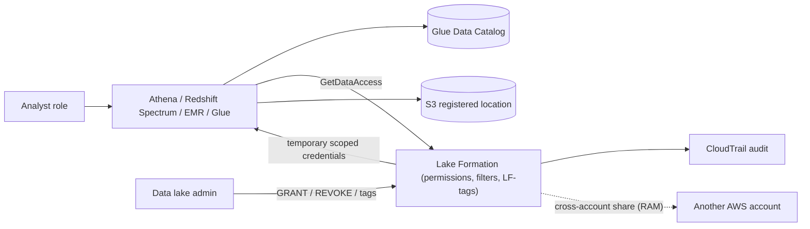
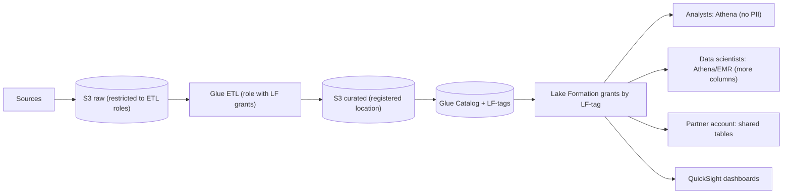
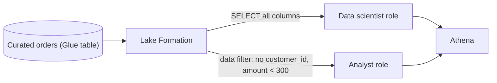
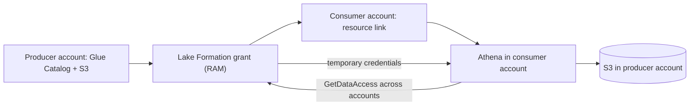
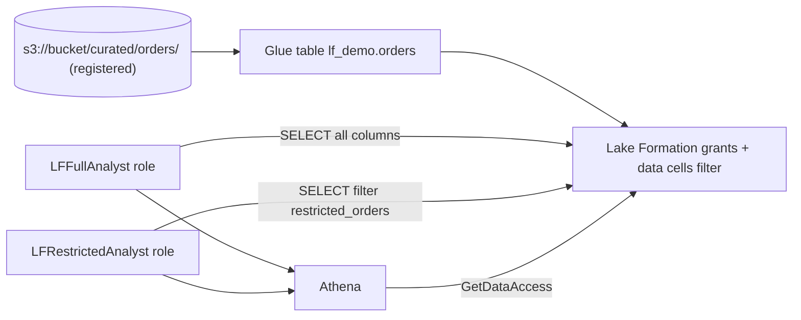

# AWS Lake Formation — Data Engineering Study Notes (0–2 YOE)

> Self-contained notes: fundamentals → implementation → interview preparation.
> Lake Formation has evolved (e.g. hybrid access mode, LF-tags, newer cross-account versions, Identity Center integration). Details, engine support and API behaviour change; confirm in the official docs linked at the end before building.

**Contents**
1. Introduction
2. Architecture and Working Mechanism
3. Core Concepts and Terminology
4. Data Engineering Use Cases
5. Hands-on Implementation (mini-project)
6. Interview Preparation (10 conceptual + 5 scenario + 3 troubleshooting, all answered)
7. Revision and Quick Reference

---

## 1. Introduction

### What is AWS Lake Formation?
**AWS Lake Formation** is a service for building, securing and governing **data lakes on Amazon S3** using the **AWS Glue Data Catalog**. Its core value is **centralised, fine-grained access control**: you grant permissions on catalog **databases, tables, columns, rows and cells** to IAM users/roles (and, with newer integrations, Identity Center users and groups), and Lake Formation enforces them for integrated engines such as **Amazon Athena, Amazon Redshift Spectrum, Amazon EMR, AWS Glue and Amazon QuickSight** — without you writing complicated S3 bucket policies per team.

### Why was it introduced and what problem does it solve?
In a plain S3 data lake, access control is done with IAM and bucket policies on S3 prefixes. This becomes unmanageable at scale (thousands of tables, many teams), can't express column- or row-level rules, and makes auditing hard. Lake Formation moves authorisation to a **database-style grant model** (`GRANT SELECT ON table TO role`) with central governance, cross-account sharing and audit trails.

### Why is it important in Data Engineering?
Data engineers build curated data products and must expose them safely: PII columns hidden from analysts, regional rows restricted per team, data shared across accounts, access audited for compliance. Lake Formation is the AWS-native way to implement that governance on the lake, and a common interview topic for AWS data roles.

### When should you use it?
- Multiple teams/accounts consume one data lake and need different permissions.
- Column-level, row-level or cell-level security is required (PII, multi-tenant data).
- You want tag-based access control that scales across many tables.
- Cross-account or cross-organisation data sharing without copying data.
- Central audit of who accessed what.

### When should you avoid it (or add care)?
| Situation | Note |
|---|---|
| Small single-team lake with simple prefix permissions | IAM + S3 policies may be enough |
| Engines or tools that don't integrate with Lake Formation | They can't enforce LF permissions — block direct S3 access or use hybrid patterns |
| Fine-grained control needed for non-catalog data (raw files not in the catalog) | Use S3 policies/Access Grants |
| Heavy transformations | Lake Formation governs access; use Glue/EMR/Spark for compute |

### Simple real-world example
The `customers` table contains names and email addresses. Analysts get `SELECT` on all columns **except** `email` and only rows for their region; data scientists get masked/hashed views; the finance account gets read-only access through cross-account sharing. All of this is configured once in Lake Formation, and Athena, Redshift Spectrum and Glue honour it.

### Brief comparison with alternatives
| | Lake Formation | IAM + S3 bucket policies | Redshift grants | Unity Catalog (Databricks) |
|---|---|---|---|---|
| Granularity | Database/table/column/row/cell | S3 bucket/prefix/object | Schema/table/column/row | Catalog/schema/table/column/row |
| Model | GRANT/REVOKE + LF-tags | JSON policies | SQL GRANT | SQL GRANT |
| Scope | Glue Catalog + S3 across engines | S3 only | Warehouse only | Databricks platform |
| Cross-account | Built in (via RAM) | Bucket policy + roles | Datashares | Delta Sharing |

---

## 2. Architecture and Working Mechanism

### Overall architecture
Lake Formation sits between **principals/query engines** and **data in S3**:
- The **Glue Data Catalog** stores metadata (databases, tables, partitions).
- **Lake Formation permissions** (stored centrally) decide what each principal can see and read.
- **Registered data locations** (S3 paths) are placed under Lake Formation control.
- When an integrated engine (e.g. Athena) needs data, it asks Lake Formation for **temporary, scoped credentials** (**credential vending** via `lakeformation:GetDataAccess`); Lake Formation checks permissions and returns credentials that allow reading only the permitted S3 locations. Row/column filters are applied by the engine/Lake Formation-enabled query layer.

### Major components
- **Data lake administrators** — principals that can grant/revoke any Lake Formation permission and manage settings.
- **Data Catalog resources** — databases, tables, columns, partitions.
- **Registered locations** — S3 paths registered with an IAM role (service-linked role by default).
- **Permissions** — `SELECT`, `INSERT`, `DELETE`, `DESCRIBE`, `ALTER`, `DROP`, `CREATE_TABLE`, `CREATE_DATABASE`, `DATA_LOCATION_ACCESS`, `ASSOCIATE`, `ALL` ("Super"), with optional **grant option**.
- **LF-tags** — key/value tags assigned to resources and used in tag-based policies.
- **Data filters (data cells filters)** — column inclusion + row filter expressions.
- **Cross-account sharing** — grants to other AWS accounts/organisations (via AWS RAM).
- **Settings** — default permissions for new databases/tables, cross-account version, admins.
- **Audit** — CloudTrail events for permission changes and data access.

### End-to-end flow of an Athena query on a governed table
1. A user (IAM role) submits a query in Athena.
2. Athena retrieves table metadata from the Glue Data Catalog (needs catalog permission, evaluated with Lake Formation).
3. Athena calls Lake Formation `GetDataAccess`; Lake Formation checks the principal's **Lake Formation permissions** (e.g. `SELECT` on the table, columns, data filter).
4. If allowed, Lake Formation returns **temporary credentials** limited to the table's registered S3 location (and tells the engine which columns/rows to expose).
5. Athena reads S3 using those credentials, applies filters and returns results. The user's own IAM role does **not** need direct S3 read permission.
6. CloudTrail logs the access.

### Mermaid architecture


### Explanation of components
- **Catalog** holds metadata; **Lake Formation** holds authorisation rules.
- **Credential vending** replaces broad S3 permissions: the user never gets raw S3 access.
- **Registered location** is what lets Lake Formation vend credentials for those prefixes.
- **CloudTrail** provides the audit trail.

### Practical Data Engineering architecture


---

## 3. Core Concepts and Important Terminologies

### 3.1 Permission model: IAM + Lake Formation
- A principal needs **both** IAM permissions to call the service APIs (e.g. `athena:StartQueryExecution`, `glue:GetTable`, `lakeformation:GetDataAccess`) **and** Lake Formation permissions on the data resources.
- **Default behaviour (backward compatibility):** The special group **`IAMAllowedPrincipals`** is granted `Super` on new databases/tables by default, meaning access is controlled **only by IAM** (Lake Formation permissions are effectively bypassed). To enforce Lake Formation, **revoke `IAMAllowedPrincipals`** on the resources (or change the default settings for new objects).
- **Hybrid access mode:** allows both IAM-based and Lake Formation-based access for selected principals on the same table during migration.
- **Mistake:** granting Lake Formation permissions but leaving `IAMAllowedPrincipals` in place, so everyone still has full access through IAM.

### 3.2 Data lake administrators and creators
- **Data lake administrators** can grant/revoke permissions on any catalog resource and register locations. They are set in **Lake Formation settings**.
- **Creators:** the creator of a database/table gets permissions on it (depending on default permission settings). Control defaults with `CreateDatabaseDefaultPermissions`/`CreateTableDefaultPermissions` (empty list = no automatic `IAMAllowedPrincipals`).
- **Best practice:** a small number of admins; separate roles for ETL (read/write), analysts (read) and platform engineers.

### 3.3 Registering data locations and credential vending
- **Register** an S3 path (`aws lakeformation register-resource`) with an IAM role (commonly the **service-linked role** `AWSServiceRoleForLakeFormationDataAccess`). This role is what Lake Formation uses to vend temporary credentials.
- Only data under registered locations can be governed by Lake Formation.
- **`DATA_LOCATION_ACCESS`** permission is required to **create** catalog tables/databases that point to a registered location (a control for who can define tables on a path).
- **Mistake:** forgetting to register the location (queries fail with access errors) or expecting S3 bucket policies to enforce Lake Formation rules.

### 3.4 Permissions and grant options
| Permission | Meaning |
|---|---|
| `CREATE_DATABASE` / `CREATE_TABLE` | Create catalog resources |
| `DESCRIBE` | See the resource exists and its metadata |
| `SELECT` | Read data (table, columns, filtered data) |
| `INSERT` / `DELETE` | Write/delete data (for engines that write via LF) |
| `ALTER` / `DROP` | Change/delete catalog definitions |
| `DATA_LOCATION_ACCESS` | Create tables on a registered S3 location |
| `ALL` (Super) | Everything on that resource |
- **Grant option:** lets a principal grant the same permission to others (delegation).
```bash
aws lakeformation grant-permissions \
  --principal DataLakePrincipalIdentifier=arn:aws:iam::111122223333:role/AnalystRole \
  --permissions SELECT DESCRIBE \
  --resource '{"Table":{"DatabaseName":"lf_demo","Name":"orders"}}'
```

### 3.5 Column-level security
Grant `SELECT` on a table with an **included column list** (or all columns with excluded columns) so the principal sees only permitted columns. Queries referencing other columns fail.
```bash
aws lakeformation grant-permissions --principal DataLakePrincipalIdentifier=<ARN> --permissions SELECT \
  --resource '{"TableWithColumns":{"DatabaseName":"lf_demo","Name":"customers","ColumnNames":["customer_id","region"]}}'
```

### 3.6 Row-level and cell-level security: data cells filters
A **data cells filter** defines, for one table, which **columns** (include list or wildcard with exclusions) and which **rows** (a filter expression such as `region = 'EU'` or `amount < 300`) a principal may access; granting `SELECT` on the filter gives **cell-level** security (rows × columns).
```bash
aws lakeformation create-data-cells-filter --table-data '{
  "TableCatalogId":"111122223333","DatabaseName":"lf_demo","TableName":"orders",
  "Name":"restricted_orders","RowFilter":{"FilterExpression":"amount < 300"},
  "ColumnNames":["order_id","amount"]}'
```
- **Notes:** requires engines that support these filters (e.g. Athena engine v3, Redshift Spectrum, EMR, Glue); filter expression syntax is a subset of SQL.
- **Mistake:** filtering on columns not present in the table, or forgetting to grant `SELECT` on the filter itself.

### 3.7 LF-tags and tag-based access control (TBAC)
- **Definition:** LF-tags are key-value pairs (`sensitivity = public|internal|pii`, `domain = sales|finance`) that you assign to databases, tables and columns. Permissions are granted to principals on **tag expressions** (`LF_TAG_POLICY`), e.g. "SELECT on resources where `sensitivity=public` and `domain=sales`".
- **Why it matters:** scales governance — new tables/columns inherit access automatically when tagged; no need to grant per table.
```bash
aws lakeformation create-lf-tag --tag-key sensitivity --tag-values public internal pii
aws lakeformation add-lf-tags-to-resource \
  --resource '{"TableWithColumns":{"DatabaseName":"lf_demo","Name":"customers","ColumnNames":["email"]}}' \
  --lf-tags TagKey=sensitivity,TagValues=pii
aws lakeformation grant-permissions --principal DataLakePrincipalIdentifier=<ARN> --permissions SELECT \
  --resource '{"LFTagPolicy":{"ResourceType":"TABLE","Expression":[{"TagKey":"sensitivity","TagValues":["public"]}]}}'
```
- **Mistakes:** tagging inconsistently; forgetting that column tags override table tags; not planning a tag taxonomy.

### 3.8 Cross-account and cross-organisation sharing
- Grant permissions to **another AWS account** (or an organisation/OU) on databases/tables; Lake Formation uses **AWS Resource Access Manager (RAM)** under the hood (use the latest cross-account version setting).
- The receiving account's data lake admin creates **resource links** (pointers to shared databases/tables) in its own catalog and can grant further access to its principals (if grant option allowed).
- Data stays in the owner's S3 bucket; consumers query it through Lake Formation-integrated engines (credentials vended across accounts).
- **Mistakes:** forgetting resource links; expecting to query the shared table directly by name without it; KMS key policies not allowing the consumer account.

### 3.9 Integrations and enforcement
Lake Formation permissions are enforced by integrated services: **Athena, Redshift Spectrum, EMR, Glue (jobs/crawlers/ETL), QuickSight, SageMaker** and others; some features (row/cell filters, writes) depend on engine versions and configuration. Always block direct S3 access paths for governed data (bucket policies/IAM) so users can't bypass Lake Formation.

### 3.10 Blueprints and workflows (ingestion helpers)
Lake Formation **blueprints** generate Glue workflows to ingest from databases or logs (e.g. CloudTrail) into S3 with catalog tables. In modern practice teams usually use DMS/Glue/Firehose directly and use Lake Formation for **governance**. Know that blueprints exist.

### 3.11 Governed tables, transactions and newer capabilities (awareness)
Lake Formation once offered "governed tables" with ACID transactions; open table formats (Iceberg) are now the recommended path for ACID, and Lake Formation can govern Iceberg tables. Newer features include integration with **IAM Identity Center** (trusted identity propagation) so users/groups from your identity provider are used directly. Confirm current status in the docs.

### 3.12 Auditing and monitoring
- **CloudTrail** records permission grants/revocations and data access events (`GetDataAccess`).
- Use Athena queries over CloudTrail logs to answer "who accessed this table?".
- Monitor changes with EventBridge rules on Lake Formation API calls; review permissions regularly (`list-permissions`).

### 3.13 Common design pattern
1. Register S3 locations; remove `IAMAllowedPrincipals` defaults.
2. Define an LF-tag taxonomy; tag databases/tables/columns.
3. Grant ETL roles write access; grant consumer groups tag-based `SELECT`.
4. Use data cells filters for row-level cases (tenant, region).
5. Share curated tables to other accounts with resource links.
6. Audit with CloudTrail.

---

## 4. Data Engineering Use Cases

### Real-world use cases
- Hiding PII columns from analysts while keeping full access for authorised teams.
- Multi-tenant or regional row-level access (`tenant_id`, `region`).
- Central governance for a data mesh: each domain publishes tables, central team governs sharing.
- Cross-account lake sharing between business units or partners.
- Regulatory audit (GDPR/HIPAA) of data access.
- Tag-based access at scale for thousands of tables.

### Batch processing
Glue/EMR ETL jobs run under roles with Lake Formation grants (read raw, write curated). After each load, tags are applied to new tables/columns (or inherited), so consumers automatically get appropriate access.

### Real-time / streaming
Lake Formation governs the **query layer**, not streams. For streaming pipelines, land data into S3/Iceberg tables in the catalog; governance applies once data is catalogued and queried through integrated engines.

### Pipeline example 1 — Column and row security for Athena users


### Pipeline example 2 — Cross-account sharing


### Why a Data Engineer chooses Lake Formation
It provides a single, auditable place to define who can access which data, scales with tags, supports column/row/cell security and cross-account sharing, and works with the major AWS analytics engines. Plain S3 policies can't express these rules; engine-specific grants (e.g. Redshift) don't cover the whole lake.

---

## 5. Hands-on Implementation

### Mini-project: Column- and row-level security on a curated orders table

**1. Objective:** Register the curated S3 location with Lake Formation, create a governed Glue table, grant a **full-access** role and a **restricted** role (no `customer_id`, only orders under 300), and prove enforcement by querying with Athena as each role.

**2. Business problem:** Data scientists need full order details; analysts must not see customer identifiers and are limited to lower-value orders. Enforcement must hold without giving anyone direct S3 access.

**3. Architecture**


**4. Prerequisites and setup**
- The S3 bucket and curated Parquet data from the S3 notes (`curated/orders/order_date=.../part-0000.parquet`, columns `order_id`, `customer_id`, `amount`).
- AWS CLI, Boto3, an IAM identity that can administer Lake Formation, Glue, IAM and Athena. If you use an SSO-assumed role, use the **IAM role ARN** (not the session ARN) as the data lake admin.
- **Caution:** this lab changes **account-level Lake Formation settings** (admins and default permissions). Use a sandbox account, and save your existing settings first (Step 1) so you can restore them.
- **Costs:** Lake Formation is free; Athena/Glue usage is tiny.

**5–6. Implementation and code**

*Step 1 — Save current settings, set yourself as data lake admin, change defaults (`lf_setup.py`)*
```python
import json, boto3
lf = boto3.client("lakeformation")
sts = boto3.client("sts")
caller = sts.get_caller_identity()["Arn"]
print("caller:", caller)     # must be an IAM user or role ARN (not an assumed-role session ARN)

settings = lf.get_data_lake_settings()["DataLakeSettings"]
json.dump(settings, open("original-lf-settings.json", "w"), indent=2, default=str)   # backup

admins = settings.get("DataLakeAdmins", [])
if not any(a["DataLakePrincipalIdentifier"] == caller for a in admins):
    admins.append({"DataLakePrincipalIdentifier": caller})
settings["DataLakeAdmins"] = admins
settings["CreateDatabaseDefaultPermissions"] = []      # new DBs do NOT grant IAMAllowedPrincipals
settings["CreateTableDefaultPermissions"] = []         # new tables do NOT grant IAMAllowedPrincipals
lf.put_data_lake_settings(DataLakeSettings=settings)
print("Lake Formation settings updated")
```
```bash
python lf_setup.py
```
*(If your caller ARN is an assumed-role session ARN, convert it to `arn:aws:iam::<account>:role/<role-name>` before adding it as an admin.)*

*Step 2 — Register the S3 location and create the database/table (`lf_catalog.py`)*
```python
import os, boto3
ACCOUNT = boto3.client("sts").get_caller_identity()["Account"]
REGION = "ap-south-1"
BUCKET = f"retail-datalake-{ACCOUNT}-{REGION}"
CALLER = os.environ["LF_ADMIN_ARN"]             # same ARN you set as admin
glue = boto3.client("glue", region_name=REGION)
lf = boto3.client("lakeformation", region_name=REGION)
s3 = boto3.client("s3", region_name=REGION)

# Register the curated location (service-linked role)
try:
    lf.register_resource(ResourceArn=f"arn:aws:s3:::{BUCKET}/curated/orders", UseServiceLinkedRole=True)
except lf.exceptions.AlreadyExistsException:
    pass

# Allow the admin to create tables on that location
lf.grant_permissions(Principal={"DataLakePrincipalIdentifier": CALLER}, Permissions=["DATA_LOCATION_ACCESS"],
    Resource={"DataLocation": {"ResourceArn": f"arn:aws:s3:::{BUCKET}/curated/orders"}})

try:
    glue.create_database(DatabaseInput={"Name": "lf_demo"})
except glue.exceptions.AlreadyExistsException:
    pass

sd = lambda loc: {
    "Columns": [{"Name": "order_id", "Type": "string"}, {"Name": "customer_id", "Type": "bigint"},
                {"Name": "amount", "Type": "double"}],
    "Location": loc,
    "InputFormat": "org.apache.hadoop.hive.ql.io.parquet.MapredParquetInputFormat",
    "OutputFormat": "org.apache.hadoop.hive.ql.io.parquet.MapredParquetOutputFormat",
    "SerdeInfo": {"SerializationLibrary": "org.apache.hadoop.hive.ql.io.parquet.serde.ParquetHiveSerDe"}}

glue.create_table(DatabaseName="lf_demo", TableInput={
    "Name": "orders", "TableType": "EXTERNAL_TABLE", "Parameters": {"classification": "parquet"},
    "PartitionKeys": [{"Name": "order_date", "Type": "string"}],
    "StorageDescriptor": sd(f"s3://{BUCKET}/curated/orders/")})

# Register partitions found in S3 (order_date=YYYY-MM-DD/)
resp = s3.list_objects_v2(Bucket=BUCKET, Prefix="curated/orders/", Delimiter="/")
for p in resp.get("CommonPrefixes", []):
    folder = p["Prefix"].rstrip("/").split("/")[-1]            # order_date=2026-11-15
    if folder.startswith("order_date="):
        d = folder.split("=", 1)[1]
        glue.create_partition(DatabaseName="lf_demo", TableName="orders", PartitionInput={
            "Values": [d], "StorageDescriptor": sd(f"s3://{BUCKET}/curated/orders/{folder}/")})
        print("partition", d)
```
```bash
export LF_ADMIN_ARN=$(aws sts get-caller-identity --query Arn --output text)   # use the IAM role/user ARN
python lf_catalog.py
```

*Step 3 — Create the two "user" roles (no S3 data access in IAM)*
```bash
ACCOUNT=$(aws sts get-caller-identity --query Account --output text); REGION=ap-south-1
BUCKET=retail-datalake-$ACCOUNT-$REGION
cat > lf-trust.json <<EOF
{"Version":"2012-10-17","Statement":[{"Effect":"Allow","Principal":{"AWS":"arn:aws:iam::$ACCOUNT:root"},"Action":"sts:AssumeRole"}]}
EOF
cat > lf-user-perms.json <<EOF
{"Version":"2012-10-17","Statement":[
 {"Effect":"Allow","Action":["athena:StartQueryExecution","athena:GetQueryExecution","athena:GetQueryResults","athena:GetWorkGroup"],"Resource":"*"},
 {"Effect":"Allow","Action":["glue:GetDatabase","glue:GetDatabases","glue:GetTable","glue:GetTables","glue:GetPartition","glue:GetPartitions"],"Resource":"*"},
 {"Effect":"Allow","Action":"lakeformation:GetDataAccess","Resource":"*"},
 {"Effect":"Allow","Action":["s3:GetBucketLocation"],"Resource":"arn:aws:s3:::$BUCKET"},
 {"Effect":"Allow","Action":["s3:ListBucket"],"Resource":"arn:aws:s3:::$BUCKET","Condition":{"StringLike":{"s3:prefix":["athena-results/*"]}}},
 {"Effect":"Allow","Action":["s3:GetObject","s3:PutObject"],"Resource":"arn:aws:s3:::$BUCKET/athena-results/*"}]}
EOF
for R in LFFullAnalyst LFRestrictedAnalyst; do
  aws iam create-role --role-name $R --assume-role-policy-document file://lf-trust.json
  aws iam put-role-policy --role-name $R --policy-name athena-lf --policy-document file://lf-user-perms.json
done
FULL_ARN=arn:aws:iam::$ACCOUNT:role/LFFullAnalyst
RESTR_ARN=arn:aws:iam::$ACCOUNT:role/LFRestrictedAnalyst
sleep 15
```

*Step 4 — Grant Lake Formation permissions*
```bash
# Full analyst: describe DB, select all columns
aws lakeformation grant-permissions --principal DataLakePrincipalIdentifier=$FULL_ARN \
  --permissions DESCRIBE --resource '{"Database":{"Name":"lf_demo"}}'
aws lakeformation grant-permissions --principal DataLakePrincipalIdentifier=$FULL_ARN \
  --permissions SELECT DESCRIBE --resource '{"Table":{"DatabaseName":"lf_demo","Name":"orders"}}'

# Restricted analyst: data cells filter = columns (order_id, amount) AND rows (amount < 300)
aws lakeformation create-data-cells-filter --table-data "{
  \"TableCatalogId\":\"$ACCOUNT\",\"DatabaseName\":\"lf_demo\",\"TableName\":\"orders\",
  \"Name\":\"restricted_orders\",\"RowFilter\":{\"FilterExpression\":\"amount < 300\"},
  \"ColumnNames\":[\"order_id\",\"amount\"]}"
aws lakeformation grant-permissions --principal DataLakePrincipalIdentifier=$RESTR_ARN \
  --permissions DESCRIBE --resource '{"Database":{"Name":"lf_demo"}}'
aws lakeformation grant-permissions --principal DataLakePrincipalIdentifier=$RESTR_ARN \
  --permissions SELECT --resource "{\"DataCellsFilter\":{\"TableCatalogId\":\"$ACCOUNT\",\"DatabaseName\":\"lf_demo\",\"TableName\":\"orders\",\"Name\":\"restricted_orders\"}}"

# Confirm IAMAllowedPrincipals is NOT granted on the table (so LF is enforced)
aws lakeformation list-permissions --resource '{"Table":{"DatabaseName":"lf_demo","Name":"orders"}}' \
  --query 'PrincipalResourcePermissions[].Principal.DataLakePrincipalIdentifier'
```

*Step 5 — Test as each role (`lf_test.py`)*
```python
import time, boto3
from botocore.exceptions import ClientError
REGION = "ap-south-1"
ACCOUNT = boto3.client("sts").get_caller_identity()["Account"]
BUCKET = f"retail-datalake-{ACCOUNT}-{REGION}"

def session_for(role):
    c = boto3.client("sts").assume_role(RoleArn=f"arn:aws:iam::{ACCOUNT}:role/{role}",
                                        RoleSessionName=f"{role}-test")["Credentials"]
    return boto3.Session(aws_access_key_id=c["AccessKeyId"], aws_secret_access_key=c["SecretAccessKey"],
                         aws_session_token=c["SessionToken"], region_name=REGION)

def run(sess, sql):
    ath = sess.client("athena")
    qid = ath.start_query_execution(QueryString=sql, QueryExecutionContext={"Database": "lf_demo"},
        ResultConfiguration={"OutputLocation": f"s3://{BUCKET}/athena-results/"})["QueryExecutionId"]
    while True:
        q = ath.get_query_execution(QueryExecutionId=qid)["QueryExecution"]["Status"]
        if q["State"] in ("SUCCEEDED", "FAILED", "CANCELLED"):
            break
        time.sleep(1)
    if q["State"] != "SUCCEEDED":
        return "ERROR: " + q.get("StateChangeReason", q["State"])[:160]
    rows = ath.get_query_results(QueryExecutionId=qid)["ResultSet"]["Rows"]
    return [[c.get("VarCharValue") for c in r["Data"]] for r in rows[:4]]

time.sleep(5)
for role in ["LFFullAnalyst", "LFRestrictedAnalyst"]:
    s = session_for(role)
    print(f"\n=== {role} ===")
    print("SELECT *            ->", run(s, "SELECT * FROM orders LIMIT 3"))
    print("COUNT / MAX(amount) ->", run(s, "SELECT count(*), max(amount) FROM orders"))
    print("customer_id column  ->", run(s, "SELECT customer_id FROM orders LIMIT 1"))
    try:
        s.client("s3").list_objects_v2(Bucket=BUCKET, Prefix="curated/orders/", MaxKeys=1)
        print("direct S3 list      -> allowed (unexpected!)")
    except ClientError as e:
        print("direct S3 list      ->", e.response["Error"]["Code"])
```
```bash
python lf_test.py
```

**7. Explanation of the code**
- Step 1 makes you a Lake Formation admin and sets `CreateDatabaseDefaultPermissions`/`CreateTableDefaultPermissions` to empty so new objects **don't** grant `IAMAllowedPrincipals` — otherwise IAM-only access would bypass Lake Formation.
- Step 2 registers the curated S3 path, creates the Glue database/table (Parquet SerDe, partitioned by `order_date`) and registers partitions found in S3.
- The two roles have IAM permissions for **Athena, Glue metadata and `lakeformation:GetDataAccess`** and for the Athena results prefix only — **no permission to read curated data in S3**.
- The full analyst gets table-level `SELECT`; the restricted analyst gets `SELECT` on a **data cells filter** limiting columns and rows.
- The test assumes each role and runs Athena queries; Lake Formation vends scoped credentials for allowed access and blocks the rest.

**8. Expected output** (values vary)
```
=== LFFullAnalyst ===
SELECT *            -> [['order_id','customer_id','amount','order_date'], ['20261115-000','7','312.45','2026-11-15'], ...]
COUNT / MAX(amount) -> [['_col0','_col1'], ['200','498.6']]
customer_id column  -> [['customer_id'], ['7']]
direct S3 list      -> AccessDenied

=== LFRestrictedAnalyst ===
SELECT *            -> [['order_id','amount'], ['20261115-001','187.2'], ...]
COUNT / MAX(amount) -> [['_col0','_col1'], ['118','299.7']]       # fewer rows, max < 300
customer_id column  -> ERROR: COLUMN_NOT_FOUND ... customer_id
direct S3 list      -> AccessDenied
```

**9. Validation and testing**
```bash
aws lakeformation list-permissions --principal DataLakePrincipalIdentifier=$RESTR_ARN \
  --query 'PrincipalResourcePermissions[].[Resource,Permissions]' --output json
aws lakeformation get-data-lake-settings --query 'DataLakeSettings.[DataLakeAdmins,CreateTableDefaultPermissions]'
aws lakeformation list-data-cells-filter
aws cloudtrail lookup-events --lookup-attributes AttributeKey=EventName,AttributeValue=GetDataAccess --max-results 5
```
Change the filter (for example `amount < 100`), recreate/update it, rerun the test and observe the different row count. **Optional LF-tag extension:** create the tag `sensitivity`, tag the `customer_id` column `pii`, tag the rest `public`, grant the restricted role `SELECT` on `LFTagPolicy` `sensitivity=public`, and confirm the same column restriction without a data filter.

**10. Common errors and troubleshooting**
| Error | Cause | Fix |
|---|---|---|
| `Insufficient Lake Formation permission(s): Required Describe on lf_demo` | Missing database/table `DESCRIBE`/`SELECT` grants | Grant the missing permission to the role |
| Restricted role sees everything | `IAMAllowedPrincipals` still granted, or role has broad S3/Glue IAM access | Revoke `IAM_ALLOWED_PRINCIPALS`; remove direct S3 permissions |
| `AccessDeniedException ... GetDataAccess` | Role lacks `lakeformation:GetDataAccess` IAM permission | Add it to the role's IAM policy |
| Table creation fails (`AccessDeniedException`) | Admin missing `DATA_LOCATION_ACCESS` or not a data lake admin | Grant data location access; check admin list |
| Query returns zero rows | Partitions not registered or filter excludes everything | Check `get-partitions` and the filter expression |

**11. Cost considerations and cleanup**
No Lake Formation charge; remove resources and **restore your original account settings**:
```bash
aws lakeformation delete-data-cells-filter --table-catalog-id $ACCOUNT --database-name lf_demo --table-name orders --name restricted_orders
aws glue delete-table --database-name lf_demo --name orders
aws glue delete-database --name lf_demo
aws lakeformation deregister-resource --resource-arn arn:aws:s3:::$BUCKET/curated/orders
for R in LFFullAnalyst LFRestrictedAnalyst; do
  aws iam delete-role-policy --role-name $R --policy-name athena-lf; aws iam delete-role --role-name $R; done
aws s3 rm s3://$BUCKET/athena-results/ --recursive
python - <<'EOF'
import json, boto3
s = json.load(open("original-lf-settings.json"))
boto3.client("lakeformation").put_data_lake_settings(DataLakeSettings=s)
print("restored original Lake Formation settings")
EOF
```

---

## 6. Interview Preparation — Questions WITH Answers

### A. Conceptual Questions (10)

**Q1. What is AWS Lake Formation and what problems does it solve?**
Lake Formation is a governance and security service for S3-based data lakes that uses the Glue Data Catalog. It provides a central, database-style permission model (`GRANT`/`REVOKE`) with table, column, row and cell-level control, tag-based access control, cross-account sharing and auditing, enforced across integrated engines (Athena, Redshift Spectrum, EMR, Glue, QuickSight). It replaces unwieldy per-prefix S3/IAM policies and lets you hide PII columns or restrict rows without copying data. *Keywords: centralised governance, registered location, credential vending, LF-tags, data filters, cross-account.*

**Q2. How do IAM permissions and Lake Formation permissions work together?**
A principal needs **both**: IAM permissions to call APIs (Athena, Glue, `lakeformation:GetDataAccess`) and Lake Formation permissions on the catalog resources (`SELECT`, `DESCRIBE` ...). By default new databases/tables grant `IAMAllowedPrincipals` `Super`, which means **IAM-only** control and bypasses Lake Formation rules; to enforce Lake Formation you revoke that group (or change the default settings). Also the principal should not have direct S3 permissions to governed data, otherwise they can bypass Lake Formation by reading S3 directly.

**Q3. What is a registered data location and what is credential vending?**
Registering an S3 path with Lake Formation (using the service-linked role or a custom role) puts that location under Lake Formation control. When an integrated engine needs data, it calls `GetDataAccess`; Lake Formation checks the user's permissions and returns **temporary credentials** scoped to the table's registered location (and tells the engine which columns/rows are allowed). Users don't need S3 permissions themselves. `DATA_LOCATION_ACCESS` is a separate permission controlling who may create tables pointing to a registered location.

**Q4. List the main Lake Formation permissions and explain grant options.**
`DESCRIBE` (see metadata), `SELECT` (read data), `INSERT`/`DELETE` (write/delete), `ALTER`/`DROP` (modify/remove definitions), `CREATE_DATABASE`/`CREATE_TABLE`, `DATA_LOCATION_ACCESS`, `ASSOCIATE` (for LF-tags) and `ALL` (Super). Permissions can be granted with a **grant option**, allowing the grantee to pass the same permission on — useful for delegation to domain teams. Granting is done by data lake administrators or principals holding the permission with grant option.

**Q5. Compare named-resource grants with LF-tag (tag-based) access control.**
Named-resource grants give permissions on specific databases/tables/columns; they're simple but require many grants as the lake grows. **LF-tags** are key-value tags (e.g. `sensitivity=pii`, `domain=sales`) assigned to databases, tables and columns; permissions are granted on tag expressions (`LF_TAG_POLICY`), so any resource carrying matching tags becomes accessible automatically. TBAC scales better (new tables inherit access when tagged) and supports consistent governance, but requires a well-defined tag taxonomy and tagging discipline.

**Q6. How do you implement column-level, row-level and cell-level security?**
**Column-level:** grant `SELECT` on `TableWithColumns` with an included/excluded column list. **Row-level and cell-level:** create a **data cells filter** specifying a row filter expression (`region='EU'`) and columns, then grant `SELECT` on the filter to the principal — the result is the intersection of allowed rows and columns. Engines such as Athena (engine v3), Redshift Spectrum, EMR and Glue enforce them. Combine with tags for scalability; remember filter expressions use a SQL-like subset and must reference existing columns.

**Q7. How does cross-account sharing work?**
The owner account grants Lake Formation permissions (database, table, column, LF-tag policy) to another AWS account, an organisation or OU; LF uses AWS RAM to share. In the consumer account a data lake admin creates **resource links** to the shared database/tables and grants permissions to local principals (if granted with grant option). Data remains in the owner's S3; queries use Lake Formation-vended cross-account credentials. Watch for KMS key policies (consumers need decrypt access), cross-account version settings and Glue catalog resource policies.

**Q8. Which services enforce Lake Formation permissions and what are the gotchas?**
Athena, Redshift Spectrum, EMR, Glue jobs/crawlers, QuickSight, SageMaker and others integrate, but feature support (row/cell filters, writes, Iceberg) varies by engine/version and may need configuration (e.g. Lake Formation-enabled EMR clusters/Glue job settings). Gotchas: engines or users with direct S3 access bypass enforcement; `IAMAllowedPrincipals` leaves tables IAM-only; service roles (Glue job roles) also need Lake Formation grants and `GetDataAccess`; non-integrated tools can't enforce permissions.

**Q9. Who are data lake administrators and how do default settings matter?**
Data lake administrators are principals that can grant/revoke Lake Formation permissions on any catalog resource, register locations and change settings. Settings include `CreateDatabaseDefaultPermissions` and `CreateTableDefaultPermissions` (defaults granting `IAMAllowedPrincipals` for backward compatibility), cross-account version and external data filtering options. Best practice: keep admins few, use roles, empty the default permissions for governed lakes, and use hybrid access mode while migrating existing IAM-based consumers.

**Q10. How do you audit and monitor Lake Formation?**
CloudTrail records permission changes (`GrantPermissions`, `RevokePermissions`, `CreateDataCellsFilter`) and data access events like `GetDataAccess` (who accessed which table). Query CloudTrail logs with Athena for compliance reports, send EventBridge alerts on sensitive permission changes, review `list-permissions` regularly, and enforce least privilege via tags/filters. Combine with CloudWatch/Config for resource monitoring and S3 server access/CloudTrail data events for bypass detection.

### B. Scenario-Based Questions (5)

**S1. Analysts must not see `email` and `ssn`; data scientists need them hashed or full access; only a few admins see raw values.**
*Solution:* tag columns (`sensitivity=pii`) and grant analysts `SELECT` on `sensitivity=public` via LF-tag policy; grant data scientists a broader tag expression (public+internal) and a masked view/column for PII, or full PII access to a restricted group; keep raw access with admins/ETL roles; ensure no direct S3 permissions for consumers. *Why:* tag-based column control scales and is auditable. *Alternatives:* data cells filters per table; Redshift column-level grants. *Trade-off:* tagging taxonomy must be maintained; masking (hashing) is done in ETL/views since LF filters hide rather than transform.

**S2. 500 new tables arrive each month across domains; manual grants don't scale.**
*Solution:* define LF-tags (`domain`, `sensitivity`, `owner`), apply them at database level (inherited by tables/columns) or automatically in the ingestion pipeline/Glue job, and grant domain teams tag-based permissions (`domain=sales AND sensitivity<=internal`). Use CloudFormation/Terraform for tag policies and review with CloudTrail. *Why:* access follows tags without new grants. *Alternatives:* named grants per table via automation. *Trade-off:* tag errors become security errors — add validation in pipelines.

**S3. A partner company in a different AWS account needs read access to one curated table.**
*Solution:* grant cross-account `SELECT` (and `DESCRIBE`) on the table (with optional column/row filter) to the partner account ID; they create a resource link and grant their analysts; ensure the S3 location is registered, KMS key policy allows the partner, and use LF-tags or filters to limit exposure; audit with CloudTrail. *Why:* no data copy, revocable instantly. *Alternatives:* S3 replication, Data Exchange, bucket policies (coarse). *Trade-off:* partner needs Lake Formation-integrated tools; some engine limitations for cross-account row filters—verify.

**S4. Existing jobs rely on IAM/S3 policies; you need to introduce Lake Formation without breaking them.**
*Solution:* use **hybrid access mode** to enable Lake Formation for selected principals while IAM-based access continues for others; inventory consumers (CloudTrail/S3 logs); register locations; grant Lake Formation permissions equivalent to current access; test with Athena/Glue; then revoke `IAMAllowedPrincipals` and remove direct S3 permissions table by table. *Why:* phased migration avoids outages. *Alternatives:* big-bang cutover in a new account/lake. *Trade-off:* temporary complexity and a period where both models coexist (bypass risk until cleanup).

**S5. A multi-tenant SaaS dataset has `tenant_id`; each customer's analysts may only see their own rows.**
*Solution:* create one **data cells filter per tenant** (`tenant_id = 'acme'`) and grant `SELECT` on it to that tenant's role/group; or use LF-tags with automation to generate filters; keep the underlying table single and partitioned by tenant for performance. *Why:* row-level security without duplicating tables. *Alternatives:* separate tables/prefixes per tenant (more storage/management), application-level filtering (weaker). *Trade-off:* many filters to manage at large tenant counts; consider partitioning/tenant-specific views at scale.

### C. Troubleshooting Questions (3)

**T1. Athena returns "Insufficient Lake Formation permission(s)" or "Table not found".**
*Root causes:* missing Lake Formation `DESCRIBE` on the database/table or `SELECT` on the table/columns/filter; querying columns not granted; wrong principal (SSO session role vs the role you granted); the table lives in another account without a resource link; catalog resource policy/cross-account setting issues; missing IAM `glue:Get*` or `lakeformation:GetDataAccess`. *Debug approach:* read the exact error (it names the missing permission and resource), identify the real principal in CloudTrail (`GetDataAccess`/Athena `StartQueryExecution`), run `aws lakeformation list-permissions --principal ...`, verify IAM policy actions. *Fix:* grant the specific permission (least privilege), use the correct role ARN, create resource links for shared tables, and retest.

**T2. Users can read data they shouldn't (Lake Formation rules appear ignored).**
*Root causes:* `IAMAllowedPrincipals` still has `Super` on the database/table (IAM-only mode); principals have direct S3 permissions to the data location (bucket policy/IAM allow); engines not integrated with Lake Formation; the data location isn't registered so LF isn't governing it; broad Glue/Athena IAM policies; Lake Formation filters not supported by the engine/workgroup version. *Debug:* `list-permissions` on the table/database and look for `IAM_ALLOWED_PRINCIPALS`; test S3 access directly with the user's credentials; check bucket policies; confirm the location is registered; check the engine version. *Fix:* revoke `IAMAllowedPrincipals`, remove direct S3 access, register locations, use supported engines/versions, and retest with each role.

**T3. Cross-account shared table isn't visible or can't be queried in the consumer account.**
*Root causes:* consumer admin didn't create a **resource link**; RAM share invitation not accepted (for non-organisation shares); permissions granted without the right resource (e.g. table without database `DESCRIBE`); the consumer principal lacks Lake Formation grants in its own account; KMS key policy blocks the consumer; cross-account version settings mismatch; Glue catalog resource policy missing/conflicting. *Debug approach:* in the consumer account run `aws lakeformation list-permissions` and `aws glue get-tables`/`get-database`; check RAM resource shares; confirm resource link existence; check KMS/S3 errors in Athena messages; review CloudTrail on both accounts. *Fix:* create resource links, accept RAM invitations, grant the consumer principals permissions on the resource link and the target, and update KMS policies.

---

## 7. Revision and Quick Reference

### Key takeaways
- Lake Formation centralises permissions for S3 lakes via the Glue Data Catalog: table, column, row and cell level.
- Both IAM and Lake Formation permissions are needed; revoke `IAMAllowedPrincipals` to enforce Lake Formation.
- Register S3 locations; Lake Formation vends temporary credentials.
- LF-tags scale access control; data cells filters give row/column security.
- Cross-account sharing uses RAM and resource links.

### Commonly forgotten details
- Users need `lakeformation:GetDataAccess` in IAM.
- `IAMAllowedPrincipals` makes tables IAM-only.
- Block direct S3 access for governed data.
- `DATA_LOCATION_ACCESS` is needed to create tables on a registered location.
- Glue job roles also need Lake Formation grants.
- Shared tables need resource links in the consumer account.
- Data filters must be granted (`SELECT` on the filter), not just created.
- Admins are set in Lake Formation settings; `put-data-lake-settings` overwrites — read-modify-write.
- Column-level LF-tags override table-level tags.

### Important commands and syntax
```bash
aws lakeformation get-data-lake-settings
aws lakeformation put-data-lake-settings --data-lake-settings file://settings.json
aws lakeformation register-resource --resource-arn arn:aws:s3:::bucket/prefix --use-service-linked-role
aws lakeformation grant-permissions --principal DataLakePrincipalIdentifier=ARN --permissions SELECT DESCRIBE \
  --resource '{"Table":{"DatabaseName":"db","Name":"t"}}'
aws lakeformation revoke-permissions --principal DataLakePrincipalIdentifier=IAM_ALLOWED_PRINCIPALS --permissions ALL \
  --resource '{"Table":{"DatabaseName":"db","Name":"t"}}'
aws lakeformation list-permissions --resource '{"Database":{"Name":"db"}}'
aws lakeformation create-data-cells-filter --table-data file://filter.json
aws lakeformation create-lf-tag --tag-key k --tag-values a b
aws lakeformation add-lf-tags-to-resource --resource '{...}' --lf-tags TagKey=k,TagValues=a
```

### Frequently used configurations
Data lake admins; `CreateDatabaseDefaultPermissions`/`CreateTableDefaultPermissions`; registered locations; LF-tag taxonomy; data cells filters; cross-account version; hybrid access mode; Identity Center integration; CloudTrail logging.

### Common errors and solutions
| Error | Solution |
|---|---|
| Insufficient Lake Formation permission(s) | Grant the named permission to the right principal |
| User sees all data | Revoke `IAMAllowedPrincipals`; remove direct S3 access |
| `AccessDenied` on `GetDataAccess` | Add IAM permission for the role |
| Cannot create table | Need `DATA_LOCATION_ACCESS`/admin rights |
| Shared table missing | Create resource link; accept RAM; fix permissions |
| Filter not applied | Grant the filter; check engine version |

### Service limitations
Enforcement depends on integrated engines/versions; only catalogued/registered data is governed; row/cell filters have expression and engine limitations; tag/permission quotas exist (check limits); cross-account setups need careful KMS/RAM configuration; bypass is possible via direct S3 access if not blocked; behaviour varies between hybrid and LF-only modes.

### Performance and cost optimisation
Lake Formation itself is free; reduce overhead by using LF-tags instead of thousands of named grants, keeping filter expressions simple, partitioning data for filtered columns, minimising cross-account hops, and caching/pre-aggregating for dashboards. Audit with CloudTrail queries rather than ad hoc checks.

### Security best practices
Revoke `IAMAllowedPrincipals`; restrict S3 direct access; least-privilege IAM for engines; few data lake admins (roles, MFA); register only needed locations; use tags/filters for PII; encrypt with KMS and manage key policies for consumers; monitor CloudTrail `GrantPermissions`/`GetDataAccess`; review permissions regularly.

### Connections with other AWS services
S3, Glue Data Catalog and ETL, Athena, Redshift Spectrum, EMR, QuickSight, SageMaker, IAM and Identity Center, KMS, RAM, CloudTrail/EventBridge, DMS/Firehose (ingestion into governed locations), CloudFormation/Terraform (policy as code).

### Quick revision cheat sheet
```
Principal needs: IAM (athena/glue/lakeformation:GetDataAccess) + LF permissions (SELECT/DESCRIBE...)
IAMAllowedPrincipals present => IAM-only (LF bypassed) -> revoke it
Register S3 location -> LF vends temp credentials (no S3 IAM needed for users)
Column: TableWithColumns | Row/cell: data cells filter (+grant SELECT on filter)
Scale: LF-tags (TBAC)  | Share: cross-account grant (RAM) + resource link
Audit: CloudTrail (GetDataAccess, Grant/Revoke)
```

### 10 rapid-fire revision questions
1. **What does Lake Formation vend to query engines?** Temporary, scoped credentials for registered S3 locations.
2. **Which group makes tables IAM-only by default?** `IAMAllowedPrincipals`.
3. **Which IAM action must users have for LF-governed queries?** `lakeformation:GetDataAccess`.
4. **How do you hide specific columns?** Grant `SELECT` on `TableWithColumns` (included/excluded columns) or use a data filter/LF-tags.
5. **What implements row-level security?** A data cells filter with a row filter expression.
6. **What are LF-tags used for?** Tag-based access control that scales across many resources.
7. **What does a consumer account create for a shared table?** A resource link.
8. **Which service handles the underlying cross-account sharing?** AWS Resource Access Manager (RAM).
9. **Which permission allows creating tables on a registered location?** `DATA_LOCATION_ACCESS`.
10. **Where do you audit data access?** CloudTrail (`GetDataAccess` events).

---

## Official AWS documentation
- AWS Lake Formation Developer Guide — https://docs.aws.amazon.com/lake-formation/latest/dg/what-is-lake-formation.html
- Lake Formation permissions reference — https://docs.aws.amazon.com/lake-formation/latest/dg/lf-permissions-reference.html
- Registering an S3 location — https://docs.aws.amazon.com/lake-formation/latest/dg/register-data-lake.html
- Tag-based access control — https://docs.aws.amazon.com/lake-formation/latest/dg/tag-based-access-control.html
- Data filtering and cell-level security — https://docs.aws.amazon.com/lake-formation/latest/dg/data-filtering.html
- Cross-account data sharing — https://docs.aws.amazon.com/lake-formation/latest/dg/cross-account-permissions.html
- Hybrid access mode — https://docs.aws.amazon.com/lake-formation/latest/dg/hybrid-access-mode.html
- Changing default settings (IAMAllowedPrincipals) — https://docs.aws.amazon.com/lake-formation/latest/dg/change-settings.html
- Integrated services — https://docs.aws.amazon.com/lake-formation/latest/dg/running-queries.html
- Boto3 Lake Formation reference — https://boto3.amazonaws.com/v1/documentation/api/latest/reference/services/lakeformation.html
