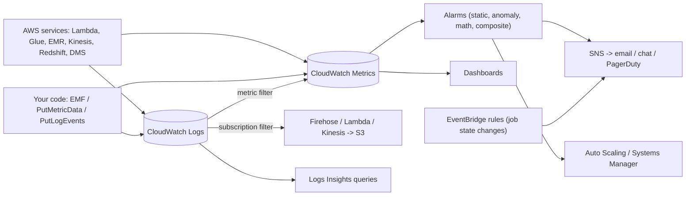
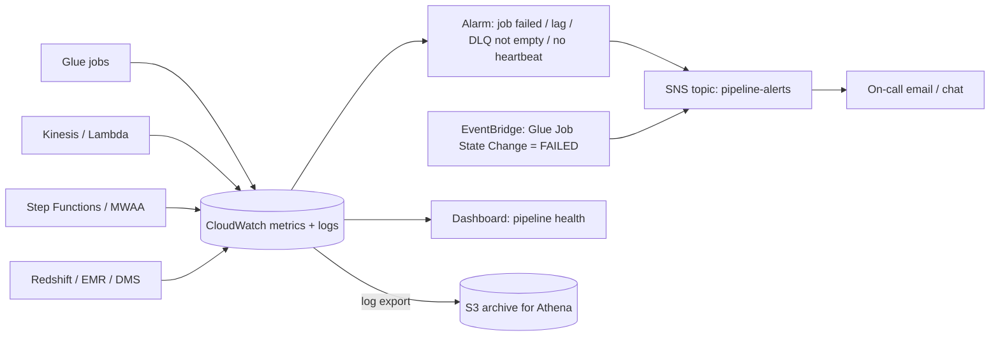
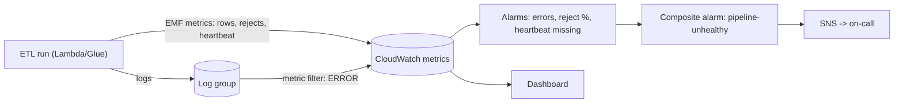
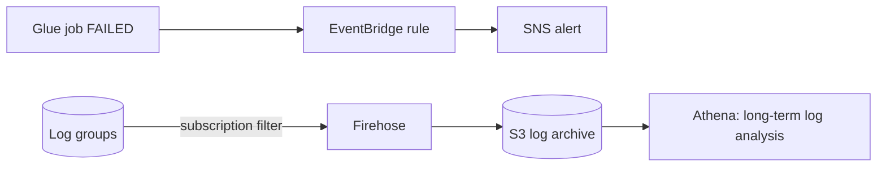
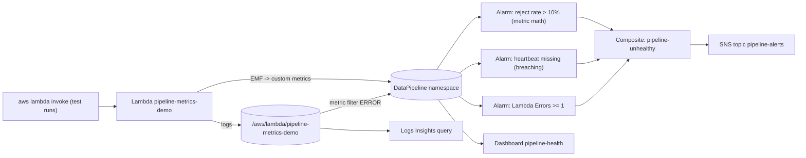

# Amazon CloudWatch — Data Engineering Study Notes (0–2 YOE)

> Self-contained notes: fundamentals → implementation → interview preparation.
> CloudWatch features, quotas, retention behaviour and pricing change often. Confirm numeric limits and prices in the official docs linked at the end.

**Contents**
1. Introduction
2. Architecture and Working Mechanism
3. Core Concepts and Terminology
4. Data Engineering Use Cases
5. Hands-on Implementation (mini-project)
6. Interview Preparation (10 conceptual + 5 scenario + 3 troubleshooting, all answered)
7. Revision and Quick Reference

---

## 1. Introduction

### What is Amazon CloudWatch?
**Amazon CloudWatch** is AWS's monitoring and observability service. It collects **metrics** (numbers over time, such as Lambda `Errors` or Kinesis `IteratorAge`), **logs** (text/JSON events from services and applications), and lets you create **alarms**, **dashboards**, and automated reactions. Almost every AWS service publishes metrics and logs to CloudWatch automatically, so it is the first place a data engineer looks when a pipeline is slow, failing or silent.

### Why was it introduced and what problem does it solve?
Distributed cloud systems have no single server to log into. CloudWatch provides a **central, managed place** to see how resources behave, be alerted when something is wrong, and investigate after the fact — without running your own monitoring stack (Prometheus, ELK, Nagios).

### Why is it important in Data Engineering?
Pipelines fail quietly: a file never arrives, a Glue job runs 5× longer, a stream consumer falls behind, a dead-letter queue fills. CloudWatch lets you:
- **Detect** problems (alarms on errors, latency, backlog, missing data).
- **Diagnose** them (logs, Logs Insights queries, metric graphs).
- **Prove health** (dashboards, SLO/SLA metrics such as data freshness).
- **Automate** responses (SNS notifications, EventBridge rules, Auto Scaling).

### When should you use it?
- Monitoring AWS-managed services (Glue, Lambda, EMR, Kinesis, Redshift, DMS, Step Functions, MWAA).
- Centralised application and pipeline logging.
- Alerting on thresholds, anomalies and missing heartbeats.
- Publishing **custom business/data-quality metrics** (rows processed, rejected, freshness).

### When should you avoid it (or complement it)?
| Situation | Better/complementary option |
|---|---|
| Distributed tracing across services | AWS X-Ray / CloudWatch Application Signals |
| Auditing who called which API | AWS CloudTrail |
| Reacting to specific events (job state change, S3 event) | Amazon EventBridge |
| Heavy log analytics over months/years | S3 + Athena (export or subscribe logs to Firehose) |
| Very high-cardinality metrics (per user/per file) | Aggregate first; use logs or a dedicated analytics store |
| Existing Prometheus/Grafana stack | Amazon Managed Service for Prometheus/Grafana (can read CloudWatch) |

### Simple real-world example
A Lambda-based ingestion function writes a log line per file and a custom metric `RowsRejected`. A CloudWatch alarm sends an SNS email if more than 10% of rows are rejected in a run, and another alarm fires if the function sends no heartbeat for 15 minutes (pipeline stalled).

### Brief comparison with alternatives
| | CloudWatch | CloudTrail | EventBridge | X-Ray |
|---|---|---|---|---|
| Purpose | Metrics, logs, alarms, dashboards | API activity audit | Event routing/automation | Request tracing |
| Data type | Time series + log events | API call records | Events (JSON) | Traces/segments |
| Typical DE question | "Is the job healthy and how fast?" | "Who deleted the table?" | "Run X when a Glue job fails" | "Where is latency in the call chain?" |

---

## 2. Architecture and Working Mechanism

### Overall architecture
CloudWatch is a regional service with several parts that share a common idea — **data in, rules over data, actions out**:
- **Metrics store** — time-series data points identified by namespace, name and dimensions.
- **Logs** — log groups containing log streams of events, with retention, queries and filters.
- **Alarms** — evaluate metrics (or math/anomaly models) and trigger **actions**.
- **Dashboards** — visual widgets (graphs, numbers, logs, alarm status).
- **Events/Rules** — now **Amazon EventBridge** (originally CloudWatch Events) for event-driven automation.
- **Agents/APIs** — CloudWatch agent (EC2/on-premises), `PutMetricData`, `PutLogEvents`, and the **Embedded Metric Format (EMF)**.

### Major components
- **Namespace** (e.g. `AWS/Lambda`, `DataPipeline`), **metric name**, **dimensions** (name/value pairs such as `FunctionName`), **unit**, **timestamp**, **value**.
- **Statistics** (Sum, Average, Minimum, Maximum, SampleCount, percentiles like p95/p99) over a **period**.
- **Log group / log stream / log event**, **retention policy**, **metric filters**, **subscription filters**, **Logs Insights**.
- **Alarm states:** `OK`, `ALARM`, `INSUFFICIENT_DATA`.
- **Alarm actions:** SNS topic, Auto Scaling, EC2 actions, Systems Manager OpsItems/incidents.
- **Composite alarms**, **anomaly detection**, **metric math**.

### End-to-end flow (a Lambda pipeline example)
1. Lambda runs; AWS automatically publishes metrics (`Invocations`, `Errors`, `Duration`, `Throttles`) to `AWS/Lambda` and sends `stdout` logs to `/aws/lambda/<function>`.
2. Your code prints an EMF JSON line; CloudWatch extracts **custom metrics** from it (no `PutMetricData` call needed).
3. A **metric filter** counts log lines containing `ERROR` and turns them into a metric.
4. An **alarm** evaluates a metric every period; after the configured number of breaching datapoints it moves to `ALARM` and publishes to an **SNS topic**.
5. Engineers see the alarm on the **dashboard**, open the logs and run a **Logs Insights** query to find the failing run.

### Mermaid architecture


### Explanation of components
- **Metrics** answer "how much / how often"; **logs** answer "what happened".
- **Metric filters** bridge logs → metrics; **subscription filters** stream logs elsewhere.
- **Alarms** turn data into notifications or automated actions; **composite alarms** reduce noise.
- **Dashboards and Insights** support investigation and reporting.

### Practical Data Engineering architecture


---

## 3. Core Concepts and Important Terminologies

### 3.1 Metrics, namespaces and dimensions
- **Definition:** A metric is a time-ordered set of data points. It is uniquely identified by **namespace + metric name + dimensions**.
- **Example:** `AWS/Lambda` / `Errors` / `FunctionName=ingest-orders`. Different dimensions create **different metrics**.
- **Why it matters:** Choosing dimensions determines how you can slice data **and cost**: every unique combination of dimension values is a separate (billable) custom metric. Avoid unbounded dimensions like `file_name` or `order_id`.
- **Resolution:** **Standard** (1-minute) and **high-resolution** (down to 1 second) custom metrics.
- **Retention (automatic roll-up):** 1-second data kept for 3 hours, 1-minute for 15 days, 5-minute for 63 days, 1-hour for 15 months (confirm in docs).
- **Mistakes:** high-cardinality dimensions; querying with the wrong dimension set and seeing "no data"; assuming old minute-level data is kept forever.

### 3.2 Statistics, periods and units
- **Statistics:** `Sum`, `Average`, `Minimum`, `Maximum`, `SampleCount`, percentiles (`p95`, `p99`). Use `Sum` for counts (Errors), `Average`/percentiles for latencies.
- **Period:** the aggregation window (multiples of 60 s for standard metrics).
- **Units:** `Count`, `Seconds`, `Milliseconds`, `Bytes`, `Percent`, `None`.
```bash
aws cloudwatch get-metric-statistics --namespace AWS/Lambda --metric-name Errors \
  --dimensions Name=FunctionName,Value=ingest-orders \
  --start-time 2026-11-19T00:00:00Z --end-time 2026-11-19T06:00:00Z \
  --period 300 --statistics Sum
```

### 3.3 Custom metrics: `PutMetricData` and Embedded Metric Format (EMF)
- **`PutMetricData`** API publishes data points (batch many per call to reduce cost/throttling):
```python
import boto3, datetime
cw = boto3.client("cloudwatch")
cw.put_metric_data(Namespace="DataPipeline", MetricData=[{
    "MetricName": "RowsProcessed", "Dimensions": [{"Name": "Pipeline", "Value": "orders_etl"}],
    "Timestamp": datetime.datetime.utcnow(), "Value": 1250, "Unit": "Count"}])
```
- **EMF** lets you emit a specially formatted JSON log line; CloudWatch extracts metrics asynchronously (ideal for Lambda/containers; also keeps the detailed log event for Insights).
```json
{"_aws":{"Timestamp":1763539200000,"CloudWatchMetrics":[{"Namespace":"DataPipeline","Dimensions":[["Pipeline"]],
  "Metrics":[{"Name":"RowsProcessed","Unit":"Count"}]}]},"Pipeline":"orders_etl","RowsProcessed":1250,"RunId":"ab12cd"}
```
- **Mistakes:** calling `PutMetricData` per record (cost/throttling); putting high-cardinality values (`RunId`) in dimensions (put them as plain properties instead).

### 3.4 Logs: groups, streams, events and retention
- **Log group:** a collection of log streams sharing retention, access and encryption settings (e.g. `/aws/lambda/ingest-orders`, `/aws-glue/jobs/output`).
- **Log stream:** a sequence of events from one source (a Lambda container, a Glue job run).
- **Retention:** **never expire by default** — set a retention policy (e.g. 14, 30, 90 days) to control cost.
- **Log classes:** Standard and Infrequent Access (cheaper ingestion, fewer features) — check docs.
- **Encryption:** server-side by default; optional KMS key.
```bash
aws logs put-retention-policy --log-group-name /aws/lambda/ingest-orders --retention-in-days 14
aws logs tail /aws/lambda/ingest-orders --follow --since 15m
```
- **Mistakes:** leaving retention at "Never expire" for chatty jobs; logging full payloads/secrets.

### 3.5 Metric filters and subscription filters
- **Metric filter:** pattern on incoming log events that increments a metric (count of `ERROR`, parsed numeric values).
```bash
aws logs put-metric-filter --log-group-name /aws/lambda/ingest-orders --filter-name errors \
  --filter-pattern "ERROR" \
  --metric-transformations metricName=ErrorLines,metricNamespace=DataPipeline,metricValue=1,defaultValue=0
```
Metric filters apply to **new** events after creation.
- **Subscription filter:** streams matching log events in near real time to **Kinesis Data Streams, Firehose or Lambda** (for archiving to S3, centralising logs across accounts, or custom processing).

### 3.6 CloudWatch Logs Insights
An interactive query language for log data:
```
fields @timestamp, @message
| filter @message like /WARN|ERROR/
| stats count() as events by bin(5m)
| sort bin(5m) desc
```
- Supports parsing (`parse`), aggregation (`stats`), `filter`, `sort`, `limit`, `dedup`; queries multiple log groups; billed per GB scanned.
- Run from the console, CLI (`start-query`/`get-query-results`) or SDK; **Live Tail** streams logs in real time.
- **Tip:** write structured (JSON) logs so fields are auto-discovered.

### 3.7 Alarms
- **Definition:** Evaluates a metric against a threshold over time and changes state: `OK`, `ALARM`, `INSUFFICIENT_DATA`.
- **Key settings:** `Period`, `EvaluationPeriods`, `DatapointsToAlarm` (M out of N), `Threshold`, `ComparisonOperator`, `Statistic`, `TreatMissingData` (`missing`, `notBreaching`, `breaching`, `ignore`), actions for `ALARM`, `OK`, `INSUFFICIENT_DATA`.
```bash
aws cloudwatch put-metric-alarm --alarm-name ingest-errors \
  --namespace AWS/Lambda --metric-name Errors --dimensions Name=FunctionName,Value=ingest-orders \
  --statistic Sum --period 60 --evaluation-periods 1 --threshold 1 \
  --comparison-operator GreaterThanOrEqualToThreshold --treat-missing-data notBreaching \
  --alarm-actions arn:aws:sns:ap-south-1:111122223333:pipeline-alerts \
  --ok-actions arn:aws:sns:ap-south-1:111122223333:pipeline-alerts
```
- **Missing data:** for event-driven jobs, `notBreaching` avoids false alarms when nothing runs; for **heartbeat** monitoring, use `breaching` so silence triggers the alarm.
- **Mistakes:** wrong dimensions (alarm sits in `INSUFFICIENT_DATA`); period shorter than metric publish interval; alerting on every blip (no M-of-N).

### 3.8 Metric math, anomaly detection and composite alarms
- **Metric math:** compute new series, e.g. error rate `100 * errors / invocations`, then alarm on it.
- **Anomaly detection:** a machine-learning band around expected values (seasonality-aware); alarm when outside the band.
- **Composite alarm:** combines other alarms with `AND`/`OR`/`NOT` to reduce alert noise: `ALARM(A) OR ALARM(B)`.
- **Mistake:** many separate alarms paging the same people instead of one composite per service.

### 3.9 Dashboards
JSON-defined widgets: metric graphs, single numbers, log query tables, alarm status. Dashboards can be cross-Region and (with observability access manager) cross-account. Keep one operational dashboard per pipeline/service with the "golden signals": errors, latency/duration, throughput/backlog, freshness.

### 3.10 CloudWatch vs EventBridge (Events)
- **CloudWatch metrics/alarms** work on **time-series thresholds**.
- **EventBridge** reacts to **discrete events** such as `Glue Job State Change` (`FAILED`), `EMR Step State Change`, `Step Functions Execution Status Change`, S3 events. Use EventBridge → SNS/Lambda for "job failed" alerts; use CloudWatch alarms for "queue age too high".

### 3.11 Key metrics for data engineering services
| Service | Metrics/signals to watch |
|---|---|
| Lambda | `Errors`, `Throttles`, `Duration` (p95), `ConcurrentExecutions`, `IteratorAge` (stream triggers), DLQ errors |
| Glue | Job run state events (EventBridge), driver/executor metrics (`glue.driver.*`, `glue.ALL.*`), job duration; enable job metrics and continuous logging |
| Kinesis Data Streams | `GetRecords.IteratorAgeMilliseconds`, `WriteProvisionedThroughputExceeded`, `IncomingBytes` |
| Firehose | `DeliveryToS3.Success`, `DeliveryToS3.DataFreshness` |
| SQS | `ApproximateNumberOfMessagesVisible`, `ApproximateAgeOfOldestMessage`, DLQ depth |
| SNS | `NumberOfNotificationsFailed` |
| DynamoDB | `ThrottledRequests`, consumed capacity, `SystemErrors` |
| Redshift | `CPUUtilization`, `PercentageDiskSpaceUsed`, `DatabaseConnections`, WLM queue metrics |
| EMR | `YARNMemoryAvailablePercentage`, `ContainerPending`, `HDFSUtilization`, `AppsRunning` |
| DMS | `CDCLatencySource`, `CDCLatencyTarget`, `FreeableMemory` |
| Step Functions | `ExecutionsFailed`, `ExecutionThrottled`, `ExecutionTime` |
| MWAA | `QueuedTasks`, scheduler heartbeat |
| Athena | workgroup `ProcessedBytes`, `EngineExecutionTime` |

### 3.12 Cross-account observability and other features (awareness)
- **Cross-account observability (OAM):** a monitoring account can view metrics, logs and traces from source accounts.
- **Application Signals / Container Insights / Lambda Insights:** curated application/container monitoring.
- **Contributor Insights:** finds top contributors (e.g. hot DynamoDB keys, noisy log sources).
- **Synthetics:** canaries that test endpoints on a schedule.
- **Data protection policies** on logs can detect/mask sensitive data.

### 3.13 Pricing and cost control
You pay for custom metrics (per unique metric per month), alarms (per alarm), dashboards (beyond free tier), log **ingestion** and **storage**, Logs Insights queries (per GB scanned), API calls (`GetMetricData`, `PutMetricData` beyond free tiers) and extra features. Control cost by setting log retention, reducing verbose logging, avoiding high-cardinality dimensions, using metric filters/EMF thoughtfully, and exporting old logs to S3. Check the pricing page.

---

## 4. Data Engineering Use Cases

### Real-world use cases
- Alarms for failed ETL runs, long runtimes and DLQ backlog.
- **Data freshness/heartbeat** monitoring (alarm when a pipeline stops reporting).
- Data-quality metrics (rows processed/rejected, null rates) published as custom metrics.
- Streaming lag monitoring (Kinesis iterator age, Lambda `IteratorAge`, SQS age of oldest message).
- Centralised logs with Logs Insights for debugging Glue/Lambda/EMR failures.
- Cost and capacity monitoring (Redshift disk, EMR memory, DynamoDB throttles).
- Log archiving to S3 for long-term analytics with Athena.

### Batch processing
Each batch run emits metrics (duration, rows in/out, rejects) and a final status; alarms detect failures and late runs (no success heartbeat by the SLA time). EventBridge rules alert on Glue/EMR/Step Functions failure events.

### Real-time / streaming
Alarm on iterator age / consumer lag (Kinesis, Lambda, SQS), throttling and DLQ depth; anomaly detection on throughput to find drops (producer outage) and spikes.

### Pipeline example 1 — Pipeline health alerting


### Pipeline example 2 — Event-driven failure alerts and log archive


### Why a Data Engineer chooses CloudWatch
It's built into every AWS service, needs no servers, supports metrics + logs + alarms + dashboards in one place and integrates with SNS/EventBridge/Lambda for automation. Pair it with CloudTrail (audit), EventBridge (events) and X-Ray (traces) for full observability.

---

## 5. Hands-on Implementation

### Mini-project: Build observability for a pipeline — custom metrics, log metric filter, alarms, dashboard and Logs Insights

**1. Objective:** Deploy a Lambda that simulates an ETL run and emits custom metrics (EMF) and logs; then create a metric filter, a metric-math alarm (reject rate), a heartbeat alarm, a Lambda error alarm, a composite alarm, a dashboard, and run a Logs Insights query.

**2. Business problem:** The data team must be alerted when an ETL run fails, rejects too many rows, or silently stops running — and have one dashboard showing pipeline health.

**3. Architecture**


**4. Prerequisites and setup**
- AWS CLI, Python 3 + Boto3; permissions for Lambda, IAM roles, CloudWatch, Logs and SNS.
- Variables: `ACCOUNT`, `REGION`.
- **Costs:** Lambda free tier covers this; CloudWatch free tier includes 10 custom metrics, 10 alarms and 3 dashboards (check current terms). Delete everything afterwards.

**5–6. Implementation and code**

*Step 1 — SNS topic (optionally subscribe your email)*
```bash
ACCOUNT=$(aws sts get-caller-identity --query Account --output text)
REGION=ap-south-1
TOPIC_ARN=$(aws sns create-topic --name pipeline-alerts --region $REGION --query TopicArn --output text)
# optional: aws sns subscribe --topic-arn $TOPIC_ARN --protocol email --notification-endpoint you@example.com   (confirm the email)
```

*Step 2 — Lambda that simulates an ETL run (`handler.py`)*
```python
import json, random, time, uuid

def lambda_handler(event, context):
    start = time.time()
    run_id = str(uuid.uuid4())[:8]
    rows = int(event.get("rows", 1000))
    bad_rate = float(event.get("bad_rate", 0.02))

    if event.get("fail"):
        print(f"ERROR run={run_id} pipeline failed: simulated upstream timeout")
        raise RuntimeError("simulated failure")

    rejected = sum(1 for _ in range(rows) if random.random() < bad_rate)
    for _ in range(min(rejected, 5)):
        print(f"WARN run={run_id} rejected row id={random.randint(1, rows)} reason=invalid_amount")

    duration_ms = int((time.time() - start) * 1000) + random.randint(200, 800)

    # Embedded Metric Format: CloudWatch extracts these as custom metrics
    print(json.dumps({
        "_aws": {
            "Timestamp": int(time.time() * 1000),
            "CloudWatchMetrics": [{
                "Namespace": "DataPipeline",
                "Dimensions": [["Pipeline"]],
                "Metrics": [{"Name": "RowsProcessed", "Unit": "Count"},
                            {"Name": "RowsRejected", "Unit": "Count"},
                            {"Name": "DurationMs", "Unit": "Milliseconds"},
                            {"Name": "Heartbeat", "Unit": "Count"}]}]},
        "Pipeline": "orders_etl", "RowsProcessed": rows, "RowsRejected": rejected,
        "DurationMs": duration_ms, "Heartbeat": 1, "RunId": run_id}))

    print(f"INFO run={run_id} processed={rows} rejected={rejected}")
    return {"run_id": run_id, "rows": rows, "rejected": rejected}
```
```bash
cat > lambda-trust.json <<'EOF'
{"Version":"2012-10-17","Statement":[{"Effect":"Allow","Principal":{"Service":"lambda.amazonaws.com"},"Action":"sts:AssumeRole"}]}
EOF
aws iam create-role --role-name PipelineDemoRole --assume-role-policy-document file://lambda-trust.json
aws iam attach-role-policy --role-name PipelineDemoRole --policy-arn arn:aws:iam::aws:policy/service-role/AWSLambdaBasicExecutionRole
zip fn.zip handler.py ; sleep 10
aws lambda create-function --function-name pipeline-metrics-demo --runtime python3.12 \
  --role arn:aws:iam::$ACCOUNT:role/PipelineDemoRole --handler handler.lambda_handler \
  --zip-file fileb://fn.zip --timeout 30 --region $REGION
```

*Step 3 — Generate some data, then set retention and a metric filter*
```bash
for i in 1 2 3 4 5; do
  aws lambda invoke --function-name pipeline-metrics-demo --payload '{"rows":1000,"bad_rate":0.02}' \
    --cli-binary-format raw-in-base64-out /tmp/out.json >/dev/null; sleep 2
done
LG=/aws/lambda/pipeline-metrics-demo
aws logs put-retention-policy --log-group-name $LG --retention-in-days 14
aws logs put-metric-filter --log-group-name $LG --filter-name error-lines --filter-pattern "ERROR" \
  --metric-transformations metricName=ErrorLines,metricNamespace=DataPipeline,metricValue=1,defaultValue=0
```

*Step 4 — Alarms (metric math reject rate, heartbeat, Lambda errors)*
```bash
cat > reject-metrics.json <<'EOF'
[
 {"Id":"e1","Expression":"100*m1/m2","Label":"RejectRatePct","ReturnData":true},
 {"Id":"m1","MetricStat":{"Metric":{"Namespace":"DataPipeline","MetricName":"RowsRejected","Dimensions":[{"Name":"Pipeline","Value":"orders_etl"}]},"Period":60,"Stat":"Sum"},"ReturnData":false},
 {"Id":"m2","MetricStat":{"Metric":{"Namespace":"DataPipeline","MetricName":"RowsProcessed","Dimensions":[{"Name":"Pipeline","Value":"orders_etl"}]},"Period":60,"Stat":"Sum"},"ReturnData":false}
]
EOF
aws cloudwatch put-metric-alarm --alarm-name pipeline-reject-rate-high --metrics file://reject-metrics.json \
  --evaluation-periods 1 --threshold 10 --comparison-operator GreaterThanThreshold --treat-missing-data notBreaching

aws cloudwatch put-metric-alarm --alarm-name pipeline-heartbeat-missing \
  --namespace DataPipeline --metric-name Heartbeat --dimensions Name=Pipeline,Value=orders_etl \
  --statistic Sum --period 300 --evaluation-periods 3 --datapoints-to-alarm 3 --threshold 1 \
  --comparison-operator LessThanThreshold --treat-missing-data breaching

aws cloudwatch put-metric-alarm --alarm-name pipeline-lambda-errors \
  --namespace AWS/Lambda --metric-name Errors --dimensions Name=FunctionName,Value=pipeline-metrics-demo \
  --statistic Sum --period 60 --evaluation-periods 1 --threshold 1 \
  --comparison-operator GreaterThanOrEqualToThreshold --treat-missing-data notBreaching

# One composite alarm sends the notification (avoid three separate pages)
aws cloudwatch put-composite-alarm --alarm-name pipeline-unhealthy \
  --alarm-rule "ALARM(pipeline-reject-rate-high) OR ALARM(pipeline-heartbeat-missing) OR ALARM(pipeline-lambda-errors)" \
  --alarm-actions $TOPIC_ARN --ok-actions $TOPIC_ARN
```

*Step 5 — Dashboard*
```bash
cat > dashboard.json <<EOF
{"widgets":[
 {"type":"metric","x":0,"y":0,"width":12,"height":6,"properties":{"title":"Rows processed vs rejected","region":"$REGION","stat":"Sum","period":60,
   "metrics":[["DataPipeline","RowsProcessed","Pipeline","orders_etl"],["DataPipeline","RowsRejected","Pipeline","orders_etl"]]}},
 {"type":"metric","x":12,"y":0,"width":12,"height":6,"properties":{"title":"Lambda errors and duration","region":"$REGION","period":60,
   "metrics":[["AWS/Lambda","Errors","FunctionName","pipeline-metrics-demo",{"stat":"Sum"}],["AWS/Lambda","Duration","FunctionName","pipeline-metrics-demo",{"stat":"p95","yAxis":"right"}]]}},
 {"type":"alarm","x":0,"y":6,"width":12,"height":4,"properties":{"title":"Alarm status","alarms":[
   "arn:aws:cloudwatch:$REGION:$ACCOUNT:alarm:pipeline-unhealthy",
   "arn:aws:cloudwatch:$REGION:$ACCOUNT:alarm:pipeline-reject-rate-high",
   "arn:aws:cloudwatch:$REGION:$ACCOUNT:alarm:pipeline-heartbeat-missing",
   "arn:aws:cloudwatch:$REGION:$ACCOUNT:alarm:pipeline-lambda-errors"]}},
 {"type":"log","x":12,"y":6,"width":12,"height":6,"properties":{"title":"Recent warnings and errors","region":"$REGION","view":"table",
   "query":"SOURCE '/aws/lambda/pipeline-metrics-demo' | fields @timestamp, @message | filter @message like /WARN|ERROR/ | sort @timestamp desc | limit 20"}}
]}
EOF
aws cloudwatch put-dashboard --dashboard-name pipeline-health --dashboard-body file://dashboard.json
```

*Step 6 — Trigger problems and run Logs Insights (`insights.py`)*
```bash
# High reject rate (30%) and a failure
aws lambda invoke --function-name pipeline-metrics-demo --payload '{"rows":1000,"bad_rate":0.30}' --cli-binary-format raw-in-base64-out /tmp/o1.json
aws lambda invoke --function-name pipeline-metrics-demo --payload '{"fail":true}' --cli-binary-format raw-in-base64-out /tmp/o2.json
sleep 90
aws cloudwatch describe-alarms --alarm-names pipeline-reject-rate-high pipeline-lambda-errors pipeline-unhealthy \
  --query 'MetricAlarms[].[AlarmName,StateValue]' --output table
aws cloudwatch describe-alarms --alarm-types CompositeAlarm --query 'CompositeAlarms[].[AlarmName,StateValue]' --output table
```
```python
import time, boto3
logs = boto3.client("logs", region_name="ap-south-1")
q = logs.start_query(
    logGroupName="/aws/lambda/pipeline-metrics-demo",
    startTime=int(time.time()) - 3600, endTime=int(time.time()),
    queryString="""fields @timestamp, @message
| filter @message like /WARN|ERROR/
| parse @message "run=* " as run_id
| stats count() as events by run_id
| sort events desc | limit 10""")["queryId"]
while True:
    r = logs.get_query_results(queryId=q)
    if r["status"] in ("Complete", "Failed", "Cancelled"):
        break
    time.sleep(1)
for row in r["results"]:
    print({c["field"]: c["value"] for c in row})
```

**7. Explanation of the code**
- The Lambda prints an **EMF** JSON line so CloudWatch creates `RowsProcessed`, `RowsRejected`, `DurationMs` and `Heartbeat` metrics under namespace `DataPipeline` with dimension `Pipeline` (the `RunId` is deliberately a property, not a dimension, to avoid high cardinality).
- The **metric filter** converts `ERROR` log lines into the `ErrorLines` metric.
- The **metric-math alarm** computes `100 × rejected / processed` and alarms above 10%.
- The **heartbeat alarm** uses `TreatMissingData=breaching`: if no data points arrive for three 5-minute periods, it alarms — detecting a stalled pipeline.
- The **composite alarm** combines the three and is the only one wired to SNS, reducing noise.
- The dashboard shows metrics, alarm status and a Logs Insights table; the Python snippet runs an aggregation query.

**8. Expected output**
After the problem runs and about 1–2 minutes:
```
| pipeline-reject-rate-high | ALARM |
| pipeline-lambda-errors    | ALARM |
| pipeline-unhealthy        | ALARM |
```
The heartbeat alarm enters `ALARM` after about 15 minutes without invocations. Insights prints rows such as `{'run_id': 'a1b2c3d4', 'events': '6'}`.

**9. Validation and testing**
```bash
aws cloudwatch list-metrics --namespace DataPipeline
aws cloudwatch get-metric-statistics --namespace DataPipeline --metric-name RowsProcessed \
  --dimensions Name=Pipeline,Value=orders_etl --start-time $(date -u -d '30 min ago' +%FT%TZ) \
  --end-time $(date -u +%FT%TZ) --period 60 --statistics Sum
aws cloudwatch describe-alarm-history --alarm-name pipeline-unhealthy --max-items 5
aws cloudwatch set-alarm-state --alarm-name pipeline-heartbeat-missing --state-value ALARM --state-reason "test"   # tests actions quickly
aws logs tail $LG --since 10m
```
(`date -d` is GNU syntax; adjust on macOS.) If you subscribed an email, confirm that the composite alarm's notification arrives. Then invoke the function successfully a few times and watch the alarms return to `OK` (you'll get an OK notification).

**10. Common errors and troubleshooting**
| Symptom | Cause | Fix |
|---|---|---|
| Custom metrics not appearing | EMF JSON malformed, wrong namespace/dimensions, or wait time (1–2 min) | Validate the JSON; list metrics; wait |
| Alarm in `INSUFFICIENT_DATA` | Dimension mismatch or no datapoints | Match dimensions exactly (`Pipeline=orders_etl`); consider `TreatMissingData` |
| No email received | Subscription not confirmed or composite alarm has no action | Confirm subscription; check `AlarmActions` |
| Metric filter shows no data | Created after the log events, or pattern mismatch | Generate new log events; check the pattern |
| `AccessDenied` when creating alarms/dashboards | Missing IAM permissions | Add `cloudwatch:*`/`logs:*` for the lab |

**11. Cost considerations and cleanup**
Within free-tier limits for this lab (custom metrics, alarms and dashboards beyond free tier cost a little). Clean up:
```bash
aws cloudwatch delete-alarms --alarm-names pipeline-unhealthy pipeline-reject-rate-high pipeline-heartbeat-missing pipeline-lambda-errors
aws cloudwatch delete-dashboards --dashboard-names pipeline-health
aws logs delete-metric-filter --log-group-name $LG --filter-name error-lines
aws logs delete-log-group --log-group-name $LG
aws lambda delete-function --function-name pipeline-metrics-demo
aws iam detach-role-policy --role-name PipelineDemoRole --policy-arn arn:aws:iam::aws:policy/service-role/AWSLambdaBasicExecutionRole
aws iam delete-role --role-name PipelineDemoRole
aws sns delete-topic --topic-arn $TOPIC_ARN
```
(Delete the composite alarm first if deletion of the child alarms is blocked: `aws cloudwatch delete-alarms --alarm-names pipeline-unhealthy`. Custom metrics themselves expire automatically and can't be deleted manually.)

---

## 6. Interview Preparation — Questions WITH Answers

### A. Conceptual Questions (10)

**Q1. What is Amazon CloudWatch and what are its main components?**
CloudWatch is AWS's monitoring and observability service. Its core components are **metrics** (time-series numbers), **logs** (log groups/streams with retention, metric filters, subscription filters and Logs Insights), **alarms** (evaluate metrics and trigger actions), **dashboards**, and integrations such as EventBridge (event rules), the CloudWatch agent, Embedded Metric Format (EMF), Contributor Insights and Application Signals. AWS services publish metrics and logs automatically; you add custom metrics for business/data-quality signals. *Keywords: namespace, dimensions, statistics, period, alarm states, log group, retention.*

**Q2. Explain namespaces, dimensions, statistics and periods. Why does dimension design matter?**
A metric is identified by **namespace + name + dimensions** (e.g. `AWS/Lambda`, `Errors`, `FunctionName=x`). Statistics (Sum, Average, Min, Max, SampleCount, percentiles) are computed over a **period** (multiples of 60 seconds for standard-resolution metrics). Every unique combination of dimension values creates a distinct metric: querying with different dimensions yields different data, and each custom metric is billed. So use stable, low-cardinality dimensions (`Pipeline`, `Environment`) and keep high-cardinality identifiers (`RunId`, `FileName`) in logs or properties, not dimensions.

**Q3. How do you publish custom metrics, and what is EMF?**
Use `PutMetricData` (batch data points to reduce cost/throttling) or the **Embedded Metric Format**: write a structured JSON log line with an `_aws.CloudWatchMetrics` block and metric values; CloudWatch Logs automatically extracts metrics and still stores the full log event for Insights. EMF is ideal for Lambda/containers because there's no API call or extra latency. Metrics can be standard (1-minute) or high-resolution (down to 1 second). Remember dimensions drive cardinality and cost.

**Q4. What are metric filters, subscription filters and Logs Insights?**
A **metric filter** scans incoming log events for a pattern (e.g. `ERROR`) and increments a metric — a way to alarm on log content (applies only to new events). A **subscription filter** streams matching log events in near real time to Kinesis, Firehose or Lambda (for archiving to S3, central logging, processing). **Logs Insights** is an interactive query language (`fields`, `filter`, `parse`, `stats`, `sort`, `limit`) for ad hoc analysis across log groups, billed per GB scanned. Structured JSON logs make Insights queries far easier.

**Q5. How do CloudWatch alarms work? Explain evaluation periods, datapoints to alarm and missing data.**
An alarm evaluates a metric (or metric math/anomaly band) each period against a threshold. **EvaluationPeriods** is how many recent periods are considered; **DatapointsToAlarm** (M of N) is how many must breach before the alarm goes to `ALARM`. States: `OK`, `ALARM`, `INSUFFICIENT_DATA`. **TreatMissingData** defines behaviour when no datapoints arrive (`missing`, `notBreaching`, `breaching`, `ignore`): use `notBreaching` for event-driven jobs that run occasionally and `breaching` for heartbeat alarms where silence is a failure. Actions (SNS, Auto Scaling, Systems Manager) can run on state transitions.

**Q6. What are metric math, anomaly detection and composite alarms?**
**Metric math** lets you compute new time series from metrics (e.g. error rate = `100*errors/invocations`) and alarm on the result. **Anomaly detection** builds a machine-learning model of expected behaviour (including daily/weekly seasonality) and alarms when values leave the expected band — useful for traffic volumes without a fixed threshold. **Composite alarms** combine alarm states with boolean logic (`ALARM(A) OR ALARM(B)`), letting you send one notification per service and cut alert noise.

**Q7. What do dashboards offer and how would you design one for a pipeline?**
Dashboards display widgets: metric graphs, numbers, log query tables and alarm status, across Regions and (with cross-account observability) accounts. A good pipeline dashboard shows the golden signals: **errors/failures**, **duration/latency** (p95), **throughput/backlog** (rows processed, queue depth, iterator age), **freshness** (time since last success) and alarm status, plus a log table of recent warnings/errors. Keep one per pipeline, define dashboards as code (JSON/CloudFormation), and link alarms to runbooks.

**Q8. How do CloudWatch, EventBridge, CloudTrail and X-Ray differ?**
CloudWatch monitors **resource behaviour** (metrics, logs, alarms). EventBridge routes **events** (e.g. `Glue Job State Change = FAILED`, S3 events, schedules) to targets and automates responses. CloudTrail records **API calls** for audit/security ("who deleted this bucket?"). X-Ray (and Application Signals) provide **distributed traces** to find latency/errors across services. They complement each other: e.g. EventBridge alerts on a job failure, CloudWatch logs show why, CloudTrail shows who changed the config.

**Q9. Which metrics would you monitor for common data engineering services?**
Lambda: `Errors`, `Throttles`, `Duration` p95, `IteratorAge`. Glue: job state events, driver/executor metrics, run time. Kinesis: `IteratorAge`, `WriteProvisionedThroughputExceeded`. Firehose: `DeliveryToS3.Success`/`DataFreshness`. SQS: age of oldest message and DLQ depth. DynamoDB: `ThrottledRequests`. Redshift: CPU, disk usage, connections, queue times. EMR: YARN memory available, HDFS utilisation. DMS: `CDCLatencySource/Target`. Step Functions: `ExecutionsFailed`. MWAA: queued tasks, scheduler heartbeat. Add custom metrics for rows processed/rejected and data freshness.

**Q10. How do you control CloudWatch cost and secure it?**
Cost: set log **retention** (default is never expire), lower log verbosity (INFO/WARN in production), avoid high-cardinality dimensions, batch `PutMetricData`, use EMF thoughtfully, use Infrequent Access log class where suitable, export/archive old logs to S3 (via subscription filter/Firehose), limit Insights query ranges, and delete unused alarms/dashboards. Security: least-privilege IAM for `logs:*`/`cloudwatch:*`, KMS encryption for log groups, log data protection policies to mask sensitive data, avoid logging secrets/PII, cross-account access via OAM with restrictions, and CloudTrail for auditing changes.

### B. Scenario-Based Questions (5)

**S1. A daily pipeline silently stopped running two days ago; no alarm fired because nothing "failed".**
*Solution:* emit a **heartbeat/success metric** (EMF or `PutMetricData`) at the end of each successful run and create an alarm with `TreatMissingData=breaching` (e.g. Sum < 1 over the expected interval), or a "data freshness" metric (minutes since last successful load) with a threshold; also alarm on EventBridge/Step Functions failure events. *Why:* failure alarms don't detect absence of runs. *Alternatives:* MWAA/Step Functions schedule monitors, Lambda canary checking table freshness. *Trade-off:* choose periods carefully to avoid false alarms around schedule jitter.

**S2. The on-call team is paged 30 times for one outage (errors, throttles, DLQ depth, latency).**
*Solution:* create a **composite alarm** per service/pipeline combining the child alarms and attach notification actions only to the composite; tune thresholds with M-of-N datapoints, use anomaly detection for noisy metrics, send low-severity alarms to a separate topic, include runbook links in alarm descriptions, and add `OK` actions to auto-resolve. *Why:* one actionable alert beats many symptoms. *Alternatives:* incident manager/aggregation tools. *Trade-off:* composite logic hides which child fired unless the message/dashboard shows details.

**S3. A Glue job fails nightly; engineers spend an hour finding the error in logs.**
*Solution:* enable Glue **continuous logging** and job metrics; route Glue `FAILED` state-change events through EventBridge to SNS with job name and run ID; add a Logs Insights saved query (`fields @timestamp, @message | filter @message like /ERROR|Exception/ | sort @timestamp desc`); include the run ID and a CloudWatch Logs deep link in the alert; add a dashboard widget for the log group. *Why:* faster detection and diagnosis. *Alternatives:* Step Functions Catch → SNS with error cause. *Trade-off:* extra logging increases cost; set retention.

**S4. CloudWatch Logs costs jumped 5× this month.**
*Solution:* identify the largest log groups (`aws logs describe-log-groups`, Cost Explorer by usage type, Logs Insights `stats sum(strlen(@message))`); reduce verbosity (DEBUG off), stop logging full payloads, set retention policies, use the Infrequent Access class for rarely queried logs, sample noisy logs, route archives to S3 via Firehose and delete from CloudWatch, and review Insights query frequency. *Why:* ingestion and storage dominate cost. *Alternatives:* metric-only monitoring for high-volume components. *Trade-off:* less log detail for debugging.

**S5. A central platform team must monitor pipelines across 20 AWS accounts.**
*Solution:* use **CloudWatch cross-account observability (OAM)**: designate a monitoring account, link source accounts, and build shared dashboards/alarms there; standardise metric namespaces/dimensions and alarm naming; centralise alerts via SNS/EventBridge buses; for log archiving use subscription filters to a central Firehose/S3 in a logging account. *Why:* one place to see everything. *Alternatives:* Grafana with CloudWatch data sources, third-party observability tools. *Trade-off:* governance of cross-account access and per-account costs.

### C. Troubleshooting Questions (3)

**T1. An alarm is stuck in `INSUFFICIENT_DATA` (or never fires although the issue is real).**
*Root causes:* dimensions/namespace/metric name don't exactly match the published metric; metric isn't being published (resource idle, wrong Region); alarm period shorter than the publishing interval; `TreatMissingData` set so missing points are ignored; metric math/stat mismatch (Sum vs Average); datapoints delayed. *Debug approach:* `aws cloudwatch list-metrics --namespace ...` to see the exact metric/dimensions; `get-metric-statistics` for recent data; check the alarm's configuration with `describe-alarms`; confirm the Region and account; review `describe-alarm-history`. *Fix:* correct dimensions/period/statistic, choose appropriate missing-data treatment, ensure the producer publishes (e.g. fix EMF JSON), and retest by generating events.

**T2. A Lambda/Glue/EMR job produces no logs in CloudWatch.**
*Root causes:* execution role lacks `logs:CreateLogGroup/CreateLogStream/PutLogEvents`; Glue continuous logging/EMR log configuration not enabled; the job never started or logs go to a different Region; KMS key policy for the log group denies the writer; log retention/quotas or throttling; application logging to files instead of stdout. *Debug approach:* check the role's policies (`AWSLambdaBasicExecutionRole`, Glue service role), find the log group name conventions (`/aws/lambda/<fn>`, `/aws-glue/jobs/*`), look in CloudTrail for denied `PutLogEvents`/`CreateLogGroup`, confirm Region. *Fix:* attach logging permissions, enable logging options, fix KMS policy, log to stdout/stderr, and rerun.

**T3. The alarm shows `ALARM` but nobody received a notification.**
*Root causes:* no alarm action configured (or action only on `OK`), notifying a composite vs child alarm incorrectly; SNS subscription unconfirmed or filtered; SNS topic policy doesn't allow `cloudwatch.amazonaws.com`; SNS topic encrypted with a KMS key the service can't use; email in spam; alarm actions disabled (`ActionsEnabled=false`); alarm in a different Region from the topic. *Debug approach:* `describe-alarms` (AlarmActions, ActionsEnabled), `get-topic-attributes` for the policy, `list-subscriptions-by-topic` for status, check SNS delivery logs/metrics and the alarm history for action failures. *Fix:* add/enable actions, correct topic access policy and KMS key policy (allow CloudWatch), confirm subscriptions, test with `set-alarm-state`.

---

## 7. Revision and Quick Reference

### Key takeaways
- CloudWatch = metrics + logs + alarms + dashboards (+ Insights, EMF, anomaly detection, composite alarms).
- Metric identity = namespace + name + **dimensions** — keep cardinality low.
- Alarms: period, evaluation periods, M-of-N, missing-data treatment, actions.
- Use EventBridge for job-state events, CloudTrail for audit, X-Ray for traces.
- Set log retention and design heartbeat/freshness metrics for pipelines.

### Commonly forgotten details
- Log groups never expire by default.
- Metric filters only apply to log events after creation.
- Wrong dimensions → `INSUFFICIENT_DATA` / "no data".
- Standard metrics resolution is 1 minute; older data is rolled up (15 days at 1 min, 63 days at 5 min, 15 months at 1 hour).
- Use `TreatMissingData=breaching` for heartbeat alarms.
- Composite alarms are the right place for notifications to reduce noise.
- Custom metrics can't be deleted; they expire after no new data (about 15 months).
- Logs Insights bills per GB scanned; narrow the time range and log groups.

### Important commands and syntax
```bash
aws cloudwatch put-metric-data --namespace NS --metric-name M --dimensions Pipeline=p --value 1 --unit Count
aws cloudwatch list-metrics --namespace NS
aws cloudwatch get-metric-statistics --namespace NS --metric-name M --dimensions Name=Pipeline,Value=p --start-time T1 --end-time T2 --period 60 --statistics Sum
aws cloudwatch put-metric-alarm --alarm-name A --namespace NS --metric-name M --statistic Sum --period 60 --evaluation-periods 1 --threshold 1 --comparison-operator GreaterThanOrEqualToThreshold --alarm-actions SNS_ARN
aws cloudwatch put-composite-alarm --alarm-name C --alarm-rule "ALARM(A) OR ALARM(B)"
aws cloudwatch set-alarm-state --alarm-name A --state-value ALARM --state-reason test
aws cloudwatch put-dashboard --dashboard-name D --dashboard-body file://d.json
aws logs tail /aws/lambda/fn --follow
aws logs put-retention-policy --log-group-name G --retention-in-days 14
aws logs put-metric-filter --log-group-name G --filter-name F --filter-pattern ERROR --metric-transformations metricName=N,metricNamespace=NS,metricValue=1
aws logs start-query --log-group-name G --start-time S --end-time E --query-string 'fields @message | limit 10'
```
```
fields @timestamp, @message | filter @message like /ERROR/ | stats count() by bin(5m)
```

### Frequently used configurations
Log retention; alarm `Period`/`EvaluationPeriods`/`DatapointsToAlarm`; `TreatMissingData`; SNS alarm/OK actions; EMF namespace/dimensions; metric filters; subscription filters to Firehose; dashboard widgets; anomaly detection bands; KMS for log groups; cross-account observability links.

### Common errors and solutions
| Error | Solution |
|---|---|
| Alarm `INSUFFICIENT_DATA` | Match dimensions/namespace; ensure data publishing; set missing-data policy |
| No logs | IAM logging permissions, enable logging, KMS policy, Region |
| No notification | Alarm actions, SNS subscription/topic policy/KMS |
| Throttled API calls | Batch `PutMetricData`; use EMF; use `GetMetricData` |
| High cost | Retention, verbosity, cardinality, IA class, archive to S3 |
| Metric filter shows nothing | Pattern, new events only |

### Service limitations
Metric resolution/roll-up and retention limits; alarm evaluation and notification delay (minutes); dimension count limits per metric; metric filter and alarm quotas; Logs Insights scan limits/timeouts and per-query result limits; log event size limits; no raw metric deletion; high-cardinality custom metrics are expensive; check current quotas.

### Performance and cost optimisation
Batch metric publishing, use EMF; limit dimensions; reduce log volume and set retention; use Insights with narrow ranges; archive logs to S3 and query with Athena; use composite alarms and anomaly detection to cut noise; delete unused alarms/dashboards; use metric math instead of publishing derived metrics.

### Security best practices
Least-privilege IAM for CloudWatch/Logs; KMS encryption for sensitive log groups; avoid secrets/PII in logs (use data protection policies); restrict who can modify alarms/dashboards; cross-account access with OAM and scoped permissions; audit changes with CloudTrail; secure SNS topics used for alarm actions.

### Connections with other AWS services
Lambda, Glue, EMR, Kinesis, Firehose, SQS/SNS, DynamoDB, Redshift, DMS, Step Functions, MWAA (metrics/logs sources), SNS/EventBridge (actions/events), S3/Athena (log archive), X-Ray/Application Signals (traces), CloudTrail (audit), Systems Manager (OpsItems), Auto Scaling.

### Quick revision cheat sheet
```
Metric = namespace + name + dimensions ; stats (Sum/Avg/p95) over period ; custom: PutMetricData | EMF
Logs: group (set retention!) -> stream -> events ; metric filter (log->metric) ; subscription filter (stream out) ; Insights (query)
Alarm: OK | ALARM | INSUFFICIENT_DATA ; M-of-N ; TreatMissingData (breaching for heartbeat) ; actions -> SNS
Reduce noise: composite alarms, anomaly detection ; metric math for rates
Events (EventBridge) for job state changes ; CloudTrail for audit ; X-Ray for traces
Cost: retention, cardinality, verbosity
```

### 10 rapid-fire revision questions
1. **What uniquely identifies a metric?** Namespace + metric name + dimensions.
2. **How do you turn log lines containing ERROR into a metric?** A metric filter.
3. **What is EMF?** Embedded Metric Format — JSON log lines that CloudWatch converts into custom metrics.
4. **Which missing-data setting suits a heartbeat alarm?** `breaching`.
5. **What are the alarm states?** `OK`, `ALARM`, `INSUFFICIENT_DATA`.
6. **What combines multiple alarms with AND/OR logic?** A composite alarm.
7. **What is the default log retention?** Never expire.
8. **Which tool queries logs interactively?** CloudWatch Logs Insights.
9. **Which service reacts to Glue job state-change events?** Amazon EventBridge.
10. **How do you stream logs to S3?** A subscription filter to Firehose (delivering to S3).

---

## Official AWS documentation
- Amazon CloudWatch User Guide — https://docs.aws.amazon.com/AmazonCloudWatch/latest/monitoring/WhatIsCloudWatch.html
- Metrics concepts — https://docs.aws.amazon.com/AmazonCloudWatch/latest/monitoring/cloudwatch_concepts.html
- Alarms — https://docs.aws.amazon.com/AmazonCloudWatch/latest/monitoring/AlarmThatSendsEmail.html
- Composite alarms — https://docs.aws.amazon.com/AmazonCloudWatch/latest/monitoring/Create_Composite_Alarm.html
- Metric math — https://docs.aws.amazon.com/AmazonCloudWatch/latest/monitoring/using-metric-math.html
- CloudWatch Logs User Guide — https://docs.aws.amazon.com/AmazonCloudWatch/latest/logs/WhatIsCloudWatchLogs.html
- Logs Insights query syntax — https://docs.aws.amazon.com/AmazonCloudWatch/latest/logs/CWL_QuerySyntax.html
- Embedded Metric Format — https://docs.aws.amazon.com/AmazonCloudWatch/latest/monitoring/CloudWatch_Embedded_Metric_Format.html
- Dashboards — https://docs.aws.amazon.com/AmazonCloudWatch/latest/monitoring/CloudWatch_Dashboards.html
- Cross-account observability — https://docs.aws.amazon.com/AmazonCloudWatch/latest/monitoring/CloudWatch-Unified-Cross-Account.html
- CloudWatch pricing — https://aws.amazon.com/cloudwatch/pricing/
- Boto3 CloudWatch reference — https://boto3.amazonaws.com/v1/documentation/api/latest/reference/services/cloudwatch.html
