# AWS Lambda — End-to-End Notes

> **Source of truth:** [AWS Lambda Developer Guide](https://docs.aws.amazon.com/lambda/latest/dg/welcome.html)  
> **Last reviewed:** 4 November 2026  
> **Purpose:** Repository-ready study notes for understanding, building, operating, and troubleshooting AWS Lambda workloads, with emphasis on event-driven functions used in serverless applications and data engineering.

---

## Table of Contents

1. [What is AWS Lambda?](#1-what-is-aws-lambda)
2. [Lambda compute primitives](#2-lambda-compute-primitives)
3. [Core concepts and components](#3-core-concepts-and-components)
4. [How a Lambda function executes](#4-how-a-lambda-function-executes)
5. [Invocation models: Push vs Pull](#5-invocation-models-push-vs-pull)
6. [Triggers and event source mappings](#6-triggers-and-event-source-mappings)
7. [Function handlers and event objects](#7-function-handlers-and-event-objects)
8. [Execution environments, runtimes, and cold starts](#8-execution-environments-runtimes-and-cold-starts)
9. [Deployment packages, container images, and layers](#9-deployment-packages-container-images-and-layers)
10. [Configuration](#10-configuration)
11. [Concurrency and scaling](#11-concurrency-and-scaling)
12. [Performance optimization and best practices](#12-performance-optimization-and-best-practices)
13. [Security and IAM permissions](#13-security-and-iam-permissions)
14. [Versions and release management](#14-versions-and-release-management)
15. [Monitoring and troubleshooting](#15-monitoring-and-troubleshooting)
16. [Reliability and event-processing design](#16-reliability-and-event-processing-design)
17. [Common data engineering patterns](#17-common-data-engineering-patterns)
18. [Limits, duration, and pricing concepts](#18-limits-duration-and-pricing-concepts)
19. [When to use and when not to use Lambda](#19-when-to-use-and-when-not-to-use-lambda)
20. [Quick revision and interview questions](#20-quick-revision-and-interview-questions)
21. [Official documentation and further reading](#21-official-documentation-and-further-reading)

---

## 1. What is AWS Lambda?

**AWS Lambda is a serverless compute service** that runs code in response to events without requiring the user to provision or manage servers.

AWS manages the underlying compute infrastructure, including:

- Server and operating-system maintenance.
- Capacity provisioning.
- Automatic scaling.
- Runtime and infrastructure patching for managed runtimes.
- Execution-environment management.
- Integration with AWS services and logging facilities.

The developer focuses primarily on application code, event handling, configuration, permissions, and operational behavior.

### Main characteristics

| Characteristic | Explanation |
|---|---|
| Serverless | You do not manage the underlying servers. |
| Event-driven | Code can run when an event or request arrives. |
| Automatic scaling | Lambda creates execution environments to meet incoming demand, subject to quotas and configured controls. |
| Pay per use | Event functions are billed based on requests and execution duration/resources. Check the current pricing page for details. |
| Integrated | Lambda can be invoked by many AWS services and applications. |
| Isolated execution | Functions run in managed, isolated execution environments. |

### Common use cases

- Process an object after it is uploaded to Amazon S3.
- Build an API backend with Amazon API Gateway or a Lambda Function URL.
- Process messages from Amazon SQS.
- Process records from Kinesis Data Streams or DynamoDB Streams.
- Run scheduled jobs through EventBridge Scheduler.
- React to application events and automate operational tasks.
- Connect services in an event-driven architecture.
- Execute individual steps in a larger workflow.

### High-level model

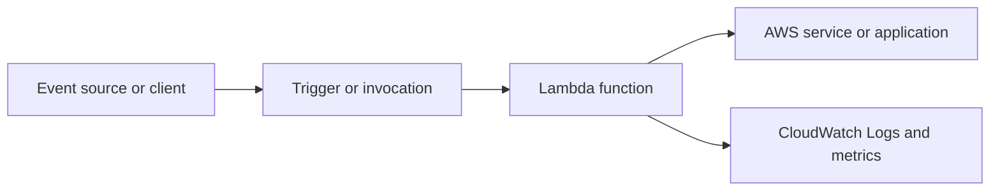

---

## 2. Lambda compute primitives

The current AWS Lambda documentation describes three compute primitives. They share a managed serverless foundation, but they are designed for different application patterns.

| Compute primitive | Main purpose | Programming model | Key behavior |
|---|---|---|---|
| **Lambda Event Functions** | Event-driven processing, request-response tasks, APIs, automation, and data processing | A handler function invoked by an event or API request | Each execution environment normally handles one request at a time; Lambda scales by creating environments. |
| **Lambda Web Functions** | Web applications and HTTP backends | A Node.js HTTP server using a web framework | An execution environment can serve multiple concurrent HTTP requests. |
| **Lambda MicroVMs** | Dedicated isolated environments for individual users or jobs, including untrusted code workloads | Customer-provided application or binaries | A MicroVM can be suspended and resumed; its total lifespan can be up to 8 hours according to the current overview. |

### Important terminology

- **Event Function** is the current documentation name for the original Lambda function type that responds to events and API calls.
- The underlying function resource and APIs remain compatible with existing Lambda function resources. Existing code, infrastructure resources, IAM permissions, and ARNs do not need to be renamed just because the documentation uses the Event Function label.
- Most traditional Lambda learning material, including handler functions, S3 triggers, SQS event source mappings, and Kinesis processing, refers to this Event Function model.

### Event Functions vs Durable Functions

A regular Lambda Event Function is designed for an invocation of up to **15 minutes**. AWS also documents **Durable Functions** for multi-step, stateful workflows that can run for up to **one year**, with progress checkpointing and resumption across interruptions.

Use a Durable Function when the workflow needs to pause, wait for an external step or approval, and resume later. Do not treat a regular 15-minute function as a long-running workflow engine.

---

## 3. Core concepts and components

| Term | Meaning |
|---|---|
| Lambda function | The deployable unit containing code and configuration. |
| Handler | The entry point that Lambda calls to process an invocation. |
| Event | JSON data describing what happened or what the caller wants processed. |
| Trigger | A connection from an event-generating service to a Lambda function. |
| Invocation | A request to execute a function. |
| Runtime | The language-specific environment that runs the function code and communicates with Lambda. |
| Execution environment | The isolated environment that contains the runtime, function code, and related processes/resources. |
| Execution role | IAM role assumed by Lambda so the function can access other AWS resources. |
| Resource-based policy | Policy attached to the function that controls which principals or services may invoke it. |
| Event source mapping | Lambda-managed resource that polls a stream or queue and invokes the function with batches of records. |
| Layer | A ZIP archive that provides shared dependencies, custom runtimes, or configuration files to functions. |
| Version | An immutable published snapshot of function code and most version-specific configuration. |
| Alias | A named pointer to a published function version. |
| Concurrency | Number of function invocations in progress at the same time. |

### Main components

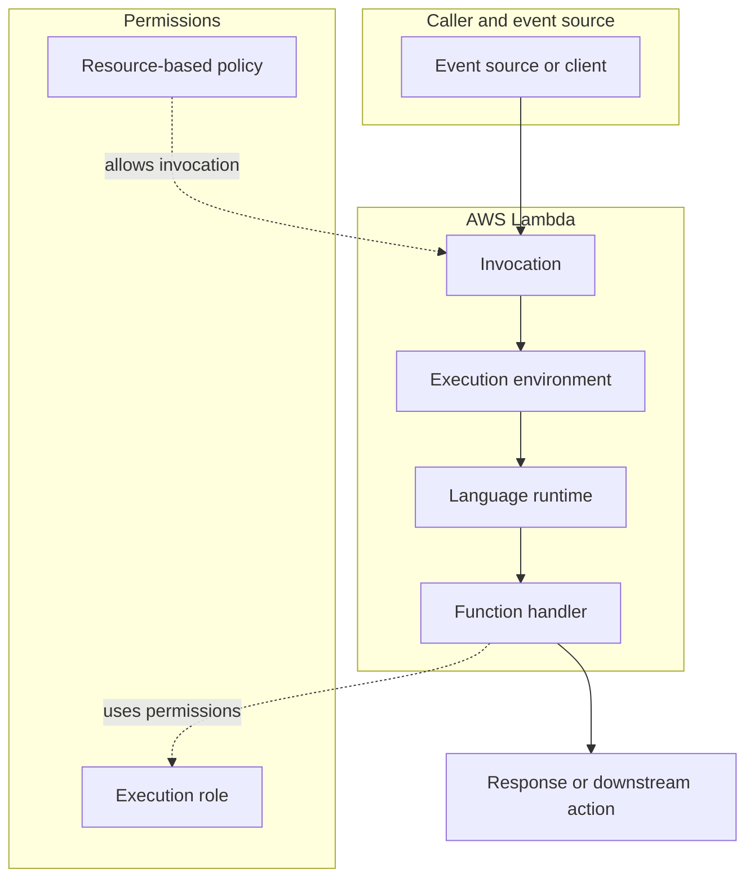

### Two different permission directions

1. **Function to AWS services:** controlled by the function's execution role. Example: Lambda reads an object from S3 or writes a record to DynamoDB.
2. **AWS services or principals to the function:** controlled through the function's resource-based policy or an applicable identity-based policy. Example: S3 is allowed to invoke a function.

These permissions solve different problems and should not be confused.

---

## 4. How a Lambda function executes

At a high level:

1. A caller or event source invokes the function.
2. Lambda selects an available execution environment or creates one.
3. If a new environment is needed, Lambda initializes the runtime and function code.
4. Lambda passes the event to the function handler.
5. The handler processes the event and returns a response or performs an action.
6. When execution finishes, the environment may be reused for a later invocation or eventually shut down.

### Execution lifecycle

The main execution-environment lifecycle has three phases:

- **Init:** Lambda prepares the runtime, loads function code, and runs initialization code outside the handler.
- **Invoke:** Lambda calls the handler to process the event.
- **Shutdown:** Lambda shuts down the runtime and extensions when the environment is retired.

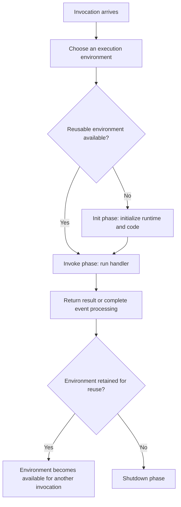

### Important execution behavior

- Lambda can reuse an execution environment for later invocations.
- Reuse can reduce initialization work and latency.
- Reuse is an optimization, **not a guarantee of durable state**.
- Do not rely on a particular environment remaining alive or on in-memory data surviving indefinitely.
- Avoid keeping user-specific or security-sensitive information in reusable global state, because another invocation may use the same environment.

---

## 5. Invocation models: Push vs Pull

Lambda supports two common event-driven invocation patterns.

### 5.1 Direct invocation — Push model

An AWS service or application sends an event directly to Lambda.

Examples:

- S3 sends an object-created event.
- SNS invokes a function when a message is published to a topic.
- API Gateway invokes a function when an HTTP request reaches an endpoint.
- EventBridge or EventBridge Scheduler invokes a function based on an event rule or schedule.

The event-generating service owns or manages the trigger configuration.

### 5.2 Event source mapping — Pull model

Lambda polls a supported queue or stream, retrieves records, groups them into batches, and invokes the function.

Examples:

- Lambda polls Amazon SQS.
- Lambda reads records from Kinesis Data Streams.
- Lambda reads records from DynamoDB Streams.
- Lambda reads from Amazon MSK or self-managed Kafka.

The event source mapping is a Lambda resource. It configures how Lambda reads from the source and invokes the function.

### Push vs Pull comparison

| Feature | Direct trigger / Push | Event source mapping / Pull |
|---|---|---|
| Who initiates delivery? | The event source or calling service | Lambda polls the source |
| Typical sources | S3, SNS, API Gateway, EventBridge | SQS, Kinesis, DynamoDB Streams, Kafka, Amazon MQ |
| Batching | Depends on the service integration | Records are commonly delivered in batches |
| Configuration owner | Commonly the event-generating service | Lambda event source mapping |
| Common use | Discrete events and request-driven operations | Queue and stream processing |

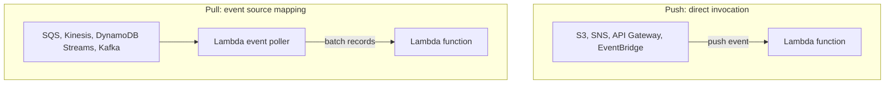

---

## 6. Triggers and event source mappings

### Triggers

A trigger connects an event source to a function. A function can have multiple triggers. The event is passed to the handler in a JSON-based structure, and the precise structure depends on the source service and event type.

Examples:

| Service | Example trigger event |
|---|---|
| Amazon S3 | Object created, deleted, or modified |
| Amazon SNS | Message published to a topic |
| Amazon API Gateway | HTTP request to an API endpoint |
| Amazon EventBridge | Event matching a rule or schedule |

### Event source mappings

An event source mapping reads records from a queue or stream and invokes a function with batches of records. Lambda-managed pollers retrieve messages and coordinate function invocation.

Common event source mapping integrations include:

- Amazon SQS
- Amazon Kinesis Data Streams
- Amazon DynamoDB Streams
- Amazon MSK
- Self-managed Apache Kafka
- Amazon MQ
- Amazon DocumentDB

### Batch processing

Batching allows a function to process several records in one invocation instead of invoking once per record. This can improve processing efficiency for high-volume streams and queues.

Batching behavior and configuration depend on the event source. Check the service-specific documentation for batch size, batching window, ordering, retry, and failure-handling behavior.

### At-least-once processing and idempotency

AWS documents that event source mappings process events **at least once**. Duplicate processing can therefore occur.

A robust handler should be **idempotent**: processing the same event more than once should not create an incorrect or duplicated business result.

Examples of idempotency techniques:

- Use a stable event or transaction identifier.
- Check whether the event has already been processed.
- Use conditional writes or deduplication records where appropriate.
- Design updates so a repeated event does not add the same business effect twice.

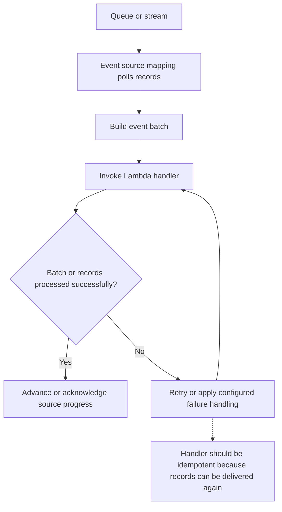

> The diagram is conceptual. Exact acknowledgement, checkpoint, retry, and partial-batch behavior differs by source type and configuration.

---

## 7. Function handlers and event objects

A **handler** is the entry point Lambda invokes to process an event. A function can contain many helper methods, but it has one configured handler entry point.

The handler receives event data generated by the caller or event source. The event structure is source-specific.

### Conceptual Python handler

```python
def lambda_handler(event, context):
    """Process one Lambda invocation."""

    # Inspect or validate the event payload.
    print("Received event:", event)

    # Perform the business operation.
    result = {"status": "processed"}

    # Return a response when the invocation pattern expects one.
    return result
```

This is an illustrative handler shape. The exact response contract depends on the invoking service. For example, an API integration expects an HTTP-compatible response shape, while an asynchronous S3 processing function may not return a client-facing response.

### Handler responsibilities

1. Validate the event structure.
2. Extract the required fields.
3. Apply business logic.
4. Interact with downstream services using authorized SDK clients.
5. Handle expected errors and log useful diagnostic information.
6. Return the response format required by the invocation type.

### Event structure awareness

Never assume all Lambda events have the same JSON schema. An S3 event, SQS batch, API Gateway request, and Kinesis record batch have different structures.

For production code:

- Inspect the event schema for the specific source.
- Validate required fields.
- Handle missing, malformed, or unexpected values.
- Test using representative event samples.

---

## 8. Execution environments, runtimes, and cold starts

### Runtime

A runtime is the language-specific environment that runs the function code and communicates invocation events and responses between Lambda and the function.

Lambda provides managed runtimes for supported languages. It also supports custom runtimes.

Managed runtimes receive runtime updates and security patches from AWS according to the configured runtime-management behavior.

### Execution environment

An execution environment is an isolated environment that provides the resources and lifecycle support needed to run a function. It includes the runtime and function code, and can also include external extensions.

### Cold start

A cold start occurs when Lambda needs to initialize a new execution environment before invoking the handler. Initialization can include loading the function package, starting the runtime, and running initialization code.

### Warm invocation

A warm invocation reuses an execution environment that has already been initialized. It can avoid repeating some initialization steps, but reuse is not guaranteed.

### Cold vs warm start

| Cold start | Warm invocation |
|---|---|
| A new execution environment is initialized | An existing environment is reused |
| Runtime and initialization code must run | Initialization work may be reused |
| Can add startup latency | Often has lower initialization overhead |
| Common when no reusable environment is available | Possible when Lambda retains an environment |

### SnapStart

Lambda SnapStart reduces initialization latency by initializing a function version when it is published and creating an encrypted snapshot of the initialized execution environment. Later environments can resume from the snapshot rather than starting from scratch.

Important considerations:

- SnapStart is intended to reduce cold-start latency.
- Support and limitations depend on runtime, Region, and feature compatibility; verify the current support table.
- Code that depends on unique state must be reviewed for snapshot/restore behavior.

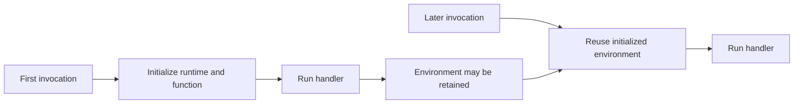

---

## 9. Deployment packages, container images, and layers

Lambda supports two main deployment package formats for standard functions:

1. **ZIP file archive:** contains function code and its dependencies.
2. **Container image:** packages the function and its dependencies into a container image workflow.

Choose the format based on dependency requirements, build process, tooling, and operational needs. Follow the current package-size and image requirements in the AWS documentation.

### Lambda layers

A Lambda layer is a ZIP archive containing supplementary code or data, commonly:

- Shared library dependencies.
- A custom runtime.
- Configuration files.

Benefits:

- Share common dependencies across multiple functions.
- Separate function logic from shared dependencies.
- Reduce duplication across deployment packages.
- Manage dependency updates independently from function code.

When a layer is attached, Lambda extracts its contents into the `/opt` directory in the execution environment. The runtime has paths configured to access supported layer directories.

### When layers may not be appropriate

AWS recommends against using layers for Go and Rust functions in the described use case because loading dependencies from a layer can add initialization work. For those languages, packaging dependencies with the executable can provide better startup behavior.

### Deployment flow

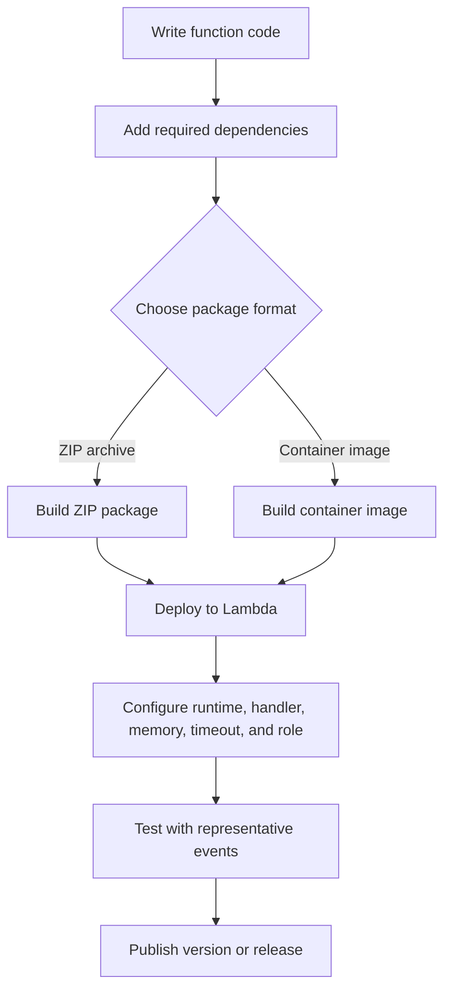

---

## 10. Configuration

A Lambda function has code and configuration settings that control its runtime behavior.

Common configuration items include:

| Setting | Purpose |
|---|---|
| Runtime | Language runtime or custom runtime used to execute the code. |
| Handler | Entry point invoked by Lambda. |
| Memory | Memory allocated to the function; increasing memory also increases available CPU. |
| Timeout | Maximum time allowed for a regular function invocation. |
| Execution role | IAM role used by the function to access AWS services. |
| Environment variables | String key-value configuration supplied to the runtime. |
| Architecture | Instruction-set architecture selected for the function. |
| Layers | Shared code, dependencies, or configuration added to the environment. |
| VPC configuration | Network connectivity to resources in a VPC when required. |
| Ephemeral storage | Temporary local storage available to the execution environment. |

### Environment variables

Environment variables let you change application behavior without changing code.

Key points from the AWS documentation:

- They are key-value pairs of strings.
- They are part of version-specific configuration.
- Published versions lock their environment-variable configuration.
- The total size of environment variables is limited to 4 KB.
- Values are treated as literal strings; Lambda does not automatically expand them.
- AWS recommends AWS Secrets Manager for database credentials, API keys, and other sensitive values instead of storing them directly as environment variables.

Example:

```text
APP_ENV=dev
SOURCE_BUCKET=my-source-bucket
TARGET_BUCKET=my-target-bucket
LOG_LEVEL=INFO
```

Use environment variables for operational configuration, not as a substitute for a dedicated secrets-management system.

### Memory and CPU

Increasing the configured memory also increases the CPU available to the function. Memory should be selected by measuring the workload rather than guessing.

A function with more memory may finish faster, which can affect total execution cost. Benchmark realistic inputs and review actual memory usage and duration.

### Timeout

Set the timeout based on measured execution time and expected downstream latency. A timeout that is too low can cause valid operations to fail; a timeout that is unnecessarily high can allow stalled work to remain active longer than needed.

---

## 11. Concurrency and scaling

**Concurrency** is the number of invocations being processed at the same time.

For the standard Event Function model, Lambda creates or reuses execution-environment instances to handle concurrent requests. If all available environments are busy, Lambda may create additional environments, subject to service scaling behavior and concurrency quotas.

### Concurrency formula

A practical estimate is:

\[
\text{Concurrency} = \text{Average requests per second} \times \text{Average duration in seconds}
\]

Example:

- Average request rate = 100 requests/second.
- Average execution duration = 0.5 seconds.
- Estimated concurrency = 100 × 0.5 = **50**.

This is an estimate; real workloads have peaks, uneven durations, retries, and downstream bottlenecks.

### Concurrency diagram

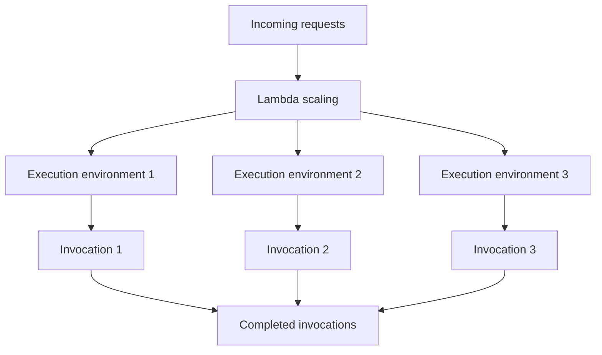

### Reserved concurrency

Reserved concurrency reserves a portion of an account's regional concurrency pool for a function. It also sets the function's maximum concurrency. This can protect critical functions from being starved by other functions, or limit a function to protect downstream systems.

### Provisioned concurrency

Provisioned concurrency prepares execution environments in advance to reduce initialization latency for supported workloads. It is useful when startup latency is important and predictable capacity is needed.

### Throttling

Throttling occurs when a function cannot obtain the concurrency needed to process an invocation because a concurrency quota or configured limit has been reached. Review function concurrency, account quotas, request volume, duration, and downstream service capacity when diagnosing throttling.

> AWS documentation currently describes a default regional account concurrency quota, but quotas can vary and can be increased. Always check the current quota in your account and the live Lambda quotas documentation instead of assuming a fixed value.

---

## 12. Performance optimization and best practices

### Code-level best practices

1. **Reuse execution environments carefully.** Initialize SDK clients and database connections outside the handler where appropriate so later invocations can reuse them.
2. **Do not use the environment as durable storage.** Avoid keeping user-specific or sensitive mutable state in reusable global variables.
3. **Use `/tmp` for reusable temporary assets when suitable.** Do not treat temporary storage as durable shared storage.
4. **Use keep-alive behavior for persistent connections.** Lambda may purge idle connections; stale connections should be handled safely.
5. **Use environment variables for non-secret configuration.** Store credentials and sensitive keys in Secrets Manager or another appropriate secret store.
6. **Write idempotent handlers.** Duplicate events should not cause duplicate business effects.
7. **Validate events.** Event payloads can differ by source and may contain unexpected or missing values.
8. **Avoid recursive invocation loops.** A function that indirectly triggers itself can create excessive invocations and cost.
9. **Use public, documented APIs.** Do not depend on undocumented runtime internals.

### Configuration and resource best practices

- Benchmark realistic workloads to select memory and timeout values.
- Review the `REPORT` log line, including duration and maximum memory used.
- Load-test functions that call downstream services.
- Ensure downstream databases and APIs can tolerate Lambda's scaling behavior.
- Be familiar with Lambda quotas, including payload size, file descriptors, and temporary storage.
- For SQS event sources, configure visibility timeout with the function's expected processing time and the integration requirements in mind.

### Cold-start optimization

- Minimize code that runs during static initialization.
- Keep deployment packages and dependency trees as lean as practical.
- Reuse initialized resources where safe.
- Consider Provisioned Concurrency for predictable latency-sensitive workloads.
- Evaluate SnapStart when the runtime and function configuration support it.

### Performance tuning loop

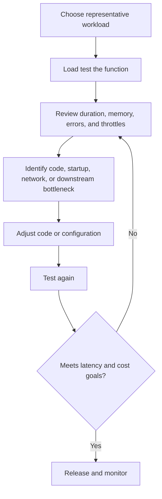

---

## 13. Security and IAM permissions

AWS Lambda follows the AWS shared responsibility model.

- **AWS responsibility:** security of the cloud infrastructure that runs Lambda.
- **Customer responsibility:** security in the cloud, including code, data, IAM permissions, configuration, dependencies, and how the function interacts with other resources.

### Execution role

Every Lambda function must have an execution role. Lambda assumes this role when the function runs. The role controls what the function can do in AWS services.

Examples:

- Read from a particular S3 bucket.
- Write to a particular DynamoDB table.
- Send messages to an SQS queue.
- Write logs to CloudWatch Logs.

### Resource-based policy

A resource-based policy attached to the function controls which AWS services, accounts, or principals can invoke the function. For service invocation, the policy commonly grants the `lambda:InvokeFunction` action to the required principal.

### Permission direction diagram

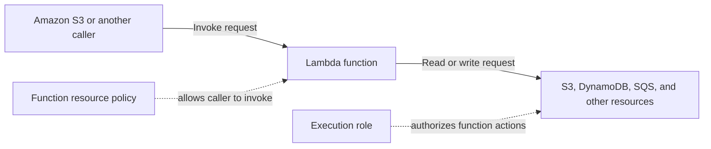

### Security best practices

- Follow least privilege: grant only required actions on required resources.
- Avoid broad managed policies in production when narrower customer-managed policies are appropriate.
- Restrict which resources can invoke a function.
- Keep secrets in a secrets-management service.
- Protect sensitive data and review logs to avoid exposing credentials or personal information.
- Review dependencies and use supported runtimes.
- Consider VPC networking when the function needs private resources.
- Consider code signing when deployment integrity requirements call for approved packages.
- Review the AWS Lambda security and compliance documentation for the specific workload.

---

## 14. Versions and release management

Lambda supports publishing function versions to create stable deployment snapshots.

### `$LATEST`

- `$LATEST` is the unpublished, mutable function version.
- Code and supported configuration changes are made to `$LATEST`.
- Deploying new code updates `$LATEST`.

### Published versions

- Publishing creates a numbered function version.
- A published version captures the code and most version-specific settings at publication time.
- The code and most configuration settings of a published version are immutable.
- A new deployment generally requires changes to `$LATEST` followed by publishing a new version.

### Aliases

An alias is a named reference to a function version. Aliases help applications refer to a stable name such as `dev`, `test`, or `prod` instead of hard-coding a numbered version ARN. Verify current alias capabilities and routing behavior in the version and alias documentation before implementing a release strategy.

### Release flow

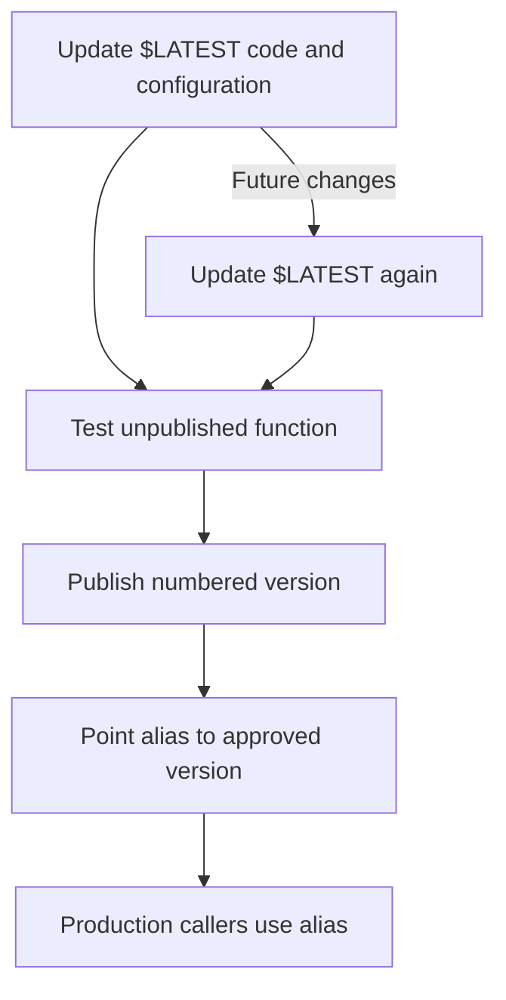

### Why versions matter

- Preserve a known-good deployment.
- Test new code without overwriting the production version.
- Make rollback and release management easier.
- Keep production integrations pointed at a stable version or alias.

---

## 15. Monitoring and troubleshooting

Lambda integrates with Amazon CloudWatch for logging and monitoring.

### Logs

Function output and runtime logs can be sent to CloudWatch Logs when the execution role has the required permissions.

Use structured logs where possible. Include identifiers that help trace a request through the system, but do not log secrets or unnecessary sensitive data.

### Metrics and report information

Useful operational signals include:

- Invocation count.
- Errors.
- Duration.
- Throttles.
- Concurrent executions.
- Maximum memory used in the invocation report.
- Downstream service errors and latency.

The `REPORT` log line can show details such as duration, billed duration, configured memory, and maximum memory used. These details help assess resource configuration.

### Common symptoms

| Symptom | Possible areas to investigate |
|---|---|
| High duration | Code path, cold starts, network latency, downstream services, memory/CPU setting |
| Out-of-memory failure | Memory configuration, payload size, data structures, dependency behavior |
| Timeout | Function logic, external calls, retry loops, network or downstream latency |
| Throttling | Regional concurrency quota, reserved concurrency, provisioned setup, traffic spike |
| Duplicate effects | At-least-once delivery, retries, missing idempotency |
| Invocation denied | Resource-based policy, caller identity, `lambda:InvokeFunction` permission |
| Downstream access denied | Execution role or target resource policy |
| Slow startup | Initialization code, package size, dependencies, cold-start behavior |

### Troubleshooting sequence

1. Find the affected function, version, and time range.
2. Review invocation metrics and CloudWatch Logs.
3. Identify whether the failure occurred during initialization, handler execution, or downstream access.
4. Check IAM permissions and resource policies.
5. Check concurrency, timeout, memory, payload, and service quotas.
6. Reproduce with a representative test event.
7. Fix the root cause and monitor after deployment.

---

## 16. Reliability and event-processing design

A reliable Lambda-based design assumes that distributed systems can retry, duplicate, delay, or fail to deliver work as expected by the source-specific integration.

### Design principles

- Make event processing idempotent.
- Validate event payloads before processing.
- Keep handlers focused on a narrow responsibility.
- Handle expected downstream errors explicitly.
- Use queues or streams to decouple producers and consumers when suitable.
- Monitor failures, age of messages/records, retries, throttles, and downstream health.
- Configure source-specific retry and failure-handling mechanisms deliberately.
- Use a workflow orchestration service or Durable Functions for multi-step processes that exceed a single function's useful execution model.

### Example: decoupled processing

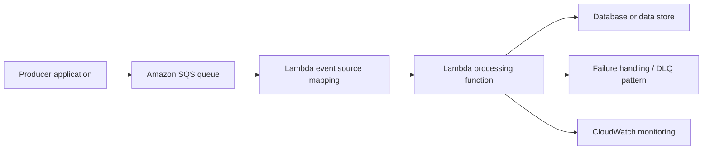

> This is a conceptual architecture. Whether a dead-letter queue, on-failure destination, partial batch response, or another failure mechanism is appropriate depends on the invocation mode and event source. Configure the source-specific mechanism rather than assuming one retry policy applies to every integration.

---

## 17. Common data engineering patterns

Lambda is useful for lightweight, event-driven data movement and orchestration steps. It is not automatically a replacement for a distributed data processing engine such as Spark.

### Pattern 1: S3 file-arrival processing

1. A producer uploads a file to an S3 bucket.
2. S3 emits an object event.
3. Lambda receives the event.
4. The handler validates the object path and metadata.
5. The function starts a downstream process, moves the file, records metadata, or performs lightweight processing.

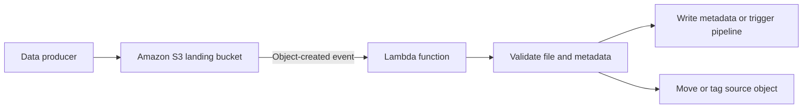

### Pattern 2: Queue-based ingestion

1. An application or service writes messages to SQS.
2. Lambda polls the queue through an event source mapping.
3. The function receives a batch of messages.
4. The handler validates and processes each record.
5. The function writes to a database or forwards the message to another system.

### Pattern 3: Streaming event processing

1. Applications publish events to Kinesis Data Streams.
2. Lambda's event source mapping reads batches of stream records.
3. The function applies lightweight transformations, filtering, enrichment, or routing.
4. The result is written to a downstream service or data store.

### Pattern 4: Scheduled data operations

1. EventBridge Scheduler initiates a scheduled invocation.
2. Lambda starts a periodic operation.
3. The function calls an AWS API, checks state, or initiates a larger workflow.

### Choosing Lambda vs Spark

| Workload | Better fit to consider |
|---|---|
| React to one S3 object event | Lambda |
| Validate metadata and route a file | Lambda |
| Process individual queue messages or small batches | Lambda |
| Lightweight API or automation logic | Lambda |
| Large-scale distributed joins and aggregations | Spark or another distributed processing engine |
| Long-running, stateful, multi-step workflow | Durable Functions or a workflow orchestration service |
| Continuous complex stream analytics | A dedicated stream-processing platform may be more appropriate |

A common architecture is to use Lambda for event handling and orchestration, then invoke a data platform or processing job for heavier transformations.

---

## 18. Limits, duration, and pricing concepts

### Duration

- Standard Lambda Event Function invocations can run for up to 15 minutes.
- Durable Functions can support longer-running workflows, with AWS documentation describing durations up to one year.
- Lambda Web Functions and MicroVMs have different execution models and limits; do not apply Event Function limits to them.

### Pricing concepts

For standard Event Functions, pricing is generally based on request volume and compute duration/resources. Memory configuration affects CPU availability and the GB-second calculation. Additional features or integrations can have separate charges.

Always check the live [AWS Lambda Pricing](https://aws.amazon.com/lambda/pricing/) page for the Region, architecture, feature, and workload being used.

### Quotas

Lambda has service quotas and operational limits for areas such as concurrency, deployment package size, request and response payloads, temporary storage, file descriptors, and execution time. Quotas can vary by feature and Region and may be adjustable.

**Practice:** check the current [Lambda quotas documentation](https://docs.aws.amazon.com/lambda/latest/dg/gettingstarted-limits.html) before designing or estimating a production workload.

---

## 19. When to use and when not to use Lambda

### Good fit

- Event-driven, short-running tasks.
- Workloads with variable or bursty demand.
- Lightweight data transformations or routing.
- API backends and integrations.
- Scheduled automation.
- Queue and stream consumers.
- Tasks where server management should be minimized.

### Consider another service or architecture when

- A regular function must run longer than its supported invocation duration.
- The workload requires long-lived processes or continuous server behavior.
- Large datasets require heavy distributed computation.
- Low-latency requirements cannot tolerate initialization or network variability.
- The function's scaling could overwhelm a downstream system unless carefully controlled.
- The workflow requires durable multi-step state; consider Durable Functions or workflow orchestration.

---

## 20. Quick revision and interview questions

### Quick revision

| Question | Key answer |
|---|---|
| What is AWS Lambda? | A serverless compute service that executes code in response to events or requests. |
| What is a handler? | The configured entry point that processes an invocation event. |
| What is an event? | JSON data describing the event or request passed to the handler. |
| What is an execution environment? | An isolated managed environment containing the runtime and function code. |
| What is a cold start? | Initialization of a new execution environment before handler execution. |
| What is a warm invocation? | Reuse of an already initialized environment. |
| What is a trigger? | A connection through which an event source invokes the function. |
| What is an event source mapping? | A Lambda resource that polls a queue or stream and invokes the function with batches. |
| Push vs pull? | Push is direct invocation by the source; pull is Lambda polling through an event source mapping. |
| What is an execution role? | IAM role assumed by Lambda so code can access permitted AWS resources. |
| What is a resource-based policy? | A policy on the function controlling who can invoke or access it. |
| What is idempotency? | Repeated processing of the same event does not create an incorrect repeated effect. |
| What is concurrency? | Number of invocations in progress at the same time. |
| What is reserved concurrency? | A function-level concurrency reservation and maximum concurrency control. |
| What is provisioned concurrency? | Pre-initialized execution environments intended to reduce startup latency. |
| What is a Lambda layer? | A ZIP archive of shared code, dependencies, runtime, or configuration. |
| What is `$LATEST`? | The mutable unpublished version of a Lambda function. |
| What is a published version? | An immutable snapshot of the function code and most version-specific configuration. |
| Why use Secrets Manager? | To store credentials and sensitive values more appropriately than plain environment-variable values. |
| Why use CloudWatch? | To inspect logs, metrics, and operational behavior. |

### Interview questions to practice

1. Explain the architecture and execution lifecycle of AWS Lambda.
2. What happens during Init, Invoke, and Shutdown?
3. Explain cold starts and warm invocations. Why is environment reuse not a state-management guarantee?
4. What is the difference between a direct trigger and an event source mapping?
5. How does Lambda process messages from SQS or records from Kinesis?
6. Why must a stream or queue consumer be idempotent?
7. Explain the difference between an execution role and a resource-based policy.
8. How does Lambda scale when request volume increases?
9. What is concurrency, and how do you estimate it?
10. Compare reserved concurrency and provisioned concurrency.
11. How do memory and CPU relate in Lambda configuration?
12. When would you use ZIP deployment, container images, or Lambda layers?
13. What is the purpose of `$LATEST`, published versions, and aliases?
14. How would you reduce cold-start latency?
15. How would you troubleshoot throttling, timeout, or out-of-memory failures?
16. Design an S3-to-Lambda file-processing workflow.
17. Design an SQS-to-Lambda ingestion workflow with duplicate-message protection.
18. When would you choose Lambda over Spark, and when would Spark be more appropriate?
19. When should you use Durable Functions or a workflow orchestrator instead of one regular function?
20. What metrics and logs would you inspect when a Lambda function becomes slow?

---

## 21. Official documentation and further reading

The following links are from the official AWS documentation. Use them for details that depend on event source, runtime, Region, quotas, or service configuration.

### Main guide

- [AWS Lambda Developer Guide — What is AWS Lambda?](https://docs.aws.amazon.com/lambda/latest/dg/welcome.html)
- [AWS Lambda Functions](https://docs.aws.amazon.com/lambda/latest/dg/lambda-functions-chapter.html)
- [How Lambda works](https://docs.aws.amazon.com/lambda/latest/dg/concepts-basics.html)

### Development and execution

- [Lambda function handlers](https://docs.aws.amazon.com/lambda/latest/dg/foundation-progmodel.html)
- [Execution environment lifecycle](https://docs.aws.amazon.com/lambda/latest/dg/lambda-runtime-environment.html)
- [Supported runtimes](https://docs.aws.amazon.com/lambda/latest/dg/lambda-runtimes.html)
- [Deployment packages](https://docs.aws.amazon.com/lambda/latest/dg/gettingstarted-package.html)
- [Container images](https://docs.aws.amazon.com/lambda/latest/dg/images-create.html)
- [Lambda layers](https://docs.aws.amazon.com/lambda/latest/dg/chapter-layers.html)

### Events and integrations

- [Event-driven architectures](https://docs.aws.amazon.com/lambda/latest/dg/concepts-event-driven-architectures.html)
- [Triggers and event source mappings](https://docs.aws.amazon.com/lambda/latest/dg/invocation-eventsourcemapping.html)
- [Integrating other services](https://docs.aws.amazon.com/lambda/latest/dg/lambda-services.html)

### Configuration, scaling, and performance

- [Lambda configuration](https://docs.aws.amazon.com/lambda/latest/dg/configuration-function-common.html)
- [Environment variables](https://docs.aws.amazon.com/lambda/latest/dg/configuration-envvars.html)
- [Concurrency and scaling](https://docs.aws.amazon.com/lambda/latest/dg/lambda-concurrency.html)
- [Best practices](https://docs.aws.amazon.com/lambda/latest/dg/best-practices.html)
- [SnapStart](https://docs.aws.amazon.com/lambda/latest/dg/snapstart.html)
- [Lambda quotas](https://docs.aws.amazon.com/lambda/latest/dg/gettingstarted-limits.html)

### Security and operations

- [Managing Lambda permissions](https://docs.aws.amazon.com/lambda/latest/dg/lambda-permissions.html)
- [Versions and aliases](https://docs.aws.amazon.com/lambda/latest/dg/configuration-versions.html)
- [Monitoring and observability](https://docs.aws.amazon.com/lambda/latest/dg/lambda-monitoring.html)
- [AWS Lambda Pricing](https://aws.amazon.com/lambda/pricing/)

---

## Final learning checklist

- [ ] Explain Lambda's purpose and serverless model.
- [ ] Distinguish Event Functions, Web Functions, MicroVMs, and Durable Functions.
- [ ] Explain handler, event, runtime, and execution environment.
- [ ] Describe Init, Invoke, and Shutdown phases.
- [ ] Distinguish direct push invocation from pull-based event source mappings.
- [ ] Explain S3, SQS, Kinesis, DynamoDB Streams, SNS, API Gateway, and EventBridge integrations.
- [ ] Explain at-least-once processing and implement idempotency.
- [ ] Configure runtime, handler, memory, timeout, environment variables, and IAM role.
- [ ] Explain ZIP packages, container images, and layers.
- [ ] Calculate approximate concurrency.
- [ ] Compare reserved and provisioned concurrency.
- [ ] Explain cold starts and the role of SnapStart.
- [ ] Apply least-privilege permissions.
- [ ] Publish versions and use aliases for controlled releases.
- [ ] Monitor logs, duration, errors, throttles, and concurrency.
- [ ] Design an event-driven data-processing workflow using Lambda.

---

**Notes disclaimer:** These notes summarize key concepts from the AWS Lambda Developer Guide. They are a study aid, not a replacement for the source documentation. Service behavior, runtime support, feature availability, quotas, and pricing can change; consult the linked AWS pages before implementing or estimating a production system.
