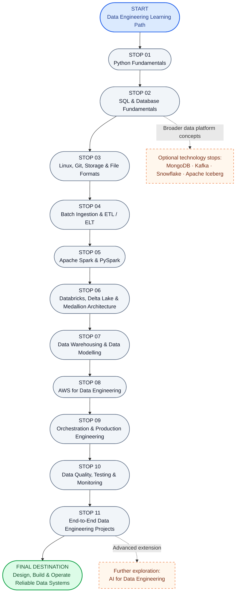

# Data Engineering Notes 2026

A practical, continuously updated knowledge base for learning **Data Engineering**, strengthening fundamentals, preparing for interviews, and documenting hands-on implementation.

This repository brings together concise notes, code examples, SQL practice, platform concepts, troubleshooting learnings, and end-to-end project work. The goal is to understand how data systems are designed and operated-not just collect tool-specific commands.

## Learning Focus

The learning path is **batch-processing first**, with emphasis on building reliable data pipelines using Python, SQL, Apache Spark, Databricks, and AWS. Streaming technologies remain part of the wider reference material, but are not the current primary study focus.

| Area | What this repository covers |
|---|---|
| Programming | Python fundamentals, data structures, reusable code, and problem solving |
| SQL & databases | Querying, joins, aggregations, window functions, optimization concepts, and database fundamentals |
| Data engineering foundations | Distributed systems, Hadoop, storage, file formats, and data processing concepts |
| Data processing | Apache Spark and PySpark, transformations, partitioning, and scalable batch processing |
| Data platforms | Databricks, Delta Lake, lakehouse concepts, and platform workflows |
| Data architecture | Data warehousing, dimensional modelling, medallion architecture, and Apache Iceberg |
| Orchestration | Workflow design, scheduling, dependencies, retries, and operational practices with Airflow |
| Cloud | AWS services and their role in ingestion, storage, processing, orchestration, and analytics |
| NoSQL & messaging | MongoDB and Kafka fundamentals for broader platform understanding |
| AI for Data Engineering | AI fundamentals and practical ways AI capabilities can support data workflows |
| Projects | End-to-end implementations that connect the concepts across the stack |

## Data Engineering Learning Roadmap

The roadmap below presents a structured path through the core concepts, platforms, and practices used to design, build, and operate data systems. It is organized around batch data engineering, with optional technologies and advanced topics shown as extensions.



### Roadmap Overview

| Route | Learning outcome |
|---|---|
| Stops 01–03 | Establish programming, SQL, database, and data platform foundations |
| Stops 04–06 | Understand batch ingestion, distributed processing, and lakehouse workflows |
| Stops 07–08 | Learn data architecture, modelling, and cloud infrastructure |
| Stops 09–10 | Build reliable, observable, and maintainable data pipelines |
| Stop 11 | Apply the concepts through end-to-end projects |
| Final destination | Understand how to design, build, and operate reliable data systems |

The main route emphasizes batch processing. MongoDB, Kafka, Snowflake, and Apache Iceberg are included as complementary technologies, while AI for Data Engineering is a further area of exploration. The sequence is a learning guide rather than a strict prerequisite chain; topics can be revisited as project requirements evolve.

## Repository Modules

The repository is organized into topic-based modules. Each module may contain notes, code, exercises, examples, and supporting resources.

| Module | Subject | Coverage |
|---|---|---|
| `Module_01-Python` | Python | Core syntax, data structures, functions, and programming practice |
| `Module_01-SQL` | SQL | Query writing, analytical SQL, and interview practice |
| `Module_02-Big Data Fundamentals & Hadoop` | Big Data & Hadoop | Distributed data concepts, HDFS, YARN, and MapReduce |
| `Module_03-Kafka` | Apache Kafka | Topics, partitions, producers, consumers, and messaging fundamentals |
| `Module_04-MongoDB` | MongoDB | Documents, collections, queries, and NoSQL concepts |
| `Module_05-Spark` | Spark & PySpark | Distributed processing, DataFrames, transformations, and actions |
| `Module_06-Airflow` | Apache Airflow | DAGs, tasks, scheduling, dependencies, and orchestration |
| `Module_07-AI Fundamentals For DE` | AI Fundamentals | Core AI concepts and their relevance to Data Engineering |
| `Module_08-Databricks` | Databricks | Lakehouse platform, Delta Lake, and data engineering workflows |
| `Module_09-Data Warehousing & Modeling` | Warehousing & Modelling | Warehouses, dimensional modelling, facts, and dimensions |
| `Module_10-Snowflake` | Snowflake | Cloud data warehouse concepts and platform fundamentals |
| `Module_11-Iceberg` | Apache Iceberg | Open table formats and modern lakehouse table management |
| `Module_13-AWS` | AWS | Cloud services and practical cloud data engineering concepts |
| `Module_14-Projects` | Projects | Applied, end-to-end Data Engineering implementations |
| `resources` | Resources | Supporting material, references, and useful learning resources |

## How I Use This Repository

The notes are intended to support a repeatable learning and implementation cycle:

1. **Understand** the concept and the problem it solves.
2. **Document** key ideas, architecture, terminology, and important trade-offs.
3. **Practise** with SQL queries, Python code, and hands-on exercises.
4. **Implement** the concept in a practical pipeline or project where possible.
5. **Review** the topic and practise explaining design decisions and interview questions.

## Current Technical Direction

The primary hands-on stack is:

- **Languages:** Python and SQL
- **Processing:** Apache Spark / PySpark
- **Lakehouse:** Databricks and Delta Lake
- **Cloud:** AWS
- **Orchestration:** Apache Airflow and relevant AWS orchestration services
- **Data architecture:** Data warehousing, dimensional modelling, and medallion architecture
- **Table formats:** Delta Lake and Apache Iceberg

Other tools in the repository provide useful breadth and context. The choice of tool for a real implementation depends on the workload and its requirements.

## Projects

The projects module is where concepts are brought together into practical solutions. Project documentation should explain:

- The business problem and expected outcome
- Source systems and input data
- Architecture and end-to-end data flow
- Ingestion and transformation approach
- Data quality, validation, and error handling
- Incremental processing and pipeline reliability
- Orchestration, deployment, and operational considerations
- Key learnings and possible improvements

Refer to [Module_14-Projects](./Module_14-Projects/) for project work and implementation details.

## Repository Structure

```text
data-engineering-notes-2026/
├── Module_01-Python/
├── Module_01-SQL/
├── Module_02-Big Data Fundamentals & Hadoop/
├── Module_03-Kafka/
├── Module_04-MongoDB/
├── Module_05-Spark/
├── Module_06-Airflow/
├── Module_07-AI Fundamentals For DE/
├── Module_08-Databricks/
├── Module_09-Data Warehousing & Modeling/
├── Module_10-Snowflake/
├── Module_11-Iceberg/
├── Module_13-AWS/
├── Module_14-Projects/
├── resources/
└── README.md
```

## Repository Status

This is an active learning repository. Topics and examples are updated as I study, practise, revisit concepts, and build projects. The presence of a module does not necessarily mean that every topic in it is complete.

## Connect

If you are also learning Data Engineering, feel free to explore the notes, share suggestions, or connect to discuss data platforms, cloud engineering, and practical pipeline design.

**GitHub:** [@rohanhrk](https://github.com/rohanhrk)
